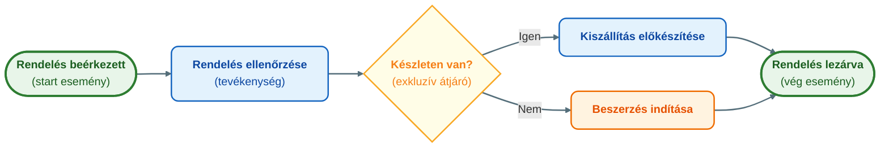
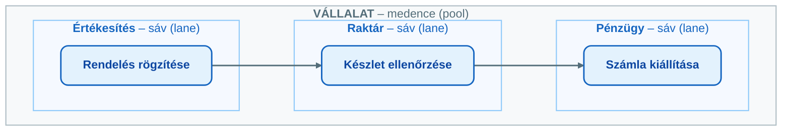
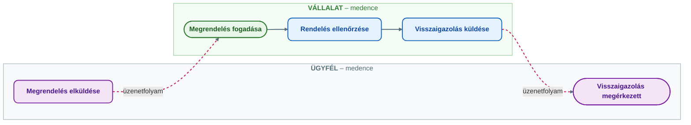

## V2 – Üzleti folyamatok modellezése BPMN 2.0 szabvány szerint

### Beszerzendő anyagok

| Szerző | Mű | Jelleg | Indoklás / érintett rész |
|---|---|---|---|
| White, S. A., & Miers, D. | *BPMN Modeling and Reference Guide* (2008) | kötelező irodalom | A tantárgynyilvántartó kötelező irodalomként nevezi meg; a jelölésrendszer teljes elemkészletének (eseménytípusok, átjárótípusok) referenciája az R1 és R3 részkérdéshez. |
| Silver, B. | *BPMN Method and Style* (2009) | kötelező irodalom | A tantárgynyilvántartó kötelező irodalomként nevezi meg; az összekötő elemek használati szabályainak és a modellezési szinteknek a forrása az R5 részkérdéshez. |
| Allweyer, T. | *BPMN 2.0* (2016) | kötelező irodalom | A tantárgynyilvántartó kötelező irodalomként nevezi meg; a 2.0-s szabvány áttekintése és a folyamatok strukturálása az R1 és R2 részkérdéshez. |

**Tétel:** Üzleti folyamatok modellezése BPMN 2.0 szabvány szerint: Mutassa be a BPMN 2.0 jelölésrendszer legfontosabb elemeit és a folyamatok strukturálásának lehetőségeit! Alapvető objektumtípusok; Szervezési elemek szerepe a felelősségi körök kijelölésében; Az összekötő elemek és használati szabályaik.

---

### 2.1. A folyamatmodellezés célja és a BPMN szerepe

A szervezetek működése folyamatokból épül fel. A folyamat egymáshoz kapcsolódó tevékenységek rendezett sorozata, amely valamilyen üzleti célt szolgál: például egy vevői rendelés feldolgozása, egy panasz kezelése vagy egy beszerzési igény jóváhagyása. A modellezés azért szükséges, mert a működés a szervezet tagjai számára gyakran csak részleteiben ismert: egy munkatárs a saját feladatát látja, az egész folyamatot nem. A folyamatmodell teszi a működést átláthatóvá, elemezhetővé és fejleszthetővé (Novák, 2026).

A folyamatmodellezésnek több ismert módszertana van: a folyamatábra, az úszósávos diagram, a Petri-háló, az eseményvezérelt folyamatlánc (EPC) és a BPMN. Ezek közül ma a BPMN (Business Process Model and Notation) az egyik legelterjedtebb üzleti folyamatmodellezési szabvány (Óbudai Egyetem KKGK, é. n., 5. lecke). Célja, hogy közös vizuális nyelvet adjon az üzleti és az informatikai szakemberek számára. Ez azért fontos, mert az üzleti oldal működési célokban, feladatokban és felelősségekben gondolkodik, az informatikai oldal pedig rendszerekben, adatokban, integrációkban és végrehajtási logikában (Novák, 2026).

A BPMN 2.0 előnye, hogy egyszerre alkalmas egyszerű, oktatási célú folyamatábrák készítésére, részletes üzleti folyamatok leírására, informatikai megvalósítás előkészítésére, automatizálható folyamatok specifikálására, valamint a szervezeti felelősségek és kommunikációs kapcsolatok bemutatására. A BPMN tehát nem csupán rajzolási technika, hanem szabványos gondolkodási keret: pontosan megmutatja, mi történik, milyen sorrendben, ki végzi, milyen döntési pontok vannak, és milyen kapcsolat van a szereplők között (Novák, 2026). Ez a híd szerep a BPMS rendszerekben válik különösen fontossá, ahol a BPMN-modell nemcsak dokumentáció, hanem a folyamat végrehajtásának alapja is lehet (Novák, 2026; lásd a V1 tételt).

### 2.2. A jelölésrendszer felépítése

A BPMN-modell elemei négy fő csoportba sorolhatók (Novák, 2026; Óbudai Egyetem KKGK, é. n., 5. lecke):

1. **Áramlási (folyamat-) objektumok:** események, tevékenységek, átjárók.
2. **Szervezési elemek (úszósávok):** medencék, sávok.
3. **Összekötő elemek:** szekvenciafolyam, üzenetfolyam, asszociáció.
4. **Kiegészítő (tárgyi) elemek:** adatobjektumok, adattárak, megjegyzések, csoportosítások.

A tételsor három alpontja az első három csoportra kérdez rá; a kiegészítő elemek a modell értelmezését segítik, például azt mutatják, milyen dokumentum vagy adat kapcsolódik egy lépéshez.

A BPMN-modell legfontosabb sajátossága, hogy a folyamatot időbeli és logikai sorrendben ábrázolja. A modellt balról jobbra vagy fentről lefelé olvassuk: a folyamat egy kezdő eseményből indul, tevékenységeken és döntési pontokon halad át, és vég eseménnyel zárul (Novák, 2026). A jegyzet alappéldája a rendelésfeldolgozás:

*(A Mermaid-ábra a BPMN logikáját szemlélteti; a tényleges BPMN-jelölésben az esemény kör, a tevékenység lekerekített téglalap, az átjáró rombusz.)*

### 2.3. Alapvető objektumtípusok

#### Események

Az esemény olyan történés, amely befolyásolja a folyamat menetét. Önmagában nem munkavégzés, hanem állapotváltozás, indító ok, várakozási pont vagy lezárás. Jelölése kör; a kör vonalvastagsága és belső jele mutatja a típust (Novák, 2026).

| Eseménytípus | Jelölés | Szerep | Példa |
|---|---|---|---|
| Start esemény | Vékony vonalú kör | A folyamat indulását és határát jelöli | „Ügyfélpanasz beérkezett” |
| Közbenső esemény | Dupla kör | A folyamat közbeni történés: megszakítja, késlelteti vagy továbbindítja a menetet | „Aláírt szerződés beérkezett” |
| Vég esemény | Vastag vonalú kör | Egy folyamatág lezárását és eredményét jelöli | „Hitel jóváhagyva” / „Hitel elutasítva” |

A start esemény azért fontos, mert kijelöli a folyamat határát: a panaszkezelés nem akkor kezdődik, amikor az ügyintéző megnyitja az ügyet, hanem amikor a panasz a szervezethez beérkezik. A jel nélküli start esemény általános kezdést mutat; az üzenet start esemény külső üzenettel induló, az időzítő start esemény meghatározott időpontban vagy rendszeres időközönként induló folyamatot jelöl (Novák, 2026).

A közbenső esemény olyan folyamatoknál hasznos, ahol várakozás, külső válasz, időzítés vagy kivételes helyzet (például hiba bekövetkezése) fordul elő: megmutatja, hogy a folyamat nem csak folyamatos munkavégzésből áll. Egy folyamatnak több végpontja is lehet, és a jól megfogalmazott vég esemény az eredményt is kifejezi: a „Folyamat lezárva” kevésbé informatív, mint a „Beszerzési igény jóváhagyva” vagy „elutasítva” (Novák, 2026).

#### Tevékenységek

A tevékenység olyan munkalépés, amelyet személy, szervezeti egység vagy informatikai rendszer végez el. Jelölése lekerekített sarkú téglalap. A neve mindig cselekvést fejezzen ki, igés szerkezettel (pl. „rendelés ellenőrzése”, „panasz kivizsgálása”); a „Számla” önmagában rossz tevékenységnév, mert nem derül ki, mi történik a számlával (Novák, 2026). Két fontos típusa van:

- **Feladat (Task):** a folyamat legkisebb, önállóan értelmezhető munkalépése, amelyet az adott részletezettségi szinten már nem bontunk tovább. Lehet emberi feladat („Vezetői jóváhagyás megadása”) vagy rendszerfeladat („Automatikus készletellenőrzés”). A részletezettség a modellezés céljától függ: áttekintő modellhez nagyobb lépések, informatikai megvalósításhoz részletesebb bontás kell.
- **Alfolyamat (Sub-process):** önmagában is több részlépésből álló tevékenység; ugyancsak lekerekített téglalap, gyakran kis pluszjellel vagy kibontott belső szerkezettel. Célja az áttekinthetőség megőrzése: a főábrán csak a nagyobb logikai egységek látszanak, a részletek külön diagramon. Példa a „Fizetés feldolgozása” alfolyamat, amelynek lépései: fizetési mód ellenőrzése, tranzakció indítása, banki válasz fogadása, sikeresség ellenőrzése, visszaigazolás küldése. Az alfolyamat a strukturált modellezés egyik legfontosabb eszköze (Novák, 2026).

#### Átjárók

Az átjáró (gateway) a folyamat elágazását, egyesítését vagy párhuzamosítását jelöli; jelölése rombusz. Az átjáró nem munkavégzés, hanem a folyamat útvonalát szabályozza, ezért helyes használata alapvető: ez mutatja meg, milyen logikai feltételek alapján halad tovább a folyamat (Novák, 2026).

| Átjárótípus | Jelölés | Logika | Példa (Novák, 2026) |
|---|---|---|---|
| Exkluzív (XOR) | Rombusz, gyakran X jellel (az X egyes eszközökben elhagyható) | Több út közül pontosan egy valósul meg | „Készleten van?” → kiszállítás vagy beszerzés |
| Párhuzamos (AND) | Rombusz pluszjellel | Minden kimenő ág egyszerre elindul; összevonáskor a folyamat csak akkor halad tovább, ha minden ág befejeződött | Szerződés-előkészítés: jogi és pénzügyi ellenőrzés egyszerre, majd összevonás |
| Inkluzív (OR) | Rombusz körrel | A feltételektől függően egy vagy több ág indul el | Panasz jellege szerint pénzügyi, műszaki és/vagy jogi vizsgálat |

Az exkluzív átjáró után a kimenő ágakat célszerű feltétellel feliratozni („igen”, „nem”, „jóváhagyva”, „elutasítva”). A párhuzamos átjárónál nem választás történik, ez a legfontosabb különbség az exkluzívhoz képest; a párhuzamos összevonó átjáró a szétválasztott ágakat egyesíti. Az inkluzív átjáró logikailag a másik kettő között helyezkedik el, és használatakor különösen fontosak az egyértelmű feltételek, mert a modell könnyen félreérthetővé válik (Novák, 2026). A három típus nem felcserélhető: ez a BPMN-modellezés egyik leggyakoribb hibája (Novák, 2026).

### 2.4. Szervezési elemek: medencék és sávok

A BPMN nemcsak azt mutatja meg, milyen lépésekből áll a folyamat, hanem azt is, ki felel az egyes lépésekért. Erre szolgálnak a szervezési elemek, amelyekkel a modell szervezeti szempontból is értelmezhetővé válik (Novák, 2026, 23. o.).

**Medence (pool):** a folyamat egy önálló résztvevőjét vagy szervezetét jelöli; nagy téglalap, amelyben a folyamat elemei helyezkednek el. Medence lehet a vállalat, az ügyfél, a beszállító, a bank, a hatóság vagy egy külső szolgáltató. Ha egy folyamatban több szervezet kommunikál, azokat külön medencékben ábrázoljuk: egy online rendelési folyamatban például ügyfél, webáruház, futárszolgálat és banki fizetési szolgáltató medence lehet. Így látható, mely lépések történnek a szervezeten belül és melyek külső szereplőknél. Fontos szabály, hogy a medencék között üzenetfolyamot használunk, nem szekvenciafolyamot, mert a két résztvevőnek saját belső folyamata van, és közöttük kommunikáció zajlik, nem közvetlen folyamatirányítás (Novák, 2026).

**Sáv (lane):** a medencén belüli felelősségi köröket, szervezeti egységeket vagy szerepköröket jelöli; a sávok a medencét kisebb részekre osztják. Sáv lehet az értékesítés, a pénzügy, a raktár, az ügyfélszolgálat, a vezető, az ügyintéző vagy az informatikai rendszer. Egy beszerzési folyamatban az igénylést a munkatárs indítja, a jóváhagyást a vezető végzi, a rendelést a beszerzési osztály adja le: ezek külön sávokban jelennek meg (Novák, 2026; Óbudai Egyetem KKGK, é. n., 5. lecke).

A sávok használatának előnyei a jegyzet szerint: tisztázzák a felelősségi köröket, megmutatják az átadási pontokat, segítik a szervezeti együttműködés elemzését, feltárják a felesleges kézi átadásokat, és támogatják a folyamatfejlesztést. Ez azért lényeges, mert sok probléma éppen az átadási pontokon keletkezik: félreértés, késedelem, hiányzó adat vagy felelősségi bizonytalanság (Novák, 2026).

A medence és a sáv különbségének megértése alapvető: a medence önálló résztvevőt vagy szervezetet, a sáv a medencén belüli szerepet, részleget vagy felelőst jelöl. Egy vállalaton belüli beszerzési folyamatnál egyetlen „Vállalat” medence van, benne igénylő munkatárs, közvetlen vezető, pénzügy és beszerzési osztály sávokkal; egy több szervezetes folyamatnál viszont vállalat, beszállító és bank külön medence, és a vállalat medencéjén belül továbbra is lehetnek sávok. Gyakori hiba, hogy minden szereplőt külön medencébe tesznek akkor is, ha ugyanazon szervezeten belül dolgoznak: ez túlbonyolítja és félreértelmezhetővé teszi a modellt (Novák, 2026).

### 2.5. Összekötő elemek és használati szabályaik

Az összekötő elemek adják meg, hogyan halad tovább a folyamat, hol történik kommunikáció, és milyen adatok vagy megjegyzések kapcsolódnak az elemekhez. Három fő típusuk van, és ezeket nem szabad felcserélni, mert mindegyik más jelentést hordoz (Novák, 2026, 25. o.).

| Összekötő | Jelölés | Hol használjuk | Mire szolgál |
|---|---|---|---|
| **Szekvenciafolyam** | Folytonos vonal nyíllal | Egy medencén belül | A folyamatlépések sorrendjét mutatja (start esemény → tevékenység → átjáró → vég esemény) |
| **Üzenetfolyam** | Szaggatott vonal nyíllal, gyakran kis körrel az elején | Külön medencék között | Két résztvevő közötti kommunikációt, információcserét jelöl |
| **Asszociáció** | Pontozott vonal | Adatokhoz, dokumentumokhoz, megjegyzésekhez | Kiegészítő, magyarázó információt kapcsol a folyamat elemeihez |

A **szekvenciafolyam** a folyamat belső logikai menetét írja le (pl. Rendelés beérkezett → Rendelés ellenőrzése → Készlet ellenőrzése → Kiszállítás előkészítése); ez a leggyakrabban használt BPMN-elem. Az **üzenetfolyam** nem azt mutatja, hogy az egyik szervezet irányítja a másik folyamatát, hanem hogy információcsere történik: az ügyfél megrendelést küld, a vállalat visszaigazol, a bank fizetési visszajelzést ad. Az **asszociáció** például a „Számla ellenőrzése” feladathoz kapcsolja a „Beérkezett számla” adatobjektumot: jelzi, hogy a tevékenységhez dokumentum tartozik, de a dokumentum nem önálló folyamatlépés (Novák, 2026).

Használati szabályok (Novák, 2026):

1. Szekvenciafolyamot medencén belül használunk; külön medencék között nem szekvenciafolyam, hanem üzenetfolyam kell.
2. Üzenetfolyamot nem használunk ugyanazon medencén belüli elemek összekötésére; a szervezeten belüli sorrendiséget szekvenciafolyam jelöli.
3. Az asszociáció csak kiegészítő információhoz való; nem helyettesíti sem a szekvencia-, sem az üzenetfolyamot.

*(Folytonos él: szekvenciafolyam a vállalat medencéjén belül; szaggatott él: üzenetfolyam a két medence között. A jegyzet példája: az ügyfél „Megrendelés elküldése” tevékenysége és a vállalat „Megrendelés fogadása” eseménye között üzenetfolyam van.)*

A helyes megkülönböztetés azért lényeges, mert a BPMN-modell nem csupán ábra, hanem jelentéssel rendelkező struktúra; egy rosszul használt kapcsolat félreérthetővé teszi a folyamatot (Novák, 2026).

### 2.6. A folyamatok strukturálásának lehetőségei

A BPMN nemcsak egyes elemekből áll, hanem lehetőséget ad a folyamatok logikus strukturálására is, ami nagyobb, összetett szervezeti folyamatoknál különösen fontos. A legfontosabb strukturálási lehetőségek (Novák, 2026, 28. o.):

- főfolyamat és alfolyamat elkülönítése;
- medencék és sávok használata;
- átjárók alkalmazása döntések és párhuzamos ágak kezelésére;
- események használata indításra, várakozásra és lezárásra;
- különböző részletezettségi szintek kialakítása.

A részletezettség mindig a célhoz igazodik: más mélység kell egy vezetői prezentációhoz, egy oktatási példához vagy egy informatikai megvalósítás előkészítéséhez. A túl egyszerű modell nem mutatja meg a fontos összefüggéseket, a túl részletes nehezen olvasható és elveszíti áttekintő szerepét (Novák, 2026). Ugyanezt a hierarchiát írja le a 3. lecke: egy rendeléskezelési főfolyamat rendelésrögzítési, készletellenőrzési, számlázási és kiszállítási részfolyamatra, ezek pedig elemi feladatokra bonthatók; a felső vezetésnek elegendő a folyamatok átfogó térképe, az operatív munkatársaknak részletes munkautasítás kell (Óbudai Egyetem KKGK, é. n., 3. lecke).

A jegyzet gyakori modellezési hibaként nevezi meg a nem cselekvésként megnevezett tevékenységet, az átjárótípusok felcserélését, a szekvencia- és üzenetfolyam összekeverését, a túl részletes vagy bonyolult modellt (ilyenkor alfolyamat vagy több részdiagram kell), valamint az egyértelmű kezdő- és végpont hiányát. A jó BPMN-modell világos, következetes és célhoz igazított: egyértelmű start eseménye van, a vég esemény az eredményt mutatja, a tevékenységnevek cselekvést fejeznek ki, az átjárók kimenő ágai feliratozottak, a sávok felelősségi köröket jelölnek, a külön szervezetek külön medencében vannak, és a nagyobb folyamatok alfolyamatokkal strukturáltak. Ellenőrző kérdések a modellhez: mi indítja el a folyamatot, mi a célja, kik vesznek részt benne, milyen tevékenységek és döntési pontok vannak, hol történik kommunikáció más szereplőkkel, milyen eredménnyel zárulhat (Novák, 2026).

### 2.7. Összegzés

A BPMN 2.0 az üzleti folyamatok modellezésének egyik legfontosabb szabványa: egységes, könnyen értelmezhető és informatikailag is használható jelölésrendszer. Alapvető objektumtípusai az esemény (kör), a tevékenység (lekerekített téglalap) és az átjáró (rombusz): az események a folyamat indítását, közbeni történéseit és lezárását, a tevékenységek a munkalépéseket, az átjárók az elágazásokat és párhuzamos ágakat jelölik. A szervezési elemek közül a medence önálló résztvevőt, a sáv a medencén belüli felelősségi kört mutatja; ezek a felelősségek, átadási pontok és szervezeti kapcsolatok elemzésében fontosak. Az összekötők közül a szekvenciafolyam a sorrendet, az üzenetfolyam a résztvevők közötti kommunikációt, az asszociáció a kiegészítő információs kapcsolatot jelöli. A helyesen használt BPMN átláthatóvá, elemezhetővé és fejleszthetővé teszi a folyamatokat, és támogatja az üzleti és informatikai oldal együttműködését, különösen ha a folyamatokat BPMS rendszerben hajtják végre (Novák, 2026).

---

### Várható vizsgáztatói kérdések

1. **Mi a különbség a szekvenciafolyam és az üzenetfolyam között?** — A szekvenciafolyam (folytonos nyíl) a folyamatlépések sorrendjét mutatja egy medencén belül; az üzenetfolyam (szaggatott nyíl) két külön medence, azaz két résztvevő közötti információcserét jelöl, és nem jelent közvetlen folyamatirányítást. Medencék között szekvenciafolyam nem használható (Novák, 2026).
2. **Miben különbözik az inkluzív átjáró az exkluzívtól és a párhuzamostól?** — Exkluzívnál pontosan egy ág indul el, párhuzamosnál minden ág, inkluzívnál a feltételektől függően egy vagy több. Az inkluzív logikailag a másik kettő között áll; használatához egyértelmű feltételek kellenek. Példa: panasz jellege szerint pénzügyi, műszaki és/vagy jogi vizsgálat (Novák, 2026).
3. **Mi a medence és a sáv közötti különbség, és mikor hibás külön medencét használni?** — A medence önálló résztvevőt vagy szervezetet, a sáv a medencén belüli szerepkört vagy részleget jelöl. Hiba minden szereplőt külön medencébe tenni, ha ugyanazon szervezeten belül dolgoznak: egy vállalaton belüli beszerzésnél egy medence és több sáv a helyes (Novák, 2026).
4. **Miben különbözik a feladat és az alfolyamat?** — A feladat az adott részletezettségi szinten tovább nem bontott, legkisebb munkalépés (emberi vagy rendszerfeladat); az alfolyamat több részlépésből álló tevékenység, amelyet a főábrán egy elemként, külön kibontva részletesen ábrázolunk. Célja az áttekinthetőség megőrzése (Novák, 2026).
5. **Miért fontos a BPMN az üzleti és az informatikai oldal együttműködésében?** — Közös nyelvet teremt: az üzleti oldal láthatóvá teszi a működési igényeket, az informatikai oldal megérti, milyen rendszerlogikát, adatkapcsolatot és automatizmust kell kialakítani. BPMS rendszerben a BPMN-modell a végrehajtás alapja is lehet, így automatizált workflow-k és jóváhagyási rendszerek épülhetnek rá (Novák, 2026).

---

## Irodalom

* Novák, G. (2026). *Számítógépes folyamatmenedzsment: Oktatási segédanyag* [Egyetemi jegyzet]. Óbudai Egyetem, Keleti Károly Gazdasági Kar.
* Óbudai Egyetem, Keleti Károly Gazdasági Kar. (é. n.). *3. A folyamatok azonosítása és strukturálása* [Elektronikus tananyag, Számítógépes folyamatmenedzsment (GMXSF2MBLF)].
* Óbudai Egyetem, Keleti Károly Gazdasági Kar. (é. n.). *5. Folyamatmodellezési módszertanok és a BPMN szerepe* [Elektronikus tananyag, Számítógépes folyamatmenedzsment (GMXSF2MBLF)].
