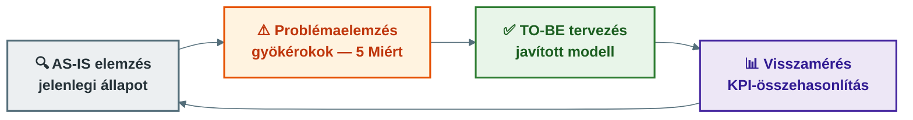

## V3 – Üzleti folyamatok mérése és optimalizálása

**Tétel:** Üzleti folyamatok mérése és optimalizálása: Elemezze a folyamatok hatékonyságának mérési lehetőségeit és az optimalizáláshoz vezető módszertani lépéseket! KPI meghatározása és szerepe a folyamatkövetésben; monitorozási adatok és folyamatszimuláció jelentősége; a folyamatoptimalizálás szakaszai;

---

### 3.1. Miért kell mérni?

Amit nem mérünk, nem tudjuk irányítani. A mindennapi szervezeti életben megjelenő szubjektív megállapítások („lassú az ügyintézés", „sok a hiba") önmagukban nem elegendők fejlesztési döntések megalapozásához. Szükség van számszerű, célértékkel összehasonlítható mutatókra.

### 3.2. KPI – kulcsfontosságú teljesítménymutató

A KPI (Key Performance Indicator) olyan mérhető mutató, amely a folyamat kritikus teljesítményterületeire vonatkozik. Jó KPI jellemzői:

- kapcsolódik a folyamat céljához
- mérhető, célértékkel összehasonlítható
- felelőshöz rendelhető
- fejlesztési intézkedést válthat ki

**KPI-típusok és példák:**

| Kategória | Példa KPI-k |
|---|---|
| **Időalapú** | Ciklusidő, átfutási idő, várakozási idő, jóváhagyási idő |
| **Minőségi** | Hibaarány, selejtarány, újramunka aránya, visszaküldött rendelések |
| **Hatékonysági** | Egy ügyre jutó munkaidő, egy ügyre jutó költség, kapacitáskihasználtság |
| **Ügyfélközpontú** | Ügyfél-elégedettség, határidőre teljesítés aránya, panaszok száma, SLA-teljesülés |

KPI akkor igazán hasznos, ha célérték is kapcsolódik hozzá: pl. „a panaszok 95%-át 5 munkanapon belül le kell zárni."

### 3.3. Szűk keresztmetszetek és folyamatszimuláció

A **szűk keresztmetszet (bottleneck)** olyan folyamatlépés, ahol torlódás alakul ki, és amely az egész folyamat teljesítményét korlátozza. Azonosítása monitorozási adatokból (átfutási idők, feladatvárakozási listák) vagy szimulációból történhet.

A **folyamatszimuláció** lehetővé teszi a folyamat előzetes modellezését különböző feltételek mellett (mennyiség, kapacitás, valószínűségek megadásával), anélkül hogy a valós rendszert meg kellene változtatni. Kérdések, amelyekre választ adhat:

- Mi történik, ha 20%-kal nő a beérkező ügyek száma?
- Hány ügyintéző szükséges a határidők teljesítéséhez?
- Csökken-e az átfutási idő, ha egy lépést automatizálunk?

### 3.4. Az optimalizálás lépései

**1. AS-IS elemzés:** A jelenlegi folyamat feltárása: lépések, felelősök, döntési pontok, dokumentumok, időadatok, problémák. Fontos a munkatársak bevonása.

**2. Problémaelemzés és gyökérokok:** Az 5 Miért (5 Why) módszer alkalmazásával a tünettől eljutunk az okig. Pl.: „Késnek a jóváhagyások → manuális e-mail-továbbítás → nincs standardizált workflow → nincs folyamatgazda."

**3. TO-BE folyamat:** A javított folyamat modellje, amelybe beépíthetők: felesleges lépések elhagyása, párhuzamosítás, automatizálás, rendszerintegráció, egyszerűsített jóváhagyás.

**4. Visszamérés:**

| Mutató | AS-IS | TO-BE cél | Mért eredmény |
|---|---|---|---|
| Átlagos átfutási idő | 6 nap | 3 nap | 3,2 nap |
| Hibaarány | 5% | 2% | 1,8% |
| Határidőre teljesítés | 78% | 95% | 93% |
| Egy ügyre jutó költség | 4200 Ft | 3000 Ft | 3100 Ft |

Ha az eredmények eltérnek a céltól, újabb elemzési kör indul – ez biztosítja a BPM ciklikus jellegét.

**Összegzés:** A folyamatmérés KPI-kon alapul, amelyek idő-, minőségi, hatékonysági és ügyfélközpontú dimenziókban értékelhetők. Az optimalizálás az AS-IS elemzéstől a gyökérok-azonosításon és TO-BE modelltervezésen át a visszaméréssel zárul.

---
