## V3 – Üzleti folyamatok mérése és optimalizálása

**Tétel:** Üzleti folyamatok mérése és optimalizálása: Elemezze a folyamatok hatékonyságának mérési lehetőségeit és az optimalizáláshoz vezető módszertani lépéseket! KPI meghatározása és szerepe a folyamatkövetésben; monitorozási adatok és folyamatszimuláció jelentősége; a folyamatoptimalizálás szakaszai;

---

### 3.1. Miért kell mérni az üzleti folyamatokat?

Egy folyamat akkor irányítható és fejleszthető tudatosan, ha a szervezet képes mérni a teljesítményét. Amit nem mérünk, azt nehéz objektíven értékelni és fejleszteni; a mérés mutatja meg, mennyire gyors, pontos, költséghatékony és megbízható a folyamat (Óbudai Egyetem KKGK, é. n., 7. lecke), és célja, hogy ne benyomások, hanem adatok alapján döntsünk (Novák, 2026).

Az olyan megállapítások, mint „lassú az ügyintézés” vagy „sok a hiba”, fontos jelzések, de a fejlesztéshez azt is tudni kell, *mennyire* lassú a folyamat, *hol* keletkezik a hiba, *milyen gyakran* fordul elő, és *mekkora* költséget okoz. A mérés ezért a BPM alapvető területe: lehetővé teszi a teljesítmény nyomon követését, a problémák és szűk keresztmetszetek azonosítását, a fejlesztési lehetőségek meghatározását és a változtatások hatásának ellenőrzését. Alapkérdései: mennyi ideig tart a folyamat, mennyi erőforrást használ, mennyibe kerül, hány hiba és újramunka keletkezik, hol alakul ki várakozás, mennyire elégedett az ügyfél, és mennyire szabályos a működés. Az adatok BPMS-, ERP-, CRM-rendszerekből, nyilvántartásokból vagy kézi gyűjtésből származhatnak (Novák, 2026).

Két elv már itt fontos. Egyrészt nem szabad túl sok mindent mérni: a jó mérési rendszer csak a szervezet céljaival valóban összefüggő mutatókat választja ki. Másrészt az optimalizálás nem egyszerűen gyorsítás: az időt, a költséget, a minőséget, a rugalmasságot, az ügyfél-elégedettséget, a szabályozottságot és az erőforrás-felhasználást kell egyensúlyba hozni – egy folyamat lehet gyors, de hibás; olcsó, de az ügyfélnek rossz; nagyon szabályozott, de nehézkes (Novák, 2026).

### 3.2. A KPI fogalma és a mérési dimenziók

A folyamatmérés központi eszközei a **kulcsfontosságú teljesítménymutatók** (Key Performance Indicator, KPI). A KPI olyan számszerű mérőszám, amely egy folyamat, szervezeti egység vagy cél teljesítményének lényeges jellemzőjét, a folyamat kritikus teljesítményterületét mutatja meg (Novák, 2026; Óbudai Egyetem KKGK, é. n., 7. lecke). Fontos, hogy **nem minden mérőszám KPI**: a szervezet sok adatot gyűjthet, de KPI-vé azok a mutatók válnak, amelyek stratégiai vagy működési szempontból kiemelt jelentőségűek (Novák, 2026).

A jó KPI (Novák, 2026):

- kapcsolódik a szervezeti célokhoz,
- mérhető és számszerűsíthető,
- rendszeresen nyomon követhető,
- egyértelműen értelmezhető,
- összehasonlítható időben vagy célértékkel,
- döntéstámogatásra alkalmas,
- felelőshöz vagy folyamathoz rendelhető.

A KPI-választás célfüggő: ügyfél-elégedettségi célnál a panaszkezelési idő vagy az elsőre megoldott ügyek aránya, költségcélnál a folyamatköltség vagy az újramunka költsége a releváns; más mutatók illenek egy rendelésfeldolgozáshoz (átfutási idő, hibás rendelések aránya) és egy belső jóváhagyáshoz (jóváhagyási ciklusidő, elutasított kérelmek aránya) (Novák, 2026).

A mutatók négy dimenzióba sorolhatók; a 7. lecke három csoportja (idő-, minőségi, hatékonysági/produktivitási mutatók) ebből az első hármat fedi le, a hatékonysági csoportba a költség- és erőforrás-mutatók tartoznak (Novák, 2026; Óbudai Egyetem KKGK, é. n., 7. lecke).

| Dimenzió | Mit mér | Példa KPI-k |
|---|---|---|
| **Idő** | A folyamat gyorsaságát | ciklusidő, átfutási idő, várakozási idő, jóváhagyási ciklusidő |
| **Költség (hatékonyság)** | Mennyi erőforrást használ fel a folyamat az eredményhez | folyamat teljes költsége, egy ügyre jutó költség, újramunka költsége, hibákból eredő veszteség, automatizálással megtakarított költség, kapacitáskihasználtság |
| **Minőség** | Milyen gyakran keletkezik hiba, mennyire szabályos a működés | hibaarány, selejtarány, visszaküldött rendelések aránya, hibás számlák aránya, újramunkák száma, elsőre helyesen teljesített ügyek aránya, szabálytalanságok száma |
| **Ügyfél és szolgáltatási szint** | Milyen értéket kap a belső vagy külső ügyfél | ügyfél-elégedettség, panaszok száma, első kapcsolatfelvételkor megoldott ügyek aránya, határidőre teljesített ügyek aránya, SLA teljesülése |

Az **időalapú mutatók** között három fogalmat kell megkülönböztetni: a **ciklusidő** egy tevékenység végrehajtási ideje (egy számla ellenőrzése), az **átfutási idő** a teljes folyamat időtartama a kezdő eseménytől a lezárásig (rendelés beérkezésétől a kiszállításig), a **várakozási idő** pedig az, amíg az ügy két aktív lépés között áll. Sok folyamatnál nem a munka, hanem a várakozás tart sokáig: a számla ellenőrzése öt perc, de három napig várakozik a jóváhagyónál – ezért az időalapú KPI-k különösen alkalmasak a szűk keresztmetszetek feltárására (Novák, 2026).

A **költségalapú mutatóknál** a közvetlen költségek (munkaidő, anyag, díjak) mellett a közvetetteket is nézni kell: késedelemből eredő ügyfélvesztés, reklamáció, vezetői beavatkozás ideje. Különösen fontosak automatizálás vagy IT-fejlesztés tervezésekor, amikor a fejlesztés költségét a várható megtakarítással kell szembeállítani. A **minőségi mutatók** közül a hibaarány a hibás kimenetek aránya (1000 rendelésből 30 hibás = 3%), de azt is érdemes vizsgálni, melyik lépésnél keletkezik a hiba; az újramunka időt és költséget visz el, a megfelelőségi mutatók pedig a szabályoknak és előírásoknak való megfelelést jelzik. Az **ügyfélközpontú mutatók** azért nélkülözhetetlenek, mert egy folyamat belülről hatékonynak tűnhet, miközben az ügyfélnek rossz élményt ad; a **szolgáltatási szint** (Service Level Agreement, SLA) az elvárt teljesítményt rögzíti, például a panaszra 24 órán belül válasz, 5 munkanapon belül lezárás (Novák, 2026).

### 3.3. A KPI-k szerepe a folyamatkövetésben

A KPI-k egyik legfontosabb szerepe a **folyamatkövetés**: annak folyamatos figyelése, hogy a folyamat a kitűzött céloknak megfelelően működik-e. Ez történhet időszakos riportokkal vagy valós idejű monitorozással. A BPMS-, ERP- és CRM-rendszerek gyakran automatikusan gyűjtik az adatokat, amelyekből riportok és **dashboardok** (vezetői irányítópultok) készülnek; egy rendelésfeldolgozási dashboard például a beérkezett és a folyamatban lévő rendelések számát, az átlagos átfutási időt, a késedelmes és hibás rendelések arányát mutatja (Novák, 2026).

A KPI-k akkor hasznosak igazán, ha **célérték** kapcsolódik hozzájuk: nem elég mérni a panaszkezelési időt, az elvárt szintet is meg kell határozni, például „a panaszok 95%-át 5 munkanapon belül le kell zárni” (Óbudai Egyetem KKGK, é. n., 7. lecke), vagy a hibaarány legfeljebb 1%. Ha a tényleges érték eltér a célértéktől, a szervezet beavatkozhat; az eltérések így nem utólag és véletlenül, hanem rendszeresen és mérhetően válnak láthatóvá (Novák, 2026).

A monitorozás a BPM-életciklus negyedik szakasza, amely a végrehajtást követi és az optimalizálást alapozza meg (Óbudai Egyetem KKGK, é. n., 9. lecke). Valós idejű felügyeletként egy BPMS jelezni tud, ha egy jóváhagyás túl sokáig várakozik, egy panasz határideje lejár, vagy egy ponton sok ügy torlódik; így a szervezet adatok, nem megérzések alapján dönt (Novák, 2026).

### 3.4. Szűk keresztmetszetek: monitorozási adatok és folyamatszimuláció

Az optimalizálás egyik fő feladata a **szűk keresztmetszetek** (bottleneck) azonosítása. A szűk keresztmetszet olyan folyamatlépés, erőforrás vagy döntési pont, amely korlátozza a teljes folyamat teljesítményét: torlódás alakul ki, nő a várakozás. A folyamat sebességét nem a lépések átlaga, hanem a leggyengébb pont határozza meg: ha a számla rögzítése 10, ellenőrzése 15, könyvelése 20 perc, de a vezetői jóváhagyás átlagosan 4 napig várakozik, a szűk keresztmetszet a jóváhagyási pont (Novák, 2026).

A szűk keresztmetszet eredhet kapacitáshiányból, döntési pontból, informatikai problémából, adatminőségből, túl bonyolult szabályozásból vagy túl sok kézi átadásból. Azonosítása nélkül az optimalizálás rossz helyre irányulhat: a szervezet egy gyors lépést fejleszt tovább, miközben a probléma máshol van (Novák, 2026).

**Monitorozási adatok alapján** a szűk keresztmetszetre utal a hosszú várakozás egy lépés előtt, a felhalmozódó folyamatban lévő ügyek, a rendszeres késés, a túlterhelt egység, a gyakori visszaküldés, a hibák koncentrálódása és a célértéktől való eltérés. Nem elég az átlagot nézni, mert az elrejti a szélsőségeket: egy 3 napos átlagos átfutási idő mögött az ügyek 20%-a tarthat 10 napnál tovább. Ezért a minimumot, maximumot, mediánt és szórást, a késedelmes esetek arányát, az ügytípus és szervezeti egység szerinti bontást és a trendeket is vizsgálni kell; az adatokból hőtérkép készíthető, amely megmutatja, hol tart legtovább a folyamat és hol keletkezik a legtöbb hiba (Novák, 2026).

A **folyamatszimuláció** a folyamat viselkedésének előzetes modellezése különböző feltételek mellett. A modellhez mennyiségi adatokat rendelnek (tevékenységek időtartama, erőforrások száma, beérkező ügyek mennyisége, döntési ágak valószínűsége, kapacitás, költség), és így vizsgálható, mi történik, ha 20%-kal nő a forgalom vagy egy jóváhagyó szabadságon van, mennyi kapacitás kell a határidők tartásához, csökken-e az átfutási idő egy lépés automatizálásával. Előnye, hogy a változtatások **kockázat nélkül, modellben** próbálhatók ki (Novák, 2026; Óbudai Egyetem KKGK, é. n., 9. lecke). Korlátja, hogy nem helyettesíti a valós adatokat: döntéstámogató eszköz, főként nagyobb változtatások előtt (Novák, 2026).

### 3.5. A folyamatoptimalizálás célja és szakaszai

Az optimalizálás a folyamat egészének tudatos javítása: irányulhat az átfutási idő és a költség csökkentésére, a hibák mérséklésére, az ügyfél-elégedettség növelésére, az erőforrások jobb kihasználására, a szabályozottságra, az automatizálásra és a felesleges lépések megszüntetésére. Kerülni kell a **részoptimalizálást**: ha egy osztály hiányos adatok továbbításával gyorsítja a saját munkáját, a teljes folyamatban több hiba és újramunka keletkezik. A jó optimalizálás a teljes folyamatot vizsgálja (Novák, 2026).

Az optimalizálás módszertani lépései a tananyag szerint hét szakaszból álló ciklust alkotnak (Novák, 2026):

```mermaid
flowchart LR
    A("<b>1. Célok és hatókör</b><br/>mérhető célok, érintettek, KPI-k"):::kek --> B("<b>2. AS-IS elemzés</b><br/>a tényleges működés feltárása"):::szurke
    B --> C("<b>3. Problémaelemzés</b><br/>gyökérokok, 5 Miért, Pareto"):::narancs
    C --> D("<b>4. TO-BE tervezés</b><br/>a jövőbeli folyamat modellje"):::zold
    D --> E("<b>5. Megoldások értékelése</b><br/>hatás–nehézség prioritási mátrix"):::sarga
    E --> F("<b>6. Megvalósítás</b><br/>bevezetés, képzés, változáskezelés"):::turkiz
    F --> G("<b>7. Visszamérés</b><br/>AS-IS és TO-BE KPI-k összevetése"):::lilaH
    G --> A

    classDef kek     fill:#e3f2fd,stroke:#1565c0,stroke-width:2px,color:#0d47a1,rx:10,ry:10;
    classDef zold    fill:#e8f5e9,stroke:#2e7d32,stroke-width:2px,color:#1b5e20,rx:10,ry:10;
    classDef narancs fill:#fff3e0,stroke:#ef6c00,stroke-width:2px,color:#e65100,rx:10,ry:10;
    classDef turkiz  fill:#e0f2f1,stroke:#00695c,stroke-width:2px,color:#004d40,rx:10,ry:10;
    classDef sarga   fill:#fffde7,stroke:#f9a825,stroke-width:2px,color:#f57f17,rx:10,ry:10;
    classDef szurke  fill:#eceff1,stroke:#546e7a,stroke-width:2px,color:#263238,rx:10,ry:10;
    classDef lilaH   fill:#f3e5f5,stroke:#7b1fa2,stroke-width:3px,color:#4a148c,rx:10,ry:10;

    linkStyle default stroke:#546e7a,stroke-width:2px;
    linkStyle 6 stroke:#c2185b,stroke-width:2px,stroke-dasharray: 5 5;
```

**1. Célok és hatókör meghatározása.** Tisztázni kell, melyik folyamatot vizsgáljuk és miért, milyen problémák jelentkeznek, kik az érintettek, milyen KPI-k alapján mérjük a javulást, és mi tartozik a vizsgálatba. A túl tág hatókör kezelhetetlen, a túl szűk elfedheti a valódi problémát. A célokat mérhetően kell megfogalmazni, például a jóváhagyási idő csökkentése 5 napról 2 napra (Novák, 2026).

**2. AS-IS elemzés.** A jelenlegi állapot feltárása: nem azt írjuk le, hogyan *kellene* működnie a folyamatnak, hanem azt, ahogyan *ténylegesen* működik, ami gyakran eltér a szabályzatoktól. Eszközei az interjú, a workshop, a dokumentum- és rendszeradat-elemzés, a folyamatmegfigyelés, a BPMN-modell és a problématérkép. Az AS-IS modellben megjelennek a tevékenységek, döntési pontok, felelősségek, dokumentumok, informatikai rendszerek, kézi átadások, várakozási pontok és hibalehetőségek. Tipikus feltárt problémák: túl sok jóváhagyási szint, ismételt adatbevitel, párhuzamos nyilvántartások, papíralapú lépések, tisztázatlan felelősségek, hiányos bemeneti adatok, nem integrált rendszerek. Kiemelten fontos a munkatársak bevonása, mert ők ismerik a mindennapi működés valóságát (Novák, 2026).

**3. Problémaelemzés és gyökérokok feltárása.** Nem elég megállapítani, hogy a folyamat lassú vagy hibás; meg kell érteni, *miért*. Módszerei: 5 Miért, ok-okozati diagram, Pareto-elemzés, értékáram-elemzés, adatbontás, szűk keresztmetszet elemzés. Az 5 Miért a „miért?” kérdés ismétlésével jut el a gyökérokig: késik a számlajóváhagyás → a vezetők későn kapják a feladatot → az ügyintézők manuálisan továbbítják az e-maileket → nincs egységes rendszer → a folyamat nem volt standardizálva → nem volt folyamatgazda. A gyökérok tehát nem a „lassú vezető”, hanem a rendszerrel támogatott folyamat hiánya; enélkül a szervezet csak tüneteket kezel (Novák, 2026).

**4. TO-BE folyamat kialakítása.** A jövőbeli, kívánt működés modellje, amely az üzleti célokra, a KPI-célértékekre, az AS-IS eredményeire, a szűk keresztmetszetekre, az ügyféligényekre, a szabályozási követelményekre, az informatikai lehetőségekre és az erőforrás-korlátokra épül. Gyakori fejlesztési irányok: felesleges lépések megszüntetése, párhuzamosítás, kézi adatbevitel csökkentése, automatikus értesítések, jóváhagyási szintek egyszerűsítése, rendszerintegráció, önkiszolgáló felületek, digitális dokumentumkezelés. Példa: kis értékű beszerzési igénynél automatikus, nagyobb értéknél vezetői és pénzügyi jóváhagyás – kevesebb adminisztráció a kontroll megőrzése mellett (Novák, 2026).

**5. Optimalizálási megoldások értékelése.** A felmerülő változatokat a várható idő- és költségmegtakarítás, a hibaarány csökkenése, az ügyfél-elégedettség, a bevezetési költség, a megvalósíthatóság, a szervezeti elfogadottság, a kockázat, a megtérülés és a szabályozási megfelelőség szerint kell értékelni. Nem mindig a legnagyobb technológiai beruházás a legjobb: egy szabálymódosítás vagy űrlap-egyszerűsítés nagyobb hatást hozhat. A lehetőségeket **prioritási mátrixba** érdemes rendezni (várható hatás × megvalósítás nehézsége), és a nagy hatású, könnyen bevezethető fejlesztésekkel kezdeni (Novák, 2026).

**6. Megvalósítás és változáskezelés.** Feladatai: bevezetési terv, felelősök, informatikai fejlesztés vagy konfiguráció, szabályzatmódosítás, képzés, kommunikáció, tesztelés, pilot, éles bevezetés. A változáskezelés azért fontos, mert az új folyamat ellenállást válthat ki, ha az érintettek nem értik a célját; ezért világosan kommunikálni kell, miért kell a változás, milyen problémát old meg, milyen előnyökkel jár, és hogyan változnak a felelősségek (Novák, 2026).

**7. Visszamérés és folyamatos fejlesztés.** A változtatás után ellenőrizni kell, hogy valóban javult-e a teljesítmény, hogy az eredmény ne feltételezés, hanem adatokkal igazolt tény legyen. Ehhez az AS-IS és a TO-BE állapot KPI-értékeit hasonlítjuk össze (Novák, 2026):

| Mutató | AS-IS érték | TO-BE cél | Bevezetés utáni érték |
|---|---|---|---|
| Átlagos átfutási idő | 6 nap | 3 nap | 3,2 nap |
| Hibaarány | 5% | 2% | 1,8% |
| Határidőre teljesítés | 78% | 95% | 93% |
| Egy ügyre jutó költség | 4200 Ft | 3000 Ft | 3100 Ft |

Ha az eredmények elmaradnak a céltól, újabb elemzés kell; ha megfelelőek, a folyamatot **standardizálni** kell, és biztosítani a folyamatos monitorozást. A fejlesztés ciklikus: az optimalizált folyamat később újra vizsgálat alá kerül, mert változnak az ügyféligények, a technológia, a jogszabályok és a célok (Novák, 2026); az életciklus-modellben az optimalizálás után a ciklus újraindul (Óbudai Egyetem KKGK, é. n., 9. lecke).

### 3.6. Példa: rendelésfeldolgozási folyamat optimalizálása

A tananyag példája a lépéseket egyben mutatja. Egy kereskedelmi vállalatnál késik a rendelésfeldolgozás. A vállalat KPI-ket határoz meg (átfutási idő, hibás rendelések aránya, határidőre teljesítés, panaszok száma, egy rendelés költsége). Az **AS-IS elemzés** szerint a rendeléseket e-mailből manuálisan rögzítik az ERP-be, az adatok hiányosak, a készletellenőrzés külön rendszerben történik. A **monitorozási adatok** alapján a szűk keresztmetszet a manuális rögzítés és a készletellenőrzés; a **szimuláció** szerint online rendelési felülettel és automatikus készletellenőrzéssel az átfutási idő jelentősen csökkenne. A **TO-BE** folyamatban bevezetik a kötelező mezős online űrlapot, az automatikus készletellenőrzést és visszaigazolást, a raktári értesítést és a készlethiány kivételkezelését. A **visszamérés** szerint az átfutási idő 2 napról 6 órára, a hibás rendelések aránya 4%-ról 1%-ra csökken. Az optimalizálás tehát akkor eredményes, ha mérésre, adatelemzésre és folyamatlogikai gondolkodásra épül (Novák, 2026).

**Összegzés:** A folyamatmérés célértékkel ellátott KPI-kon alapul, amelyek idő-, költség-, minőségi és ügyfél-dimenzióban értékelik a folyamatot, és a folyamatkövetés révén láthatóvá teszik az eltéréseket. A monitorozási adatok és a szimuláció a szűk keresztmetszetek feltárását szolgálják. Az optimalizálás hét szakaszon halad a célkijelöléstől az AS-IS és gyökérok-elemzésen, a TO-BE tervezésen, az értékelésen és a megvalósításon át a visszamérésig, amely a következő ciklus kiindulópontja. A végső cél a gyorsabb, pontosabb, költségtudatosabb és ügyfélközpontúbb működés (Novák, 2026).

---

### Várható vizsgáztatói kérdések

1. **Mi a különbség a ciklusidő, az átfutási idő és a várakozási idő között?** — A ciklusidő egy tevékenység vagy folyamatlépés végrehajtási ideje; az átfutási idő a teljes folyamat időtartama a kezdő eseménytől a lezárásig; a várakozási idő az az idő, amíg az ügy két aktív lépés között áll. Sok folyamatban nem a munka, hanem a várakozás tart sokáig (öt perc ellenőrzés, három nap várakozás a jóváhagyónál), ezért az időalapú KPI-k jól mutatják a szűk keresztmetszeteket (Novák, 2026).
2. **Miért nem elég az átlagos átfutási időt figyelni a monitorozási adatokban?** — Az átlag elrejti a szélsőségeket: egy 3 napos átlag mögött az ügyek 20%-a tarthat 10 napnál tovább, és ezek lehetnek a kritikus ügyfelek. Ezért a minimumot, maximumot, mediánt, szórást, a késedelmes esetek arányát és az ügytípus szerinti bontást is vizsgálni kell, akár hőtérképen (Novák, 2026).
3. **Mire jó a folyamatszimuláció, és mi a korlátja?** — A folyamatmodellhez mennyiségi adatokat (időtartam, erőforrás, érkezési mennyiség, ágvalószínűség, kapacitás, költség) rendelve kockázat nélkül vizsgálható, hogyan viselkedne a folyamat például 20%-kal nagyobb forgalomnál vagy egy lépés automatizálása után. Korlátja, hogy nem helyettesíti a valós adatokat; döntéstámogató eszköz nagyobb változtatások előtt (Novák, 2026).
4. **Mit jelent a részoptimalizálás, és hogyan kerülhető el?** — Egy lépés javítása úgy, hogy a teljes folyamat teljesítménye nem javul vagy romlik, például egy osztály hiányos adatok továbbításával gyorsít, és a következő osztálynál nő a hiba és az újramunka. Elkerülése: a teljes folyamat vizsgálata, folyamatszintű KPI-k, a szűk keresztmetszet azonosítása az optimalizálás előtt (Novák, 2026).
5. **Miért fontos a gyökérokok feltárása, és hogyan működik az 5 Miért?** — Gyökérok nélkül a szervezet csak tüneteket kezel. Az 5 Miért módszerrel a „miért?” kérdést ismételve jutunk el az októl az alapokig: a késő számlajóváhagyás gyökéroka nem a lassú vezető, hanem a standardizált, rendszerrel támogatott folyamat és a folyamatgazda hiánya (Novák, 2026).
6. **Hogyan kapcsolódik a mérés és az optimalizálás a BPM-életciklushoz?** — A monitorozás az életciklus negyedik, az optimalizálás az ötödik szakasza: a monitorozásban gyűjtött KPI-adatok, riportok és dashboardok alapozzák meg az optimalizálást, az optimalizálás után pedig a ciklus újraindul, mert a folyamatok soha nem tekinthetők véglegesen késznek (Novák, 2026; Óbudai Egyetem KKGK, é. n., 9. lecke).

---

## Irodalom

* Novák, G. (2026). *Számítógépes folyamatmenedzsment: Oktatási segédanyag* [Egyetemi jegyzet]. Óbudai Egyetem, Keleti Károly Gazdasági Kar.
* Óbudai Egyetem, Keleti Károly Gazdasági Kar. (é. n.). *7. Folyamatok mérése* [Elektronikus tananyag, Számítógépes folyamatmenedzsment (GMXSF2MBLF)].
* Óbudai Egyetem, Keleti Károly Gazdasági Kar. (é. n.). *9. A folyamatmenedzsment életciklus modellje* [Elektronikus tananyag, Számítógépes folyamatmenedzsment (GMXSF2MBLF)].
