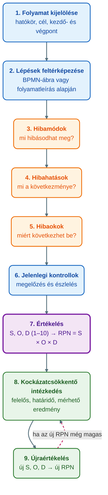

## V4 – Kockázatkezelés és hibamód-elemzés (FMEA) a folyamatokban

**Tétel:** Kockázatkezelés és hibamód-elemzés (FMEA) a folyamatokban: Mutassa be a folyamatokhoz kapcsolódó kockázatok elemzésének módszertanát, különös tekintettel az FMEA alkalmazására! FMEA célja és alkalmazási területei; a kockázati prioritási szám (RPN); kockázatcsökkentő intézkedések.

---

### 4.1. Kockázat a folyamatmenedzsmentben

Egy folyamat a gyakorlatban ritkán működik teljesen hibamentesen: előfordulhatnak késedelmek, adatbeviteli hibák, technikai problémák vagy szabályozási hiányosságok (Novák, 2026, 51. o.). A **kockázat** általános értelemben olyan bizonytalan esemény vagy körülmény, amely bekövetkezése esetén negatívan befolyásolhatja a folyamat eredményét. A folyamatmenedzsmentben a kockázat azt jelenti, hogy a folyamat nem a tervezett módon, nem a kívánt minőségben, nem a megfelelő időben vagy nem az elvárt költségszinten teljesít (Novák, 2026, 51. o.; Óbudai Egyetem [ÓE], é. n., 8. lecke). Folyamatkockázat például egy rendelés hibás rögzítése, egy számla késedelmes jóváhagyása, egy ügyfélpanasz határidőn túli kezelése, egy informatikai rendszer leállása vagy egy kritikus ellenőrzési pont kihagyása (Novák, 2026, 51. o.).

A **kockázatkezelés** célja, hogy a szervezet ne csak utólag reagáljon a hibákra, hanem előre azonosítsa a lehetséges hibaforrásokat, értékelje azok jelentőségét, majd megelőző vagy mérséklő intézkedéseket dolgozzon ki. A megelőző szemlélet lényege, hogy nem elegendő azt vizsgálni, „mi történt rosszul”; azt is meg kell kérdezni, hogy *mi romolhat el, milyen következménnyel járhat, milyen gyakran fordulhat elő, és mennyire tudjuk időben észlelni* (Novák, 2026, 51. o.). Erre a négy kérdésre ad strukturált módszert az FMEA.

### 4.2. A kockázatelemzés módszertana

A kockázatelemzés célja a potenciális hibák, veszélyek és gyenge pontok azonosítása, értékelése és kezelése. Alapvető lépései: a folyamat kiválasztása; a lehetséges kockázatok azonosítása; a kockázatok okainak és hatásainak meghatározása; a kockázatok értékelése és rangsorolása; intézkedések kidolgozása és végrehajtása; végül nyomon követés és visszamérés (ÓE, é. n., 8. lecke). A kockázatok értékelése történhet **egyszerű minősítéssel** (alacsony, közepes, magas kategóriával) vagy **számszerű módszerrel**, amelyre a tananyag példája az FMEA (ÓE, é. n., 8. lecke).

A számszerű kockázatelemzés alaplogikája öt kérdésre épül (Novák, 2026, 53–54. o.): **mi hibásodhat meg** (ez a **hibamód**, failure mode: az a mód, ahogyan a folyamatlépés nem teljesíti az elvárást); **mi történik, ha a hiba bekövetkezik** (a **hibahatás**, effect); **mi okozhatja** (a **hibaok**, cause); **milyen jelenlegi kontrollok** – ellenőrzések, szabályok, automatizmusok, jóváhagyások – léteznek a megelőzésére vagy észlelésére; végül **milyen magas a kockázat**, amit az FMEA a súlyosság, az előfordulás és az észlelhetőség számszerű értékelésével, a kockázati prioritási számmal (RPN) ad meg.

### 4.3. Az FMEA célja és alkalmazási területei

Az **FMEA** (Failure Mode and Effects Analysis – hibamód- és hatáselemzés) szisztematikus és proaktív kockázatkezelési módszer: célja, hogy a szervezet még a hiba bekövetkezése előtt azonosítsa a lehetséges meghibásodási módokat, azok okait és következményeit (ÓE, é. n., 12. lecke). Novák (2026, 51. o.) megfogalmazásában az FMEA célja a lehetséges hibák előzetes azonosítása, hatásaik értékelése, valamint a kockázatok rangsorolása és csökkentése. Az FMEA tehát nem pusztán hibajegyzék, hanem strukturált kockázatelemzési módszer, amely arra szolgál, hogy a szervezet a legsúlyosabb vagy legkritikusabb kockázatokra koncentráljon, és ne minden hibát azonos súllyal kezeljen (Novák, 2026, 51. o.).

**Típusai.** A tananyag két gyakori típust különböztet meg (ÓE, é. n., 12. lecke):

- **DFMEA** (Design FMEA – tervezési FMEA): termékek, szolgáltatások vagy rendszerek tervezési kockázatait vizsgálja.
- **PFMEA** (Process FMEA – folyamat-FMEA): a folyamatlépések lehetséges hibáit elemzi. A folyamatmenedzsmentben ez az elsődleges típus: nem a végterméket, hanem a folyamat működését elemzi (Novák, 2026, 52. o.).

**Alkalmazási területek.** Az FMEA eredetileg műszaki és gyártási környezetben terjedt el, ma már üzleti, szolgáltatási és adminisztratív folyamatokra is széles körben alkalmazzák. Különösen hasznos ott, ahol a hiba jelentős következménnyel járhat: gyártás, egészségügy, logisztika, pénzügyi szolgáltatás, autóipar, gyógyszeripar, közigazgatás, IT-szolgáltatásmenedzsment (Novák, 2026, 52. o.). A folyamatmenedzsmenten belül tipikus terepe a rendelésfeldolgozási, beszerzési, számlakezelési, panaszkezelési, HR be- és kiléptetési, minőségellenőrzési, IT-incidenskezelési, valamint megfelelőségi és auditfolyamat (Novák, 2026, 52. o.). Az FMEA **csapatmunkára épül**: akkor működik jól, ha a folyamatgazda, a minőségügyi szakember, az operatív munkatársak, a vezetők és az informatikai szakemberek – szükség esetén ügyfél- vagy beszállítói képviselők – együtt elemeznek (Novák, 2026, 53. o.).

### 4.4. Az FMEA módszertani lépései

Az FMEA-elemzés nem ötletszerű hibagyűjtés, hanem strukturált folyamat (Novák, 2026, 54. o.). Lépéseit az alábbi ábra foglalja össze.

1. **A vizsgált folyamat kijelölése.** Meg kell határozni a hatókört: ha túl tág, az elemzés kezelhetetlenné válik; ha túl szűk, fontos kockázatok maradnak ki (vizsgálható a teljes beszerzési folyamat, de akár csak a számla-jóváhagyás is). Ezután rögzíteni kell a folyamat célját, kezdő- és végpontját, fő bemeneteit és kimeneteit (Novák, 2026, 54. o.).
2. **A folyamat lépéseinek feltérképezése.** A folyamatot BPMN-ábra, folyamatábra vagy táblázatos folyamatleírás alapján tevékenységekre bontjuk (egy panaszkezelési folyamatnál: fogadás, rögzítés, jogosultság-ellenőrzés, kivizsgálás, döntés, értesítés, lezárás), és minden lépésnél megvizsgáljuk a lehetséges hibamódokat (Novák, 2026, 54–55. o.).
3. **Hibamódok meghatározása.** A hibamód legyen konkrét: adat hibásan kerül rögzítésre, jóváhagyás elmarad, határidő túllépése. Érdemes a folyamatban dolgozók tapasztalatára építeni, mert ők ismerik a gyakori problémákat és kivételeket (Novák, 2026, 55. o.).
4. **Hibahatások meghatározása.** Mi történik, ha a hiba bekövetkezik – ügyfélpanasz, késő kiszállítás, hibás számla, újramunka, hibás adatokra épülő vezetői döntés –, a folyamat, a szervezet és az ügyfél szempontjából vizsgálva (Novák, 2026, 55–56. o.).
5. **Hibaokok azonosítása.** Miért következhet be a hibamód: nem egyértelmű munkautasítás, hiányos képzés, manuális adatbevitel, rendszerintegráció hiánya, hiányos ellenőrzési pont. Az FMEA értéke, hogy az okot is vizsgálja: a kockázatcsökkentő intézkedésnek lehetőleg **az okot kell kezelnie**, nem csupán a következményt (Novák, 2026, 56. o.).
6. **Jelenlegi kontrollok feltárása.** Ami már most segít megelőzni vagy felismerni a hibát: automatikus adatellenőrzés, kötelező mezők, vezetői jóváhagyás, kétlépcsős ellenőrzés, audit. Ugyanaz a hibamód sokkal kisebb kockázat, ha jó észlelési vagy megelőzési rendszer működik (Novák, 2026, 56–57. o.).
7. **Értékelés és RPN-számítás** (4.5.), majd 8. **intézkedések kidolgozása** és 9. **újraértékelés** (4.7.).

### 4.5. A kockázati prioritási szám (RPN)

Az FMEA klasszikus értékelési módszerében a kockázatok rangsorolása a **kockázati prioritási szám** (Risk Priority Number, RPN) alapján történik, amely három tényező szorzata (Novák, 2026, 57. o.; ÓE, é. n., 12. lecke):

$$\text{RPN} = S \times O \times D$$

| Tényező | Angol | Tartalom | Skála |
|---|---|---|---|
| **S** | Severity (súlyosság) | Milyen komoly következmény várható, ha a hiba bekövetkezik | 1–10 |
| **O** | Occurrence (előfordulás) | Milyen valószínűséggel következik be a hiba | 1–10 |
| **D** | Detection (észlelhetőség) | Mennyire képes a szervezet időben felismerni a hibát (a magasabb érték rosszabb) | 1–10 |

Minél magasabb az RPN, annál nagyobb a kockázat (Novák, 2026, 57. o.).

- **Súlyosság (S):** annál magasabb, minél nagyobb kárt okoz a hiba az ügyfélnek, a folyamatnak, a szervezetnek vagy a megfelelőségnek. Nem azt nézzük, milyen gyakori a hiba, hanem azt, mekkora bajt okoz, ha bekövetkezik (Novák, 2026, 57–58. o.).
- **Előfordulás (O):** minél gyakrabban fordulhat elő a hibamód, annál magasabb. A becslés lehet tapasztalati, de ideális esetben adatokkal – hibajegyekkel, reklamációkkal, auditjelentésekkel, BPMS-monitorozási adatokkal – alátámasztott (Novák, 2026, 58. o.).
- **Észlelhetőség (D):** mennyire képes a szervezet időben felismerni a hibát, mielőtt kárt okozna vagy eljutna az ügyfélhez. Sajátossága a **fordított logika**: a magasabb szám rosszabb észlelhetőséget jelent. Az értékelésnél a meglévő kontrollokat kell figyelembe venni: automatikus formátumellenőrzés mellett az adatbeviteli hibák könnyen észlelhetők, kézi ellenőrzésre épülő folyamatban viszont rejtve maradhatnak (Novák, 2026, 58–59. o.).

**Példaszerű skálák** (Novák, 2026, 57–59. o.):

| Érték | Súlyosság (S) | Előfordulás (O) | Észlelhetőség (D) |
|---|---|---|---|
| 1–2 | Csekély hatás, a folyamat eredményét alig befolyásolja | Nagyon ritka előfordulás | Szinte biztosan észlelhető, erős automatikus kontroll működik |
| 3–4 | Kisebb zavar, korlátozott javítás szükséges | Ritka, de ismert hiba | Jó eséllyel észlelhető, rendszeres ellenőrzés van |
| 5–6 | Érezhető folyamatprobléma, ügyfél vagy belső felhasználó érintett lehet | Időnként előforduló hiba | Közepes eséllyel észlelhető, részleges kontroll működik |
| 7–8 | Jelentős hatás: komoly késedelem, költség vagy minőségi probléma | Gyakori hiba | Nehezen észlelhető, főként utólag derül ki |
| 9–10 | Kritikus hatás: jogszabályi, biztonsági vagy jelentős üzleti kár | Nagyon gyakori vagy szinte biztosan bekövetkező hiba | Nagyon nehezen vagy egyáltalán nem észlelhető a folyamat során |

**Számpéldák.** Egy számlakezelési folyamatban a hibamód, hogy a számla rossz költséghelyre kerül könyvelésre (hibahatás: pontatlan kimutatás, hibás vezetői döntés; hibaok: manuális adatbevitel; kontroll: havi könyvelési ellenőrzés). Értékelése S = 7, O = 5, D = 6, így **RPN = 7 × 5 × 6 = 210**: viszonylag magas kockázat, amely intézkedést igényelhet (Novák, 2026, 59. o.; ÓE, é. n., 12. lecke). Ezzel szemben egy belső űrlapon ejtett kisebb formai hiba értékelése S = 2, O = 6, D = 3, azaz **RPN = 36**: bár gyakran előfordulhat, súlyossága alacsony és könnyen észlelhető, ezért beavatkozási prioritása kisebb (Novák, 2026, 59. o.).

Az RPN segít a rangsorolásban, de **nem szabad mechanikusan alkalmazni**: ha egy hiba súlyossága kritikus (S = 10), a kockázat külön figyelmet igényelhet akkor is, ha RPN-je nem a legmagasabb és előfordulása ritka (Novák, 2026, 60. o.; ÓE, é. n., 12. lecke).

### 4.6. Az FMEA-táblázat

Az FMEA eredményeit táblázatban rögzítik, amelynek legfontosabb oszlopai: folyamatlépés, hibamód, hibahatás, hibaok, jelenlegi kontroll, S, O, D, RPN és javasolt intézkedés. A táblázat átláthatóvá teszi a kockázatokat és a beavatkozási prioritásokat; a magas RPN-értékű hibák általában elsőbbséget kapnak (Novák, 2026, 60. o.).

| Folyamatlépés | Hibamód | Hibahatás | Hibaok | Jelenlegi kontroll | S | O | D | RPN | Javasolt intézkedés |
|---|---|---|---|---|---|---|---|---|---|
| Számla rögzítése | Hibás költséghely | Pontatlan kimutatás | Manuális adatbevitel | Havi ellenőrzés | 7 | 5 | 6 | **210** | Költséghely-lista automatizált kiválasztása |
| Panasz rögzítése | Hiányos adat | Késedelmes kivizsgálás | Nem kötelező mezők | Ügyintézői ellenőrzés | 6 | 7 | 5 | **210** | Kötelező mezők bevezetése |
| Ügyfél értesítése | Értesítés elmarad | Ügyfél-elégedetlenség | Manuális e-mail | Nincs automatikus kontroll | 8 | 4 | 7 | **224** | Automatikus értesítés bevezetése |

*(Forrás: Novák, 2026, 60. o.)*

### 4.7. Kockázatcsökkentő intézkedések és visszamérés

Az FMEA egyik legfontosabb eredménye a kockázatcsökkentő intézkedések meghatározása. Az intézkedések **három irányban** hathatnak: csökkenthetik a hiba előfordulását, javíthatják az észlelhetőségét, ritkább esetben csökkenthetik a súlyosságát (ÓE, é. n., 13. lecke). A **súlyosság** gyakran nehezen csökkenthető, mert a hiba következménye adott: egy hibás gyógyszerkiadás súlyos egészségügyi következménye önmagában nem mérsékelhető, ilyenkor az előfordulás csökkentésére és az észlelhetőség javítására kell koncentrálni (Novák, 2026, 60–61. o.).

- **Az előfordulás (O) csökkenthető** a folyamatlépések egyszerűsítésével, automatizálással, képzéssel, egyértelmű munkautasításokkal, hibabiztos megoldásokkal, szabványosított űrlapokkal, rendszerintegrációval és a manuális adatbevitel csökkentésével (Novák, 2026, 61. o.).
- **Az észlelhetőség (D) javítható** automatikus ellenőrzésekkel, validációs szabályokkal, figyelmeztetésekkel, dashboardokkal, ellenőrzőlistákkal, jóváhagyási pontokkal és auditokkal (Novák, 2026, 61. o.; ÓE, é. n., 13. lecke).

Minden intézkedésnek legyen **felelőse, határideje és mérhető eredménye**, különben az FMEA csak dokumentum marad, nem valódi fejlesztési eszköz (Novák, 2026, 62. o.).

**Rangsorolás.** Mivel az elemzés sok hibát tár fel, nem lehet mindent egyszerre kezelni. Rangsorolási szempont az RPN nagysága, a súlyosság, az ügyfélre gyakorolt hatás, a jogszabályi vagy biztonsági kockázat, az előfordulási gyakoriság, a beavatkozás költsége és gyorsasága, valamint a várható kockázatcsökkentő hatás; először a magas súlyosságú, magas RPN-értékű, illetve ügyfél- és megfelelőségi szempontból kritikus hibákat célszerű kezelni. Nem minden intézkedés igényel nagy beruházást: gyakran egy kötelező mező, egy ellenőrzőlista vagy egy automatikus figyelmeztetés is jelentős kockázatcsökkentést hoz (Novák, 2026, 62. o.).

**Újraértékelés (visszamérés).** Az FMEA nem zárul le az intézkedések meghatározásával: a bevezetés után ismét meg kell határozni az S, O és D értékeket, és új RPN-t kell számítani; ez mutatja meg, hogy a beavatkozás valóban csökkentette-e a kockázatot (Novák, 2026, 62. o.; ÓE, é. n., 13. lecke). A számlakezelési példában az eredeti 7 × 5 × 6 = 210 az automatikus költséghely-választó lista és a rendszeres validáció bevezetése után 7 × 3 × 3 = **63**-ra csökken: a súlyosság változatlan, mert a bekövetkező hiba hatása továbbra is jelentős; az előfordulás csökkent az automatikus kiválasztás miatt; az észlelhetőség javult, mert a rendszer validál (Novák, 2026, 62–63. o.). A panaszkezelési példában a hiányos panaszadatok rögzítése (6 × 7 × 5 = 210) kötelező mezők, automatikus figyelmeztetés és ügyintézői képzés után 6 × 3 × 3 = **54**-re csökken (Novák, 2026, 65–66. o.). Ha az új RPN még mindig magas, további intézkedés szükséges.

### 4.8. Beépítés a folyamatszabályozásba és a BPM-életciklusba

Az FMEA akkor válik igazán hasznossá, ha eredményei beépülnek a mindennapi folyamatszabályozásba: a kockázatelemzés alapján módosítani kell a folyamatleírásokat, munkautasításokat, ellenőrzési pontokat, informatikai szabályokat és mérési rendszereket – új kontrollpontok, adatvalidációs szabályok, pontosított felelősségi körök, hibajelentési folyamat, KPI-k és kockázati mutatók monitorozása, illetve a BPMS vagy ERP rendszer konfigurálása révén. Ha például az FMEA kimutatja, hogy a beszerzésben a hibás beszállítói adatok gyakran okoznak késedelmet, a szervezet kötelező beszállítói adatellenőrzést, automatizált adószám-validációt és az adatkarbantartásért felelős szerepkört vezethet be. A cél, hogy a kockázatkezelés ne alkalmi elemzés legyen, hanem a folyamat működésének része (Novák, 2026, 63. o.).

Az FMEA jól illeszkedik a **BPM-életciklusba** (Novák, 2026, 64. o.):

| BPM-szakasz | Az FMEA szerepe |
|---|---|
| Tervezés és modellezés | A kockázatok előzetes azonosítása |
| Végrehajtás | A kockázatcsökkentő intézkedések kontrollpontként és szabályként jelennek meg |
| Monitorozás | A kockázatokhoz kapcsolódó KPI-k figyelése |
| Optimalizálás | A folyamatok javítása az FMEA eredményei alapján |

A **BPMN-folyamatmodell és az FMEA kiegészíti egymást**: a BPMN megmutatja, hogyan működik a folyamat, az FMEA pedig azt elemzi, hol és hogyan hibásodhat meg – a BPMN-ábra egyes lépéseihez (például a panasz rögzítéséhez) rendeli a lehetséges hibamódokat, így a folyamatmodell nemcsak leíró, hanem kockázatelemzési alap is (Novák, 2026, 64. o.).

Az FMEA **nem egyszeri dokumentációs feladat, hanem a folyamatos fejlesztés része**, ezért rendszeresen felül kell vizsgálni: új folyamat vagy informatikai rendszer bevezetésekor, jelentős folyamatmódosítás, súlyos incidens vagy auditmegállapítás után, az ügyfélpanaszok növekedésekor, jogszabályi változáskor és a teljesítménymutatók romlásakor. A frissített FMEA a szervezet tanulását támogatja: a hibákból és a majdnem bekövetkezett hibákból származó tapasztalat visszacsatolható a folyamatfejlesztésbe (Novák, 2026, 64–65. o.).

### 4.9. Az FMEA előnyei és korlátai

**Előnyei** (Novák, 2026, 66. o.): segíti a megelőző gondolkodást; a számszerű értékeléssel támogatja a prioritások kijelölését; javítja a folyamatszabályozást (kontrollpontok, felelősségi körök, munkautasítások); elősegíti a csapatmunkát és a tudásmegosztást; és a hibák, késedelmek csökkentésével hozzájárul az ügyfél-elégedettséghez.

**Korlátai** (Novák, 2026, 66–67. o.): az értékelések részben **szubjektívek**, ezért egységes skálák és közös értelmezés kell; az elemzés **időigényes**, ezért a kritikus folyamatokra célszerű koncentrálni; az **RPN önmagában nem ad teljes képet**, mert két kockázat azonos RPN-t kaphat eltérő S, O, D kombinációval: S = 10, O = 2, D = 3 és S = 3, O = 5, D = 4 egyaránt 60-at ad, de az első a magas súlyosság miatt sokkal kritikusabb, ezért az RPN-t szakmai mérlegeléssel együtt kell használni. Végül az FMEA veszít értékéből, ha csak **formális dokumentumként** készül el, és az intézkedések nem valósulnak meg.

**Összegzés.** Az FMEA strukturált, proaktív módszer a folyamatkockázatok feltárására és rangsorolására: lépésenként azonosítja a hibamódokat, hatásaikat, okaikat és a meglévő kontrollokat, majd az RPN = S × O × D mutatóval rangsorol. A magas RPN-értékű vagy magas súlyosságú hibák intézkedést igényelnek, amelyek az előfordulás csökkentésére, az észlelhetőség javítására és – ahol lehet – a súlyosság mérséklésére irányulnak, és akkor hatékonyak, ha beépülnek a folyamatszabályozásba. Az újraértékelés zárja a ciklust, a rendszeres felülvizsgálat pedig a folyamatos fejlesztés részévé teszi az FMEA-t (Novák, 2026, 67. o.; ÓE, é. n., Összegzés).

---

### Várható vizsgáztatói kérdések

1. **Miért fordított logikájú az észlelhetőség (D) értékelése?** — Mert a D azt méri, mennyire képes a szervezet időben felismerni a hibát: minél nehezebben észlelhető, annál nagyobb a kockázat, ezért a rosszabb észlelhetőség kap magasabb pontszámot. Így mindhárom tényezőnél a magasabb érték nagyobb kockázatot jelent, és a szorzat egyirányúan értelmezhető. A D értékénél a meglévő kontrollokat kell figyelembe venni: automatikus formátumellenőrzés mellett alacsony, kézi ellenőrzésre épülő folyamatnál magas D indokolt (Novák, 2026, 58–59. o.).
2. **Miért nem elég önmagában az RPN alapján dönteni?** — Mert két eltérő kockázat azonos RPN-t kaphat: S = 10, O = 2, D = 3 és S = 3, O = 5, D = 4 egyaránt 60, de az első kritikus súlyosságú. Ezért a magas súlyosságú hibák alacsony RPN mellett is külön figyelmet igényelnek, és az RPN-t szakmai mérlegeléssel, a súlyosság, az ügyfélhatás és a megfelelőségi kockázat együttes figyelembevételével kell használni (Novák, 2026, 60., 62., 67. o.).
3. **Mi a különbség a hibahatás és a hibaok között, és melyiket kezelje az intézkedés?** — A hibahatás a hiba következménye a folyamatra, az ügyfélre vagy a szervezetre (pl. késedelmes kivizsgálás), a hibaok pedig a hibamód bekövetkezésének magyarázata (pl. nem kötelező mezők az űrlapon). Az FMEA értéke, hogy az okot is vizsgálja, ezért a kockázatcsökkentő intézkedésnek lehetőleg az okot kell kezelnie, nem csupán a következményt (Novák, 2026, 55–56. o.).
4. **Hogyan kapcsolódik az FMEA a BPMN-modellhez és a BPM-életciklushoz?** — A BPMN megmutatja, hogyan működik a folyamat, az FMEA pedig lépésenként elemzi, hol és hogyan hibásodhat meg; a folyamatlépések feltérképezése BPMN-ábra alapján történhet. Az életciklusban a tervezésnél és modellezésnél a kockázatok azonosítását, a végrehajtásnál a kontrollpontokat, a monitorozásnál a kockázati KPI-k figyelését, az optimalizálásnál a javítást támogatja (Novák, 2026, 54., 64. o.).
5. **Miért nem egyszeri feladat az FMEA, és mikor kell felülvizsgálni?** — Mert a folyamatok, rendszerek, jogszabályok és ügyféligények változnak. Felülvizsgálat kell új folyamat vagy informatikai rendszer bevezetésekor, jelentős módosítás, súlyos incidens vagy auditmegállapítás után, az ügyfélpanaszok növekedésekor, jogszabályi változáskor és a teljesítménymutatók romlásakor; a frissített FMEA a szervezeti tanulást szolgálja (Novák, 2026, 64–65. o.).
6. **Hogyan kapcsolódik az FMEA a folyamatméréshez?** — Az előfordulás (O) becslése ideális esetben adatokra épül: hibajegyek, reklamációk, auditjelentések, BPMS-monitorozási adatok. Az intézkedéseknek mérhető eredményt kell adniuk, a beépítés egyik módja a KPI-k és kockázati mutatók monitorozása, a teljesítménymutatók romlása pedig felülvizsgálatot indokol. Az újraértékelés maga is mérés: az új RPN igazolja a tényleges kockázatcsökkenést (Novák, 2026, 58., 62–63., 65. o.).

---

## Irodalom

* Novák, G. (2026). *Számítógépes folyamatmenedzsment: Oktatási segédanyag* [Egyetemi jegyzet]. Óbudai Egyetem, Keleti Károly Gazdasági Kar.
* Óbudai Egyetem, Keleti Károly Gazdasági Kar. (é. n.). *8. Kockázatelemzési módszerek* [Elektronikus tananyag, Számítógépes folyamatmenedzsment (GMXSF2MBLF)].
* Óbudai Egyetem, Keleti Károly Gazdasági Kar. (é. n.). *12. FMEA módszer* [Elektronikus tananyag, Számítógépes folyamatmenedzsment (GMXSF2MBLF)].
* Óbudai Egyetem, Keleti Károly Gazdasági Kar. (é. n.). *13. Kockázatcsökkentő intézkedések és visszamérés* [Elektronikus tananyag, Számítógépes folyamatmenedzsment (GMXSF2MBLF)].
* Óbudai Egyetem, Keleti Károly Gazdasági Kar. (é. n.). *Összegzés* [Elektronikus tananyag, Számítógépes folyamatmenedzsment (GMXSF2MBLF)].
