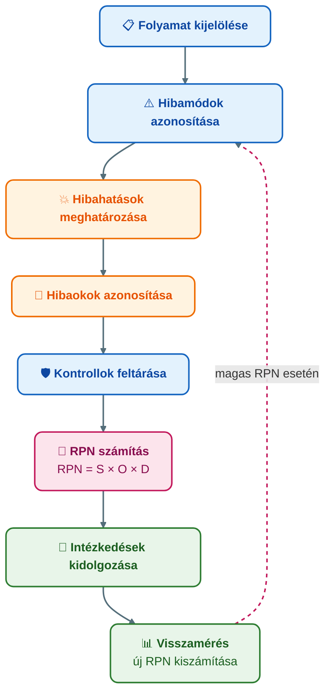

## V4 – Kockázatkezelés és hibamód-elemzés (FMEA) a folyamatokban

**Tétel:** Kockázatkezelés és hibamód-elemzés (FMEA) a folyamatokban: Mutassa be a folyamatokhoz kapcsolódó kockázatok elemzésének módszertanát, különös tekintettel az FMEA alkalmazására! FMEA célja és alkalmazási területei; a kockázati prioritási szám (RPN); kockázatcsökkentő intézkedések.

---

### 4.1. Kockázat a folyamatmenedzsmentben

A kockázat olyan bizonytalan esemény, amely bekövetkezése esetén negatívan befolyásolja a folyamat eredményét. A folyamatkockázat azt jelenti, hogy a folyamat nem a tervezett minőségben, nem időben vagy nem a várt költségen teljesít.

### 4.2. Az FMEA módszer

Az FMEA (Failure Mode and Effects Analysis – hibamód- és hatáselemzés) szisztematikus, proaktív kockázatkezelési módszer. Célja a hibák előzetes azonosítása, hatásaik értékelése és kockázatcsökkentő intézkedések kidolgozása — mielőtt a hiba bekövetkezne.

**Két fő típus:**
- **DFMEA** (Design FMEA): Termék vagy szolgáltatás tervezési kockázatai
- **PFMEA** (Process FMEA): Folyamatlépések lehetséges hibái → **a folyamatmenedzsmentben ez az elsődleges**

### 4.3. Az FMEA módszertani lépései

### 4.4. A kockázati prioritási szám (RPN)

Az FMEA értékelési mutatója az RPN (Risk Priority Number – kockázati prioritási szám):

$$\text{RPN} = S \times O \times D$$

| Tényező | Angol | Tartalom | Skála |
|---|---|---|---|
| **S** | Severity (Súlyosság) | A hiba következménye, ha bekövetkezik | 1–10 |
| **O** | Occurrence (Előfordulás) | Milyen valószínűséggel fordulhat elő | 1–10 |
| **D** | Detection (Észlelhetőség) | Mennyire nehéz időben észlelni (10 = szinte észrevehetetlen) | 1–10 |

**Skálák összefoglalása:**

| Értéktartomány | Súlyosság (S) | Előfordulás (O) | Észlelhetőség (D) |
|---|---|---|---|
| 1–2 | Csekély hatás | Ritka, kivételes | Szinte biztosan észlelhető |
| 5–6 | Érezhető probléma, ügyfél érintett | Közepes valószínűség | Részleges kontroll |
| 9–10 | Kritikus, jogi/biztonsági kár | Rendszeresen előfordul | Szinte felismerhetetlen |

### 4.5. Az FMEA táblázat

| Folyamatlépés | Hibamód | Hibahatás | Hibaok | Kontroll | S | O | D | RPN | Intézkedés |
|---|---|---|---|---|---|---|---|---|---|
| Panasz rögzítése | Hiányos adatok | Kivizsgálás késik, ügyfél elégedetlen | Nem kötelező mezők | Ügyintézői ellenőrzés | 6 | 7 | 5 | **210** | Kötelező mezők + auto figyelmeztetés |
| Számla rögzítése | Rossz költséghely | Pénzügyi eltérés | Manuális kiválasztás | Utólagos ellenőrzés | 7 | 5 | 6 | **210** | Legördülő lista, validáció |
| Belső űrlap kitöltése | Kisebb formai hiba | Adminisztratív javítás | Nincs sablon | Kézi ellenőrzés | 2 | 6 | 3 | **36** | Sablon bevezetése |

### 4.6. Kockázatcsökkentő intézkedések és visszamérés

Az intézkedések három irányban hatnak:
- **O csökkentése:** Automatizálás, képzés, szabványosítás, rendszerintegráció
- **D javítása:** Automatikus validáció, ellenőrzőlista, jóváhagyási pontok, audit
- **S csökkentése:** Ritkán csökkenthető, a következmény adott (pl. egészségügyi kockázatnál)

Az intézkedések után az S, O, D értékeket újra kell becsülni, és kiszámítani az új RPN-t. Ha pl. az eredeti RPN = 210, az intézkedések után (S=6, O=3, D=3) → **RPN = 54**, a kockázat jelentősen csökkent.

**Fontos:** Az RPN mechanikusan nem alkalmazható. Ha S = 10, az a hiba kritikus figyelmet igényel alacsony RPN esetén is.

**Az FMEA és BPM kapcsolata:** Az FMEA beépül a BPM életciklusba: tervezésnél a kockázatok előzetes azonosítása, végrehajtásnál kontrollpontok, monitorozásnál kockázati KPI-k, optimalizálásnál intézkedések.

**Összegzés:** Az FMEA proaktív kockázatkezelési módszer. Az RPN = S × O × D képlet alapján rangsorolja a kockázatokat. A kockázatcsökkentő intézkedések végrehajtása és visszamérése zárja le a ciklust.

---