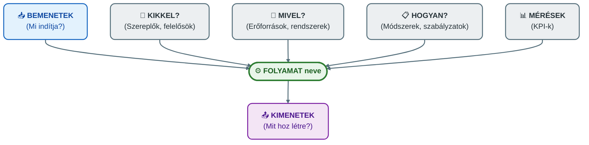
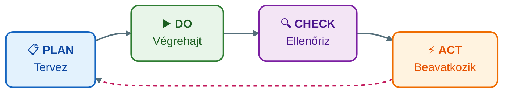

## V5 – Folyamatszemléletű irányítási rendszerek és dokumentáció

**Tétel:** Folyamatszemléletű irányítási rendszerek és dokumentáció: Értelmezze a folyamatközpontú megközelítést a minőségirányítási rendszerekben (MIR) és a kapcsolódó dokumentációs követelményeket! A folyamatleltár és a folyamatleírások; a "teknős-elemzés" (turtle diagram); KPI és a PDCA ciklus kapcsolata a szabványosított rendszerekben.

---

### 5.1. Folyamatszemlélet a minőségirányításban

A minőségirányítási rendszer (MIR) – legismertebb szabványa az ISO 9001:2015 – a folyamatszemléletű megközelítést alapelvként rögzíti. Lényege: a szervezet tevékenységeit nem osztályok elszigetelt feladataiként, hanem egymáshoz kapcsolódó folyamatok rendszereként értelmezi.

Egy vevői rendelés teljesítése például érinti az ügyfélszolgálatot, értékesítést, pénzügyet, raktárt, logisztikát és számlázást. Ha minden szervezeti egység csak a saját részfeladatát optimalizálja, az nem feltétlenül javítja a teljes folyamatot.

**A folyamatok négy fő kategóriája MIR-ben:**

| Típus | Példák |
|---|---|
| Vezetési folyamatok | Stratégiai tervezés, célok meghatározása, vezetőségi átvizsgálás |
| Főfolyamatok | Termékfejlesztés, gyártás, rendelésfeldolgozás, kiszállítás |
| Támogató folyamatok | HR, IT, pénzügy, karbantartás, dokumentumkezelés |
| Mérési és fejlesztési folyamatok | Belső audit, vevői elégedettség mérése, helyesbítő intézkedések |

### 5.2. A folyamatleltár

A folyamatleltár a szervezet folyamatainak rendszerezett felsorolása – az egész MIR kiindulópontja. Megmutatja, milyen folyamatok léteznek, milyen kategóriába tartoznak, és ki felel értük.

| Folyamat neve | Típus | Folyamatgazda | Fő kimenet |
|---|---|---|---|
| Vevői rendelés kezelése | Főfolyamat | Értékesítési vezető | Teljesített rendelés |
| Belső audit | Fejlesztési folyamat | Minőségügyi vezető | Auditjelentés |
| Munkatársak képzése | Támogató folyamat | HR vezető | Képzett munkatárs |
| Vezetőségi átvizsgálás | Vezetési folyamat | Ügyvezető | Fejlesztési döntések |

### 5.3. A teknős-elemzés (Turtle Diagram)

A teknős-elemzés a folyamatok átfogó szabályozási és elemzési eszköze. A diagram középen a vizsgált folyamatot tartalmazza, körülötte hat dimenzió helyezkedik el:

**Panaszkezelési folyamat teknős-elemzése:**

| Elem | Tartalom |
|---|---|
| **Folyamat** | Ügyfélpanasz kezelése |
| **Bemenetek** | Beérkezett panasz, ügyféladatok, vásárlási adatok |
| **Kimenetek** | Kivizsgált panasz, ügyfélválasz, helyesbítő intézkedés, lezárt ügy |
| **Kikkel?** | Ügyfélszolgálat, minőségügy, szakmai terület, folyamatgazda |
| **Mivel?** | CRM rendszer, dokumentumkezelő, e-mail, panaszűrlap |
| **Hogyan?** | Panaszkezelési szabályzat, adatvédelmi előírás, határidő-szabály |
| **Mérések** | Átfutási idő, határidőre lezárt ügyek aránya, ismételt panaszok száma |

A teknős-elemzés nem helyettesíti a BPMN-modellt, de kiváló kiegészítője: a BPMN a sorrendet, a teknős az operatív feltételrendszert mutatja meg.

### 5.4. KPI és a PDCA ciklus kapcsolata

A **PDCA (Plan–Do–Check–Act)** Deming ciklusa a folyamatos fejlesztés alapmodellje a MIR-ben:

| PDCA szakasz | KPI-k szerepe |
|---|---|
| **Plan** | KPI-célértékek meghatározása (pl. 95% határidőn belüli panaszlezárás) |
| **Do** | Folyamat működik, KPI-adatok gyűlnek |
| **Check** | KPI-mérés: tényleges értékek összehasonlítása a céllal |
| **Act** | Ha az eltérés fennáll: helyesbítő intézkedés, folyamatmódosítás, új ciklus |

### 5.5. Dokumentációs követelmények

A MIR dokumentáció két rétegből áll:

**Szabályozó dokumentumok** (mit kell tenni):
- Folyamatleltár, folyamatleírás, munkautasítás, szabályzat, ellenőrzőlista, BPMN-modell

**Bizonyító feljegyzések** (mit tettünk):
- KPI-riportok, auditjelentések, helyesbítő intézkedések nyilvántartása, vezetőségi átvizsgálási jegyzőkönyvek

A dokumentáció leggyakoribb hibái: túlzott formalizmus (csak auditon elővett papírok), túlzott részletezettség (senki nem használja), elavult tartalom (változás után nem frissítik).

**Összegzés:** A folyamatszemléletű MIR a folyamatokat rendszerként kezeli. A folyamatleltár adja az áttekintést, a teknős-elemzés az operatív feltételeket, a KPI-k a mérhetőséget, a PDCA ciklus pedig a folyamatos fejlesztés keretét biztosítja.

---

*Forrás: Novák Géza – Számítógépes folyamatmenedzsment, oktatási segédanyag (2026); Dumas, M. et al.: Fundamentals of Business Process Management (2018, Springer); OMG: BPMN 2.0 specifikáció (2013)*
