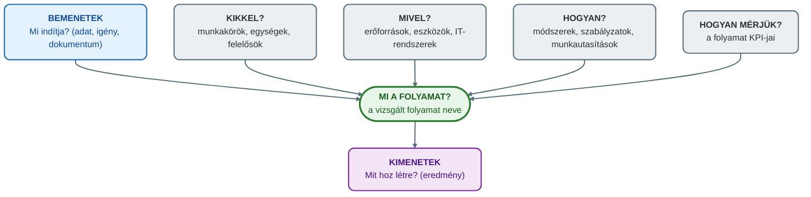
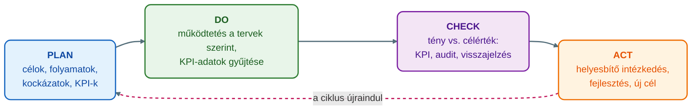

## V5 – Folyamatszemléletű irányítási rendszerek és dokumentáció

**Tétel:** Folyamatszemléletű irányítási rendszerek és dokumentáció: Értelmezze a folyamatközpontú megközelítést a minőségirányítási rendszerekben (MIR) és a kapcsolódó dokumentációs követelményeket! A folyamatleltár és a folyamatleírások; a "teknős-elemzés" (turtle diagram); KPI és a PDCA ciklus kapcsolata a szabványosított rendszerekben.

---

### 5.1. Folyamatszemlélet a minőségirányításban

Egy termék előállítása, egy ügyfélpanasz kezelése vagy egy megrendelés teljesítése több szervezeti egység, munkatárs, informatikai rendszer és külső partner együttműködését igényli, ezért nem elegendő az osztályokat külön-külön irányítani: a működést folyamatokként kell értelmezni. A **folyamatszemléletű irányítás** lényege, hogy a szervezet tevékenységeit egymáshoz kapcsolódó folyamatok rendszerének tekinti: a folyamatok bemenetekből kiindulva, erőforrások és szabályozott tevékenységek segítségével kimeneteket (terméket, szolgáltatást, döntést, dokumentumot, információt) hoznak létre (Novák, 2026, 86. o.).

A **minőségirányítási rendszer (MIR)** olyan szabályozott vezetési és működési keret, amelynek célja, hogy a szervezet képes legyen következetesen megfelelni a vevői, a jogszabályi és a saját belső követelményeinek. A MIR nem kizárólag minőségellenőrzést jelent, hanem a teljes szervezeti működés tudatos irányítását (Novák, 2026, 87. o.). A MIR-re külső követelményként szabvány is vonatkozhat, például az ISO 9001 (Óbudai Egyetem KKGK, é. n., 4. lecke). A folyamatszemlélet a MIR-ben különösen fontos, mert a minőség nem csupán a végtermék ellenőrzésével biztosítható, hanem azzal, hogy a szervezet a teljes működési folyamatot tudatosan tervezi, szabályozza, méri és fejleszti. Ha a folyamat jól szabályozott, nagyobb eséllyel lesz megfelelő a végeredmény is (Novák, 2026, 86. o.).

A **folyamatközpontú megközelítés** abból indul ki, hogy a szervezet eredményei nem elszigetelt tevékenységek következményei, hanem egymással összefüggő folyamatok eredői. A hagyományos, osztályokra bontott szemlélet azt nézi, hogy egy-egy részleg önmagában hatékony-e, pedig az ügyfél szempontjából a teljes folyamat működése számít (Óbudai Egyetem KKGK, é. n., 2. lecke). Egy vevői rendelés teljesítése például érinti az ügyfélszolgálatot, az értékesítést, a pénzügyet, a raktárt, a logisztikát és a számlázást; ha minden egység csak a saját részfeladatát optimalizálja, egy osztály gyorsabban dolgozhat, de hiányos adatokat ad tovább, ami később hibát és újramunkát okoz. A folyamatszemlélet ezért a teljes értékteremtési láncot vizsgálja (Novák, 2026, 87. o.).

A folyamatközpontú megközelítés főbb jellemzői: a működést folyamatok rendszerében értelmezi, a folyamatokhoz felelőst rendel, meghatározza a bemeneteket és kimeneteket, szabályozza a végrehajtás módját, méri a teljesítményt, figyelembe veszi a kockázatokat, és támogatja a folyamatos fejlesztést. A minőségirányításban ez azt jelenti, hogy a szervezet nem csupán a végső kimenet megfelelőségét ellenőrzi, hanem azt is, hogy a kimenetet létrehozó folyamatok képesek-e következetesen megfelelő eredményt adni (Novák, 2026, 87. o.).

**A folyamatok csoportjai a MIR-ben.** A BPM általános folyamattérképe három csoportot különböztet meg: vezetési, alap- (kulcs-) és támogató folyamatokat (Óbudai Egyetem KKGK, é. n., 3. lecke). A MIR-ben ezt egy negyedik csoport egészíti ki, mert a rendszer a mérést és a fejlesztést külön nevesíti (Novák, 2026, 87–88. o.):

| Típus | Példák |
|---|---|
| Vezetési folyamatok | Stratégiai tervezés, célok meghatározása, vezetőségi átvizsgálás, erőforrások biztosítása |
| Fő- vagy értékteremtő folyamatok | Termékfejlesztés, gyártás, szolgáltatásnyújtás, rendelésfeldolgozás, kiszállítás |
| Támogató folyamatok | HR, informatika, karbantartás, beszerzés, pénzügy, dokumentumkezelés |
| Mérési, elemzési és fejlesztési folyamatok | Belső audit, vevői elégedettség mérése, nemmegfelelőségek kezelése, helyesbítő intézkedések |

A MIR akkor működik jól, ha ezek a folyamatok nem különálló szigetek, hanem összekapcsolt rendszert alkotnak; a folyamatleltár, a folyamatleírások, a teknős-elemzés, a KPI-k és a PDCA mind azt szolgálják, hogy a működés átlátható, ismételhető, ellenőrizhető és fejleszthető legyen (Novák, 2026, 86., 88. o.).

### 5.2. A folyamatleltár

A **folyamatleltár** a szervezet folyamatainak rendszerezett felsorolása: áttekintő dokumentum, amely megmutatja, milyen folyamatok vannak, milyen kategóriába tartoznak, ki felel értük, és hogyan kapcsolódnak egymáshoz. Célja, hogy a teljes működés átlátható legyen, és egyetlen folyamat se működjön „gazdátlanul” (Novák, 2026, 89. o.).

A folyamatleltár tipikus tartalmi elemei (Novák, 2026, 89–90. o.): a folyamat neve, típusa, a folyamatgazda, a folyamat célja, a fő bemenetek és kimenetek, a kapcsolódó dokumentumok, a kapcsolódó KPI-k, az érintett szervezeti egységek és a kapcsolódó kockázatok.

| Folyamat neve | Típus | Folyamatgazda | Fő kimenet |
|---|---|---|---|
| Vevői rendelés kezelése | Főfolyamat | Értékesítési vezető | Teljesített rendelés |
| Beszerzés | Támogató folyamat | Beszerzési vezető | Beszerzett termék vagy szolgáltatás |
| Belső audit | Fejlesztési folyamat | Minőségirányítási vezető | Auditjelentés |
| Munkatársak képzése | Támogató folyamat | HR vezető | Képzett munkatárs |
| Vezetőségi átvizsgálás | Vezetési folyamat | Ügyvezető | Fejlesztési döntések |

A folyamatleltár nem egyszerű lista, hanem a folyamatalapú irányítás kiindulópontja: erre épülhet a folyamatok részletes leírása, mérési rendszere és fejlesztése (Novák, 2026, 90. o.).

### 5.3. A folyamatleírások

A **folyamatleírás** egy adott folyamat részletes bemutatása: egyértelművé teszi, hogyan működik a folyamat, milyen lépésekből áll, ki miért felel, milyen bemenetek, kimenetek, dokumentumok és ellenőrzési pontok tartoznak hozzá. Tipikus tartalmi elemei: név, cél, hatókör, kezdő- és végpont, folyamatgazda, résztvevők és felelősök, bemenetek, tevékenységek, kimenetek, dokumentumok, kapcsolódó informatikai rendszerek, kockázatok és kontrollok, mérőszámok, kapcsolódó szabályzatok (Novák, 2026, 90–91. o.).

Folyamatleírás nélkül a működés személyfüggővé válik: ugyanazt a feladatot különböző munkatársak eltérően végzik, ami hibákhoz és minőségi ingadozáshoz vezet. A jó leírás nem bonyolult, de tartalmazza a lényeges információkat: nem minden apró mozdulatot szabályoz, hanem a folyamat irányítását, felelősségét és ellenőrzését teszi világossá (Novák, 2026, 91. o.). A részletezettség a vezetési szinttől függ: a felső vezetésnek elég az átfogó folyamattérkép, az operatív munkatársaknak részletes munkautasítás kell (Óbudai Egyetem KKGK, é. n., 3. lecke).

A folyamatleírás négy kiemelt működési eleme a **feladat** (az elvégzendő manuális, gépi, informatikai vagy döntési tevékenység), a **felelős** (aki a feladat végrehajtásáért, ellenőrzéséért vagy eredményéért felel; pontos kijelölése nélkül felelősséghárítás alakul ki), a **bemenet** (a folyamat elindításához szükséges információ, anyag, dokumentum, igény, adat) és a **kimenet** (az előállított termék, szolgáltatás, dokumentum, döntés, adatrekord, visszajelzés) (Novák, 2026, 91. o.).

| Elem | Példa (beszerzési folyamat) |
|---|---|
| Bemenet | Jóváhagyott beszerzési igény |
| Feladat | Ajánlatkérés beszállítóktól |
| Felelős | Beszerzési ügyintéző |
| Kimenet | Beérkezett ajánlatok |
| Kontroll | Legalább három ajánlat bekérése |
| KPI | Átlagos beszerzési átfutási idő |

A bemenetek és kimenetek pontos meghatározása különösen fontos a folyamatok kapcsolódásánál: egy folyamat kimenete gyakran egy másik folyamat bemenete, ezért ha a kimenet hibás, hiányos vagy késedelmes, a következő folyamat is problémásan működik (Novák, 2026, 92. o.).

A folyamatszemléletű irányítás kulcsszereplője a **folyamatgazda**: ő felel a folyamat teljesítményéért, szabályozottságáért és fejlesztéséért; nem feltétlenül ő hajtja végre a lépéseket, de ő látja át a teljes, szervezeti határokat átlépő folyamatot. Feladatai: a folyamatcél meghatározása, a folyamatleírás karbantartása, a KPI-k figyelése, a kockázatok kezelése, a fejlesztési lehetőségek azonosítása, kapcsolattartás az érintett egységekkel, a nemmegfelelőségek elemzése, helyesbítő intézkedések kezdeményezése. A felelősségek tisztázására RACI-mátrix is alkalmazható (végrehajtó, felelős, bevonandó, tájékoztatandó) (Novák, 2026, 92. o.). A folyamatleírás egyben a **folyamatszabályozás** eszköze, amelynek célja a stabil, ismételhető és ellenőrizhető működés; további elemei a folyamatábra, a munkautasítás, a felelősségi mátrix, az ellenőrzési pontok, a dokumentumsablonok, az elektronikus workflow, a jogosultsági és döntési szabályok és a teljesítménymutatók (Óbudai Egyetem KKGK, é. n., 6. lecke).

### 5.4. A teknős-elemzés (turtle diagram)

A **teknős-elemzés** (turtle diagram) a folyamatok átfogó szabályozásának és elemzésének gyakorlati eszköze; nevét onnan kapta, hogy ábrája teknősre emlékeztet: középen a folyamat, körülötte a működéséhez szükséges elemek. Célja, hogy a folyamatot ne csak lépések sorozataként, hanem teljes működési környezetében vizsgálja: miből indul ki, mit állít elő, kik végzik, milyen erőforrásokkal, milyen módszerek szerint, és milyen mérőszámokkal értékelhető. A MIR-ben különösen hasznos, mert egyszerre támogatja a folyamatleírást, az auditfelkészülést, a kockázatkezelést és a teljesítménymérést (Novák, 2026, 93. o.). A diagram hat fő kérdésre épül (Novák, 2026, 93–96. o.):

**Panaszkezelési folyamat teknős-elemzése** (Novák, 2026, 96. o.):

| Elem | Tartalom |
|---|---|
| **Folyamat** | Ügyfélpanasz kezelése |
| **Bemenetek** | Beérkezett panasz, ügyféladatok, vásárlási adatok, bizonyítékok |
| **Kimenetek** | Kivizsgált panasz, ügyfélválasz, helyesbítő intézkedés, lezárt ügy |
| **Kikkel?** | Ügyfélszolgálat, minőségügy, szakmai terület, folyamatgazda |
| **Mivel?** | CRM rendszer, dokumentumkezelő, e-mail, panaszűrlap |
| **Hogyan?** | Panaszkezelési szabályzat, adatvédelmi előírás, határidő-szabály |
| **Mérések** | Átfutási idő, határidőre lezárt ügyek aránya, ismételt panaszok száma |
| **Kockázatok** | Hiányos adat, késedelmes válasz, rossz kategorizálás, ügyfél-elégedetlenség |

Ez az áttekintés a folyamatgazdát és az auditort is segíti: láthatóvá válik, hogy a folyamat nem csak tevékenységekből áll, hanem erőforrásokból, felelősségekből, szabályokból, mérőszámokból és kockázatokból is. Legnagyobb előnye az áttekinthetőség: egyetlen ábrán mutatja a lényeges működési elemeket, ezért hasznos auditokon, oktatásban és fejlesztési workshopokon; egyszerű, gyorsan elkészíthető, egységesíti a folyamatleírásokat, segít a kockázatok azonosításában és a KPI-k kiválasztásában (Novák, 2026, 96–97. o.).

A teknős-diagram nem helyettesíti a részletes folyamatábrát vagy a BPMN-modellt, de kiváló kiegészítőjük: a folyamatábra azt mutatja meg, milyen sorrendben történnek a lépések, a teknős-elemzés pedig azt, hogy milyen feltételek között működik a folyamat (Novák, 2026, 97. o.).

### 5.5. KPI és a PDCA ciklus kapcsolata a szabványosított rendszerekben

A folyamatszemléletű irányítás alapelve, hogy a folyamatokat mérni kell: a mérés mutatja meg, hogy a folyamat eléri-e a célját, és kell-e fejleszteni. A folyamatokhoz rendelt mutatószám a **KPI** (Key Performance Indicator, kulcsfontosságú teljesítménymutató): a folyamat működésének lényeges jellemzőjét mutató mérőszám. Folyamat-KPI lehet például az átfutási idő, a hibaarány, a határidőre teljesítés aránya, a vevői elégedettség, az újramunka aránya, a költség, az auditeltérések száma vagy a selejtarány (Novák, 2026, 97–98. o.).

A KPI-knek a folyamat céljához kell kapcsolódniuk: először azt kell meghatározni, milyen eredményt kell a folyamatnak elérnie, és ehhez kell mutatót rendelni (Novák, 2026, 98–99. o.):

| Folyamat | Folyamatcél | Lehetséges KPI |
|---|---|---|
| Rendeléskezelés | Gyors és pontos rendelésteljesítés | Átfutási idő, hibás rendelések aránya |
| Panaszkezelés | Ügyfél-elégedettség fenntartása | Határidőre lezárt panaszok aránya |
| Beszerzés | Megfelelő minőségű beszerzés kedvező feltételekkel | Beszállítói hibaarány, beszerzési átfutási idő |
| Belső audit | A MIR működésének ellenőrzése | Auditprogram teljesülése, eltérések száma |
| Képzés | Megfelelő kompetenciák biztosítása | Képzési terv teljesülése, vizsgaeredmények |

Nem minden mérőszám alkalmas KPI-nek. **A jó KPI** kapcsolódik a folyamat céljához, mérhető, egyértelmű, rendszeresen gyűjthető, célértékkel összehasonlítható, felelőshöz rendelhető, döntéstámogatásra alkalmas, és fejlesztési intézkedést válthat ki. „Javuljon a minőség” önmagában nem KPI; „a határidőre lezárt panaszok aránya legalább 95%” vagy „a hibás teljesítések aránya legfeljebb 2%” igen. Ne legyen túl sok mutató: a jó mérési rendszer a kritikus folyamatcélokra koncentrál (Novák, 2026, 98–99. o.), és minden KPI-hez célérték tartozik, mert nem elég mérni a panaszkezelési időt, az elvárt szintet is meg kell adni (Óbudai Egyetem KKGK, é. n., 7. lecke).

A folyamatos fejlesztés legismertebb modellje a **PDCA ciklus** (Plan–Do–Check–Act): a szervezet nem egyszeri módon alakítja ki folyamatait, hanem rendszeresen tervezi (**Plan**: célok, folyamatok, erőforrások, kockázatok, mérőszámok), működteti (**Do**), méri és értékeli (**Check**: KPI-k, auditok, vevői visszajelzések, hibajelentések, riportok), majd beavatkozik (**Act**: helyesbítő intézkedés, fejlesztés, a szabályozás módosítása, új célok). A PDCA így összekapcsolja a folyamatmérést és a folyamatfejlesztést, és jól illeszkedik a MIR-hez (Novák, 2026, 99–100. o.).

**A KPI-k és a PDCA kapcsolata.** A KPI-k a Check szakaszban kapnak kiemelt szerepet, de valójában az egész ciklust támogatják (Novák, 2026, 100. o.):

| PDCA szakasz | A KPI-k szerepe | Példa (panaszkezelés) |
|---|---|---|
| **Plan** | Folyamatcélok és KPI-k, célértékek meghatározása | Cél: a panaszok legalább 95%-a határidőn belül lezárva |
| **Do** | A folyamat a szabályok szerint működik, közben KPI-adatok gyűlnek | Panaszok rögzítése, határidők naplózása |
| **Check** | Az adatok elemzése: a tényleges teljesítmény megfelel-e a célértéknek | A határidőre lezárt panaszok aránya csak 82% → eltérés |
| **Act** | Fejlesztési intézkedések indítása | Folyamat módosítása, új felelősségi rend, automatizált határidő-figyelés, ügyintézői képzés |

Ezután a ciklus újraindul, és a fejlesztések hatását ismét mérni kell; így válik a KPI-rendszer a folyamatos fejlesztés gyakorlati eszközévé (Novák, 2026, 100. o.). A szabványosított irányítási rendszerek alapelve a folyamatos fejlesztés, amelynek forrásai a KPI-eltérések, a belső auditok megállapításai, a vevői panaszok, a munkatársi javaslatok, a vezetőségi átvizsgálás, a kockázatelemzések, a nemmegfelelőségek, valamint a piaci, jogszabályi és technológiai változások. A fejlesztés lehet kis léptékű (egy űrlap egyszerűsítése) vagy nagy (egy folyamat digitalizálása), de mindig adatokra kell épülnie; a PDCA biztosítja, hogy a változtatást a szervezet megtervezi, bevezeti, ellenőrzi, végül standardizálja (Novák, 2026, 100–101. o.).

### 5.6. Dokumentációs követelmények

A dokumentáció a MIR egyik alapvető eleme; célja, hogy a működés követhető, egységes és bizonyítható legyen. Nem azt jelenti, hogy minden tevékenységet részletesen le kell írni, hanem azt, hogy a lényeges folyamatok, felelősségek, szabályok és bizonyítékok rögzítettek legyenek. Szerepei: egységes munkavégzés, az új munkatársak betanítása, egyértelmű felelősségek, az ellenőrzés és az audit támogatása, a követelmények teljesítésének bizonyítása, a kockázatkezelés és a fejlesztés megalapozása. Fontos elv, hogy a dokumentációt a szervezet méretéhez, tevékenységéhez, kockázataihoz és összetettségéhez kell igazítani: egy kis szolgáltatónál nem kell olyan részletes dokumentáció, mint egy több telephelyes gyártóvállalatnál (Novák, 2026, 88–89. o.).

A MIR-ben a szervezetnek bizonyítania is kell tudnia a működés megfelelőségét; ezt a dokumentált információk két rétege szolgálja (Novák, 2026, 101–102. o.):

- **A működési szabályokat leíró dokumentumok** (hogyan kell működni): folyamatleírások, eljárásrendek, munkautasítások, szabályzatok, folyamatábrák, teknős-diagramok.
- **A működést bizonyító feljegyzések** (hogyan működtünk ténylegesen): kitöltött űrlapok, ellenőrzési jegyzőkönyvek, auditjelentések, képzési nyilvántartások, mérési eredmények, KPI-riportok, vezetőségi átvizsgálási jegyzőkönyvek, helyesbítő intézkedések nyilvántartása.

A folyamatdokumentáció **gyakori hibái** (Novák, 2026, 103. o.): túlzott formalizmus (a dokumentum csak audit előtt kerül elő); túlzott részletezettség (a hosszú, bonyolult leírást senki nem használja); elavult tartalom (a működés változik, a leírás nem frissül); hiányosan meghatározott felelősségek (a hibák gazdátlanok maradnak); és mérőszámokhoz nem kapcsolódó dokumentáció (a folyamat le van írva, de nem derül ki, jól működik-e).

A **jó gyakorlatok** (Novák, 2026, 103–104. o.): teljes és frissített folyamatleltár; minden fontos folyamathoz folyamatgazda; a folyamatleírásban bemenetek, kimenetek és felelősök; áttekinthető folyamatábra; a működési feltételeket mutató teknős-elemzés; a folyamatcélokhoz kötött KPI-k; könnyen elérhető dokumentumok; a munkatársak oktatása; az audittapasztalatok visszavezetése a dokumentációba; és a PDCA szerinti rendszeres fejlesztés. A dokumentáció akkor jó, ha nem teher, hanem segíti a mindennapi munkát, a vezetői döntéseket és a fejlesztéseket.

### 5.7. Példa: egy rendeléskezelési folyamat dokumentációja

Az eszközök összekapcsolódását a jegyzet rendeléskezelési példája mutatja (Novák, 2026, 102–103. o.):

| Eszköz | Tartalom a példában |
|---|---|
| **Folyamatleltár** | Vevői rendelés kezelése; főfolyamat; folyamatgazda: értékesítési vezető; fő kimenet: teljesített rendelés |
| **Folyamatleírás** | Start: a rendelés beérkezése; bemenet: rendelési, ügyfél- és termékadatok; tevékenységek: ellenőrzés, készletvizsgálat, visszaigazolás, kiszállítás előkészítése, számlázás; felelősök: ügyfélszolgálat, raktár, pénzügy, logisztika; rendszerek: ERP, CRM, raktárkezelő; kontroll: ár- és készletellenőrzés; KPI: feldolgozási idő, hibás rendelések aránya, határidőre teljesítés aránya |
| **Teknős-elemzés** | Mivel? ERP, CRM, e-mail, raktári rendszer · Kikkel? értékesítés, raktár, pénzügy, logisztika · Hogyan? rendeléskezelési szabályzat, számlázási előírás · Mérés: átfutási idő, hibaarány, vevői elégedettség |
| **PDCA** | Plan: a feldolgozási idő csökkentése · Do: új ellenőrzési szabályok · Check: KPI-adatok elemzése · Act: folyamatmódosítás, automatizált visszaigazolás |

A példa mutatja, hogy a folyamatleltár, a folyamatleírás, a teknős-elemzés, a KPI és a PDCA nem különálló elemek, hanem egymást kiegészítő irányítási eszközök (Novák, 2026, 103. o.).

**Összegzés:** A folyamatszemléletű irányítási rendszerek a működést átlátható, szabályozott, mérhető és fejleszthető folyamatok rendszerében kezelik; a MIR-ben ez azért kiemelt, mert a minőséget nem végellenőrzéssel, hanem jól működő folyamatokkal lehet biztosítani. A folyamatleltár az áttekintést és a felelősöket adja, a folyamatleírás az egyes folyamatok működési elemeit, a teknős-elemzés a működési feltételeket, a KPI a mérhetőséget, a PDCA a folyamatos fejlesztés keretét. A dokumentáció így nem adminisztratív kényszer, hanem a szabályozott működés, a minőség, az auditálhatóság és a fejlődés alapja (Novák, 2026, 104. o.).

---

### Várható vizsgáztatói kérdések

1. **Mi a különbség a folyamatleltár és a folyamatleírás között?** — A folyamatleltár a szervezet összes folyamatának rendszerezett, áttekintő felsorolása (név, típus, folyamatgazda, cél, fő bemenet/kimenet, KPI-k, kockázatok), amely a folyamatalapú irányítás kiindulópontja. A folyamatleírás egyetlen folyamat részletes bemutatása: hatókör, kezdő- és végpont, tevékenységek, felelősök, bemenetek, kimenetek, dokumentumok, rendszerek, kontrollok és mérőszámok. A leltár a „mi van”, a leírás a „hogyan működik” kérdésre válaszol (Novák, 2026).
2. **Miért fontos a folyamatgazda kijelölése, és mi a RACI-mátrix szerepe?** — A folyamatok gyakran átlépik a szervezeti határokat; folyamatgazda nélkül minden részleg csak a saját feladatára koncentrál, és senki nem felel a teljes folyamat eredményéért. A folyamatgazda felel a folyamat teljesítményéért, szabályozottságáért és fejlesztéséért, karbantartja a leírást, figyeli a KPI-ket és intézkedéseket kezdeményez. A RACI-mátrix a felelősségek tisztázására szolgál: megkülönbözteti a végrehajtót, a felelőst, a bevonandót és a tájékoztatandót (Novák, 2026).
3. **Mi a különbség a teknős-elemzés és a BPMN-modell között?** — A BPMN-modell vagy folyamatábra a lépések sorrendjét, elágazásait és szereplőit mutatja; a teknős-elemzés a folyamat működési feltételeit: bemenetek, kimenetek, résztvevők, erőforrások, módszerek, mérőszámok. A teknős nem helyettesíti a folyamatábrát, hanem kiegészíti; a MIR-ben az auditfelkészülés, a folyamatleírás, a kockázatkezelés és a teljesítménymérés közös eszköze (Novák, 2026).
4. **Mitől jó egy KPI? Mondjon egy rossz és egy jó példát!** — A jó KPI a folyamat céljához kapcsolódik, mérhető, egyértelmű, rendszeresen gyűjthető, célértékkel összehasonlítható, felelőshöz rendelhető, döntéstámogatásra alkalmas, és fejlesztési intézkedést válthat ki. „Javuljon a minőség” nem KPI; „a határidőre lezárt panaszok aránya legalább 95%” az. Fontos, hogy ne legyen túl sok mutató, és mindegyikhez célérték tartozzon (Novák, 2026; Óbudai Egyetem KKGK, é. n., 7. lecke).
5. **Hogyan kapcsolódik a KPI-rendszer a PDCA ciklushoz?** — A Plan szakaszban kitűzzük a folyamatcélokat és a KPI-célértékeket, a Do szakaszban a működés közben gyűlnek a KPI-adatok, a Check szakaszban a tényt vetjük össze a célértékkel (pl. 82% a 95% helyett), az Act szakaszban fejlesztési intézkedés indul, majd a ciklus újraindul és a hatást újra mérjük. A KPI tehát a Check szakaszban kap kiemelt szerepet, de az egész ciklust támogatja (Novák, 2026).
6. **Mi a két rétege a MIR-dokumentációnak, és melyek a dokumentáció gyakori hibái?** — Az egyik réteg a működési szabályokat írja le (folyamatleírás, eljárásrend, munkautasítás, szabályzat, folyamatábra, teknős-diagram), a másik bizonyítja a tényleges működést (kitöltött űrlapok, jegyzőkönyvek, auditjelentések, KPI-riportok, helyesbítő intézkedések nyilvántartása). Gyakori hibák: túlzott formalizmus, túlzott részletezettség, elavult tartalom, hiányos felelősségek, mérőszámokhoz nem kapcsolódó dokumentáció (Novák, 2026).

---

## Irodalom

* Novák, G. (2026). *Számítógépes folyamatmenedzsment: Oktatási segédanyag* [Egyetemi jegyzet]. Óbudai Egyetem, Keleti Károly Gazdasági Kar.
* Óbudai Egyetem, Keleti Károly Gazdasági Kar. (é. n.). *2. A folyamatmenedzsment beépítése a szervezet működésébe* [Elektronikus tananyag, Számítógépes folyamatmenedzsment (GMXSF2MBLF)].
* Óbudai Egyetem, Keleti Károly Gazdasági Kar. (é. n.). *3. A folyamatok azonosítása és strukturálása* [Elektronikus tananyag, Számítógépes folyamatmenedzsment (GMXSF2MBLF)].
* Óbudai Egyetem, Keleti Károly Gazdasági Kar. (é. n.). *4. Folyamatkövetelmények meghatározása* [Elektronikus tananyag, Számítógépes folyamatmenedzsment (GMXSF2MBLF)].
* Óbudai Egyetem, Keleti Károly Gazdasági Kar. (é. n.). *6. Folyamatszabályozás* [Elektronikus tananyag, Számítógépes folyamatmenedzsment (GMXSF2MBLF)].
* Óbudai Egyetem, Keleti Károly Gazdasági Kar. (é. n.). *7. Folyamatok mérése* [Elektronikus tananyag, Számítógépes folyamatmenedzsment (GMXSF2MBLF)].
