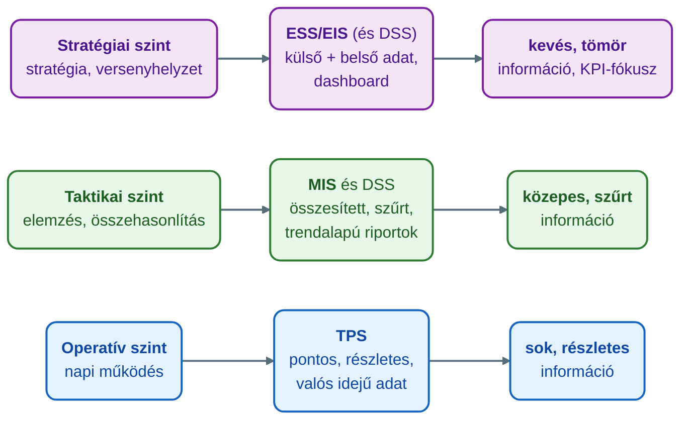
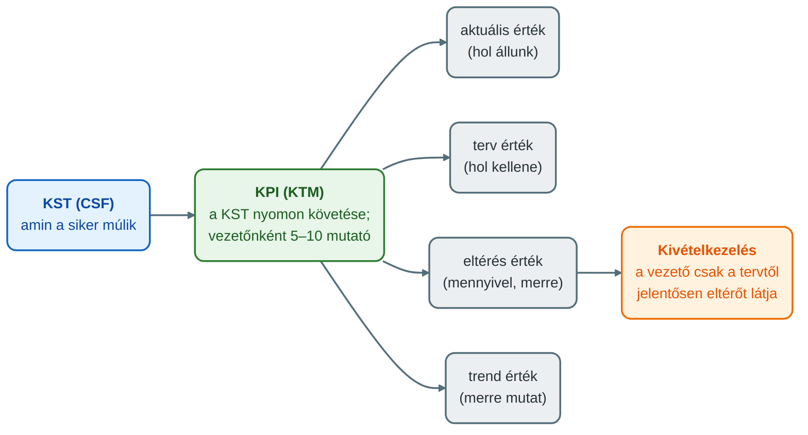

## V6 – VIR fogalma, típusai, pénzügyi mutatók

### Beszerzendő anyagok

| Szerző | Mű | Jelleg | Indoklás / érintett rész |
|---|---|---|---|
| Bángi-Magyar, A. et al. | AVIR kézikönyv (Digitális Tankönyvtár) | ajánlott irodalom | A syllabus ajánlott irodalomként nevezi meg; az R6 (összetett mutatószámrendszerek, EVA, Z-score) és az R5 (pénzügyi mutatószámok) pótlásához jöhet szóba. Tartalmát nem ellenőriztem. |
| Laudon, K. C., & Laudon, J. P. | *Management information systems: Managing the digital firm* (17th ed., 2022) | kötelező irodalom | A syllabus kötelező irodalma; az R1 (a VIR/MIS fogalma) és az R7b (ismereti mélység a programcsomagoknál) pótlásához jöhet szóba. Tartalma nincs a mappában. |

**Tétel:** Határozza meg a Vezetői Információs Rendszer (VIR) fogalmát, jellemezze az információs rendszerek főbb típusait, és mutassa be a VIR szerepét a vállalati irányítási struktúrában! Ismertesse a VIR legfontosabb funkcióit, soroljon fel pénzügyi mutatószámokat és összetett mutatószámrendszereket (pl. EVA, Z-score), majd fejtse ki, hogy a műszaki menedzser milyen céllal és milyen mélységű ismerettel kell hogy rendelkezzen a VIR programcsomagok tekintetében!

---

### 6.1. A VIR fogalma és a terminológia

Az információs rendszer (IS) több, mint számítógép: a hatékony használathoz a szervezeti, a menedzsment és a technológiai dimenzió együttes megértése szükséges (Laudon et al., 2025, idézi: Óbudai Egyetem, Keleti Károly Gazdasági Kar, Üzleti Tudományok és Digitális Ismeretek Intézet [ÓE KGK ÜTDI], 2026b, 2. szakasz). A technológia csak a „jéghegy csúcsa”: a projektkudarcok többsége a szervezeti kultúrában, a menedzsment döntéseiben és a folyamatokban rejlik (ÓE KGK ÜTDI, 2026b, 2. szakasz).

**Terminológia.** A tananyag a „MIR/VIR” megfogalmazást használja (ÓE KGK ÜTDI, 2026b, 4. szakasz). A szöveges táblázat a MIS-t „menedzsment IS”-ként a taktikai szinthez rendeli (ÓE KGK ÜTDI, 2026b, 3. szakasz). A hivatkozott ábrák – a Vállalati információs rendszer piramis (ÓE KGK ÜTDI, 2026b, 3. szakasz) és a MIR kronologikus fejlődése (ÓE KGK ÜTDI, 2026a, 2. szakasz) – ugyanezt a rendszert „vezetői információs rendszer (MIS)” felirattal jelölik. Önálló VIR-definíciót a tananyag nem ad.

**Munkadefiníció** *(a tananyag állításaiból összeállított összefoglalás, nem szó szerinti definíció).* A VIR olyan, a vezetői munka hatékonyságát növelő rendszer (ez a MIR 1970-es évekbeli „vezetői információk korszakának” célja: Turban et al., 2002, idézi: ÓE KGK ÜTDI, 2026a, 2. szakasz), amely a taktikai szinten összesített, szűrt, trendalapú riportokat ad (ÓE KGK ÜTDI, 2026b, 3. szakasz). Az információt kritikus sikertényezők (KST) és kulcsfontosságú teljesítménymutatók (KPI) köré szervezi, és támogatja a kivételek kezelését (ÓE KGK ÜTDI, 2026b, 4. szakasz). A piramis-ábra szerint jelentéseket, kimutatásokat, teljesítménymutatókat és kivételfigyelést nyújt (ÓE KGK ÜTDI, 2026b, 3. szakasz).

Mögötte konkrét szakmai szerepek állnak: rendszerfejlesztők, rendszergazdák, kontrollingosok, vezetői informatikai tanácsadók, informatikai auditorok, az IT-projektek minőségbiztosítói és az üzleti folyamatokat újjászervező szakemberek (ÓE KGK ÜTDI, 2026b, 4. szakasz).

---

### 6.2. Az információs rendszerek főbb típusai

A tananyag az IS-típusokat a döntési szintekhez rendeli (ÓE KGK ÜTDI, 2026b, 3. szakasz):

| Szint | Döntés jellege | Rendszer | Mit kap a döntéshozó? |
|---|---|---|---|
| Operatív | strukturált, ismétlődő, szabályozható | TPS (tranzakció-feldolgozó) | pontos, részletes, valós idejű tranzakciós adat |
| Taktikai | félig strukturált, rendszeres riportok | MIS (menedzsment IS) | összesített, szűrt, trendalapú riportok |
| Taktikai / stratégiai | félig strukturált, elemzésvezérelt | DSS (döntéstámogató) | modellek, szcenárió-elemzések, what-if szimulációk |
| Stratégiai | strukturálatlan, bizonytalanság alatt | ESS/EIS (vezetői IS) | külső és belső adatok aggregátuma, dashboard |

*(A piramis-ábra a DSS-t a stratégiai vezetés mellett, ESS nélkül jelöli; eltérés esetén a szöveg és a táblázat a mérvadó.)*

A döntéstípusok szerint: a strukturált döntést (pl. napi rendelési mennyiség) a MIS rutinjelentései, a félig strukturáltat (pl. „mi történne, ha 5%-kal emelnénk az árat?”) a DSS what-if elemzése, a strukturálatlant (pl. belépés új piacra) az ESS és a vezetői ítélőképesség szolgálja ki (ÓE KGK ÜTDI, 2026e, 3. szakasz).

**A szintek felcserélésének három tipikus hibája** (ÓE KGK ÜTDI, 2026b, 3. szakasz): (1) túl sok operatív adat jut felfelé, ami információs túlterheléshez és döntésképtelenséghez vezet; (2) aggregált adat jut lefelé, ezért a problémák késve derülnek ki; (3) DSS kerül operatív szintre, és a túl bonyolult rendszert senki nem használja.

**Fejlődés.** A MIR négy korszaka: az adatfeldolgozás korszaka (’60-as évek, cél a működési hatékonyság növelése), a vezetői információk korszaka (’70-es évek, a vezetői munka hatékonysága), a stratégiai információs rendszerek korszaka (’80–’90-es évek, üzleti előnyök szerzése) és az intelligens on-line megoldások korszaka (2000-es évektől, a tudásalapú társadalom megteremtése). Az alrendszerek: ’80-as évek EIS és DSS, ’90-es évek adattárház és BI, 2000-es évek dashboardok és scorecardok, teljesítményirányítás (Turban et al., 2002, idézi: ÓE KGK ÜTDI, 2026a, 2. szakasz).

---

### 6.3. A VIR szerepe a vállalati irányítási struktúrában

A menedzsment négy alapfunkciója – tervezés, szervezés, irányítás, ellenőrzés – mindhárom vezetői szinten jelen van, de nem ugyanazt az információt igényli. Az információ eredete szerint lehet belső vagy külső, jellege szerint előrejelző, speciális, eseti vagy időszaki (ÓE KGK ÜTDI, 2026b, 4. szakasz).

*(Az ábra a ÓE KGK ÜTDI, 2026b, 3–4. szakasz táblázatai alapján készült.)*

Felfelé haladva csökken a vezetőre jutó információ mennyisége, miközben nő a mélységi hozzáférés igénye (bármikor bele tudjon nézni a részletekbe) és az információ lényegszerűsége, vagyis a KPI-kra való összpontosítás. A rendszer feladata mindhárom szinten ugyanaz: a nyomon követés, az irányítás és a kommunikáció támogatása, valamint a versenyhelyzet és a vevői igények folyamatos figyelése (ÓE KGK ÜTDI, 2026b, 4. szakasz). A szintek ábrája a belső információk aggregáltságának felfelé növekedését mutatja, és a külső információkat (piaci kereslet és kínálat, tőzsde, törvényi változások, kamatváltozás) a napi, rövid és hosszú távú döntési szintekhez kapcsolja (ÓE KGK ÜTDI, 2026b, 4. szakasz).

A Vállalati információs rendszer piramis a vezetési szinteket a funkcionális rendszerekkel (értékesítés és marketing, gyártás és termelés, pénzügy és számvitel, humán erőforrás), a vállalati rendszerekkel (ERP, integrált IS) és a külső kapcsolatokkal (beszállítók, vevők, ellátási lánc) együtt ábrázolja (ÓE KGK ÜTDI, 2026b, 3. szakasz). Az ERP-ről lásd V12. A szerepkör szerinti információigényre kutatási példa a gyártóüzemi dashboardok vizsgálata: a KPI-kiválasztást a felhasználói szerepkörhöz (műszakvezető, üzemvezető, felső vezetés) kell igazítani (Tokola et al., 2016, idézi: ÓE KGK ÜTDI, 2026d, 2. szakasz).

**A VIR sikere három elem egyensúlyán áll:** a felhasználó vezetőén, aki ténylegesen dönt a rendszer alapján, az információén és a technológiáén. A bukás leggyakoribb okai: a rendszer lemarad a szervezeti változások mögött, nem megfelelő a projektvezetés, gyenge a kommunikáció, irreális elvárások (csodavárás) és bizalmatlanság a VIR információjával szemben. Segít a legbefolyásosabb vezetők nyílt támogatása, az üzletmenet alapos ismerete, a fokozatos bővítés („big bang” helyett) és a tudatos csoportmunka (ÓE KGK ÜTDI, 2026b, 5. szakasz).

---

### 6.4. A VIR legfontosabb funkciói

**Alkalmazási célok.** A VIR a pénzügy, a stratégia, a marketing és értékesítés, a HR, a piaci verseny és a gyártási adatok területén használható, és támogatja az új termék- vagy szolgáltatásfejlesztést és az innovációt (eljárás-, termék- és piaci innováció) (ÓE KGK ÜTDI, 2026b, 4. szakasz).

**Információszervezés: KST és KPI.** A kritikus sikertényező (KST, CSF) az a néhány terület, amelynek jól kell mennie a siker érdekében. A kulcsfontosságú teljesítménymutató (KTM, KPI) az a mérőszám, amellyel a KST-t nyomon követjük. Egy jó KPI-nak négy jellemzője van: az aktuális érték, a terv érték, az eltérés érték és a trend érték. A valódi kihívás annak eldöntése, melyik 5–10 KPI-n keresztül tudja a vezető a saját területét ténylegesen monitorozni. A VIR a kivételek kezelését is támogatja: nem minden adatot kell a vezetőnek látnia, csak a tervtől jelentősen eltérőket (ÓE KGK ÜTDI, 2026b, 4. szakasz).

**Gazdasági hatások.** A tananyag tíz területet nevez meg: a menedzseri jelentések színvonalának javulása, több időszerű adat, a stratégiai tervezés javulása, megbízható adatbázis kialakítása, a pénzügyi irányítás javulása, a vállalati szervezet jobb megértése, a gazdasági és piaci adatok minőségének javulása, a termék- és szolgáltatásminőség javulása, a piaci versenyanalízis javulása és a vezetői teamek közötti kommunikáció javulása. Egyik sem közvetlenül pénzügyi mutató, mégis mindegyik végső soron pénzügyi hatással jár, ezért a VIR megtérülését nem elég egyetlen mutatóval mérni (ÓE KGK ÜTDI, 2026b, 7. szakasz).

**A mutatók korlátja.** Egy 22 KPI-t megjelenítő dashboard elemzési bénultsághoz vezet, mert a rendszer nem tesz különbséget a fontos és a kevésbé fontos között (ÓE KGK ÜTDI, 2026c, 2. és 8. szakasz). Goodhart törvénye szerint amikor egy mutató célponttá válik, megszűnik jó mutatónak lenni (Goodhart, 1975, idézi: ÓE KGK ÜTDI, 2026c, 3. szakasz). Ezért a mutató eszköz marad, nem döntéshozó (ÓE KGK ÜTDI, 2026c, 8. szakasz).

---

### 6.5. Pénzügyi mutatószámok

A tananyag a VIR-beruházás pénzügyi értékelésére az alábbi mutatókat (módszereket) tárgyalja (ÓE KGK ÜTDI, 2026b, 7. szakasz):

| Mutató | Mit mér |
|---|---|
| PV – jelenérték | a jövőbeli pénzáramlások mai értéke |
| NPV – nettó jelenérték | a beruházás jelenértéke mínusz a beruházás költsége; pozitív NPV esetén éri meg a beruházás |
| IRR – belső megtérülési ráta | az a kamatláb, amely mellett a beruházás NPV-je pontosan nulla |
| ROI – megtérülési mutató | a beruházásból származó nyereség aránya a beruházás költségéhez képest |
| TCO – teljes tulajdonlási költség | a hardver- és szoftverbeszerzés a teljes költségnek kb. 20%-a, a fennmaradó 80% rejtett tétel |

A TCO rejtett elemei: telepítés, képzés, támogatás, karbantartás, infrastruktúra, üzemkiesés, hely és energia. Ezek együtt egy számítógép TCO-ját akár a vételár háromszorosára emelhetik (Laudon & Laudon, 2018, idézi: ÓE KGK ÜTDI, 2026b, 7. szakasz). A beruházás mértékének eltalálása is kockázat: a túlköltekezés kihasználatlan erőforrást, a túl kevés költés versenyhátrányt eredményezhet (ÓE KGK ÜTDI, 2026b, 7. szakasz). A megtérülést a komplementer szervezeti és menedzsment-befektetések is meghatározzák: magas IT-befektetés komplementer befektetés nélkül semmilyen vagy negatív megtérülést hozhat (ÓE KGK ÜTDI, 2026b, 6. szakasz).

### ⚠️ Tartalmi hiány — pénzügyi mutatószámok (R5)

A tételsor „pénzügyi mutatószámokat” kér. A megengedett forrás a fenti mutatókat beruházás-gazdaságossági módszerként tárgyalja; a klasszikus pénzügyi mutatószám-családok (pl. ROE, ROA, likviditási mutatók) nem szerepelnek benne. Keresett kifejezések (mind a 25 HTML-ben, ékezetes és ékezet nélküli alakban): a „mutatószám”, ROE, ROA, likviditás, DuPont, WACC, EBITDA kifejezésre 0 találat; a „pénzügyi mutató” csak említés szintjén fordul elő (a kötelező anyagban egyetlen tagadó értelmű mondatban). Pótlás: lásd a Beszerzendő anyagokat; az újrafuttatáskor a szakasz bővül.

---

### ⚠️ Tartalmi hiány — összetett mutatószámrendszerek, EVA, Z-score (R6)

A tételsor összetett mutatószámrendszereket és példaként az EVA-t és a Z-score-t kéri. A megengedett forrásokban ezek nem szerepelnek. Keresett kifejezések (mind a 25 HTML-ben, ékezetes és ékezet nélküli alakban): EVA, Economic Value Added, gazdasági hozzáadott érték, Z-score, Altman, mutatószámrendszer: 0 találat. Forráson kívüli tartalmat nem írok be. Az R6 kitöltetlen; pótlás: lásd a Beszerzendő anyagokat; az újrafuttatáskor a szakasz bővül.

---

### 6.6. A műszaki menedzser célja és ismereti mélysége a VIR programcsomagoknál

**Cél (R7a)** *(tananyag-alapú szintézis; a tananyag a tételsor megfogalmazásában nem tárgyalja).*

- A műszaki menedzser feladata nem az ideális, teljesen digitális állapot azonnali elérése, hanem a folyamatos, tudatos közelítés: az egyes bevezetési döntések stratégiai kontextusba helyezése (ÓE KGK ÜTDI, 2026b, 8. szakasz).
- A cél az, hogy a rendszer az ítélőképességet támogassa, ne helyettesítse. A legnagyobb kockázat ma nem az adathiány, hanem a túl sok, túl kifinomult, „objektívnek tűnő” adat, amely miatt a menedzser lemondhat a saját szakmai ítélőképességéről (ÓE KGK ÜTDI, 2026d, 8. szakasz). Aki minden döntését kizárólag a dashboardra hivatkozva hozza, és nem meri megkérdőjelezni a mutatót, az már mikromenedzsmentet végez (ÓE KGK ÜTDI, 2026c, 8. szakasz).
- A tananyag szerint érdemes megkérdezni, pontosan melyik vezetői szerepet szeretnénk a rendszerrel támogatni. Az erőforrás-elosztó szerepet a BI/DSS jól szolgálja, a vállalkozó és a tárgyaló szerephez semmilyen rendszer nem ad támogatást. A műszaki menedzsernél gyakori a zavarelhárító és az erőforrás-elosztó szerep; a projekt indoklásánál azt kell megvizsgálni, hogy a döntési szakaszt vagy csak az információgyűjtést gyorsítja-e (Mintzberg, 1971, idézi: ÓE KGK ÜTDI, 2026e, 6. szakasz).
- A tananyag eszközöket ad a beruházás értékeléséhez (NPV, IRR, ROI, TCO; lásd 6.5) és a komplementer befektetések felméréséhez (ÓE KGK ÜTDI, 2026b, 6–7. szakasz), valamint a szervezeti ellenállás kezeléséhez: a megoldás nem a jobb dokumentáció, hanem a változásmenedzsment (ÓE KGK ÜTDI, 2026b, 5. szakasz).

**Mélység (R7b).** A tananyag programcsomag-specifikus ismereti mélységet nem fogalmaz meg. Közvetett támpont, hogy az automatikus kiemelő funkciók (a Power BI Key Influencers és Anomaly Detection) megkönnyítik a mintázatfelismerést, de nem mentesítenek a Goodhart- és OEE-gaming kritikák alól, és „objektívnek” tűnő kimenetük nehezebben megkérdőjelezhető (ÓE KGK ÜTDI, 2026c, 7. szakasz).

### ⚠️ Tartalmi hiány — a programcsomag-ismeret mélysége (R7b)

A tételsor a VIR programcsomagok tekintetében kér ismereti mélységet. A „programcsomag” kifejezés a 25 HTML egyikében sem szerepel (0 találat); a Power BI csak példaként jelenik meg. Pótlás: lásd a Beszerzendő anyagokat.

---

### 6.7. Összegzés és tárgyon belüli kapcsolódások

A VIR a MIR fejlődésének és a vezetői szintek információigényének metszéspontja: a TPS-től a MIS-en és DSS-en át az ESS-ig terjedő rendszerek a döntés jellegéhez igazodnak, a KST/KPI-szervezés és a kivételkezelés pedig a vezetői figyelmet tereli. A beruházás megtérülése csak komplementer szervezeti és menedzsment-befektetésekkel együtt értelmezhető, a mutatók értéke pedig a kritikus használattól függ.

Kapcsolódások: a BSC mint oksági stratégiai eszköz (és kritikája) a V7-hez (ÓE KGK ÜTDI, 2026c, 5. szakasz), a BI-érettség és a BICC a V8-hoz (ÓE KGK ÜTDI, 2026e, 2. szakasz), a KPI-tervezés és a dashboard a V9-hez (ÓE KGK ÜTDI, 2026c, 2–6. szakasz), az OLAP és az adatbányászat a V10-hez (ÓE KGK ÜTDI, 2026d, 3–4. szakasz) tartozik.

---

### Várható vizsgáztatói kérdések

1. **Mi történik, ha a rendszertípusokat felcserélik a szintek között?** — Három tipikus hiba van: a vezérigazgatóhoz változtatás nélkül érkező operatív adat információs túlterhelést okoz, a gyártósor-vezető számára adott havi összesítő késői beavatkozáshoz vezet, a raktáros számára adott DSS pedig használhatatlan (ÓE KGK ÜTDI, 2026b, 3. szakasz).
2. **Miért bukik el a gyakorlatban egy VIR-bevezetés?** — Okok: a rendszer lemarad a szervezeti változások mögött, rossz a projektvezetés, gyenge a kommunikáció, irreális elvárások és bizalmatlanság az információval szemben. Három tipikus ellenállási minta: a párhuzamos futtatás, az adatminőség-szabotázs és a bypass kultúra (ÓE KGK ÜTDI, 2026b, 5. szakasz).
3. **Hogyan mutatható ki egy VIR-beruházás megtérülése?** — Klasszikus módszerekkel (PV, NPV, IRR, ROI), de a TCO szerint a vételár csak kb. 20%-a a költségnek. A tíz gazdasági hatás egyike sem közvetlenül pénzügyi mutató, ezért egy mutató nem elég (ÓE KGK ÜTDI, 2026b, 7. szakasz).
4. **Mikor romlik el egy KPI?** — Ha célponttá válik (Goodhart-törvény), ha túl sok van belőlük egy képernyőn (22 KPI), vagy ha az OEE komponenseit egymás rovására „játsszák meg” (ÓE KGK ÜTDI, 2026c, 2–4. szakasz).
5. **Mit támogat és mit nem egy rendszer a vezetői szerepek közül?** — Az erőforrás-elosztó szerepet a BI/DSS jól szolgálja, a vállalkozó és tárgyaló szerephez semmilyen rendszer nem ad támogatást (Mintzberg, 1971, idézi: ÓE KGK ÜTDI, 2026e, 6. szakasz).

---

## Irodalom

* Óbudai Egyetem, Keleti Károly Gazdasági Kar, Üzleti Tudományok és Digitális Ismeretek Intézet. (2026a). *Az integrált vállalat: ERP, CRM, SCM* [Kötelező tananyag, 3. ea.].
* Óbudai Egyetem, Keleti Károly Gazdasági Kar, Üzleti Tudományok és Digitális Ismeretek Intézet. (2026b). *AZ MIS valódi szerepe* [Kötelező tananyag, 1. ea.].
* Óbudai Egyetem, Keleti Károly Gazdasági Kar, Üzleti Tudományok és Digitális Ismeretek Intézet. (2026c). *BI a gyakorlatban I.* [Kötelező tananyag, 6. ea.].
* Óbudai Egyetem, Keleti Károly Gazdasági Kar, Üzleti Tudományok és Digitális Ismeretek Intézet. (2026d). *BI a gyakorlatban II.* [Kötelező tananyag, 7. ea.].
* Óbudai Egyetem, Keleti Károly Gazdasági Kar, Üzleti Tudományok és Digitális Ismeretek Intézet. (2026e). *Üzleti intelligencia: kultúra, nem eszköz* [Kötelező tananyag, 5. ea.].
