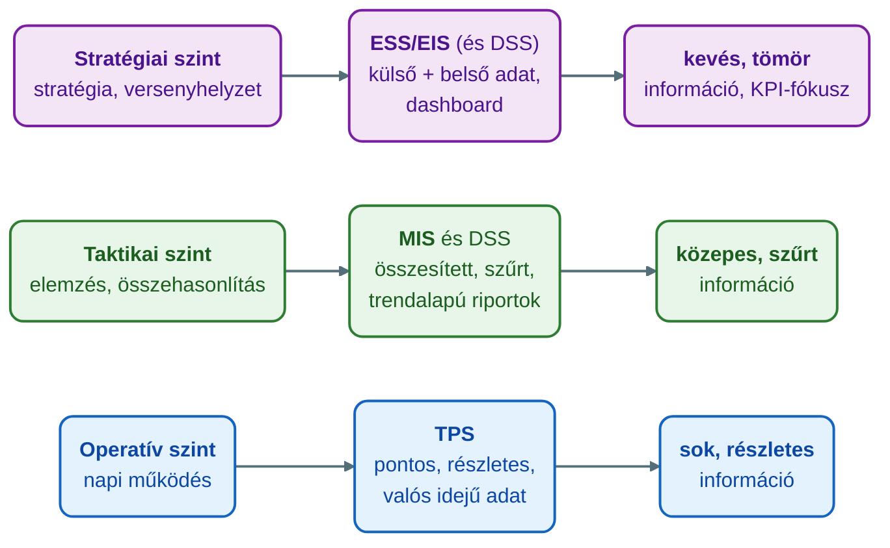
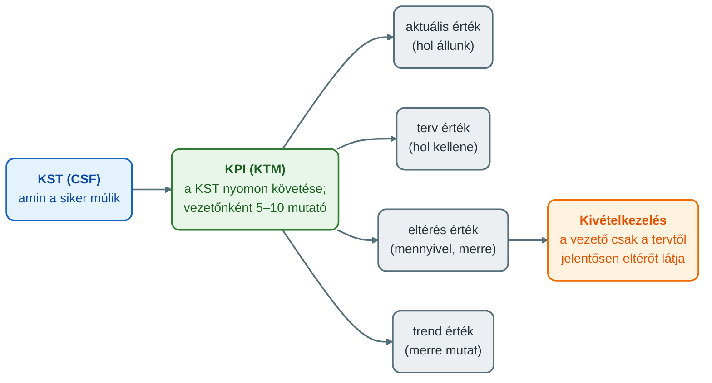

## V6 – VIR fogalma, típusai, pénzügyi mutatók

### Beszerzendő anyagok

| Szerző | Mű | Jelleg | Indoklás / érintett rész |
|---|---|---|---|
| Bángi-Magyar, A. et al. | AVIR kézikönyv (Digitális Tankönyvtár) | ajánlott irodalom | A syllabus ajánlott irodalomként nevezi meg (Óbudai Egyetem, Keleti Károly Gazdasági Kar, 2026); az R6 (EVA, Z-score – a tananyag összetett mutatóra csak az OEE-t és a BSC-t adja) és az R5 (klasszikus pénzügyi mutatószámok, amelyek a tananyagban nincsenek) pótlásához jöhet szóba. Tartalmát nem ellenőriztem. |
| Laudon, K. C., & Laudon, J. P. | *Management information systems: Managing the digital firm* (17th ed., 2022) | kötelező irodalom | A syllabus kötelező irodalma; az R1 (a VIR/MIS fogalma) és az R7b (ismereti mélység a programcsomagoknál) pótlásához jöhet szóba. Tartalma nincs a mappában. |

**Tétel:** Határozza meg a Vezetői Információs Rendszer (VIR) fogalmát, jellemezze az információs rendszerek főbb típusait, és mutassa be a VIR szerepét a vállalati irányítási struktúrában! Ismertesse a VIR legfontosabb funkcióit, soroljon fel pénzügyi mutatószámokat és összetett mutatószámrendszereket (pl. EVA, Z-score), majd fejtse ki, hogy a műszaki menedzser milyen céllal és milyen mélységű ismerettel kell hogy rendelkezzen a VIR programcsomagok tekintetében!

---

### 6.1. A VIR fogalma és a terminológia

Az információs rendszer (IS) több, mint számítógép: a hatékony használathoz a szervezeti, a menedzsment és a technológiai dimenzió együttes megértése szükséges (Laudon et al., 2025, idézi: Óbudai Egyetem, Keleti Károly Gazdasági Kar, Üzleti Tudományok és Digitális Ismeretek Intézet [ÓE KGK ÜTDI], 2026b, 2. szakasz). A technológia csak a „jéghegy csúcsa”: a projektkudarcok többsége a szervezeti kultúrában, a menedzsment döntéseiben és a folyamatokban rejlik (ÓE KGK ÜTDI, 2026b, 2. szakasz).

**Terminológia.** A tananyag a „MIR/VIR” megfogalmazást használja (ÓE KGK ÜTDI, 2026b, 4. szakasz). A rendszertípusok táblázata viszont két címkével dolgozik: a MIS „menedzsment IS” a taktikai, az ESS/EIS „vezetői IS” a stratégiai szinten (ÓE KGK ÜTDI, 2026b, 3. szakasz). A piramis-ábra (ÓE KGK ÜTDI, 2026b, 3. szakasz) és a MIR-fejlődés ábrája (ÓE KGK ÜTDI, 2026a, 2. szakasz) „vezetői információs rendszer (MIS)” feliratot használ, az 5. előadás nyitó esete pedig egy Power BI-alapú rendszert nevez vezetői információs rendszernek (ÓE KGK ÜTDI, 2026e, 1. szakasz). A „vezetői IS” címke tehát hol a stratégiai szint rendszertípusát (ESS/EIS), hol a vezetői szinteket együtt kiszolgáló MIR/VIR egészét jelöli; a viszonyt a tananyag nem mondja ki, önálló VIR-definíciót nem ad.

**Munkadefiníció** *(a tananyag állításaiból összeállított összefoglalás, nem szó szerinti definíció).* A VIR olyan, a vezetői munka hatékonyságát növelő rendszer (ez a MIR 1970-es évekbeli „vezetői információk korszakának” célja: Turban et al., 2002, idézi: ÓE KGK ÜTDI, 2026a, 2. szakasz), amely mindhárom vezetői szintet – az alsó, a közép- és a felső szintű vezetést – a szintnek megfelelő mennyiségű és aggregáltságú információval látja el: felfelé haladva egyre kevesebb, de tömörebb információt ad (ÓE KGK ÜTDI, 2026b, 4. szakasz). Az információt kritikus sikertényezők (KST) és kulcsfontosságú teljesítménymutatók (KPI) köré szervezi, és támogatja a kivételek kezelését (ÓE KGK ÜTDI, 2026b, 4. szakasz). A piramis-ábra szerint jelentéseket, kimutatásokat, teljesítménymutatókat és kivételfigyelést nyújt (ÓE KGK ÜTDI, 2026b, 3. szakasz). Szintenként más-más rendszertípus szolgálja ki: a taktikai szintet a MIS, a stratégiait az ESS/EIS (ÓE KGK ÜTDI, 2026b, 3. szakasz; lásd 6.2).

Mögötte konkrét szakmai szerepek állnak (rendszerfejlesztő, rendszergazda, kontrollingos, vezetői informatikai tanácsadó, IT-auditor, projekt-minőségbiztosító, folyamat-újraszervező szakember) (ÓE KGK ÜTDI, 2026b, 4. szakasz).

---

### 6.2. Az információs rendszerek főbb típusai

A tananyag az IS-típusokat a döntési szintekhez rendeli (ÓE KGK ÜTDI, 2026b, 3. szakasz):

| Szint | Döntés jellege | Rendszer | Mit kap a döntéshozó? |
|---|---|---|---|
| Operatív | strukturált, ismétlődő, szabályozható | TPS (tranzakció-feldolgozó) | pontos, részletes, valós idejű tranzakciós adat |
| Taktikai | félig strukturált, rendszeres riportok | MIS (menedzsment IS) | összesített, szűrt, trendalapú riportok |
| Taktikai / stratégiai | félig strukturált, elemzésvezérelt | DSS (döntéstámogató) | modellek, szcenárió-elemzések, what-if szimulációk |
| Stratégiai | strukturálatlan, bizonytalanság alatt | ESS/EIS (vezetői IS) | külső és belső adatok aggregátuma, dashboard |

*(A piramis-ábra a DSS-t a stratégiai vezetés mellett, ESS nélkül jelöli; eltérés esetén a szöveg és a táblázat a mérvadó.)*

Döntéstípus szerint: a strukturált döntést (napi rendelési mennyiség) a MIS rutinjelentései, a félig strukturáltat (what-if árváltozás) a DSS, a strukturálatlant (új piacra lépés) az ESS és a vezetői ítélőképesség szolgálja ki (ÓE KGK ÜTDI, 2026e, 3. szakasz).

**A szintek felcserélésének három tipikus hibája** (ÓE KGK ÜTDI, 2026b, 3. szakasz): (1) túl sok operatív adat felfelé: információs túlterhelés, döntésképtelenség; (2) aggregált adat lefelé: a problémák késve derülnek ki; (3) DSS operatív szinten: a túl bonyolult rendszert senki nem használja.

**Fejlődés.** A MIR négy korszaka: adatfeldolgozás (’60-as évek, működési hatékonyság), vezetői információk (’70-es évek, a vezetői munka hatékonysága), stratégiai információs rendszerek (’80–’90-es évek, üzleti előny) és intelligens on-line megoldások (2000-es évektől, tudásalapú társadalom). Az alrendszerek az ábra szerint: ’60-as évek TPS, ’70-es évek MIS (összesített jelentések), ’80-as évek EIS és DSS, ’90-es évek adattárház és BI, 2000-es évek dashboardok, scorecardok és teljesítményirányítás (Turban et al., 2002, idézi: ÓE KGK ÜTDI, 2026a, 2. szakasz).

---

### 6.3. A VIR szerepe a vállalati irányítási struktúrában

A menedzsment négy alapfunkciója – tervezés, szervezés, irányítás, ellenőrzés – mindhárom vezetői szinten jelen van, de nem ugyanazt az információt igényli. Az információ eredete szerint lehet belső vagy külső, jellege szerint előrejelző, speciális, eseti vagy időszaki (ÓE KGK ÜTDI, 2026b, 4. szakasz).

*(Az ábra a ÓE KGK ÜTDI, 2026b, 3–4. szakasz táblázatai alapján készült.)*

Felfelé haladva csökken a vezetőre jutó információ mennyisége, miközben nő a mélységi hozzáférés igénye és a lényegszerűség (KPI-fókusz). A rendszer feladata mindhárom szinten ugyanaz: nyomon követés, irányítás, kommunikáció, valamint a versenyhelyzet és a vevői igények figyelése. A szintek ábrája a belső információk felfelé növekvő aggregáltságát mutatja, a külső információkat (piaci kereslet és kínálat, tőzsde, törvényi és kamatváltozás) pedig a napi, rövid és hosszú távú döntési szintekhez kapcsolja (ÓE KGK ÜTDI, 2026b, 4. szakasz).

A piramis-ábra a vezetési szinteket a funkcionális rendszerekkel (értékesítés-marketing, gyártás, pénzügy-számvitel, HR), a vállalati rendszerekkel (ERP, integrált IS) és a külső kapcsolatokkal (beszállítók, vevők, ellátási lánc) együtt ábrázolja (ÓE KGK ÜTDI, 2026b, 3. szakasz). Az ERP-ről lásd V12. A szerepkör szerinti igényt kutatás is igazolja: a gyártási dashboardok KPI-kiválasztását a felhasználói szerepkörhöz (műszakvezető, üzemvezető, felső vezetés) kell igazítani (Tokola et al., 2016, idézi: ÓE KGK ÜTDI, 2026d, 2. szakasz). A BI-felhasználók megoszlása ugyanezt mutatja: 80%-nál több az alkalmi felhasználó (kész jelentések), a felső vezetők dashboardot használnak, a középvezetők és elemzők „power userként” maguk kérdeznek le és szeletelnek (ÓE KGK ÜTDI, 2026e, 4. szakasz).

**A VIR sikere három elem egyensúlyán áll:** a felhasználó vezetőén, aki ténylegesen dönt a rendszer alapján, az információén és a technológiáén. A bukás okai: a rendszer lemarad a szervezeti változások mögött, rossz projektvezetés, gyenge kommunikáció, irreális elvárások, bizalmatlanság az információval szemben; segít a befolyásos vezetők nyílt támogatása, az üzletmenet ismerete, a fokozatos bővítés („big bang” helyett) és a tudatos csoportmunka (ÓE KGK ÜTDI, 2026b, 5. szakasz).

---

### 6.4. A VIR legfontosabb funkciói

**Alkalmazási célok.** A VIR a pénzügy, a stratégia, a marketing és értékesítés, a HR, a piaci verseny és a gyártási adatok területén használható, és támogatja az új termék- vagy szolgáltatásfejlesztést és az innovációt (eljárás-, termék- és piaci innováció) (ÓE KGK ÜTDI, 2026b, 4. szakasz).

**Információszervezés: KST és KPI.** A kritikus sikertényező (KST, CSF) az a néhány terület, amelynek jól kell mennie a siker érdekében. A kulcsfontosságú teljesítménymutató (KTM, KPI) az a mérőszám, amellyel a KST-t nyomon követjük. Egy jó KPI-nak négy jellemzője van: az aktuális érték, a terv érték, az eltérés érték és a trend érték. A kihívás a vezetőnként 5–10 releváns KPI kiválasztása. A VIR a kivételek kezelését is támogatja: nem minden adatot kell a vezetőnek látnia, csak a tervtől jelentősen eltérőket (ÓE KGK ÜTDI, 2026b, 4. szakasz).

**Gazdasági hatások.** A tananyag tíz területet nevez meg: jobb menedzseri jelentések, több időszerű adat, jobb stratégiai tervezés, megbízható adatbázis, jobb pénzügyi irányítás, a szervezet jobb megértése, jobb gazdasági és piaci adatok, jobb termék- és szolgáltatásminőség, jobb versenyanalízis, jobb kommunikáció a vezetői teamek között. Egyik sem közvetlenül pénzügyi mutató, mégis mindegyik végső soron pénzügyi hatással jár, ezért a VIR megtérülését nem elég egyetlen mutatóval mérni (ÓE KGK ÜTDI, 2026b, 7. szakasz).

**A mutatók korlátja.** Egy 22 KPI-t mutató dashboard elemzési bénultságot okoz, mert nem különbözteti meg a fontosat a kevésbé fontostól (ÓE KGK ÜTDI, 2026c, 2. és 8. szakasz); Goodhart törvénye szerint a célponttá vált mutató megszűnik jó mutatónak lenni (Goodhart, 1975, idézi: ÓE KGK ÜTDI, 2026c, 3. szakasz), ezért a mutató eszköz marad, nem döntéshozó (ÓE KGK ÜTDI, 2026c, 8. szakasz).

---

### 6.5. Pénzügyi mutatószámok

A tananyag a VIR-beruházás pénzügyi értékelésére az alábbi mutatókat (módszereket) tárgyalja (ÓE KGK ÜTDI, 2026b, 7. szakasz):

| Mutató | Mit mér |
|---|---|
| PV – jelenérték | a jövőbeli pénzáramlások mai értéke |
| NPV – nettó jelenérték | a beruházás jelenértéke mínusz a beruházás költsége; pozitív NPV esetén éri meg a beruházás |
| IRR – belső megtérülési ráta | az a kamatláb, amely mellett a beruházás NPV-je pontosan nulla |
| ROI – megtérülési mutató | a beruházásból származó nyereség aránya a beruházás költségéhez képest |
| TCO – teljes tulajdonlási költség | a hardver- és szoftverbeszerzés a teljes költségnek kb. 20%-a, a fennmaradó 80% rejtett tétel |

A TCO rejtett elemei: telepítés, képzés, támogatás, karbantartás, infrastruktúra, üzemkiesés, hely és energia; együtt a vételár háromszorosára is emelhetik egy számítógép TCO-ját (Laudon & Laudon, 2018, idézi: ÓE KGK ÜTDI, 2026b, 7. szakasz). A beruházás mérete is kockázat: a túlköltekezés kihasználatlan erőforrást, a túl kevés költés versenyhátrányt hoz (ÓE KGK ÜTDI, 2026b, 7. szakasz). A megtérülést a komplementer szervezeti és menedzsment-befektetések döntik el: magas IT-befektetés komplementer befektetés nélkül semmilyen vagy negatív megtérülést hozhat (ÓE KGK ÜTDI, 2026b, 6. szakasz).

### ⚠️ Tartalmi hiány — pénzügyi mutatószámok (R5)

A tételsor „pénzügyi mutatószámokat” kér. A megengedett forrás a fenti mutatókat beruházás-gazdaságossági módszerként tárgyalja; a klasszikus pénzügyi mutatószám-családok (pl. ROE, ROA, likviditási mutatók) nem szerepelnek benne. Keresett kifejezések (a 12 előadás kötelező részében, ékezetes és ékezet nélküli alakban): mutatószám, ROE, ROA, likviditás, DuPont, WACC, EBITDA: 0 találat; a „pénzügyi mutató” kifejezés a kötelező részben egyetlen, tagadó értelmű mondatban fordul elő (ÓE KGK ÜTDI, 2026b, 7. szakasz). Pótlás: lásd a Beszerzendő anyagokat; az újrafuttatáskor a szakasz bővül.

---

### 6.6. Összetett mutatók a tananyagban: OEE és BSC (R6)

A tételsor példái (EVA, Z-score) a tananyagban nem szerepelnek (lásd a következő hiány-szakaszt). Összetett mutatóra és mutatórendszerre viszont a tananyag két példát ad.

**OEE (Overall Equipment Effectiveness, teljes eszközhatékonyság)** – a gyáripar egyik legelterjedtebb összetett mutatója, három komponens szorzata: OEE = Rendelkezésre állás (tényleges / tervezett üzemidő) × Teljesítmény (ciklusidő × darabszám / tényleges üzemidő) × Minőség (jó darab / összes darab); például 0,90 × 0,85 × 0,98 = 0,75, azaz 75%. Kritikája az „OEE gaming”: szorzatként az egyik komponens a másik rovására javítható (alacsonyabb ideális ciklusidő, a hibák műszak végi rögzítése), a helyi optimalizálás pedig rendszerszintű kárt okozhat, ha a szűk keresztmetszet nem gyorsul (ÓE KGK ÜTDI, 2026c, 4. szakasz).

**Balanced Scorecard (BSC)** – nem egyszerű mutatólista, hanem négy perspektíva (pénzügyi, vevői, belső folyamat, tanulás-fejlődés) oksági lánca: a tanulás-fejlődési beruházások javítják a belső folyamatokat, azok a vevői elégedettséget, ami pénzügyi eredményben csapódik le. A gyakorlatban gyakran utólag illesztett mutatólistává, négy silóvá és bürokratikus rituálévá silányul (Kaplan & Norton, 1996, idézi: ÓE KGK ÜTDI, 2026c, 5. szakasz). Részletesen lásd V7.

### ⚠️ Tartalmi hiány — EVA, Z-score (R6)

A tételsor példaként az EVA-t és a Z-score-t kéri. A megengedett forrásokban ezek nem szerepelnek. Keresett kifejezések (a 12 előadás kötelező részében, ékezetes és ékezet nélküli alakban): EVA, Economic Value Added, gazdasági hozzáadott érték, Z-score, Altman, csőd (csak esetleírásokban), mutatószám, mutatószámrendszer, DuPont: 0 releváns találat. Forráson kívüli tartalmat nem írok be. Pótlás: lásd a Beszerzendő anyagokat; az újrafuttatáskor a szakasz bővül.

---

### 6.7. A műszaki menedzser célja és ismereti mélysége a VIR programcsomagoknál

**Cél (R7a)** *(tananyag-alapú szintézis; a tananyag a tételsor megfogalmazásában nem tárgyalja).*

- A műszaki menedzser feladata nem az ideális, teljesen digitális állapot azonnali elérése, hanem a folyamatos, tudatos közelítés: az egyes bevezetési döntések stratégiai kontextusba helyezése (ÓE KGK ÜTDI, 2026b, 8. szakasz).
- A rendszer az ítélőképességet támogassa, ne helyettesítse: a fő kockázat ma a túl sok, „objektívnek tűnő” adat, amely miatt a menedzser lemond a saját ítélőképességéről (ÓE KGK ÜTDI, 2026d, 8. szakasz); aki minden döntést a dashboardra hivatkozva hoz, mikromenedzsmentet végez (ÓE KGK ÜTDI, 2026c, 8. szakasz).
- Előbb azt kell tisztázni, melyik vezetői szerepet támogassa a rendszer: az erőforrás-elosztó szerepet a BI/DSS jól szolgálja, a vállalkozó és a tárgyaló szerepet semmilyen rendszer. A műszaki menedzsernél gyakori a zavarelhárító és az erőforrás-elosztó szerep; a projekt indoklásánál kérdés, hogy a döntést vagy csak az információgyűjtést gyorsítja-e (Mintzberg, 1971, idézi: ÓE KGK ÜTDI, 2026e, 6. szakasz).
- A tananyag eszközöket ad a beruházás értékeléséhez (NPV, IRR, ROI, TCO; lásd 6.5) és a komplementer befektetések felméréséhez (ÓE KGK ÜTDI, 2026b, 6–7. szakasz), valamint a szervezeti ellenállás kezeléséhez: a megoldás nem a jobb dokumentáció, hanem a változásmenedzsment (ÓE KGK ÜTDI, 2026b, 5. szakasz).

**Mélység (R7b).** A tananyag programcsomag-specifikus ismereti mélységet nem fogalmaz meg; a támpontot a syllabus adja. Eszerint a hallgató egyfajta MIS-szoftvert használ, és gyakorlatot szerez üzleti jelentések, KPI-k és dashboardok készítésében; a kurzus végén képes meghatározni, mi a VIR, jellemezni az információs rendszereket, elmagyarázni a VIR szerepét, funkcióit és felépítését, és döntéshozatali eszközöket kiépíteni a középvezetés számára irányítópultok és üzleti intelligencia alkalmazásával (Óbudai Egyetem, Keleti Károly Gazdasági Kar, 2026). A gyakorlati program ugyanezt a szintet jelöli ki: Excel-dashboard; Power BI adatbetöltés, adatmodellezés, DAX-alapok, vizualizáció; Power BI Service (publikálás, megosztás, biztonság); kitekintés a Looker Studio, Tableau és Fabric eszközökre (Óbudai Egyetem, Keleti Károly Gazdasági Kar, 2026). A tétel szintézise: a műszaki menedzsertől nem fejlesztői, hanem építő-felhasználói mélység várható – ismeri a rendszertípusokat, és maga is készít KPI-alapú jelentést és dashboardot. A tananyag közvetett támpontja, hogy az automatikus kiemelő funkciók (a Power BI Key Influencers és Anomaly Detection) megkönnyítik a mintázatfelismerést, de nem mentesítenek a Goodhart- és OEE-gaming kritikák alól, és „objektívnek” tűnő kimenetük nehezebben megkérdőjelezhető (ÓE KGK ÜTDI, 2026c, 7. szakasz).

### ⚠️ Tartalmi hiány — a VIR programcsomagok áttekintése (R7b)

A tételsor a VIR programcsomagok tekintetében kér ismereti mélységet. A mélység szintjét a syllabus kijelöli (fent), magukat a programcsomagokat azonban a tananyag nem tekinti át: a „programcsomag” és a „szoftvercsomag” kifejezés a 12 előadás kötelező részében nem szerepel (0 találat), a Power BI eszközként és példaként jelenik meg (5–7. előadás), más VIR/BI-termék csak a syllabus gyakorlati programjában van megnevezve. Pótlás: lásd a Beszerzendő anyagokat.

---

### 6.8. Összegzés és tárgyon belüli kapcsolódások

A VIR a MIR fejlődésének és a vezetői szintek információigényének metszéspontja: a TPS-től az ESS-ig terjedő rendszertípusok a döntés jellegéhez igazodnak, a KST/KPI-szervezés és a kivételkezelés a vezetői figyelmet tereli. A megtérülés csak komplementer szervezeti és menedzsment-befektetésekkel együtt értelmezhető, a mutatók értéke pedig a kritikus használattól függ – ezt a tananyag két összetett mutatója, az OEE és a BSC is példázza.

Kapcsolódások: a BSC mint oksági stratégiai eszköz (és kritikája) a V7-hez (ÓE KGK ÜTDI, 2026c, 5. szakasz), a BI-érettség és a BICC a V8-hoz (ÓE KGK ÜTDI, 2026e, 2. szakasz), a KPI-tervezés és a dashboard a V9-hez (ÓE KGK ÜTDI, 2026c, 2–6. szakasz), az OLAP és az adatbányászat a V10-hez (ÓE KGK ÜTDI, 2026d, 3–4. szakasz) tartozik.

---

### Várható vizsgáztatói kérdések

1. **Mi történik, ha a rendszertípusokat felcserélik a szintek között?** — Három tipikus hiba van: a vezérigazgatóhoz változtatás nélkül érkező operatív adat információs túlterhelést okoz, a gyártósor-vezető számára adott havi összesítő késői beavatkozáshoz vezet, a raktáros számára adott DSS pedig használhatatlan (ÓE KGK ÜTDI, 2026b, 3. szakasz).
2. **Miért bukik el a gyakorlatban egy VIR-bevezetés?** — Okok: a rendszer lemarad a szervezeti változások mögött, rossz a projektvezetés, gyenge a kommunikáció, irreális elvárások és bizalmatlanság az információval szemben. Három tipikus ellenállási minta: a párhuzamos futtatás, az adatminőség-szabotázs és a bypass kultúra (ÓE KGK ÜTDI, 2026b, 5. szakasz).
3. **Hogyan mutatható ki egy VIR-beruházás megtérülése?** — Klasszikus módszerekkel (PV, NPV, IRR, ROI), de a TCO szerint a vételár csak kb. 20%-a a költségnek. A tíz gazdasági hatás egyike sem közvetlenül pénzügyi mutató, ezért egy mutató nem elég (ÓE KGK ÜTDI, 2026b, 7. szakasz).
4. **Mikor romlik el egy KPI?** — Ha célponttá válik (Goodhart-törvény), ha túl sok van belőlük egy képernyőn (22 KPI), vagy ha az OEE komponenseit egymás rovására „játsszák meg” (ÓE KGK ÜTDI, 2026c, 2–4. szakasz).
5. **Mit támogat és mit nem egy rendszer a vezetői szerepek közül?** — Az erőforrás-elosztó szerepet a BI/DSS jól szolgálja, a vállalkozó és tárgyaló szerephez semmilyen rendszer nem ad támogatást (Mintzberg, 1971, idézi: ÓE KGK ÜTDI, 2026e, 6. szakasz).
6. **Mi a különbség a MIS, az ESS/EIS és a VIR között a tananyag szóhasználatában?** — A rendszertípusok táblázata a MIS-t „menedzsment IS”-ként a taktikai szinthez (összesített, szűrt riportok), az ESS/EIS-t „vezetői IS”-ként a stratégiai szinthez (külső és belső adatok aggregátuma, dashboard) rendeli (ÓE KGK ÜTDI, 2026b, 3. szakasz). A „MIR/VIR” ettől eltérően a vezetői szinteket együtt kiszolgáló rendszert jelöli, amely KST/KPI köré szervezi az információt, és felfelé egyre tömörebb információt ad (ÓE KGK ÜTDI, 2026b, 4. szakasz). A tananyag a két szóhasználat viszonyát nem oldja fel, ezért a tétel nem tesz közéjük egyenlőségjelet.

---

## Irodalom

* Óbudai Egyetem, Keleti Károly Gazdasági Kar. (2026). *Menedzsment információs rendszerek (GMXIR1MBLF) — Tantárgynyilvántartó adatlap* [Syllabus].
* Óbudai Egyetem, Keleti Károly Gazdasági Kar, Üzleti Tudományok és Digitális Ismeretek Intézet. (2026a). *Az integrált vállalat: ERP, CRM, SCM* [Kötelező tananyag, 3. ea.].
* Óbudai Egyetem, Keleti Károly Gazdasági Kar, Üzleti Tudományok és Digitális Ismeretek Intézet. (2026b). *AZ MIS valódi szerepe* [Kötelező tananyag, 1. ea.].
* Óbudai Egyetem, Keleti Károly Gazdasági Kar, Üzleti Tudományok és Digitális Ismeretek Intézet. (2026c). *BI a gyakorlatban I.* [Kötelező tananyag, 6. ea.].
* Óbudai Egyetem, Keleti Károly Gazdasági Kar, Üzleti Tudományok és Digitális Ismeretek Intézet. (2026d). *BI a gyakorlatban II.* [Kötelező tananyag, 7. ea.].
* Óbudai Egyetem, Keleti Károly Gazdasági Kar, Üzleti Tudományok és Digitális Ismeretek Intézet. (2026e). *Üzleti intelligencia: kultúra, nem eszköz* [Kötelező tananyag, 5. ea.].
