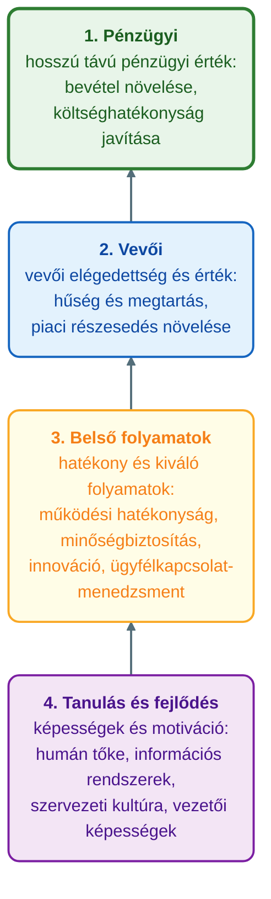

## V7 – Balanced Scorecard és VIR/BI programcsomagok

### Beszerzendő anyagok

| Szerző | Mű | Jelleg | Indoklás / érintett rész |
|---|---|---|---|
| Bángi-Magyar, A. et al. | AVIR kézikönyv (Digitális Tankönyvtár) | ajánlott irodalom | A syllabus ajánlott irodalomként nevezi meg; az R1–R3 (a BSC részletei) elmélyítésére jöhet szóba. Tartalmát nem ellenőriztem, az R4–R6 pótlására való alkalmasságáról nincs információm. |
| — | Hazai VIR/BI programcsomagokat összevető anyag (forrás nyitott) | jegyzet | Az R4–R6 (hazai programcsomagok áttekintése, sorbaállítás elterjedtség, ár, komplexitás és BSC-támogatás szerint, beépített BSC) pótlásához. A syllabus egyik műve sem rendelhető ehhez egyértelműen. |

**Tétel:** Ismertesse a Balanced Scorecard (BSC) filozófiáját, mutassa be annak négy nézőpontját és a stratégiai térkép logikáját! Tekintse át a hazánkban elterjedt VIR és BI programcsomagokat és állítsa sorba azokat elterjedtség, ár, komplexitás és BSC-támogatás szempontjából! Térjen ki arra, hogy mely rendszerek alkalmazzák beépítetten a Balanced Scorecard mutatószámrendszert, és indokolja, miért meghatározó szempont ez egy vállalati rendszerválasztás során!

---

### 7.1. A BSC filozófiája

A Balanced Scorecard (BSC) négy perspektívája – pénzügyi, vevői, belső folyamat, tanulás-fejlődés – alapfogalom. Kaplan és Norton eredeti szándéka szerint a BSC nem egyszerű mutatólista, hanem **oksági lánc**: a tanulás-fejlődési beruházások javítják a belső folyamatokat, azok javítják a vevői elégedettséget, ami végül pénzügyi eredményben csapódik le (Kaplan & Norton, 1996, idézi: Óbudai Egyetem, Keleti Károly Gazdasági Kar, Üzleti Tudományok és Digitális Ismeretek Intézet [ÓE KGK ÜTDI], 2026c, 5. szakasz).

A BSC tehát stratégiai gondolkodási eszköz, nem pusztán jelentés. Ha a mutatók kitöltése önmagáért való céllá válik, a BSC elveszti stratégiai funkcióját (ÓE KGK ÜTDI, 2026c, 5. szakasz). Ez a jelenség rokon a Goodhart-csapdával: amikor egy mutató célponttá válik, megszűnik jó mutatónak lenni (Goodhart, 1975, idézi: ÓE KGK ÜTDI, 2026c, 3. szakasz). A tananyag példája: egy call centerben az átlagos hívásidő lett az egyetlen mutató; a hívások gyorsabban zárultak, de az ismételt hívások aránya drasztikusan nőtt, vagyis a mutató javult, a valódi cél romlott (ÓE KGK ÜTDI, 2026c, 3. szakasz). A tananyag szintézise szerint a BSC csak akkor marad stratégiai eszköz, ha nem engedik bürokratikus rituálévá silányulni (ÓE KGK ÜTDI, 2026c, 8. szakasz).

*(A tananyag a BSC-nek önálló definíciót és kialakulástörténetet nem ad; a „filozófia” itt az oksági stratégiai eszköz gondolata és annak kritikája.)*

---

### 7.2. A négy nézőpont

A tananyag a négy nézőpontot a stratégiai térkép ábráján célkitűzésekkel tölti meg (ÓE KGK ÜTDI, 2026c, 5. szakasz, ábra):

| Nézőpont | Mit jelent | Célkitűzések az ábra szerint |
|---|---|---|
| 1. Pénzügyi | a stratégia végső céljait tükröző pénzügyi eredmények | hosszú távú pénzügyi érték; a bevétel növelése; a költséghatékonyság javítása |
| 2. Vevői | a vevői érték létrehozása, amely a pénzügyi célok eléréséhez vezet | vevői elégedettség és érték; vevői elégedettség; vevői hűség és megtartás; a piaci részesedés növelése |
| 3. Belső folyamatok | a kulcsfolyamatok kiválósága, amelyek értéket teremtenek a vevők számára | hatékony és kiváló belső folyamatok; működési hatékonyság; minőségbiztosítás; innovációs folyamatok; ügyfélkapcsolat-menedzsment |
| 4. Tanulás és fejlődés | az emberek, rendszerek és kultúra fejlesztése, amely megalapozza a stratégia végrehajtását | képességek és motiváció a fejlődéshez; humán tőke fejlesztése; információs rendszerek; szervezeti kultúra és elkötelezettség; vezetői képességek |

Az ábra szerint az **információs rendszerek a tanulás és fejlődés nézőpontban** szerepelnek: a BSC logikájában az IS az oksági lánc alapja, nem a vége. Konkrét mutatókat (KPI-kat) nézőpontonként a tananyag nem nevez meg.

---

### 7.3. A stratégiai térkép logikája

A stratégiai térkép (strategy map) a négy nézőpontot oksági láncként kapcsolja össze. Alulról felfelé olvasandó: a beruházások és képességek (tanulás és fejlődés) javítják a belső folyamatokat, azok növelik a vevői értéket, ez vezet végül jobb pénzügyi eredményhez (ÓE KGK ÜTDI, 2026c, 5. szakasz, ábra).

*(Az ábra a ÓE KGK ÜTDI, 2026c, 5. szakasz stratégiaitérkép-ábrája alapján készült.)*

A pénzügyi nézőpont az eredmény, a másik három az eredményt előidéző ok. A négy nézőpont ezért egymásra épülő lánc, nem négy külön siló. A kritikai szakirodalom szerint a gyakorlatban a szervezetek gyakran (ÓE KGK ÜTDI, 2026c, 5. szakasz):

- utólag illesztik a mutatókat a már meglévő jelentési struktúrához, ahelyett hogy valódi oksági stratégiai térképet építenének;
- a négy perspektívát négy külön silóként kezelik;
- a rendszer idővel bürokratikus rituálévá válik: negyedévente kitöltött táblázat, amelyet senki nem használ tényleges döntéshozatalra.

A stratégiai térkép tehát az, ami a BSC-t megkülönbözteti egy mutatólistától: a mutató értelmét a láncban elfoglalt helye adja.

---

### ⚠️ Tartalmi hiány — a hazai VIR- és BI-programcsomagok és sorbaállításuk (R4, R5)

A tételsor a hazánkban elterjedt VIR- és BI-programcsomagok áttekintését, és sorbaállításukat kéri elterjedtség, ár, komplexitás és BSC-támogatás szerint. A megengedett forrásokban ilyen áttekintés vagy sorbaállítás nem szerepel. Keresett kifejezések (mind a 25 HTML-ben, ékezetes és ékezet nélküli alak): programcsomag, szoftvercsomag, Qlik, Tableau, Cognos, Hyperion, BusinessObjects, MicroStrategy, SAP BW, SAP Analytics, Oracle BI, Looker, Fabric, Dynamics 365, Navision, Infor, Jedox, Pentaho, Targit, Anaplan, piaci részesedés, market share: mind 0 találat. Forráson kívüli tartalmat nem írok be. Az R4 és az R5 kitöltetlen; pótlás: lásd a Beszerzendő anyagokat.

**Név szerint szereplő rendszerek (nem rangsor, nem hazai elterjedtség).** Az alábbi lista csak azt rögzíti, mi fordul elő a tananyagban; a tételsor kérdésére nem válasz.

| Rendszer | Hol és milyen minőségben szerepel |
|---|---|
| Power BI | BI-eszközként: egy Power BI-alapú vezetői információs rendszer bevezetése a nyitó dilemmában (ÓE KGK ÜTDI, 2026e, 1. szakasz); a Key Influencers és az Anomaly Detection funkció (ÓE KGK ÜTDI, 2026c, 7. szakasz) |
| SAP (S/4HANA) | vállalatirányítási rendszerként: a MOL brownfield átállása (ÓE KGK ÜTDI, 2026a, 9. szakasz) |
| Oracle NetSuite | cloud ERP-ként, a tananyag szerint a KKV-szegmens piacvezetője (ÓE KGK ÜTDI, 2026a, 9. szakasz) |
| Salesforce | cloud CRM-ként (ÓE KGK ÜTDI, 2026a, 9. szakasz) |

A Power BI kivételével ezek ERP- vagy CRM-rendszerek, nem VIR/BI-csomagok, és egyikhez sem tartozik ár-, komplexitás- vagy BSC-támogatási adat.

---

### ⚠️ Tartalmi hiány — a beépített BSC-támogatás (R6)

A tételsor azt kéri, hogy mely rendszerek alkalmazzák beépítetten a BSC mutatószámrendszert. A megengedett forrásokban egyetlen rendszer sem szerepel beépített BSC-támogatással. A „scorecard” kifejezés csak a MIR alrendszereinek idővonalán fordul elő: a 2000-es évek jellemzője a „dashboards and scorecards, performance management” (ÓE KGK ÜTDI, 2026a, 2. szakasz). A BSC-re vonatkozó kifejezések (BSC, Balanced Scorecard, scorecard, stratégiai térkép) a módszertan kritikai tárgyalásában fordulnak elő (ÓE KGK ÜTDI, 2026c, 5. szakasz), szoftverhez kötve egyikben sem. Keresett kifejezések (mind a 25 HTML-ben, ékezetes és ékezet nélküli alak): BSC, Balanced Scorecard, scorecard, stratégiai térkép, pontozókártya, mutatórendszer; a fenti és a R4–R5 szakaszban keresett szoftvernevek BSC-vel együtt említve: 0 találat. Az R6 kitöltetlen; pótlás: lásd a Beszerzendő anyagokat.

---

### 7.4. Miért szempont a rendszerválasztásnál? (R7)

*(Tananyag-alapú szintézis. A megengedett források nem mondják ki, hogy a BSC-támogatás meghatározó szempont a rendszerválasztásnál; az alábbiak azt gyűjtik össze, mi támasztható alá a rendszerválasztás és a BSC kapcsán.)*

- **Stratégiai illeszkedés.** A tananyag szerint a kérdés nem az, hogy „milyen rendszert vegyünk”, hanem az, hogy „hol fáj a legjobban”; az IT és az üzleti stratégia összehangolása a legjövedelmezőbb vállalatok közös jellemzője (ÓE KGK ÜTDI, 2026d, 8. szakasz). A BSC ugyanezt a logikát a mérés oldalán adja: a mutatók a stratégia oksági láncából következnek (ÓE KGK ÜTDI, 2026c, 5. szakasz).
- **Beszerzési opciók.** A tananyag az ERP/CRM/SCM kapcsán négy opciót tárgyal: saját fejlesztés (build), kész szoftver (buy), felhő (cloud) és a legjobb egyedi megoldások összekötése (best-of-breed). Mindegyiknél megadja, mikor éri meg (ÓE KGK ÜTDI, 2026a, 9. szakasz).
- **Gazdaságosság.** A beruházást NPV, IRR és ROI mutatja; a TCO szerint a hardver- és szoftverbeszerzés a teljes költségnek csak kb. 20%-a, a többi rejtett tétel (Laudon & Laudon, 2018, idézi: ÓE KGK ÜTDI, 2026b, 7. szakasz). A megtérülést a komplementer szervezeti és menedzsment-befektetések határozzák meg (ÓE KGK ÜTDI, 2026b, 6. szakasz).
- **Kritikai szempont.** A BSC-bevezetések tipikus hibája, hogy a mutatókat utólag illesztik a meglévő jelentési struktúrához, és a rendszer rituálévá válik (ÓE KGK ÜTDI, 2026c, 5. szakasz). A BI-nél a tananyag szerint a probléma nem a szoftverrel van, hanem a hiányzó szervezeti híddal (ÓE KGK ÜTDI, 2026e, 2. szakasz). A tananyag a szoftvermodulokról nem mondja ki, de a logika az, hogy a beépített BSC-támogatás önmagában nem garantálja a stratégiai használatot.

⚠️ A tételsor ezzel szemben a BSC-támogatást meghatározó szempontnak tekinti. A megengedett források ezt sem megerősíteni, sem cáfolni nem tudják; az indoklást a Beszerzendő anyagok pótlása után lehet kiegészíteni.

---

### 7.5. Összegzés és tárgyon belüli kapcsolódások

A BSC a stratégiát négy nézőpont oksági láncává bontja, és a mutatók értelmét a láncban elfoglalt helyük adja. Ereje a stratégiai térkép, gyengesége a rituálévá válás. A tételsor második fele (programcsomagok, sorbaállítás, beépített BSC) a megengedett forrásokból nem készíthető fel; ezt a ⚠️ szakaszok nyíltan jelzik.

Kapcsolódások:
- **V6:** a KST és a KPI a VIR információszervezésének eszköze (ÓE KGK ÜTDI, 2026b, 4. szakasz). A tananyag a BSC-t és a KST/KPI-t külön tárgyalja, közvetlen kapcsolatot nem mond ki.
- **V8:** a BI-érettség és a BICC mint a szervezeti híd (ÓE KGK ÜTDI, 2026e, 2. szakasz).
- **V9:** a KPI-tervezés, a Goodhart-csapda és a dashboard-tervezés (ÓE KGK ÜTDI, 2026c, 2–6. szakasz).
- A BSC controlling-szemléletű tárgyalását lásd K20, az ERP-rendszerek témáját lásd V12 (csak utalás).

---

### Várható vizsgáztatói kérdések

1. **Miért nem „csak mutatólista” a BSC?** — Kaplan és Norton szándéka szerint oksági lánc: a tanulás-fejlődési beruházások javítják a belső folyamatokat, azok a vevői elégedettséget, ami pénzügyi eredményben csapódik le (Kaplan & Norton, 1996, idézi: ÓE KGK ÜTDI, 2026c, 5. szakasz).
2. **Miben különbözik a BSC egy 22 KPI-t mutató dashboardtól?** — A 22 KPI-s dashboard elemzési bénultsághoz vezet, mert nem tesz különbséget a fontos és a kevésbé fontos mutató között (ÓE KGK ÜTDI, 2026c, 2. és 8. szakasz). A BSC-ben a mutató helyét az oksági lánc adja, de a BSC is elromolhat, ha a mutatókat utólag illesztik a jelentési struktúrához (ÓE KGK ÜTDI, 2026c, 5. szakasz).
3. **Melyek a BSC bevezetésének tipikus hibái?** — Utólag illesztett mutatók valódi stratégiai térkép helyett, a négy nézőpont négy külön silóként kezelése, és a negyedéves kitöltési rituálé (ÓE KGK ÜTDI, 2026c, 5. szakasz).
4. **Mit jelent az, hogy az információs rendszerek a tanulás és fejlődés nézőpontban szerepelnek?** — Az ábra szerint az IS a képességek és a kultúra mellett az oksági lánc alapját képezi, amelyre a belső folyamatok, a vevői érték és a pénzügyi eredmény épül (ÓE KGK ÜTDI, 2026c, 5. szakasz, ábra).
5. **Mit mérlegel a vállalat egy új rendszer beszerzésekor?** — A build, buy, cloud és best-of-breed opciót, a TCO-t (a vételár kb. 20%-a) és a komplementer befektetéseket (ÓE KGK ÜTDI, 2026a, 9. szakasz; Laudon & Laudon, 2018, idézi: ÓE KGK ÜTDI, 2026b, 6–7. szakasz).

---

## Irodalom

* Óbudai Egyetem, Keleti Károly Gazdasági Kar, Üzleti Tudományok és Digitális Ismeretek Intézet. (2026a). *Az integrált vállalat: ERP, CRM, SCM* [Kötelező tananyag, 3. ea.].
* Óbudai Egyetem, Keleti Károly Gazdasági Kar, Üzleti Tudományok és Digitális Ismeretek Intézet. (2026b). *AZ MIS valódi szerepe* [Kötelező tananyag, 1. ea.].
* Óbudai Egyetem, Keleti Károly Gazdasági Kar, Üzleti Tudományok és Digitális Ismeretek Intézet. (2026c). *BI a gyakorlatban I.* [Kötelező tananyag, 6. ea.].
* Óbudai Egyetem, Keleti Károly Gazdasági Kar, Üzleti Tudományok és Digitális Ismeretek Intézet. (2026d). *Hogyan teremt versenyelőnyt az IT* [Kötelező tananyag, 2. ea.].
* Óbudai Egyetem, Keleti Károly Gazdasági Kar, Üzleti Tudományok és Digitális Ismeretek Intézet. (2026e). *Üzleti intelligencia: kultúra, nem eszköz* [Kötelező tananyag, 5. ea.].
