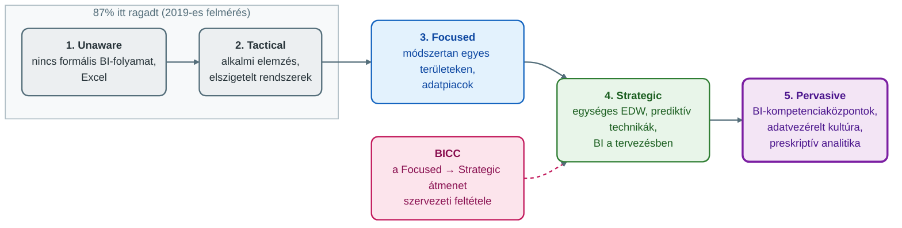
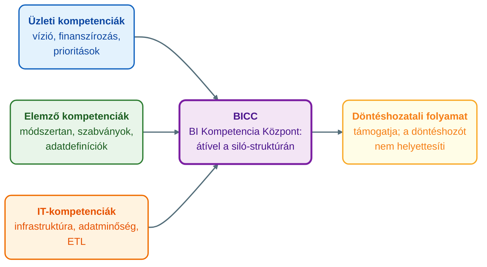
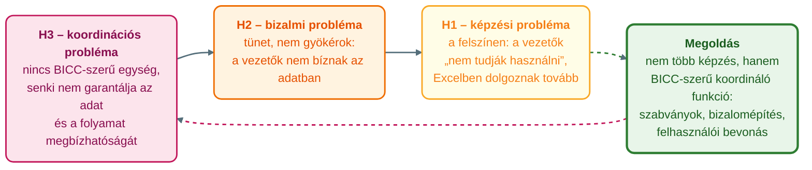

## V8 – Üzleti intelligencia (BI), a VIR–BI kapcsolat és a BICC

### Beszerzendő anyagok

| Szerző | Mű | Jelleg | Indoklás / érintett rész |
|---|---|---|---|
| Laudon, K. C., & Laudon, J. P. | *Management information systems: Managing the digital firm* (17th ed., 2022) | kötelező irodalom | A syllabus kötelező irodalma; az R1 (a BI szó szerinti definíciója, amelyet a kötelező tananyag nem ad) és az R2 (a VIR–BI kapcsolat és különbségek) pótlásához jöhet szóba. Tartalmát nem ellenőriztem. |
| Turban, E., Pollard, C., & Wood, G. | *Information technology for management* (11th ed., 2018) | kötelező irodalom | A syllabus kötelező irodalma; az R1–R2 pótlásához jöhet szóba. Tartalmát nem ellenőriztem. |

**Tétel:** Határozza meg az Üzleti Intelligencia (Business Intelligence – BI) fogalmát és funkcióit, majd mutassa be részletesen a VIR és a BI közötti kapcsolatot és különbségeket! Ismertesse a BICC (Business Intelligence Competency Center) fogalmát, kialakításának szempontjait és szervezeti szerepét, fejtse ki, hogyan támogatja a BICC a vállalati döntéshozatalt és az adatvezérelt kultúra kiépítését! Mutassa be, hogyan illeszkedik a BI a különböző vezetési szintek (operatív, taktikai, stratégiai) információs igényeihez!

---

### 8.1. A BI fogalma a tananyag szerint

A tananyag az üzleti intelligenciát (Business Intelligence, BI) nem egy mondatban definiálja, hanem a címében foglalja össze a lényegét: a BI „kultúra, nem eszköz" (Óbudai Egyetem, Keleti Károly Gazdasági Kar, Üzleti Tudományok és Digitális Ismeretek Intézet [ÓE KGK ÜTDI], 2026g).

**Helye a MIR fejlődésében.** A menedzsment információs rendszer (MIR) alrendszereinek kronológiájában az 1980-as évek az EIS és a DSS, az 1990-es évek az adattárház (Data Warehousing, DW) és a BI, a 2000-es évek pedig a dashboardok, a scorecardok és a teljesítménymenedzsment korszaka (Turban et al., 2002, idézi: ÓE KGK ÜTDI, 2026a, 2. szakasz). Az ERP-ág 2000-es évekbeli sora: belső ERP/SCM + üzleti intelligencia → ERP II (ÓE KGK ÜTDI, 2026a, 3. szakasz). A BI tehát a MIR-nek az adattárházzal együtt megjelenő alrendszere.

**Munkadefiníció** *(a tananyag állításaiból összeállított összefoglalás, nem szó szerinti definíció).* A BI a vállalat adataira épülő elemző és jelentéskészítő képesség, amely:

- adatpiacokra és egységes vállalati adattárházra (EDW) épül (ÓE KGK ÜTDI, 2026g, 2. szakasz);
- az adatokat OLAP-pal és adatbányászattal keresi, feldolgozza, és vizualizációval „tálalja" a döntéshozónak (ÓE KGK ÜTDI, 2026g, 5. szakasz);
- dashboardokban és riportokban jelenik meg (ÓE KGK ÜTDI, 2026g, 1. szakasz);
- a leíró elemzéstől a prediktív, majd a legérettebb szinten a preskriptív analitikáig terjed, amikor a rendszer már konkrét cselekvést vagy döntést javasol (ÓE KGK ÜTDI, 2026g, 2. szakasz);
- sikere nem a szoftveren, hanem a koordináló szervezeti egységen és a bizalmon múlik (ÓE KGK ÜTDI, 2026g, 2. és 8. szakasz).

*(A kötelező tananyag önálló, szó szerinti BI-definíciót nem ad. Pótlás: lásd a Beszerzendő anyagokat.)*

---

### 8.2. A BI funkciói

A tananyag a BI funkcióit nem egy helyen sorolja fel; az alábbi táblázat a kötelező anyag különböző helyein megnevezett funkciókat gyűjti össze.

| Funkció | Mit jelent a tananyag szerint | Forrás |
|---|---|---|
| Jelentéskészítés és dashboard | kész jelentések az alkalmi felhasználóknak (80%+), dashboard a felső vezetőknek, lekérdezés és szeletelés a középvezető–elemző „power usereknek" | ÓE KGK ÜTDI, 2026g, 4. szakasz (ábrafelirat) |
| Kulcsadatok grafikus megjelenítése, figyelmeztetés, egy kattintásos lefúrás | a self-service BI jellemzői | ÓE KGK ÜTDI, 2026g, 4. szakasz |
| Adatintegráció | különböző forrásokból vegyített, aggregált és részletes, historikus és valós idejű adat | ÓE KGK ÜTDI, 2026g, 4. szakasz |
| OLAP-elemzés | slice, dice, drill-down, roll-up: megmondja, hol van a probléma | ÓE KGK ÜTDI, 2026d, 3. szakasz |
| Adatbányászat | társításelemzés, osztályozás, csalásdetektálás, keresletelőrejelzés, ajánlórendszer, hitelbírálat: a kiváltó ok feltárása | ÓE KGK ÜTDI, 2026d, 3–6. szakasz (az OLAP megmondja, hol a probléma; a kiváltó okhoz adatbányászat kell: 3. szakasz; technikák: 4–6. szakasz) |
| Prediktív és preskriptív analitika | előrejelzés, majd konkrét cselekvés- vagy döntésjavaslat (Pervasive szint) | ÓE KGK ÜTDI, 2026g, 2. szakasz |
| Döntéstámogatás döntéstípus szerint | strukturált → MIS, rutinjelentések; félig strukturált → DSS, what-if elemzés; strukturálatlan → ESS, vezetői ítélőképesség | ÓE KGK ÜTDI, 2026g, 3. szakasz |
| Erőforrás-elosztás támogatása | adatalapú allokációs döntések | Mintzberg, 1971, idézi: ÓE KGK ÜTDI, 2026g, 6. szakasz |

**A funkciók korlátja.** A BI nem minden vezetői szerepet támogat: a vállalkozó és a tárgyaló szerephez semmilyen rendszer nem ad támogatást (Mintzberg, 1971, idézi: ÓE KGK ÜTDI, 2026g, 6. szakasz), és egy jó KPI-rendszer a döntéshozó ítélőképességét támogatja, nem helyettesíti (ÓE KGK ÜTDI, 2026c, 8. szakasz).

---

### ⚠️ Tartalmi hiány — a VIR és a BI kapcsolata és különbségei (R2)

A tételsor a vezetői információs rendszer (VIR) és a BI közötti kapcsolat és különbségek részletes bemutatását kéri. A megengedett források a két fogalmat nem tárgyalják együtt, és összehasonlítást nem adnak. Keresett kifejezések mind a 12 előadás kötelező részében (ékezetes és ékezet nélküli alak, szóhatáron): „business intelligence" 5, „üzleti intelligencia" 6, „BI" 64 (ebből 46 az 5. előadásban), „VIR" 11 (mind az 1. előadásban), „vezetői információs rendszer" 5, „MIR" 38, „MIS" 13, „EIS" 2, „ESS" 4 találat; a VIR/MIS/EIS/ESS és a BI egy mondaton belüli együttes előfordulása: 2 sor (lásd az alábbi táblázat első két sorát). Saját összehasonlítást és forráson kívüli tartalmat nem írok be. Az R2 kitöltetlen; pótlás: lásd a Beszerzendő anyagokat.

**Ami a forrásokban mégis kapcsolódik** *(nem válasz a részkérdésre, és nem összehasonlítás; csak azt rögzíti, hol fordul elő a két fogalom egymás közelében):*

| Forráshely | Mit mond | Megjegyzés |
|---|---|---|
| ÓE KGK ÜTDI, 2026g, 1. szakasz | a nyitó dilemma egy „Power BI-alapú vezetői információs rendszer" bevezetéséről szól | a tananyag itt a BI-t egy VIR megvalósítási technológiájaként említi, a viszonyt nem fejti ki |
| Turban et al., 2002, idézi: ÓE KGK ÜTDI, 2026a, 2. szakasz | a MIR alrendszerei: 1980-as évek EIS és DSS; 1990-es évek DW és BI; 2000-es évek dashboardok, scorecardok, teljesítménymenedzsment | a BI a MIR fejlődésének az EIS-nél későbbi alrendszere; az EIS és a BI viszonyát a tananyag nem fejti ki |
| ÓE KGK ÜTDI, 2026b, 3–4. szakasz | a MIS (menedzsment IS) a taktikai szint rendszere, az ESS/EIS (vezetői IS) a stratégiai szinté; a tananyag a „MIR/VIR" megfogalmazást használja | önálló VIR-definíció nincs (lásd V6); a tananyag nem mondja ki, hogy a VIR és a MIS azonos |
| Óbudai Egyetem, Keleti Károly Gazdasági Kar, 2026 | oktatási cél: „meghatározni, mi az a Vezetői Információs Rendszer", és „döntéshozatali eszközök kiépítése a középvezetés számára irányítópultok és üzleti intelligencia alkalmazásával" | a syllabus a VIR-t fogalomként, a BI-t alkalmazott eszközként nevezi meg; viszonyukat nem fejti ki |

---

### 8.3. A BI-érettségi modell: a BICC kontextusa

A tananyag a BICC-et az érettségi modellből vezeti le. Egy széles körben használt öt szintű modell írja le, hol tarthat egy szervezet a BI-ban (Gartner, é. n., idézi: ÓE KGK ÜTDI, 2026g, 2. szakasz):

| Szint | Jellemző |
|---|---|
| 1. Unaware | nincs formális BI-folyamat, mindenki a kéznél lévő eszközzel (Excel) dolgozik |
| 2. Tactical | alkalmi elemzés, elszigetelt rendszerek és adatforrások |
| 3. Focused | kidolgozott elemzési módszertan egyes területeken, adatpiacok jelennek meg |
| 4. Strategic | egységes vállalati adattárház (EDW), prediktív technikák, a BI a tervezést is támogatja |
| 5. Pervasive | BI-kompetenciaközpontok működnek, kollaboratív, adatvezérelt vállalati kultúra |

Egy 2019-es felmérés szerint a szervezetek 87%-a még mindig az alsó két szinten ragadt (Gartner, é. n., idézi: ÓE KGK ÜTDI, 2026g, 2. szakasz). A modell önmagában leíró: megmondja, hol tartunk, de nem magyarázza meg, miért nem lépünk tovább. A válasz a tananyag szerint nem technikai, hanem strukturális: a Focused → Strategic átmenethez olyan szervezeti egység kell, amely átível a hagyományos siló-struktúrán. Ezt az egységet nevezik BI Kompetencia Központnak (BICC, Business Intelligence Competency Center) (ÓE KGK ÜTDI, 2026g, 2. szakasz).

*(Az ábra a Gartner-féle BI-érettségi modell tananyagbeli leírása alapján készült: ÓE KGK ÜTDI, 2026g, 2. szakasz.)*

---

### 8.4. A BICC fogalma, kialakításának szempontjai és szervezeti szerepe

**Fogalom.** A BICC olyan szervezeti egység, amely a legmagasabb (Strategic/Pervasive) BI-érettségi szinten jelenik meg, és három kompetenciaterületet fog össze: az üzleti kompetenciákat (vízió, finanszírozás, prioritások), az elemző kompetenciákat (módszertan, szabványok, adatdefiníciók) és az IT-kompetenciákat (infrastruktúra, adatminőség, ETL). Fontos korlát: a BICC nem helyettesíti a döntéshozót, csak a döntéshozatali folyamatot támogatja (Gartner, é. n., idézi: ÓE KGK ÜTDI, 2026g, 2. szakasz).

*(Forráseltérés: a tananyag szövege három kompetenciaterületet nevez meg; a szakaszhoz tartozó ábra – a tárgy Döntési naplójának K8 pontja szerint – hat területre utal. A szöveg a mérvadó, a feleletben a három terület mondandó.)*

*(Az ábra a BICC három kompetenciaterületét mutatja a tananyag szövege szerint: ÓE KGK ÜTDI, 2026g, 2. szakasz.)*

**Kialakításának szempontjai** *(ami a tananyagból kiolvasható; a tananyag a kialakítást nem lépéssorként tárgyalja).*

| Szempont | Mit mond a tananyag | Forrás |
|---|---|---|
| Mikor van rá szükség? | a Focused → Strategic átmenetnél; ha a vállalat bevezeti a technológiát, de nem hoz létre koordináló egységet, technikailag éretlenebbnek tűnik, mint amilyen valójában | ÓE KGK ÜTDI, 2026g, 2. szakasz |
| Miért felel? | a szabványokért, a bizalomépítésért és a felhasználói bevonásért; az adat és a folyamat megbízhatóságának garantálásáért | ÓE KGK ÜTDI, 2026g, 2. és 8. szakasz |
| Mit fog össze? | mindhárom kompetenciaterületet (üzleti, elemző, IT) együtt, nem csak az IT-t | ÓE KGK ÜTDI, 2026g, 2. szakasz |
| Hol a határ az IT-kontroll és a felhasználói szabadság között? | az IT-centrikus BI megbízható, konzisztens, de lassú és rugalmatlan; a self-service BI gyors, rugalmas, de a konzisztencia és a „ki mit lát" kérdése bonyolultabb; a tágabb keret a bimodális IT (Mode 1: stabil, IT-vezérelt; Mode 2: gyors, kísérletező, üzleti oldal által vezérelt) | ÓE KGK ÜTDI, 2026g, 4. szakasz; Gartner, é. n., idézi: ÓE KGK ÜTDI, 2026g, 4. szakasz |
| Milyen a középút? | a Microsoft „felügyelt önkiszolgáló BI" (Managed Self-Service BI) modellje: közös adatszabványok és önkiszolgáló hozzáférés egyszerre | ÓE KGK ÜTDI, 2026g, 4. szakasz |
| Mi a korlátja? | nem helyettesíti a döntéshozót; a technológia nem helyettesíti, hanem eszközzé teszi az elemzést | ÓE KGK ÜTDI, 2026g, 2. és 8. szakasz |

A Microsoft-eset a kialakítás tanulságát adja. A cég kultúrája korábban arra ösztönözte az egyéneket, hogy teljes körűen „birtokolják" saját adataikat és elemzéseiket. Az eredmény: régiónként inkonzisztens adatdefiníciók, az elemzők idejük 75%-át adatgyűjtéssel töltötték, a jelentések 78%-a „offline környezetben" készült, és évi kb. 30 millió dollárba kerültek az „árnyék-alkalmazások". A megoldás a középút: közös adatszabványok mellett önkiszolgáló hozzáférés (ÓE KGK ÜTDI, 2026g, 4. szakasz).

*(A tananyag nem tárgyalja a BICC szervezeti elhelyezését, létszámát, finanszírozását vagy bevezetési lépéseit. Rokon, de külön tárgyalt kérdés a 4. előadás adatirányítása (data governance) és a CDO szerepe, aki a vállalati szintű adatirányításért felel (ÓE KGK ÜTDI, 2026f, 6. szakasz); a tananyag a CDO-t és a BICC-et nem kapcsolja össze.)*

**Szervezeti szerep.** A BICC szerepe a híd: a probléma a tananyag szerint „nem a szoftverrel van, hanem a hiányzó szervezeti híddal" (ÓE KGK ÜTDI, 2026g, 2. szakasz). A nyitó dilemma feloldása ugyanezt mondja ki: a leggyakoribb, legmélyebb ok a koordinációs probléma, vagyis technikailag kész rendszer mellett nincs BICC-szerű szervezeti egység, amely felelős volna a szabványokért, a bizalomépítésért és a felhasználói bevonásért (ÓE KGK ÜTDI, 2026g, 8. szakasz). A BICC tehát nem IT-részleg és nem elemzőcsapat, hanem a silókon átívelő koordináló funkció.

---

### 8.5. Hogyan támogatja a BICC a vállalati döntéshozatalt?

**A folyamatot támogatja, nem a döntést hozza.** A BICC nem helyettesíti a döntéshozót, csak a döntéshozatali folyamatot támogatja (ÓE KGK ÜTDI, 2026g, 2. szakasz). Az OTP Mobilbank példáján a tananyag ezt „a BICC-elv gyakorlati alkalmazásának" nevezi: a bonyolult analitikai koncepciókat intuitív felületbe csomagolták, és a technológia nem helyettesíti, hanem eszközzé teszi az elemzést a laikus felhasználó számára is (ÓE KGK ÜTDI, 2026g, 8. szakasz).

**Megbízható adat a döntéshez.** A BICC IT-kompetenciaterülete az adatminőségért, elemző területe a szabványokért és adatdefiníciókért felel (ÓE KGK ÜTDI, 2026g, 2. szakasz). Az adatminőségnek döntéshozatali szempontból hét dimenziója van (pontosság, integritás, konzisztencia, teljesség, érvényesség, időszerűség, hozzáférhetőség), és ezek nem optimalizálhatók egyszerre: minél időszerűbb az adat, annál kevesebb validáció fér a folyamatba, tehát csökken a pontosság (Laudon, é. n., idézi: ÓE KGK ÜTDI, 2026g, 3. szakasz). A három döntéstípust a BI-rendszer másképp szolgálja ki (lásd 8.2).

**Bizalom.** A nyitó dilemma diagnózisa szerint a bizalmi probléma gyakori, de tünet, nem gyökérok: a bizalmatlanság onnan ered, hogy nincs, aki garantálja az adat konzisztenciáját (ÓE KGK ÜTDI, 2026g, 8. szakasz).

**A döntéshozó korlátai megmaradnak.** Még ha a BI-rendszer tökéletes, naprakész adatot ad, a döntéshozó torzított szűrőkön („management filters") keresztül dolgozza fel: rosszul méri fel a kockázatot, mintázatot lát ott is, ahol nincs, és a probléma keretezése alapján dönt (Kahneman, 2011; Tversky & Kahneman, 1986, idézi: ÓE KGK ÜTDI, 2026g, 5. szakasz). Az ellenkező kockázat az algoritmus-averzió: a döntéshozó egy látott hiba után akkor sem bízik újra az algoritmusban, ha az összességében jobban teljesít (Dietvorst et al., 2015, idézi: ÓE KGK ÜTDI, 2026g, 5. szakasz); ennek ellentéte az automation bias, a kritikátlan elfogadás. A jó döntéstámogatás e két kockázat között egyensúlyoz (ÓE KGK ÜTDI, 2026g, 5. szakasz), és minél automatizáltabb a döntés, annál nagyobb a tét, ha a mögöttes adat vagy a szervezeti bizalom hibás (ÓE KGK ÜTDI, 2026g, 2. szakasz).

**Mely vezetői szerepeket támogatja?** A tíz Mintzberg-szerep közül az erőforrás-elosztót a BI/DSS kifejezetten jól szolgálja; a vállalkozó és a tárgyaló szerephez semmilyen rendszer nem ad támogatást. A műszaki menedzsernél gyakori zavarelhárító szerepnél meg kell kérdezni, hogy a BI a döntési szakaszt gyorsítja-e, vagy csak az információgyűjtést (Mintzberg, 1971, idézi: ÓE KGK ÜTDI, 2026g, 6. szakasz).

---

### 8.6. Hogyan támogatja a BICC az adatvezérelt kultúra kiépítését?

**A kultúra az érettség csúcsa.** A Pervasive szint jellemzője, hogy BI-kompetenciaközpontok működnek, és kollaboratív, adatvezérelt vállalati kultúra alakul ki (Gartner, é. n., idézi: ÓE KGK ÜTDI, 2026g, 2. szakasz). A 8. előadás adatvezérelt szervezeti érettségi modellje ugyanide érkezik: a negyedik lépés a szervezeti kultúra átalakítása, ahol az adatvezérelt döntés az alapértelmezett elvárás; ezt a tananyag a BICC-érettséggel azonosítja (Davenport & Harris, 2017, idézi: ÓE KGK ÜTDI, 2026e, 8. szakasz).

| Lépés | Jellemző | Kapcsolódó eset |
|---|---|---|
| 1. Szórványos kísérletezés | izolált próbálkozások, nincs vezetői mandátum | a legtöbb elbukó projekt |
| 2. Technológiai befektetés mandátum nélkül | megvan a technológia, hiányzik a „miért" | GE/Predix |
| 3. Adatvezérelt döntés egy területen | mérhető eredmény egy konkrét problémán | Moneyball, Zara, Tesco |
| 4. Szervezeti kultúra átalakítása | adatvezérelt döntés az alapértelmezett elvárás | BICC-érettség (5. előadás) |

*(Forrás: Davenport & Harris, 2017, idézi: ÓE KGK ÜTDI, 2026e, 8. szakasz.)*

Egy hazai közepes gyártó vállalat tipikusan a 2–3. lépés között áll: van szenzoros adatgyűjtés egy-egy gépsoron, de az adatalapú döntés nem alapértelmezett; egy KKV-nak nem kell egyből a 4. lépésre ugrania, a 3. lépés, egy jól kiválasztott pilot-terület a reális belépési pont (ÓE KGK ÜTDI, 2026e, 8. szakasz).

**Miért nehéz?** Egy vállalati felmérés szerint a cégek 85%-a indított célzottan adatvezérelt kultúra-programot, de csak 37%-uk számolt be tényleges sikerről (NewVantage Partners, é. n., idézi: ÓE KGK ÜTDI, 2026e, 2. szakasz). A menedzsment döntéshozatali stílusa nem mindig illeszkedik az adatvezérelt megközelítéshez (ÓE KGK ÜTDI, 2026b, 2. szakasz).

**Mit tesz hozzá a BICC?** A nyitó dilemma feloldása adja a mechanizmust: a válasz jellemzően H3 (koordinációs probléma), ami H2-t (bizalmi probléma) okozza, ami H1-ként (képzési probléma) jelenik meg a felszínen. A vezetők „nem tudják használni" a rendszert, mert nem bíznak benne, mert senki nem garantálja a mögötte álló adat és folyamat megbízhatóságát. A megoldás nem több képzés, hanem egy BICC-szerű koordináló funkció (ÓE KGK ÜTDI, 2026g, 8. szakasz).

*(Az ábra a nyitó dilemma három hipotézisét és feloldását mutatja: ÓE KGK ÜTDI, 2026g, 1. és 8. szakasz.)*

A BICC kultúraformáló eszközei tehát a közös adatszabványok és adatdefiníciók, a bizalomépítés és a felhasználók bevonása (ÓE KGK ÜTDI, 2026g, 2., 4. és 8. szakasz). Az adatvezérelt kultúrának korlátja is van: amikor egy vezető minden döntését kizárólag a dashboardra hivatkozva hozza meg, és nem meri megkérdőjelezni a mutatót, az már nem adatvezérelt vezetés, hanem mikromenedzsment automatizált álruhában (ÓE KGK ÜTDI, 2026c, 8. szakasz).

---

### 8.7. A BI és a vezetési szintek információs igényei

A szervezetek szintjei (operatív, taktikai, stratégiai menedzsment) különböző típusú információt igényelnek (ÓE KGK ÜTDI, 2026b, 2. szakasz). A szintek, a rendszertípusok és az információ jellege (ÓE KGK ÜTDI, 2026b, 3–4. szakasz; a BI-felhasználói kör: ÓE KGK ÜTDI, 2026g, 4. szakasz, ábrafelirat):

| Szint | Döntés jellege | Rendszer | Mit kap a döntéshozó? | Információ mennyisége, fókusza | BI-felhasználói kör |
|---|---|---|---|---|---|
| Operatív (alsó szintű vezetés) | strukturált, ismétlődő, szabályozható | TPS (tranzakció-feldolgozó); strukturált döntéshez MIS rutinjelentés | pontos, részletes, valós idejű tranzakciós adat | sok, részletes; napi működés | a tananyag a BI-felhasználók közül az alkalmi felhasználókat (80%+, kész jelentések) nem rendeli szinthez |
| Taktikai (középszintű vezetés) | félig strukturált, rendszeres riportok; elemzésvezérelt | MIS (menedzsment IS); DSS (döntéstámogató) | összesített, szűrt, trendalapú riportok; modellek, szcenárió-elemzés, what-if | közepes, szűrt; elemzés, összehasonlítás | középvezetők/elemzők: „power user", lekérdez és szeletel |
| Stratégiai (felső szintű vezetés) | strukturálatlan, bizonytalanság alatt | ESS/EIS (vezetői IS); DSS | külső és belső adatok aggregátuma, dashboard | kevés, tömör; stratégia, versenyhelyzet | felső vezetők: dashboard |

Felfelé haladva csökken a vezetőre jutó információ mennyisége, miközben nő a mélységi hozzáférés igénye és a KPI-kra való összpontosítás (ÓE KGK ÜTDI, 2026b, 4. szakasz). A mélységi hozzáférést a BI eszköztárából az „egy kattintásos lefúrás" és az OLAP drill-down művelete szolgálja (ÓE KGK ÜTDI, 2026g, 4. szakasz; ÓE KGK ÜTDI, 2026d, 3. szakasz). A syllabus célkitűzése: „döntéshozatali eszközök kiépítése a középvezetés számára irányítópultok és üzleti intelligencia alkalmazásával" (Óbudai Egyetem, Keleti Károly Gazdasági Kar, 2026), vagyis a BI a tárgyban elsősorban a taktikai szint eszköze.

**A szintek felcserélésének hibái.** Ha az operatív TPS-adatokat változtatás nélkül küldik a vezérigazgatónak, information overload és döntésképtelenség az eredmény; ha a gyártósor-vezető csak havi összesítőt kap, a problémák késve kerülnek felszínre; ha a raktáros komplex optimalizációs modellt kap készletjelentés helyett, a rendszert senki nem használja (ÓE KGK ÜTDI, 2026b, 3. szakasz).

**Szerepkörhöz igazított dashboardok.** Egy gyártóüzemi dashboard-kutatás szerint a legtöbb vállalati dashboard nem a döntéshozó tényleges kérdéseiből indul ki, hanem abból, milyen adat áll rendelkezésre; a javasolt módszertan a KPI-kiválasztást a felhasználói szerepkörhöz (műszakvezető, üzemvezető, felső vezetés) igazítja, és egy vállalati célszám (például az OEE) a hierarchia szintjein különböző részletezettségű dashboardokká bomlik le (Tokola et al., 2016, idézi: ÓE KGK ÜTDI, 2026d, 2. szakasz).

---

### 8.8. Összegzés és tárgyon belüli kapcsolódások

A tananyag a BI-t nem technológiaként, hanem szervezeti képességként tárgyalja: a MIR adattárházra épülő alrendszere, amely a leíró elemzéstől a preskriptív analitikáig terjed, de értéke a szervezeti érettségtől függ. A BICC a Focused → Strategic átmenet szervezeti feltétele, a három kompetenciaterületet összefogó híd, amely a szabványokon, a bizalomépítésen és a felhasználói bevonáson keresztül teszi lehetővé az adatvezérelt kultúrát, de a döntést nem hozza meg a vezető helyett. A BI a vezetési szinteken az információ aggregáltságához igazodik: kész jelentés, lekérdezés és szeletelés, dashboard. A VIR–BI összehasonlítást a tananyag nem tartalmazza (lásd a ⚠️ szakaszt).

Kapcsolódások:
- **V6:** az IS-típusok és a vezetési szintek (ÓE KGK ÜTDI, 2026b, 3–4. szakasz), a MIR fejlődése (ÓE KGK ÜTDI, 2026a, 2. szakasz).
- **V7:** a BSC kritikája és a Power BI mint BI-eszköz (ÓE KGK ÜTDI, 2026c, 5. és 7. szakasz).
- **V9:** a KPI-tervezés, a Goodhart-csapda és a dashboard-tervezés (ÓE KGK ÜTDI, 2026c, 2–6. szakasz; ÓE KGK ÜTDI, 2026d, 2. szakasz).
- **V10:** az adattárház (ÓE KGK ÜTDI, 2026f, 5. szakasz), az OLAP és az adatbányászat (ÓE KGK ÜTDI, 2026d, 3–6. szakasz), a Big Data és az adatvezérelt érettség (ÓE KGK ÜTDI, 2026e, 3. és 8. szakasz).
- A „single source of truth" elve és a CDO (ÓE KGK ÜTDI, 2026f, 6–7. szakasz) a BICC bizalomépítő funkciójának rokona; a tananyag a kettőt nem köti össze.
- Az ERP-rendszerekről lásd V12 (csak utalás).

---

### Várható vizsgáztatói kérdések

1. **Miért mondja a tananyag, hogy a BI „kultúra, nem eszköz"?** — Mert a BI-érettség alsó két szintjén ragadt szervezetek 87%-ánál a továbblépés akadálya nem technikai, hanem strukturális: hiányzik a silókon átívelő koordináló egység. A technológia bevezetése koordináció nélkül a szervezetet éretlenebbnek mutatja, mint amilyen; a probléma a hiányzó szervezeti híd, nem a szoftver (ÓE KGK ÜTDI, 2026g, 2. szakasz).
2. **Mi a BICC három kompetenciaterülete, és miért nem helyettesíti a döntéshozót?** — Üzleti (vízió, finanszírozás, prioritások), elemző (módszertan, szabványok, adatdefiníciók) és IT (infrastruktúra, adatminőség, ETL). A BICC a döntéshozatali folyamatot támogatja, a döntést a vezető hozza; a Mintzberg-szerepek közül a vállalkozó és a tárgyaló szerephez semmilyen rendszer nem ad támogatást (Gartner, é. n., idézi: ÓE KGK ÜTDI, 2026g, 2. szakasz; Mintzberg, 1971, idézi: ÓE KGK ÜTDI, 2026g, 6. szakasz).
3. **Hogyan oldja fel a tananyag a nyitó dilemmát (a vezetők Excelben dolgoznak a 50 milliós Power BI-rendszer mellett)?** — H3 (koordinációs probléma) okozza H2-t (bizalmi probléma), ami H1-ként (képzési probléma) jelenik meg. A képzés önmagában ritkán elég, a bizalmatlanság tünet; a megoldás egy BICC-szerű koordináló funkció, amely garantálja az adat és a folyamat megbízhatóságát (ÓE KGK ÜTDI, 2026g, 1. és 8. szakasz).
4. **Self-service vagy IT-centrikus BI: melyiket válassza egy gyártó részleg vezetője?** — Az IT-centrikus megbízható, de lassú; a self-service gyors, de inkonzisztenciához vezethet (három különböző „hivatalos" selejtarány). A Microsoft-eset tanulsága a középút: felügyelt önkiszolgáló BI közös adatszabványokkal; a tágabb keret a bimodális IT (ÓE KGK ÜTDI, 2026g, 4. szakasz).
5. **Mi a különbség az algoritmus-averzió és az automation bias között, és mit jelent ez a BI-döntéstámogatásra?** — Az algoritmus-averzió a jó gépi javaslat reflexszerű elutasítása egy látott hiba után; az automation bias a kritikátlan elfogadás. A jó döntéstámogatás a két kockázat között egyensúlyoz; minél automatizáltabb a döntés, annál nagyobb a tét hibás adat vagy bizalom esetén (Dietvorst et al., 2015, idézi: ÓE KGK ÜTDI, 2026g, 5. szakasz; ÓE KGK ÜTDI, 2026g, 2. szakasz).
6. **Hol tart egy tipikus hazai közepes gyártó vállalat az adatvezérelt érettségben, és mi a reális következő lépés?** — A négylépcsős modell 2–3. lépése között: van szenzoros adatgyűjtés egy-egy gépsoron, de az adatalapú döntés nem alapértelmezett. Nem kell egyből a 4. lépésre (kultúra-átalakítás, BICC-érettség) ugrani; a 3. lépés, egy jól kiválasztott pilot-terület a reális belépési pont (Davenport & Harris, 2017, idézi: ÓE KGK ÜTDI, 2026e, 8. szakasz).

---

## Irodalom

* Óbudai Egyetem, Keleti Károly Gazdasági Kar. (2026). *Menedzsment információs rendszerek (GMXIR1MBLF) — Tantárgynyilvántartó adatlap* [Syllabus].
* Óbudai Egyetem, Keleti Károly Gazdasági Kar, Üzleti Tudományok és Digitális Ismeretek Intézet. (2026a). *Az integrált vállalat: ERP, CRM, SCM* [Kötelező tananyag, 3. ea.].
* Óbudai Egyetem, Keleti Károly Gazdasági Kar, Üzleti Tudományok és Digitális Ismeretek Intézet. (2026b). *AZ MIS valódi szerepe* [Kötelező tananyag, 1. ea.].
* Óbudai Egyetem, Keleti Károly Gazdasági Kar, Üzleti Tudományok és Digitális Ismeretek Intézet. (2026c). *BI a gyakorlatban I.* [Kötelező tananyag, 6. ea.].
* Óbudai Egyetem, Keleti Károly Gazdasági Kar, Üzleti Tudományok és Digitális Ismeretek Intézet. (2026d). *BI a gyakorlatban II.* [Kötelező tananyag, 7. ea.].
* Óbudai Egyetem, Keleti Károly Gazdasági Kar, Üzleti Tudományok és Digitális Ismeretek Intézet. (2026e). *Big Data: Hogyan nyerjünk értéket?* [Kötelező tananyag, 8. ea.].
* Óbudai Egyetem, Keleti Károly Gazdasági Kar, Üzleti Tudományok és Digitális Ismeretek Intézet. (2026f). *Mit ér az adat és ki felelős érte?* [Kötelező tananyag, 4. ea.].
* Óbudai Egyetem, Keleti Károly Gazdasági Kar, Üzleti Tudományok és Digitális Ismeretek Intézet. (2026g). *Üzleti intelligencia: kultúra, nem eszköz* [Kötelező tananyag, 5. ea.].
