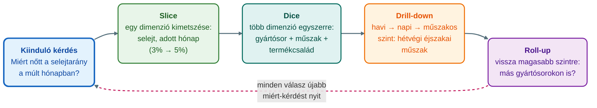
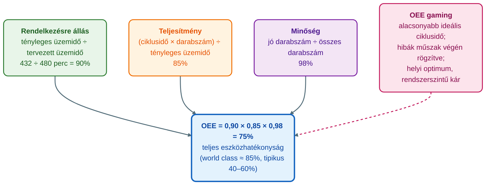

## V9 – Dashboard-rendszerek, KPI-alapú jelentések, DAX és Power BI

### Beszerzendő anyagok

| Szerző | Mű | Jelleg | Indoklás / érintett rész |
|---|---|---|---|
| Microsoft | Power BI documentation (Microsoft Learn, 2025) | kötelező irodalom | A syllabus kötelező irodalomként nevezi meg (Óbudai Egyetem, Keleti Károly Gazdasági Kar, 2026). Az R8 (DAX-kifejezések), az R9 (egyéni és vállalati vizualizációk), az R10 (megosztás vállalaton belül és kívül) és az R11 (jogosultságok, engedélyezés) pótlásához; a kötelező tananyag ezeket nem tárgyalja. Tartalmát nem ellenőriztem. |
| Óbudai Egyetem, Keleti Károly Gazdasági Kar (gyakorlatvezető) | A syllabus heti tematikájában nevesített gyakorlati anyagok: Interaktív Excel dashboard I–II. (2–3. hét), Power BI bevezetés, adatmodellezés és DAX alapok, haladó vizualizáció és interaktivitás (4–6. hét), Power BI Service: publikálás, megosztás, biztonság (10. hét) | gyakorlati anyag | A gyakorlati órák anyaga nincs a forrásmappában. Az R2 (dashboard-típusok), az R4 (szűrők), az R7 (KPI-alapú jelentés készítésének lépései), az R8 (DAX) és az R9–R11 (vizualizáció, megosztás, jogosultság) eszközszintű tartalma a syllabus szerint itt szerepel (Óbudai Egyetem, Keleti Károly Gazdasági Kar, 2026). |

**Tétel:** Mutassa be az üzleti műszerfal (dashboard) rendszerek fogalmát, típusait és felépítését, ismertesse, hogyan szolgáltatnak információt a felhasználóknak (valós idejű adatok, drill-down, szűrők), és fejtse ki, hogy milyen vezetési szinteken alkalmazzák ezeket! Értelmezze a Kulcs Teljesítménymutató (KPI) fogalmát, mutassa be, hogyan készülnek KPI-alapú üzleti jelentések egy BI rendszerben, és ismertesse az alapvető DAX-kifejezések szerepét az adatelemzésben! Fejtse ki az egyéni és vállalati vizualizációk alkalmazásának lehetőségeit, a jelentések vállalaton belüli és kívüli megosztásának módjait, valamint a rendszeradminisztrációs jogosultságok és engedélyezési eljárások kezelésének elveit!

---

### 9.1. A dashboard fogalma és helye a vezetői információs rendszerben (R1)

A tananyag a dashboardot (üzleti műszerfal) nem önálló definícióval, hanem a vezetői információs rendszer kimeneteként vezeti be: a stratégiai szint rendszere, az ESS/EIS (vezetői IS) „külső és belső adatok aggregátumát, dashboardot" ad a döntéshozónak (Óbudai Egyetem, Keleti Károly Gazdasági Kar, Üzleti Tudományok és Digitális Ismeretek Intézet [ÓE KGK ÜTDI], 2026b, 3. szakasz). A MIR alrendszereinek kronológiájában a dashboardok és a scorecardok a 2000-es évek fejleménye, az EIS/DSS (1980-as évek) és az adattárház/BI (1990-es évek) után (ÓE KGK ÜTDI, 2026a, 2. szakasz).

A dashboard tananyagbeli képét a 6. előadás nyitó dilemmája adja: egy gyártóüzem napi dashboardja 22 KPI-t mutat egyetlen felületen (selejtarány, OEE, energiafogyasztás, túlóra-arány stb.), „mind zölden vagy pirosan villogva" (ÓE KGK ÜTDI, 2026c, 2. szakasz). Három hónap múlva a műszakvezetők egyre kevesebbet nézik, mert nem tudják eldönteni, melyik szám számít: „amikor minden piros, semmi sem sürgős"; ez az elemzési bénultság (analysis paralysis) jelensége (ÓE KGK ÜTDI, 2026c, 2. szakasz). A dashboard nem azért volt rossz, mert a mutatók egyenként hibásak lettek volna, hanem mert a rendszer egésze nem tett különbséget a fontos és a kevésbé fontos között (ÓE KGK ÜTDI, 2026c, 8. szakasz). Ezt empirikus kutatás is igazolja: Tokola és munkatársai szerint a legtöbb vállalati dashboard nem a döntéshozó tényleges kérdéseiből indul ki, hanem abból, milyen adat áll rendelkezésre; ezért a KPI-kiválasztást a felhasználói szerepkörhöz igazító tervezési módszertant javasolnak (Tokola et al., 2016, idézi: ÓE KGK ÜTDI, 2026d, 2. szakasz).

*(A tananyag tankönyvi dashboard-definíciót nem közöl; a fogalom a fenti leírásokból áll össze.)*

---

### ⚠️ Tartalmi hiány — a dashboard-rendszerek típusai (R2)

A tételsor a dashboard-rendszerek típusainak bemutatását kéri. A megengedett forrásokban dashboard-tipológia (pl. operatív, taktikai, stratégiai vagy elemző dashboard mint típusnevek) nem szerepel. Keresett kifejezések a 12 előadás kötelező részében (ékezetes és ékezet nélküli alak): dashboard (37 találat, egyik sem típusfelsorolás), műszerfal (0), irányítópult (0), scorecard a Balanced Scorecard-említéseken kívül (1, a kronológiában), dashboard-típus, operatív dashboard, stratégiai dashboard, elemző dashboard (mind 0). Forráson kívüli tartalmat nem írok be. Az R2 kitöltetlen; pótlás: lásd a Beszerzendő anyagokat.

**Ami a forrásokban mégis kapcsolódik (nem válasz a részkérdésre):** a tananyag a dashboardokat nem típus, hanem a szervezeti hierarchia szintje szerint különbözteti meg. A 7. előadás ábrája azt mutatja, „hogyan bomlik le egy vállalati célszám (pl. OEE) a szervezeti hierarchia szintjein különböző részletezettségű dashboardokká" (ÓE KGK ÜTDI, 2026d, 2. szakasz, ábra), Tokola és munkatársai pedig a műszakvezető, az üzemvezető és a felső vezetés szerepköréhez igazítják a KPI-kiválasztást (Tokola et al., 2016, idézi: ÓE KGK ÜTDI, 2026d, 2. szakasz). Ezt a szintek szerinti bontást a 9.4. szakasz tárgyalja.

---

### 9.2. A dashboard felépítése: a tervezés tudománya (R3)

A tananyag a dashboard felépítését nem komponensek, hanem tervezési elvek szintjén tárgyalja („a dashboard-tervezés tudománya"). Két klasszikus forrást nevez meg: Tufte data-ink ratio elvét, amely szerint minden vizuális elemnek információt kell hordoznia, és Few 13 gyakori dashboard-hibáját, köztük a túlzsúfoltságot, a félrevezető skálázást és a felesleges 3D-effekteket (Tufte; Few, idézi: ÓE KGK ÜTDI, 2026c, 6. szakasz).

A központi fogalom a **Lie Factor**: a grafikonon látható vizuális változás aránya a mögötte lévő valós adatváltozáshoz képest. Ha egy oszlopdiagram y-tengelyét nem nulláról indítják, egy 2%-os valós növekedés vizuálisan akár 200%-osnak tűnhet. Ez etikai kérdés: aki tudatosan csonkolt y-tengelyt használ egy negyedéves eredményjelentésben, technikai értelemben nem hazudik, de manipulál; a dashboard-tervező „olyan hatalommal bír, mint egy szerkesztő: eldönti, mit látunk meg először" (ÓE KGK ÜTDI, 2026c, 6. szakasz). Egy AI-alapú automatikus kiemelés (pl. Power BI Key Influencers) öntudatlanul is torzíthat, és a torzítás forrása – a tanítóadat vagy az algoritmus – nehezebben azonosítható (ÓE KGK ÜTDI, 2026c, 6. szakasz). A dashboard-tervezés ezért sosem semleges: akár ember, akár AI emel ki, az értékítéletet tartalmaz (ÓE KGK ÜTDI, 2026c, 8. szakasz).

| Tervezési elv vagy hiba | Mit jelent | Forrás |
|---|---|---|
| Data-ink ratio (Tufte) | minden vizuális elem hordozzon információt | ÓE KGK ÜTDI, 2026c, 6. szakasz |
| Túlzsúfoltság (Few) | a 13 gyakori hiba egyike; vö. a 22 KPI-s nyitó dilemmát | ÓE KGK ÜTDI, 2026c, 2. és 6. szakasz |
| Félrevezető skálázás, Lie Factor | nem nulláról induló tengely: 2% → látszólag 200% | ÓE KGK ÜTDI, 2026c, 6. szakasz |
| Felesleges 3D-effektek (Few) | a 13 gyakori hiba egyike | ÓE KGK ÜTDI, 2026c, 6. szakasz |
| Szerepkörhöz igazított KPI-kiválasztás | a döntéshozó kérdéséből induljon, ne a rendelkezésre álló adatból | Tokola et al., 2016, idézi: ÓE KGK ÜTDI, 2026d, 2. szakasz |
| AI-alapú automatikus kiemelés | megkönnyíti a mintázatfelismerést, de „objektívnek" tűnve nehezebben kérdőjelezhető meg | ÓE KGK ÜTDI, 2026c, 6–7. szakasz |

*(A tananyag tervezési elveket ad; a dashboard komponens-felépítését – vizuálok, kártyák, szűrőpanel, oldalak – nem tárgyalja.)*

---

### 9.3. Hogyan szolgáltat információt a dashboard: valós idejű adat, lefúrás, szűrés (R4)

**Valós idejű adat.** A valós idejű adat az operatív szinthez kötődik: a TPS „pontos, részletes, valós idejű tranzakciós adatot" ad; ha a gyártósor-vezető csak havi összesítőt kap, a problémák késve kerülnek felszínre, és a beavatkozás elkésik (ÓE KGK ÜTDI, 2026b, 3. szakasz). A valós idejűség azonban nem ingyenes: az adatminőség hét dimenziója közül az időszerűség és a pontosság között trade-off van, mert a gyorsabb adatba kevesebb validáció fér; egy valós idejű gyártási dashboard tudatosan elfogad kisebb pontossági kockázatot a sebességért, egy pénzügyi zárás inkább vár, de garantáltan pontos (ÓE KGK ÜTDI, 2026f, 3. szakasz). A valós idejű dashboard önmagában nem hoz jobb döntést; a Bosch hatvani és a Siemens ambergi esetben a siker a döntéshozók ítélőképességén múlt (ÓE KGK ÜTDI, 2026d, 8. szakasz).

**Lefúrás (drill-down).** A tananyag a lefúrást az OLAP négy alapművelete (slice, dice, drill-down, roll-up) között, nem technikaként, hanem gondolkodásmódként tárgyalja: az a képesség, hogy a vezető folyamatosan új kérdéseket tudjon feltenni az adatnak. Az ábra forgatókönyvében a drill-down a havi összesítésből a műszakos szintig vezet, ahol kiderül, hogy a selejtnövekedés a hétvégi éjszakai műszakra koncentrálódik; minden válasz újabb miért-kérdést nyit meg, szemben a statikus riporttal (ÓE KGK ÜTDI, 2026d, 3. szakasz). A lefúrás igénye felfelé nő: csökken a vezetőre jutó információ mennyisége, de nő a mélységi hozzáférés igénye, hogy „bármikor bele tudjon nézni a részletekbe" (ÓE KGK ÜTDI, 2026b, 4. szakasz).

*(Az ábra az ÓE KGK ÜTDI, 2026d, 3. szakasz „OLAP mint gondolkodásmód" forgatókönyve alapján készült.)*

Az OLAP korlátja: megmondja, hol van a probléma, de nem azt, miért pont ott; a kiváltó ok feltárásához statisztikai vagy adatbányászati elemzés kell (ÓE KGK ÜTDI, 2026d, 3. szakasz).

**Szűrés.** A taktikai szint „összesített, szűrt, trendalapú riportokat" kap, és a VIR a kivételkezelést támogatja: a vezetőnek csak a tervtől jelentősen eltérő adatot kell látnia (ÓE KGK ÜTDI, 2026b, 3–4. szakasz). OLAP-műveletként a slice egy, a dice több dimenzió egyidejű szűrése (ÓE KGK ÜTDI, 2026d, 3. szakasz).

*(A dashboard szűrő-vezérlőit – szeletelő, oldal- és jelentésszintű szűrő – a tananyag nem tárgyalja; keresett: szűrő, szűrés, filter, slicer – 11 találat, egyik sem ilyen értelemben.)*

---

### 9.4. Alkalmazás a vezetési szinteken (R5)

Az IS-típusok nem cserélhetők fel egymással (ÓE KGK ÜTDI, 2026b, 3. szakasz); az alábbi táblázat az 1. előadás két táblázatát vonja össze.

| Szint | Döntés jellege | Rendszer | Mit kap a döntéshozó | Információ mennyisége és fókusza |
|---|---|---|---|---|
| Operatív (alsó szintű vezetés) | strukturált, ismétlődő, szabályozható | TPS | pontos, részletes, valós idejű tranzakciós adat | sok, részletes; napi működés, operatív adatok |
| Taktikai (középszintű vezetés) | félig strukturált, rendszeres riportok, illetve elemzésvezérelt | MIS; DSS (taktikai/stratégiai) | összesített, szűrt, trendalapú riportok; modellek, szcenárió-elemzések, what-if szimulációk | közepes, szűrt; elemzés, összehasonlítás |
| Stratégiai (felső szintű vezetés) | strukturálatlan, bizonytalanság alatt | ESS/EIS | külső és belső adatok aggregátuma, dashboard | kevés, tömör; stratégia, versenyhelyzet |

*(Forrás: ÓE KGK ÜTDI, 2026b, 3–4. szakasz. Az IS-típusok szintezése az 1. előadás 3. szakaszának szövegét és táblázatát követi; a DSS-t a tananyag a taktikai/stratégiai szinthez rendeli.)*

A BI-felhasználók az 5. előadás ábrája szerint három csoportot alkotnak: 80%-nál több alkalmi felhasználó (kész jelentések), a felső vezetők (dashboard), valamint a középvezetők és elemzők („power user": lekérdez és szeletel) (ÓE KGK ÜTDI, 2026f, 4. szakasz, ábra). A dashboard tehát elsősorban a felső vezetés eszköze. A három döntéstípust a BI másképp szolgálja ki: a strukturált döntést (napi rendelési mennyiség) a MIS rutinjelentései, a félig strukturáltat („mi történne, ha 5%-kal emelnénk az árat?") a DSS what-if elemzése, a strukturálatlant (belépjünk-e egy új piacra?) az ESS és a vezetői ítélőképesség (ÓE KGK ÜTDI, 2026f, 3. szakasz).

A szintek felcserélésének három tipikus hibája: túl sok adat felfelé (nyers TPS-adat a vezérigazgatónak: information overload); aggregált adat lefelé (havi összesítő a gyártósor-vezetőnek: késő beavatkozás); DSS operatív szinten (optimalizációs modell a raktárosnak: senki nem használja) (ÓE KGK ÜTDI, 2026b, 3. szakasz). A dashboardok szintenkénti bontását a 7. előadás ábrája mutatja: egy vállalati célszám (pl. az OEE) a hierarchia szintjein különböző részletezettségű dashboardokká bomlik le; a kérdés mindig az, „kinek, milyen döntéshez kell az adott mutató" (ÓE KGK ÜTDI, 2026d, 2. szakasz, ábra).

---

### 9.5. A KPI fogalma és a KPI-tervezés csapdái (R6)

A VIR két kulcsfogalom köré szervezi az információt. A **kritikus sikertényező** (KST / CSF – Critical Success Factor) az a néhány terület, amelynek jól kell mennie a szervezet sikeréhez; a **kulcsfontosságú teljesítménymutató** (KTM / KPI – Key Performance Indicator) az a mérőszám, amellyel a kritikus sikertényezőt nyomon követjük. Egy jó KPI-nak négy jellemzője van: aktuális, terv-, eltérés- és trendérték. A valódi kihívás nem a KPI legyártása, hanem annak eldöntése, melyik 5–10 KPI-n keresztül tudja a vezető ténylegesen monitorozni a területét (ÓE KGK ÜTDI, 2026b, 4. szakasz). A 6. előadás a KPI-tervezés alapszabályait (SMART, lag- és lead-mutatók) ismertnek tekinti, és azt kérdezi: mi történik, ha egy jó KPI-t célként, nem mérőeszközként kezdenek kezelni (ÓE KGK ÜTDI, 2026c, 3. szakasz).

**Goodhart-csapda.** Goodhart törvénye (eredetileg monetáris politikai kontextusban): „amikor egy mutató célponttá válik, megszűnik jó mutatónak lenni" (Goodhart, 1975, idézi: ÓE KGK ÜTDI, 2026c, 3. szakasz). Példa: egy call centerben az átlagos hívásidőt (Average Handling Time, AHT) vezetik be egyetlen mutatóként; az AHT javul, de az ismételt hívások aránya drasztikusan nő: a mutató javult, a valódi cél romlott. Gyártásban ugyanez a „gyártott darabszám/műszak" mint egyetlen KPI, a minőség és a karbantartás rovására (ÓE KGK ÜTDI, 2026c, 3. szakasz). A mai AI-rendszerek „fegyverként használják" a Goodhart-törvényt, mert egyetlen metrikára optimalizálnak (Thomas & Uminsky, 2022, idézi: ÓE KGK ÜTDI, 2026c, 3. szakasz).

**OEE: pontos képlet és gaming.** Az OEE (Overall Equipment Effectiveness, teljes eszközhatékonyság) a gyáripar egyik legelterjedtebb összetett mutatója: OEE = rendelkezésre állás × teljesítmény × minőség. A számpéldát az ábra mutatja: 0,90 × 0,85 × 0,98 = 0,75, azaz 75%; a „world class" OEE kb. 85%, a legtöbb üzem valós OEE-je 40–60% (ÓE KGK ÜTDI, 2026c, 4. szakasz).

*(Az ábra az ÓE KGK ÜTDI, 2026c, 4. szakasz képlete és számpéldája alapján készült.)*

Mivel az OEE három komponens szorzata, egy műszakvezető az egyik komponenst a másik rovására javíthatja (alacsonyabb „ideális ciklusidő" nyilvántartásba vétele, hibák műszak végi rögzítése), a helyi optimalizálás pedig rendszerszintű kárt okoz, ha a bottleneck-gép nem gyorsul és az átfutási idő nem javul (ÓE KGK ÜTDI, 2026c, 4. szakasz). Az OEE technikai pontossága tehát nem garancia a manipuláció ellen (ÓE KGK ÜTDI, 2026c, 8. szakasz).

| KPI-tervezési csapda | Mi történik | Ellenszer a tananyag szerint | Forrás |
|---|---|---|---|
| Elemzési bénultság | 22 KPI egy képernyőn; a rendszer nem különbözteti meg a fontosat a kevésbé fontostól | 5–10 KPI, amelyen a vezető ténylegesen monitorozni tud; kivételkezelés | ÓE KGK ÜTDI, 2026c, 2. és 8. szakasz; 2026b, 4. szakasz |
| Goodhart-csapda | a mutató céllá válik, a mutató javul, a valódi cél romlik (AHT, darabszám/műszak) | a KPI mérőeszköz maradjon, ne cél; több mutató együttes figyelése (ismételt hívások aránya) | Goodhart, 1975, idézi: ÓE KGK ÜTDI, 2026c, 3. szakasz |
| OEE gaming | egyik komponens a másik rovására; helyi optimum | rendszerszintű (bottleneck) szemlélet; valós idejű hibarögzítés | ÓE KGK ÜTDI, 2026c, 4. szakasz |
| Adatból induló dashboard | a mutató abból indul, milyen adat van, nem a döntéshozó kérdéséből | szerepkörhöz igazított KPI-kiválasztás | Tokola et al., 2016, idézi: ÓE KGK ÜTDI, 2026d, 2. szakasz |
| Mikromenedzsment automatizált álruhában | a vezető minden döntését a dashboardra hivatkozva hozza, nem meri megkérdőjelezni a mutatót | a KPI-rendszer a döntéshozó ítélőképességét támogassa, ne helyettesítse | ÓE KGK ÜTDI, 2026c, 8. szakasz |

---

### 9.6. KPI-alapú üzleti jelentés készítése BI-rendszerben (R7)

*(Tananyag-alapú szintézis. A kötelező tananyag a jelentéskészítés eszközszintű lépéseit – adatbetöltés, adatmodell, vizuálok – nem tárgyalja; ezek a syllabus szerint a gyakorlati órák anyaga. Az alábbiak a tananyag elveit gyűjtik össze.)*

1. **Kinek, milyen döntéshez?** A jelentés a döntéshozó kérdéséből induljon, ne a rendelkezésre álló adatból; a KPI-kiválasztás a szerepkörhöz igazodjon (Tokola et al., 2016, idézi: ÓE KGK ÜTDI, 2026d, 2. szakasz).
2. **Kevés, de jó KPI.** 5–10 mutató aktuális, terv-, eltérés- és trendértékkel; kivételkezelés, hogy a vezető csak a tervtől jelentősen eltérő adatot lássa (ÓE KGK ÜTDI, 2026b, 4. szakasz).
3. **Közös definíciók.** A self-service BI gyors és rugalmas, de a konzisztencia és a „ki mit lát" kérdése bonyolultabbá válik; az IT-centrikus BI megbízható, de lassú. Példa: egy 200 fős gyártó részlegben mindenki önállóan épít Power BI-jelentést, és fél év múlva három különböző „hivatalos" selejtarány kering. A Microsoft „Starlight/KPI Lake" tanulsága a felügyelt önkiszolgáló BI (Managed Self-Service BI): közös adatszabványok, önkiszolgáló hozzáférés (ÓE KGK ÜTDI, 2026f, 4. szakasz).
4. **Becsületes megjelenítés.** Data-ink ratio, nulláról induló tengely, Lie Factor (ÓE KGK ÜTDI, 2026c, 6. szakasz).
5. **Lefúrás és riasztás.** Egy kattintásos lefúrás, figyelmeztetés, aggregált és részletes, historikus és valós idejű adat vegyítése (ÓE KGK ÜTDI, 2026f, 4. szakasz).
6. **AI-funkciók kritikával.** A Power BI Key Influencers vizuálja automatikusan azonosítja, mely tényezők befolyásolják leginkább egy mutatót (pl. mi korrelál az OEE ingadozásával), az Anomaly Detection pedig jelzi, ha egy idősor szokatlanul viselkedik (nagy léptékű példa: GE Predix). Ezek nem mentesítenek a Goodhart- és OEE-gaming kritika alól; az automatikus kiemelés „objektívnek" tűnik, ezért nehezebben kérdőjelezhető meg (ÓE KGK ÜTDI, 2026c, 7. szakasz).

A jelentés önmagában nem old meg semmit: a tananyag példájában „a dashboardok szépek, a riportok pontosak", a középvezetők mégis Excelben dolgoznak, mert hiányzik a koordináció (ÓE KGK ÜTDI, 2026f, 1. és 8. szakasz).

---

### ⚠️ Tartalmi hiány — az alapvető DAX-kifejezések szerepe (R8)

A tételsor az alapvető DAX-kifejezések adatelemzési szerepének ismertetését kéri. A megengedett forrásokban a DAX nem szerepel. Keresett kifejezések a 12 előadás kötelező részében (ékezetes és ékezet nélküli alak): DAX, Data Analysis Expressions, measure, mérték (17 találat, egyik sem Power BI-mérték), calculated, számított oszlop, számított mező, CALCULATE, SUMX, FILTER (mint függvény), időintelligencia: mind 0 releváns találat. A „Power BI" 14 találata az 5–7. előadásban eszközként, a Key Influencers és az Anomaly Detection funkcióhoz, illetve a nyitó dilemmához kötődik, DAX-ra egyik sem utal. Forráson kívüli tartalmat nem írok be. Az R8 kitöltetlen; pótlás: a syllabus 5. heti gyakorlata („Power BI adatmodellezés és DAX alapok") és a Microsoft Power BI documentation (Óbudai Egyetem, Keleti Károly Gazdasági Kar, 2026) – lásd a Beszerzendő anyagokat.

**Ami a forrásokban mégis kapcsolódik (nem válasz a részkérdésre):** a tananyag a számított mutató fogalmát az OEE-nél adja (három komponens szorzata, képlettel és számpéldával; ÓE KGK ÜTDI, 2026c, 4. szakasz), a Power BI elemző funkcióit pedig a Key Influencers és az Anomaly Detection példáján (ÓE KGK ÜTDI, 2026c, 7. szakasz).

---

### ⚠️ Tartalmi hiány — egyéni és vállalati vizualizációk, a jelentések megosztása, jogosultságok és engedélyezés (R9, R10, R11)

A tételsor három, logikailag összetartozó részkérdést tesz fel a Power BI Service-szintű működésről: az egyéni és vállalati vizualizációk alkalmazását (R9), a jelentések vállalaton belüli és kívüli megosztásának módjait (R10), valamint a rendszeradminisztrációs jogosultságok és engedélyezési eljárások kezelésének elveit (R11). A megengedett forrásokban ezek egyike sem szerepel. Keresett kifejezések a 12 előadás kötelező részében (ékezetes és ékezet nélküli alak): custom visual (0), egyéni vizualizáció (0), vizualizáció (2, nem egyéni/vállalati értelemben), megoszt (16: tudásmegosztás, adatmegosztás, FASMI), publikál (3, mind „publikált kutatás/modell" értelemben), share (7: SharePoint, FASMI), workspace (0), munkaterület (0), app (2, App Store), row-level (0), RLS (0), sorszintű (0), jogosultság (1, felhő-kontextusban), engedély (4, BYOD- és önkiszolgálás-kontextusban), adminisztr (0), tenant (0), bérlő (0), licenc (2, TCO-kontextusban): egyik sem Power BI-megosztási vagy -jogosultsági kontextusban. Forráson kívüli tartalmat nem írok be. Az R9–R11 kitöltetlen; pótlás: a syllabus 10. heti gyakorlata („Power BI Service: publikálás, megosztás, biztonság") és a Microsoft Power BI documentation – lásd a Beszerzendő anyagokat.

**Ami a forrásokban mégis kapcsolódik (nem válasz a részkérdésekre):**

| Részkérdés | Kapcsolódó tananyag-elem | Forrás |
|---|---|---|
| R9 egyéni vs. vállalati | A self-service BI-ban a felhasználók maguk építik jelentéseiket; az IT-centrikus BI-ban az IT tervezi, építi és karbantartja. A bimodális IT (Mode 1 stabil, IT-vezérelt; Mode 2 gyors, kísérletező, üzleti oldal által vezérelt) ugyanezt a feszültséget írja le. | ÓE KGK ÜTDI, 2026f, 4. szakasz |
| R10 belső és külső megosztás | Az intranet a belső, csak alkalmazottaknak elérhető céges háló, az extranet a kiterjesztett hozzáférés partnereknek. Az OLAP elvárásai között a FASMI betűszó a „megosztott" (shared) elérést is tartalmazza. | ÓE KGK ÜTDI, 2026a, 7. szakasz; ÓE KGK ÜTDI, 2026e, 4. szakasz |
| R11 jogosultság, engedélyezés | A self-service BI-nál a „ki mit lát" kérdése bonyolultabbá válik; a felügyelt önkiszolgáló BI közös adatszabványokra és önkiszolgáló hozzáférésre épül. A vállalati adatvagyonért felelős szerepkörök: CIO, CSO/CISO (információbiztonsági szabályzat kikényszerítése), CPO (adatvédelmi megfelelés), CKO, CDO (vállalati szintű adatirányítás). A „single source of truth" elve: egyetlen, megbízhatóan karbantartott, mindenki által ugyanúgy látott adatforrás. | ÓE KGK ÜTDI, 2026f, 4. szakasz; ÓE KGK ÜTDI, 2026e, 6–7. szakasz |

Ezek szervezeti és adatirányítási elvek, nem a Power BI Service megosztási módjai és engedélyezési eljárásai.

---

### 9.7. Összegzés és tárgyon belüli kapcsolódások

A tananyag a dashboardot a vezetői információs rendszer kimeneteként kezeli: az ESS/EIS külső és belső adatok aggregátumát adja dashboard formájában, és a mutatók a hierarchia szintjein különböző részletezettségű dashboardokká bomlanak le. A dashboard értéke a fontos és a kevésbé fontos megkülönböztetésén múlik (22 KPI-s dilemma, Tokola-kutatás, Tufte–Few-elvek). A KPI a kritikus sikertényező mérőszáma; elromlik, ha céllá válik (Goodhart), ha komponensei egymás rovására javíthatók (OEE gaming), vagy ha a vezető nem meri megkérdőjelezni. Az eszközszintű részek – dashboard-típusok, szűrők, DAX, vizualizációk, megosztás, jogosultságok – a kötelező tananyagból nem készíthetők fel; ezt a ⚠️ szakaszok jelzik.

Kapcsolódások:
- **V6:** IS-típusok, vezetési szintek, KST/KPI, kivételkezelés (ÓE KGK ÜTDI, 2026b, 3–4. szakasz); a tananyag „MIR/VIR" együttes megfogalmazását a tétel megtartja, a két fogalom közé egyenlőségjelet nem tesz.
- **V7:** a BSC rituálévá válása rokon a Goodhart-csapdával (ÓE KGK ÜTDI, 2026c, 5. és 8. szakasz).
- **V8:** BI-érettség, BICC, self-service vs. IT-centrikus BI; a koordinációs probléma mint a nem használt dashboardok gyökéroka (ÓE KGK ÜTDI, 2026f, 2., 4. és 8. szakasz).
- **V10:** az adatbányászat ott kezdődik, ahol az OLAP véget ér (ÓE KGK ÜTDI, 2026d, 3–4. szakasz); az adatminőség hét dimenziója (ÓE KGK ÜTDI, 2026f, 3. szakasz).
- ERP és controlling-mutatószámok: lásd V12 és K20 (csak utalás).

---

### Várható vizsgáztatói kérdések

1. **Miért kevesebbet mond 22 KPI, mint 3?** — Nem azért, mert a mutatók egyenként hibásak, hanem mert a rendszer egésze nem tesz különbséget a fontos és a kevésbé fontos között; amikor minden piros, semmi sem sürgős, és ez elemzési bénultsághoz vezet (ÓE KGK ÜTDI, 2026c, 2. és 8. szakasz). A tananyag szerint 5–10 KPI az, amelyen keresztül egy vezető ténylegesen monitorozni tud (ÓE KGK ÜTDI, 2026b, 4. szakasz).
2. **Mi a különbség a slice, a dice, a drill-down és a roll-up között, és mire nem képes az OLAP?** — A slice egy dimenziót metsz ki, a dice több dimenziót szűr egyszerre, a drill-down részletesebb szintre megy le, a roll-up magasabb szintre lép vissza. Az OLAP megmondja, hol a probléma, de nem azt, miért; ehhez statisztikai vagy adatbányászati elemzés kell (ÓE KGK ÜTDI, 2026d, 3. szakasz).
3. **Mi a Lie Factor, és miért etikai kérdés?** — A vizuális változás mértékének aránya a valós adatváltozáshoz képest; nem nulláról induló tengelynél 2% valós növekedés 200%-osnak tűnhet. Aki ezt tudatosan használja, technikailag nem hazudik, de manipulál; AI-alapú automatikus kiemelésnél a torzítás forrása nehezebben azonosítható (ÓE KGK ÜTDI, 2026c, 6. szakasz).
4. **Hogyan lehet „megjátszani" az OEE-t, ha a képlet pontos?** — Mivel három komponens szorzata: alacsonyabb ideális ciklusidő nyilvántartásba vételével a teljesítmény javítható; a hibák műszak végi rögzítésével a minőség; és egy gépcsoport OEE-je felhajtható úgy, hogy a bottleneck-gép nem gyorsul, így az átfutási idő nem javul (ÓE KGK ÜTDI, 2026c, 4. szakasz).
5. **Miért ellentmondásos a valós idejű dashboard?** — Az adatminőség dimenziói között trade-off van: minél időszerűbb az adat, annál kevesebb validáció fér bele, így csökken a pontosság; a valós idejű gyártási dashboard tudatosan vállalja ezt, a pénzügyi zárás nem (ÓE KGK ÜTDI, 2026f, 3. szakasz). A valós idejű dashboard önmagában nem hoz jobb döntést, ha a döntéshozó nem illeszti saját ítélőképességébe (ÓE KGK ÜTDI, 2026d, 8. szakasz).
6. **Miért nem használják a vezetők a szép dashboardot?** — A tananyag három hipotézise (képzési, bizalmi, koordinációs) közül jellemzően a koordinációs az ok: nincs BICC-szerű egység, amely a szabványokért és a bizalomépítésért felel; a bizalmatlanság tünet, a „nem tudják használni" a felszín (ÓE KGK ÜTDI, 2026f, 1. és 8. szakasz). Self-service BI-nál ugyanez inkonzisztens definíciókhoz vezet (három „hivatalos" selejtarány; ÓE KGK ÜTDI, 2026f, 4. szakasz).

---

## Irodalom

* Óbudai Egyetem, Keleti Károly Gazdasági Kar. (2026). *Menedzsment információs rendszerek (GMXIR1MBLF) — Tantárgynyilvántartó adatlap* [Syllabus].
* Óbudai Egyetem, Keleti Károly Gazdasági Kar, Üzleti Tudományok és Digitális Ismeretek Intézet. (2026a). *Az integrált vállalat: ERP, CRM, SCM* [Kötelező tananyag, 3. ea.].
* Óbudai Egyetem, Keleti Károly Gazdasági Kar, Üzleti Tudományok és Digitális Ismeretek Intézet. (2026b). *AZ MIS valódi szerepe* [Kötelező tananyag, 1. ea.].
* Óbudai Egyetem, Keleti Károly Gazdasági Kar, Üzleti Tudományok és Digitális Ismeretek Intézet. (2026c). *BI a gyakorlatban I.* [Kötelező tananyag, 6. ea.].
* Óbudai Egyetem, Keleti Károly Gazdasági Kar, Üzleti Tudományok és Digitális Ismeretek Intézet. (2026d). *BI a gyakorlatban II.* [Kötelező tananyag, 7. ea.].
* Óbudai Egyetem, Keleti Károly Gazdasági Kar, Üzleti Tudományok és Digitális Ismeretek Intézet. (2026e). *Mit ér az adat és ki felelős érte?* [Kötelező tananyag, 4. ea.].
* Óbudai Egyetem, Keleti Károly Gazdasági Kar, Üzleti Tudományok és Digitális Ismeretek Intézet. (2026f). *Üzleti intelligencia: kultúra, nem eszköz* [Kötelező tananyag, 5. ea.].
