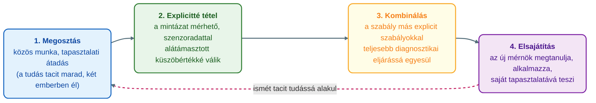
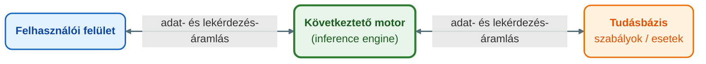

## V10 – OLTP és OLAP, adattárház, tudásfeltárás és adatbányászat, szakértői rendszerek, Big Data

### Beszerzendő anyagok

| Szerző | Mű | Jelleg | Indoklás / érintett rész |
|---|---|---|---|
| Bencsik, A. | A tudásmenedzsment elméletben és gyakorlatban (2015); Tudásmenedzsment elméletben és gyakorlatban: Az üzleti stratégiától a mesterséges intelligenciáig (2024, bővített kiadás). Akadémiai Kiadó. | ajánlott irodalom | A syllabus ajánlott irodalomként nevezi meg; a szakértői rendszerek architektúrájának részletei (R6) és a VIR-hez kapcsolódó szakértői rendszerek előnyei/korlátai (R8) a kötelező tananyagban csak vázlatosan szerepelnek. Tartalmát nem ellenőriztem. |
| Laudon, K. C., & Laudon, J. P. | Management information systems: Managing the digital firm (17th ed., 2022). Pearson. | kötelező irodalom | A syllabus kötelező irodalma; a tananyag adattárház-, OLAP- és KDD-oldalai maguk is erre hivatkoznak. A KDD iteratív jellege (R3), a BI-architektúra rétegei (R2) és a Big Data definíciója (R9) a kötelező tananyagban nincs kifejtve. Tartalmát nem ellenőriztem; a mappában nincs meg. |

**Tétel:** Ismertesse az OLTP és OLAP rendszerek közötti különbséget, és mutassa be az adattárházak szerepét és jelentőségét a vállalati döntéstámogatásban és a BI architektúrában! Ismertesse a tudásfeltárás iteratív folyamatát (KDD – Knowledge Discovery in Databases), mutassa be a tudásfeltárás és az adatbányászat kapcsolatát, és ismertesse a leggyakrabban alkalmazott adatbányászati technikákat! Fejtse ki a szakértői rendszerek struktúráját és a tudás informatikai kezelésének módszereit, sorolja fel a VIR-hez kapcsolódó szakértői rendszerek előnyeit és korlátait, végül mutassa be, milyen új lehetőségeket és kihívásokat jelent a Big Data világa a vállalati adatelemzés és az üzleti intelligencia számára!

---

### 10.1. OLTP és OLAP: két kérdés, két rendszer

A tananyag kiindulópontja, hogy más rendszer kell egy tranzakció rögzítéséhez, mint ahhoz, hogy trendeket elemezzünk belőle (Óbudai Egyetem, Keleti Károly Gazdasági Kar, Üzleti Tudományok és Digitális Ismeretek Intézet [ÓE KGK ÜTDI], 2026e, 4. szakasz). Az OLTP (Online Transaction Processing) az operatív feldolgozás, az OLAP (Online Analytical Processing) a döntéstámogatás rendszere. A különbséget a tananyag kilenc tulajdonság mentén foglalja össze (ÓE KGK ÜTDI, 2026e, 4. szakasz):

| Tulajdonság | OLTP | OLAP |
|---|---|---|
| Felhasználó | ügyintéző | elemző |
| Használat | rendszeresen ismétlődő | alkalmi |
| Adatok | naprakész, aktuális állapot | történeti, archivált |
| Összegzés szintje | nagyon részletes | összesített |
| Elérés | írás/olvasás | főleg olvasás |
| Elért rekordszám | tízes nagyságrend | milliós nagyságrend |
| Adatbázis szerkezete | relációs | csillag- vagy hópehelyséma |
| Teljesítménymutató | tranzakciós idő | lekérdezési idő |
| Funkció | operatív feldolgozás | döntéstámogatás |

Az OLAP elvárásait a FASMI betűszó (Fast Analysis of Shared Multidimensional Information) foglalja össze: gyors, megosztott, többdimenziós, elemzésre optimalizált hozzáférés. A tananyag analógiája: az OLTP a gyártósor valós idejű PLC-vezérlése, az OLAP a havi termelési riport elemzése; ha az OLTP-n futtatnák a milliós rekordokat összesítő OLAP-lekérdezéseket, az lelassítaná vagy leállítaná a napi működést, ezért kell a kettőt külön rendszerben tartani (ÓE KGK ÜTDI, 2026e, 4. szakasz).

Az OLAP négy alapművelete a slice, a dice, a drill-down és a roll-up, amelyeket a tananyag gondolkodásmódként tanít. A „miért nőtt a selejtarány?” kérdésnél a slice egy dimenziót (selejt, adott hónap) metsz ki, a dice több dimenziót (gyártósor + műszak + termékcsalád) szűr egyszerre, a drill-down a havi összesítésről napi, majd műszakos szintre megy le, a roll-up visszalép, hogy lássuk, más gyártósorokon is jelentkezik-e a mintázat. Minden művelet egy miért-kérdésre válaszol, és minden válasz újabb kérdést nyit. Az OLAP megmondja, hol van a probléma, de nem azt, miért: a kiváltó okhoz már adatbányászati elemzés kell (ÓE KGK ÜTDI, 2026b, 3. szakasz).

---

### 10.2. Az adattárház szerepe és jelentősége a döntéstámogatásban és a BI-architektúrában

Az adattárház (data warehouse) a teljes vállalat összes releváns adatát egyesíti: minden részleg adatai egy helyen, hosszú távú, elemzésre optimalizált formában. Az adatpiac (data mart) ennek kisebb, célzott alegysége egyetlen üzleti terület (pl. értékesítés, HR) adataival: gyorsabban felépíthető és olcsóbb, de szűkebb rálátást ad. Technikailag mindkettő „csak” egy nagy, elemzésre optimalizált adatbázis; sikeres kialakításuk azonban menedzseri, nem technikai kihívás (ÓE KGK ÜTDI, 2026e, 5. szakasz).

Ezt a Société Générale esete mutatja: a bank napi tízmillió tranzakciója több mint 1500 fájlban érkezik, és az adat gyakran „koszos” (duplikált, hiányzó, rossz sorrendű fájlok). Korábban több száz alkalmazott ellenőrzött manuálisan; az új „intelligens rendszer” lényege nem a szoftver volt, hanem az, hogy a vezetésnek fel kellett térképeznie és kodifikálnia a 220-nál több, tapasztalatból kialakult üzleti szabályt. Az adattárház sikere tehát azon múlik, tudatosítja-e a vezetés a saját szervezeti tudását az adatokról (ÓE KGK ÜTDI, 2026e, 5. szakasz).

A döntéstámogatásban az adattárház jelentőségét a „single source of truth” elve adja: ha a szervezet egyetlen, megbízhatóan karbantartott, mindenki által ugyanúgy látott adatforrásra támaszkodik, a döntések gyorsak és pontosak lehetnek; ha ez hiányzik, a legjobb csapat is rossz irányba korrigál (ÓE KGK ÜTDI, 2026e, 7. szakasz). A Knight Capital 2012-ben 45 perc alatt 440 millió dollárt vesztett, mert nem volt egyetlen hely, ahonnan tudni lehetett volna, hogy mind a nyolc szerver ugyanazt a kódot futtatja; a Siemens Amberg-gyár napi kb. 50 millió folyamatadatot egyetlen közös adatmodellben kezel, 99,99885%-os minőségi mutatóval (ÓE KGK ÜTDI, 2026e, 1. és 7. szakasz). A DIKW-lánc (adat → információ → tudás → bölcsesség) itt diagnosztikai eszköz: a rossz döntés szinte mindig egy korábbi töréspontra, leggyakrabban az adat→információ átmenetre vezethető vissza (ÓE KGK ÜTDI, 2026e, 2. szakasz). Az adatvagyonért a CDO (Chief Data Officer) felel: a megfelelő adatot gyűjtsék, jól elemezzék, és az eredményt valóban használják a döntésekhez (ÓE KGK ÜTDI, 2026e, 6. szakasz).

A BI-architektúrában az adattárház az érettség jelzője: a Gartner-féle ötszintű BI-érettségi modellben (Unaware → Tactical → Focused → Strategic → Pervasive) a Focused szinten adatpiacok jelennek meg, a Strategic szintet az egységes vállalati adattárház (EDW) és a prediktív technikák jellemzik; a BICC IT-kompetenciái az infrastruktúra, az adatminőség és az ETL (ÓE KGK ÜTDI, 2026g, 2. szakasz). Az OLAP felől nézve az adattárház a történeti, csillag- vagy hópehelysémájú, főleg olvasott adatállomány, amelyen a döntéstámogató lekérdezések futnak (ÓE KGK ÜTDI, 2026e, 4. szakasz).

*(A kötelező tananyag réteges BI-architektúra-ábrát – forrásrendszerek → ETL → adattárház → OLAP/riport – nem ad; az elemek külön szerepelnek, összekapcsolásuk itt összeolvasás.)*

---

### 10.3. A tudásfeltárás (KDD) folyamata

A KDD (Knowledge Discovery in Databases) klasszikus modelljét Fayyad, Piatetsky-Shapiro és Smyth írta le, és lényegében ma is ez az adatbányászat „receptje” (Fayyad et al., 1996, idézi: ÓE KGK ÜTDI, 2026b, 4. szakasz). Öt lépése:

```mermaid
flowchart LR
    subgraph ELO["Adat-előkészítés – az öt lépésből három"]
        S("<b>1. Kiválasztás</b><br/>(Selection)<br/>melyik forrásból, mely adatok?"):::kek --> P("<b>2. Előfeldolgozás</b><br/>(Preprocessing)<br/>hiányzó, hibás, duplikált adatok"):::kek
        P --> T("<b>3. Transzformáció</b><br/>(Transformation)<br/>az algoritmus számára<br/>feldolgozható forma"):::kek
    end
    T --> DM("<b>4. Adatbányászat</b><br/>(Data Mining)<br/>az algoritmus futtatása:<br/>osztályozás, csoportosítás, társításelemzés"):::zoldH
    DM --> E("<b>5. Kiértékelés / interpretáció</b><br/>üzleti értelmezés:<br/>valódi felismerés vagy véletlen?"):::narancs
    G("<b>GIGO</b><br/>szemét be, szemét ki:<br/>hibás adatból félrevezető mintázat"):::rozsa -.-> ELO

    classDef kek     fill:#e3f2fd,stroke:#1565c0,stroke-width:2px,color:#0d47a1,rx:10,ry:10;
    classDef narancs fill:#fff3e0,stroke:#ef6c00,stroke-width:2px,color:#e65100,rx:10,ry:10;
    classDef rozsa   fill:#fce4ec,stroke:#c2185b,stroke-width:2px,color:#880e4f,rx:10,ry:10;
    classDef zoldH   fill:#e8f5e9,stroke:#2e7d32,stroke-width:3px,color:#1b5e20,rx:10,ry:10;

    style ELO fill:#f5f9ff,stroke:#90caf9,stroke-width:1.5px,color:#1565c0;

    linkStyle default stroke:#546e7a,stroke-width:2px;
    linkStyle 4 stroke:#c2185b,stroke-width:2px,stroke-dasharray: 5 5;
```

*(Az ábra a ÓE KGK ÜTDI, 2026b, 4. szakasz KDD-leírása alapján készült.)*

A kulcstanulság: az öt lépésből három (1–3.) az adat előkészítéséről szól, és csak a negyedik a „bányászat”. Ez a GIGO-elv (Garbage In, Garbage Out): hibás vagy hiányos adatból a legkifinomultabb algoritmus is félrevezető mintázatot „fedez fel”. A tananyag két számot ad: a Gartner becslése szerint a nagyvállalati adatbázisok kritikus adatainak több mint 25%-a pontatlan vagy hiányos (ÓE KGK ÜTDI, 2026b, 4. szakasz), és egy iparági felmérés szerint az adatelemzők idejük kb. 80%-át adat-előkészítéssel töltik (Press, 2016, idézi: ÓE KGK ÜTDI, 2026b, 4. szakasz). Az AI ma már az adatmenedzsmentet is támogatja (katalogizálás, adatminőség-javítás, integráció), így a KDD 1–3. lépése maga is AI-támogatottá válik; ez a GIGO-elvet nem szünteti meg, csak áthelyezi: azt is meg kell kérdezni, mennyire megbízható az adatminőséget javító AI-eszköz (ÓE KGK ÜTDI, 2026b, 4. szakasz).

*(A tételsor a KDD „iteratív” folyamatát kéri. A tananyag kötelező része a lépéseket adja meg, az iteratív, visszacsatolásos jelleget nem tárgyalja; a 12 előadás kötelező részében az iterat, visszacsatol, ciklus, ciklikus, ismétl, spirál, újra kifejezések KDD-kontextusban nem fordulnak elő.)*

---

### 10.4. A tudásfeltárás és az adatbányászat kapcsolata

A két fogalom rész–egész viszonyban áll: a KDD a teljes folyamat a kiválasztástól a kiértékelésig, az adatbányászat (data mining) ennek negyedik lépése, az algoritmus futtatása, amelyet a köznyelv az egész folyamattal azonosít (ÓE KGK ÜTDI, 2026b, 4. szakasz). Az adatbányászat ott kezdődik, ahol az OLAP véget ér: az OLAP megmondja, hol a probléma, a kiváltó okhoz mélyebb, statisztikai vagy adatbányászati elemzés kell (ÓE KGK ÜTDI, 2026b, 3. szakasz). A KDD ipari szabvány-változata a CRISP-DM módszertan (Chapman et al., 2000, idézi: ÓE KGK ÜTDI, 2026b, 6. és 9. szakasz). Az OLAP és a klasszikus adatbányászat strukturált, kisebb adathalmazokon működik jól; nagy volumenű, gyorsan változó, vegyes formátumú adatnál a gépi tanulás ismer fel mintázatot ott, ahol az ember zajt látna (ÓE KGK ÜTDI, 2026c, 5. szakasz).

---

### 10.5. A leggyakrabban alkalmazott adatbányászati technikák

A tananyag a technikákat üzleti alkalmazásként tárgyalja, mindegyiknél azzal, milyen menedzseri döntést támogatnak (ÓE KGK ÜTDI, 2026b, 2. szakasz); a KDD negyedik lépésénél algoritmuscsaládként az osztályozást, a csoportosítást és a társításelemzést nevezi meg (ÓE KGK ÜTDI, 2026b, 4. szakasz).

| Technika | Mire válaszol | Tananyag-példa és tanulság |
|---|---|---|
| Társításelemzés (association rule mining) | „mi vásárlódik / fordul elő együtt?” | Bank: 10 000 ügyfél, 6000 folyószámla (C), 5000 megtakarítás (S), 5000 mindkettő. Support(S és C) = 50%; Confidence(C→S) = 83%; elvárt konfidencia 85%; Lift = 0,83/0,85 = 0,98. Lift < 1: az együttjárás nem erősebb a véletlennél, a magas konfidencia félrevezető (ÓE KGK ÜTDI, 2026b, 5. szakasz) |
| Osztályozás (classification) | ismert kimenetelű adatból tanult modell, amely új eseteket sorol be | Ügyfél-lemorzsolódás (churn): maláj telekomcég NPS-adatain döntési fa (CART) 98%-os pontossággal; kulcstényező a panaszkezelési idő és az NPS-trend (Mustafa et al., 2021, idézi: ÓE KGK ÜTDI, 2026b, 5. szakasz). Gyártásban ugyanez a logika: „melyik gép fog meghibásodni” |
| Csalásdetektálás (fraud detection) | eltérés a szokásos mintázattól | nem azt tanulja, „milyen a csalás”, hanem azt, „milyen a normális”, és onnan jelzi az anomáliát; rokon a Power BI Anomaly Detection funkciójával (ÓE KGK ÜTDI, 2026b, 6. szakasz) |
| Keresletelőrejelzés | történeti mintázatból valószínűségi becslés | Kőbánya-eset: CRISP-DM-mel öt algoritmus (döntési fa, neurális háló, random forest, naiv Bayes, logisztikus regresszió) a gyártási késések előrejelzésére; nincs egyetlen „legjobb” algoritmus (ÓE KGK ÜTDI, 2026b, 6. szakasz) |
| Ajánlórendszer (recommendation system) | „mely termékeket vásárolják gyakran együtt mások?” | Amazon tételalapú kollaboratív szűrése; a társításelemzés kereskedelmi alkalmazása (ÓE KGK ÜTDI, 2026b, 6. szakasz) |
| Hitelbírálat / scoring | hiteltörténet, jövedelem → jövőbeli fizetési hajlandóság | ZEAL Network (korábban Tipp24): prediktív modellek ügyfélszegmensek viselkedésére, pl. mely inaktív ügyfelek térnek vissza (ÓE KGK ÜTDI, 2026b, 6. szakasz) |

A technikák közös határát a Target-eset mutatja: az algoritmus a vásárlási mintázatokból (illatmentes testápoló, vitaminok, nagy táskák) korábban ismerte fel egy középiskolás lány terhességét, mint az apja. Ebből két kérdés következik: a hamis pozitív/negatív arány (ha 100 megjelölt nőből csak 60 valóban terhes, 40 esetben téves feltételezés alapján érkezik a reklám), és az etikai határ, hogy mit szabad megjósolni, még ha lehet is (ÓE KGK ÜTDI, 2026b, 7. szakasz). A tananyag szintézise szerint az algoritmus eszköz, nem döntéshozó (ÓE KGK ÜTDI, 2026b, 8. szakasz).

---

### 10.6. A tudás informatikai kezelésének módszerei

A tudásmenedzsment alapmegkülönböztetése a tacit (hallgatólagos) és az explicit (dokumentált) tudás. Az explicit tudás leírható (kézikönyv, szabványeljárás, adatbázis-bejegyzés); a tacit tudás az, amit a tapasztalt mérnök „megérez” (szokatlan zajminta, egy rezgés „furcsasága”), és nyelvileg nehezen ragadható meg. Aki azt hiszi, hogy a tacit tudás egyszerűen leíratható, csalódni fog: a dokumentum csak az explicit réteget rögzíti (Laudon & Laudon, 2018, idézi: ÓE KGK ÜTDI, 2026f, 3. szakasz). A tudás négy, egymásra épülő lépésben mozog a szervezetben; ez a klasszikus tudásteremtési modell logikáját követi (Nonaka & Takeuchi, 1995, idézi: ÓE KGK ÜTDI, 2026f, 3. szakasz):

*(Az ábra a ÓE KGK ÜTDI, 2026f, 3. szakasz táblázata alapján készült; a modell nevét és kvadránsmátrixát a kötelező tananyag nem adja meg.)*

A folyamat nem lineáris és nem automatikus: minden lépésnél elveszhet valami, ezért egy nyugdíjazás előtti „tudásmegosztó workshop” önmagában kevés (ÓE KGK ÜTDI, 2026f, 3. szakasz). A tudás informatikai kezelésének módszerei erre a különbségtételre épülnek:

| Módszer, eszköz | Mit csinál | Tananyag-tanulság |
|---|---|---|
| Tudásmenedzsment-értéklánc | négy lépés: megszerzés → tárolás → terjesztés → alkalmazás (Laudon & Laudon, 2018, idézi: ÓE KGK ÜTDI, 2026f, 4. szakasz) | a szervezetek túlzottan a tárolásra fókuszálnak, és elhanyagolják a terjesztést (ÓE KGK ÜTDI, 2026f, 4. szakasz) |
| Szakértő-kereső rendszerek | nem a tudást tárolják, hanem azt, ki tudja az adott dolgot a szervezetben | realistább cél, mint a tacit tudás teljes explicitté tétele (ÓE KGK ÜTDI, 2026f, 4. szakasz) |
| Tudásmunka-rendszerek (Knowledge Work Systems, KWS): CAD, VR/AR, digitális iker | CAD: digitális tervezés és tesztelés fizikai prototípus előtt; VR/AR: immerzív vizsgálat, valós idejű rárétegzett útmutatás karbantartás közben; digitális iker: fizikai eszköz valós idejű szenzoradatokkal szinkronizált virtuális mása | a három rendszertípus a tudásmunkát támogató KWS (Laudon & Laudon, 2018, idézi: ÓE KGK ÜTDI, 2026f, 5. szakasz); a digitális iker a konceptualizációt, az összehasonlítást és az együttműködést támogatja (Grieves & Vickers, 2017, idézi: ÓE KGK ÜTDI, 2026f, 5. szakasz), és a tacit tudás egy részét működő modellé (küszöbérték, mintafelismerési szabály) teszi szavak nélkül (ÓE KGK ÜTDI, 2026f, 5. szakasz) |
| Tudástárak, dokumentumtárak | explicit tudás tárolása | „SharePoint-temető”: a tudásmunkások ellenállnak a rájuk kényszerített megosztásnak; a szervezeti felejtés lehet szándékos vagy véletlen (de Holan & Phillips, 2004, idézi: ÓE KGK ÜTDI, 2026f, 6. szakasz); a TCS ellenpéldája: a tudásmegosztás beépítése a munkafolyamatba és az ösztönzőrendszerbe (ÓE KGK ÜTDI, 2026f, 6. szakasz) |
| Intelligens technikák | szakértői rendszerek (10.7), esetalapú következtetés, genetikus algoritmusok, intelligens ágensek, hibrid AI | a hibrid rendszerben a neurális háló felismeri a mintázatot, a szakértői rendszer adja a szabályalapú, emberi nyelvű indoklást (Laudon & Laudon, 2018, idézi: ÓE KGK ÜTDI, 2026f, 8. szakasz) |
| Generatív AI és RAG | dokumentumok összefoglalása, kérdésekre válasz, karbantartási jelentés nyers adatból (ÓE KGK ÜTDI, 2026f, 9. szakasz); a RAG (Retrieval-Augmented Generation) a szervezet ellenőrzött forrásaiból keres vissza, mielőtt válaszol (Fan et al., 2024, idézi: ÓE KGK ÜTDI, 2026f, 9. szakasz) | a hallucináció kockázatát csökkenti; az AI felerősíti a jó és a rossz adatstratégiát is (ÓE KGK ÜTDI, 2026f, 9. szakasz) |

A fejezet üzenete: a tudás nem magától marad meg a szervezetben, és a technológia önmagában sosem elég, a szervezeti kultúra dönt (ÓE KGK ÜTDI, 2026f, 10. szakasz).

---

### 10.7. A szakértői rendszerek struktúrája

A szakértői rendszerek szabályalapú programok, amelyek egy szűk, jól körülhatárolt szakterületen adják vissza egy emberi szakértő döntési logikáját, jellemzően IF-THEN szabályok formájában (Laudon & Laudon, 2018, idézi: ÓE KGK ÜTDI, 2026f, 7. szakasz); a rendszer e „HA… AKKOR…” szabályok alapján dönt, például arról, adjunk-e hitelt, vagy mi egy gépi hiba diagnózisa (ÓE KGK ÜTDI, 2026d, 3. szakasz). A tananyag ábra-helyőrzője szerint az architektúra három elemből áll, kétirányú adat- és lekérdezés-áramlással (ÓE KGK ÜTDI, 2026f, 7. szakasz):

*(Az ábra a ÓE KGK ÜTDI, 2026f, 7. szakasz szöveges ábra-helyőrzője alapján készült.)*

A tudásbázis felépítése szerint a tananyag négy típust különböztet meg (ÓE KGK ÜTDI, 2026f, 7. szakasz):

| Tudásbázis-típus | Leírás |
|---|---|
| Esetbázisú | korábbi, hasonló esetek és megoldásaik tárolása, visszakeresése |
| Keretbázisú | strukturált „sablonok” objektumokról és tulajdonságaikról |
| Objektumalapú | objektumok és a köztük lévő kapcsolatok modellezése |
| Szabálybázisú | explicit IF-THEN logikai szabályok gyűjteménye |

A szabályalapú rendszer finomítása a fuzzy logika, amely „elmosódott” kategóriákat kezel (a hőmérséklet fokozatosan megy át a „meleg” és a „hideg” között). A gépi tanulás és a neurális hálók más logikát követnek: nem előre megírt szabályokat alkalmaznak, hanem mintázatokat tanulnak nagy mennyiségű adatból; ez a paradigmaváltás a generatív AI technikai alapja (Laudon & Laudon, 2018, idézi: ÓE KGK ÜTDI, 2026f, 7. szakasz). A tananyag analógiája: a szakértői rendszer relémeghajtású vezérlés, amely azt teszi, amire beprogramozták, de előre nem látott helyzetben tehetetlen; a gépi tanulás tapasztalt operátor, aki alkalmazkodik, de nem mindig világos, miért döntött úgy (ÓE KGK ÜTDI, 2026f, 7. szakasz).

---

### 10.8. A szakértői rendszerek előnyei és korlátai; kapcsolat a VIR-rel

| Előnyök | Korlátok |
|---|---|
| a szakértő tudását tartósan, fáradtság nélkül elérhetővé teszik a szervezetben, a szakértő távozása után is (ÓE KGK ÜTDI, 2026f, 7. szakasz) | nem tanulnak önmaguktól (ÓE KGK ÜTDI, 2026f, 7. szakasz) |
| megbízhatóan, fáradtság nélkül végzik, amire programozták (ÓE KGK ÜTDI, 2026f, 7. szakasz) | karbantartásuk és bővítésük költséges (ÓE KGK ÜTDI, 2026f, 7. szakasz) |
| a szabálybázis átlátható és visszakereshető: pontosan megmutatható, melyik szabály okozza a problémát; ez az elszámoltathatóság alapfeltétele (ÓE KGK ÜTDI, 2026d, 3. szakasz) | képtelenek reagálni olyan helyzetekre, amelyeket a szabályok megalkotói nem láttak előre (ÓE KGK ÜTDI, 2026f, 7. szakasz) |
| hibrid rendszerben emberi nyelvű indoklást adnak a neurális háló riasztásához (ÓE KGK ÜTDI, 2026f, 8. szakasz) | ha torzítás kerül a rendszerbe, az azért van, mert valaki egy konkrét szabályba beírta (ÓE KGK ÜTDI, 2026d, 3. szakasz) |

A VIR-rel való kapcsolatot a tananyag nem mondja ki. A VIR a tananyagban az információt a kritikus sikertényezők (KST) és a KPI-k köré szervezi, és a kivételek kezelését támogatja; a vezetői szinteket a DSS (modellek, what-if szimulációk) és az ESS/EIS (külső és belső adatok aggregátuma, dashboard) szolgálja ki (ÓE KGK ÜTDI, 2026a, 3–4. szakasz). A szakértői rendszereket ettől külön, az AI fejlődési ívében tárgyalja (ÓE KGK ÜTDI, 2026f, 7–8. szakasz). Közös pont a döntéstámogatás két ellentétes kockázata: az algoritmus-averzió és az automation bias, vagyis a gépi javaslatot se reflexből elutasítani, se kritika nélkül elfogadni nem szabad (Dietvorst et al., 2015, idézi: ÓE KGK ÜTDI, 2026g, 5. szakasz).

---

### ⚠️ Tartalmi hiány — a szakértői rendszer architektúrájának részletei és a VIR-kapcsolat (R6, R8)

A tételsor a szakértői rendszerek struktúrájának kifejtését és a VIR-hez kapcsolódó szakértői rendszerek előnyeinek és korlátainak felsorolását kéri. A megengedett forrásokban a struktúra csak a 9. előadás 7. szakaszának szöveges ábra-helyőrzőjében szerepel (felhasználói felület, következtető motor, tudásbázis), a komponensek működését, további alrendszereket (pl. tudásszerzés, magyarázat) a szöveg nem írja le; a tudásbázis négy típusa és az előny–korlát lista megvan. A „VIR-hez kapcsolódó szakértői rendszer” fogalma egyik előadásban sem fordul elő: a VIR (1. ea.) és a szakértői rendszer (9. és 11. ea.) külön témaként szerepel. Keresett kifejezések a 12 előadás kötelező részében (ékezetes és ékezet nélküli alak): „szakértői rendszer” (16 sor, mind 9. és 11. ea.), „tudásbázis” (4), „következtet” (15, ebből 2 architektúra-kontextus), „inference” (1), „expert system” (1), „IF-THEN” (2); „VIR” / „vezetői információs” szakértői rendszerrel együtt: 0. Forráson kívüli tartalmat nem írok be; a 10.7–10.8. szakasz azt tartalmazza, ami a kötelező szövegből megírható. Pótlás: lásd a Beszerzendő anyagokat.

---

### 10.9. Big Data: új lehetőségek és kihívások az adatelemzés és a BI számára

A tananyag a Big Datát nem definiálja, hanem döntési kérdésként kezeli: nem az a kérdés, van-e elég adatunk, hogy Big Datának nevezzük, hanem hogy a probléma igényli-e a nagy volumenű, nagy sebességű vagy nagy változatosságú adatok kezelését; sok szervezet a kifejezés presztízse miatt épít drága infrastruktúrát olyan problémára, amelyet a hagyományos („kis”) adatelemzés is megoldana (McAfee & Brynjolfsson, 2012, idézi: ÓE KGK ÜTDI, 2026c, 3. szakasz). A Big Data nem informatikai projekt, hanem szervezeti-stratégiai döntés (ÓE KGK ÜTDI, 2026c, 2. szakasz).

| Új lehetőségek | Forrás |
|---|---|
| Az AI „üzemanyaga”: a prediktív karbantartási modell több ezer berendezés több éves adatán jóval megbízhatóbb, mint egyetlen gép néhány hónapján; a gépi tanulás mintázatot ismer fel ott, ahol az ember zajt lát; a generatív AI nyers szenzoradatból természetes nyelvű karbantartási jelentést készít | ÓE KGK ÜTDI, 2026c, 5. szakasz |
| Edge computing: a feldolgozás egy része a gép mellett történik (egy–alacsony kétjegyű ms válaszidő a felhő ~100–500 ms-ával szemben); a döntés ott születik, ahol az adat keletkezik (Achouch et al., 2022, idézi: ÓE KGK ÜTDI, 2026c, 6. szakasz); hibrid architektúra: edge a valós idejű riasztásra, felhő a hosszú távú elemzésre és modelltanításra; kevesebb függés, alacsonyabb sávszélesség-költség, működés hálózatkimaradásnál | ÓE KGK ÜTDI, 2026c, 6. szakasz |
| Adatosítás (datafication): korábban nem számszerűsíthető dolgok adattá válnak; a Big Data-szemlélet korrelációt keres okság helyett, és bizonyos kérdéseknél a megbízható korreláció is elég a cselekvéshez | Mayer-Schönberger & Cukier, 2013, idézi: ÓE KGK ÜTDI, 2026c, 7. szakasz |
| A megérzés-alapú döntés szisztematikussá és megismételhetővé tétele: Moneyball (sabermetrics), Zara (valós idejű visszacsatolás a boltokból), Tesco Clubcard (a hűségkártya mint adatgyűjtő infrastruktúra) | ÓE KGK ÜTDI, 2026c, 7. szakasz |

| Kihívások | Forrás |
|---|---|
| Magas kudarcráta szervezeti okból: a projektek 60%-a, később felülvizsgálva kb. 85%-a nem jut túl a pilot fázison (üzleti folyamatokba illesztés, vezetői ellenállás, belső politika, szakemberhiány, hiányos adat-governance); a cégek 85%-a indított adatvezérelt kultúra-programot, 37%-uk számolt be sikerről | Gartner, 2015, 2017; NewVantage Partners, é. n., idézi: ÓE KGK ÜTDI, 2026c, 2. szakasz |
| Build/buy/outsource döntés: build, ha az adatelemzés a versenyelőny megkülönböztető eleme (kockázat: költség, átfutás); buy, ha támogató funkció (vendor lock-in); outsource gyors indulásnál (függőség, adatbiztonság, a tudás nem épül be) | ÓE KGK ÜTDI, 2026c, 3. szakasz |
| GIGO élesebben: a volumen és a változatosság miatt az adattisztítás nehezebb; az elemzők idejük 50–80%-át tisztítással töltik, erre explicit erőforrást kell allokálni | ÓE KGK ÜTDI, 2026c, 3. szakasz |
| GE/Predix: több mint 7 milliárd dollár befektetés, elmaradt bevétel; három ok: saját felhő-adatközpont a technológiai óriásokkal versenyezve, univerzális platform diffúz stratégiával, termék- és nem szolgáltatásközpontú szemlélet | ÓE KGK ÜTDI, 2026c, 4. szakasz |
| Az AI nem oldja meg a szervezeti problémát: egy előrejelzés szerint az AI-projektek 85%-a téves eredményt ad; a hibás adatra épülő modellt az AI nagyobb magabiztossággal és léptékben termeli újra | Gartner, 2018, idézi: ÓE KGK ÜTDI, 2026c, 5. szakasz |
| ROI-csapda és TCO: a technológiai aktivitás mérése (terabájt/nap) üzleti érték helyett a Goodhart-törvény rokona; a teljes birtoklási költség (TCO; Ellram, 1993, idézi: ÓE KGK ÜTDI, 2026c, 9. szakasz) rejtett elemei az adatmérnöki létszám, az integráció és a stratégiai lehetőségköltség; nem éri meg, ha nincs konkrét, javítandó döntés | ÓE KGK ÜTDI, 2026c, 9. szakasz |
| Érettség: szórványos kísérletezés → technológiai befektetés mandátum nélkül (GE) → adatvezérelt döntés egy területen (Moneyball, Zara, Tesco) → kultúra átalakítása (BICC-érettség); a hazai közepes gyártó a 2–3. lépés között áll, reális belépési pont egy pilot-terület | Davenport & Harris, 2007, 2017, idézi: ÓE KGK ÜTDI, 2026c, 8. szakasz |

A fejezet záró üzenete az üzleti intelligencia számára: a Big Data-projektek sikere nem a technológián, hanem a szervezeti gondolkodáson múlik; az AI és az edge computing bővíti az eszköztárat, de egyik sem old meg rosszul definiált üzleti problémát vagy adatellenes kultúrát (ÓE KGK ÜTDI, 2026c, 10. szakasz).

*(A tananyag kötelező része a Big Data definícióját és a „3V”-modellt nem adja meg; a három dimenzió – volumen, sebesség, változatosság – csak a fenti döntési kérdés megfogalmazásában szerepel (3. szakasz). A 3V, volume, velocity, variety kifejezés Big Data-definícióként a 12 előadás kötelező részében nem fordul elő.)*

---

### 10.10. Összegzés és tárgyon belüli kapcsolódások

A tétel íve az adattól a tudásig vezet. Az OLTP rögzíti a tranzakciót, az OLAP a történeti, összesített adatot elemzi; közöttük az adattárház az egyetlen közös igazságforrás, amelynek kialakítása menedzseri feladat (ÓE KGK ÜTDI, 2026e, 4–5. és 7. szakasz). Az OLAP megmondja, hol a probléma; a KDD negyedik lépése, az adatbányászat azt keresi, miért (ÓE KGK ÜTDI, 2026b, 3–4. szakasz). A szakértői rendszer a szabályba foglalt explicit tudás eszköze, korlátait a tanuló rendszerek oldják fel, új problémákat teremtve (ÓE KGK ÜTDI, 2026f, 7. szakasz). A Big Datánál a több adat önmagában nem több érték: a siker szervezeti döntés (ÓE KGK ÜTDI, 2026c, 10. szakasz). A közös szál: az algoritmus és a mutató eszköz, nem döntéshozó (ÓE KGK ÜTDI, 2026b, 8. szakasz).

Kapcsolódások:
- **V6:** az IS-típusok és a VIR KST/KPI-logikája (ÓE KGK ÜTDI, 2026a, 3–4. szakasz); a TPS valós idejű tranzakciós adata az OLTP jellemzőivel esik egybe, de a megfeleltetést a tananyag nem mondja ki.
- **V8:** a BI-érettségi modell és a BICC (ÓE KGK ÜTDI, 2026g, 2. szakasz); a Big Data-érettség 4. lépése a BICC-érettség (ÓE KGK ÜTDI, 2026c, 8. szakasz).
- **V9:** a drill-down és a Power BI Anomaly Detection (ÓE KGK ÜTDI, 2026b, 3. és 6. szakasz); a Goodhart-törvény a Big Data ROI-mérésében (ÓE KGK ÜTDI, 2026c, 9. szakasz).
- **Más előadások:** a Target-eset és a szabálybázis átláthatósága a 11. előadás felelős AI-témájához vezet (ÓE KGK ÜTDI, 2026b, 7. szakasz; 2026d, 3. szakasz); a vállalatirányítási rendszerek tárgybeli (GMXIV2MBLF) tárgyalását lásd V11–V15 (csak utalás).

---

### Várható vizsgáztatói kérdések

1. **Miért kell az OLTP-t és az OLAP-ot külön rendszerben tartani?** — Mert más a felhasználó, a használat, az adat és a teljesítménymutató: az OLTP tízes nagyságrendű rekordot ír és olvas tranzakciós időre optimalizálva, az OLAP milliós nagyságrendet összesít lekérdezési időre. Ha az OLAP-lekérdezések az OLTP-n futnának, lelassítanák vagy leállítanák a napi működést (ÓE KGK ÜTDI, 2026e, 4. szakasz).
2. **Miért menedzseri, és nem IT-feladat az adattárház kialakítása?** — A Société Générale esetében a lényeg nem a szoftver volt, hanem az, hogy a vezetés feltérképezze és kodifikálja a 220-nál több üzleti szabályt, amelyet az alkalmazottak tapasztalatból alakítottak ki; ezt technológia nem helyettesíti (ÓE KGK ÜTDI, 2026e, 5. szakasz).
3. **Mi a különbség a KDD és az adatbányászat között, és hol történik a legtöbb hiba?** — A KDD a teljes ötlépéses folyamat, az adatbányászat a negyedik lépés; a hibák az első három, adat-előkészítő lépésben keletkeznek (GIGO), ahová az elemzők idejük kb. 80%-a megy (Fayyad et al., 1996; Press, 2016, idézi: ÓE KGK ÜTDI, 2026b, 4. szakasz).
4. **Miért félrevezető a 83%-os konfidencia a bank-példában?** — Mert az elvárt konfidencia 85%, így a Lift 0,98, azaz kisebb mint 1: a két termék együttes birtoklása nem erősebb a véletlen egybeesésnél; a konfidenciát mindig az elvárt aránnyal kell összevetni (ÓE KGK ÜTDI, 2026b, 5. szakasz).
5. **Mi a szakértői rendszer alapvető korlátja, és mivel próbálja ezt feloldani a modern AI?** — Nem tanul önmagától, karbantartása költséges, és nem reagál előre nem látott helyzetre; a gépi tanulás mintázatot tanul adatból, de cserébe nem mindig világos, miért döntött; a hibrid rendszer a két logikát kombinálja (ÓE KGK ÜTDI, 2026f, 7–8. szakasz).
6. **Mikor nem éri meg Big Data-infrastruktúrát építeni?** — Ha a szervezet nem tudja megfogalmazni, milyen konkrét, rosszul meghozott döntést javítana a beruházás, vagy ha a probléma mérete nem indokolja; ilyenkor a TCO (adatmérnöki létszám, integráció, lehetőségköltség) szinte garantáltan meghaladja a hasznot (ÓE KGK ÜTDI, 2026c, 3. és 9. szakasz).

---

## Irodalom

* Óbudai Egyetem, Keleti Károly Gazdasági Kar, Üzleti Tudományok és Digitális Ismeretek Intézet. (2026a). *AZ MIS valódi szerepe* [Kötelező tananyag, 1. ea.].
* Óbudai Egyetem, Keleti Károly Gazdasági Kar, Üzleti Tudományok és Digitális Ismeretek Intézet. (2026b). *BI a gyakorlatban II.* [Kötelező tananyag, 7. ea.].
* Óbudai Egyetem, Keleti Károly Gazdasági Kar, Üzleti Tudományok és Digitális Ismeretek Intézet. (2026c). *Big Data: Hogyan nyerjünk értéket?* [Kötelező tananyag, 8. ea.].
* Óbudai Egyetem, Keleti Károly Gazdasági Kar, Üzleti Tudományok és Digitális Ismeretek Intézet. (2026d). *Etika, algoritmusok és felelős AI* [Kötelező tananyag, 11. ea.].
* Óbudai Egyetem, Keleti Károly Gazdasági Kar, Üzleti Tudományok és Digitális Ismeretek Intézet. (2026e). *Mit ér az adat és ki felelős érte?* [Kötelező tananyag, 4. ea.].
* Óbudai Egyetem, Keleti Károly Gazdasági Kar, Üzleti Tudományok és Digitális Ismeretek Intézet. (2026f). *Tudásmenedzsment és intelligens szervezet* [Kötelező tananyag, 9. ea.].
* Óbudai Egyetem, Keleti Károly Gazdasági Kar, Üzleti Tudományok és Digitális Ismeretek Intézet. (2026g). *Üzleti intelligencia: kultúra, nem eszköz* [Kötelező tananyag, 5. ea.].
