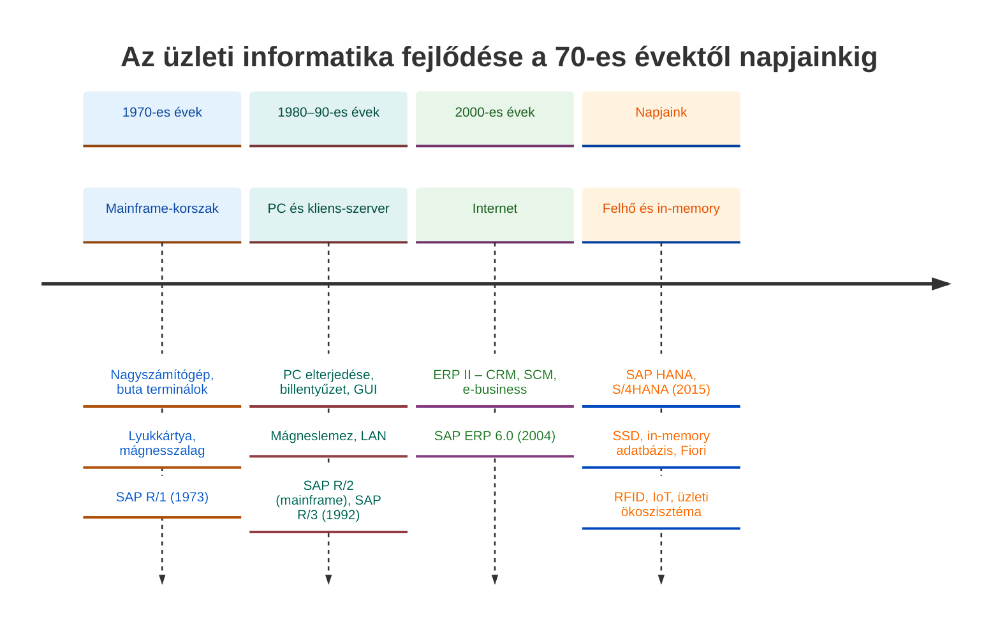
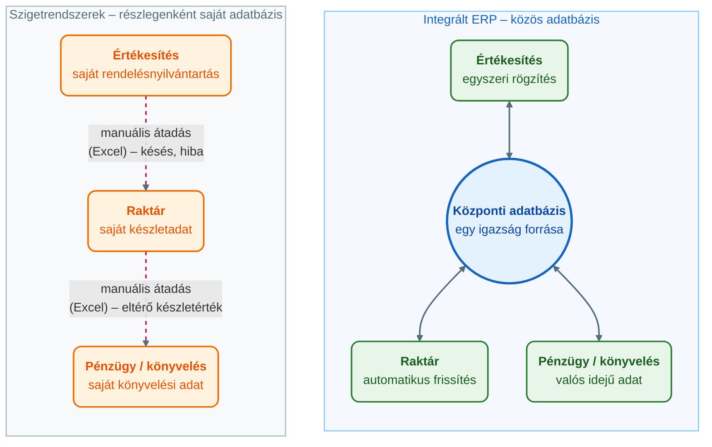

## V11 – Informatikai megoldások fejlődése és a szigetrendszerektől az integrált rendszerekig

### Beszerzendő anyagok

| Szerző | Mű | Jelleg | Indoklás / érintett rész |
|---|---|---|---|
| Tasi M. | *Vállalatirányítási rendszerek* (Edutus Főiskola, 2011) | kötelező irodalom | A syllabus kötelező irodalomként nevezi meg; tartalma helyben nem ellenőrizhető. A 11.1–11.3 rész (az informatikai és az ERP-fejlődés) mélyítéséhez. |
| Molnár B. | *Vállalatirányítási rendszerek gazdaságinformatikai megközelítésben* (2014) | kötelező irodalom | A syllabus kötelező irodalomként nevezi meg; tartalma helyben nem ellenőrizhető. A 11.5 rész (integrációs módszerek és technológiák) bővítéséhez. |
| — | *Vállalati információs rendszerek I. Bevezetés a vállalati információs rendszerekbe* (Széchenyi István Egyetem, online jegyzet) | kötelező irodalom | A syllabus kötelező irodalomként nevezi meg; tartalma helyben nem ellenőrizhető. A 11.1–11.2 rész (információrendszerek fejlődése, szigetrendszerek) alapozásához. |

**Tétel:** Informatikai fejlődés és szigetrendszerek: Ismertesse az informatikai megoldások fejlődését a 70-es évektől napjainkig, kitérve a hardver, az adatbevitel, az adattárolás és a kommunikáció evolúciójára! Mutassa be a szigetrendszerek kialakulásának okait és jellemzőit, majd fejtse ki, milyen szervezeti és technológiai igények vezettek az integrált rendszerek megjelenéséhez! Hasonlítsa össze a hagyományos szigetrendszerek és az integrált vállalatirányítási rendszerek tulajdonságait, és ismertesse a különböző rendszerek összekapcsolásának lehetőségeit és módszereit!

---

### 11.1. Az informatikai megoldások fejlődése a 70-es évektől napjainkig

Az információs technológia fejlődése az elmúlt öt évtizedben radikálisan átalakította a vállalatok működését. Ez a folyamat négy pillér mentén érthető meg: a hardver és architektúra, az adatbevitel, az adattárolás és a kommunikáció evolúcióján keresztül (Oktatási segédanyag, 2026, 1. o.). A négy pillér nem egymástól függetlenül fejlődött: minden korszakban a hardver lehetőségei szabták meg, hogyan lehetett adatot bevinni, tárolni és továbbítani.

**Hardver és architektúra.** Az 1970-es évek a nagyszámítógépek (mainframe) kora. A feldolgozás központosított: egyetlen nagy gép végzi a munkát, a felhasználók „buta" terminálokon érik el. Ebbe a korszakba tartozik az SAP első két rendszere, az R/1 és az R/2 (Oktatási segédanyag, 2026, 1. o.). Az R/1 1973-ban jelent meg pénzügyi könyvelési szoftverként, az R/2 pedig az 1980-as évek elejének mainframe-alapú standard rendszere volt (Óbudai Egyetem KKGK, é. n., „Fogalma és alapjai" lecke). Az 1980-as és 1990-es években a személyi számítógépek (PC) elterjedésével megjelent a kliens-szerver architektúra: a feldolgozási teljesítmény kikerült a végfelhasználókhoz. Ennek tipikus példája az SAP R/3 (1992), amely kliens-szerver alapon világszerte elterjedt (Oktatási segédanyag, 2026, 1. o.; Óbudai Egyetem KKGK, é. n., „Vállalatirányítási rendszerek" lecke). Napjaink korszakát a felhőalapú számítástechnika (cloud) és az in-memory technológia jellemzi: az adatfeldolgozás már nem merevlemezen, hanem a memóriában (RAM) történik, ami drasztikusan növeli a sebességet. Ennek példája az SAP HANA és a rá épülő S/4HANA (2015), az SAP negyedik generációs üzleti csomagja (Oktatási segédanyag, 2026, 1. o.; Óbudai Egyetem KKGK, é. n., „Fogalma és alapjai" lecke).

**Adatbevitel.** A lyukkártyáktól a billentyűzeten és a grafikus felhasználói felületeken (GUI) át jutottunk el a modern, szerepkör-alapú webes felületekig (SAP Fiori), valamint az automatizált adatbevitelig: RFID, IoT-szenzorok, hangalapú asszisztensek (Oktatási segédanyag, 2026, 1. o.). A fejlődés iránya tehát az, hogy az adat egyre kevesebb emberi beavatkozással, egyre közelebb a keletkezés helyéhez kerül a rendszerbe.

**Adattárolás.** A mágnesszalagokat és a lassú mágneslemezeket felváltották az SSD-k, majd az in-memory adatbázisok. Ezzel párhuzamosan az adatmodell is egyszerűsödött: a redundáns, aggregált táblákat az „egy igazság forrásán" alapuló, tömörített adattárolás váltotta fel (Oktatási segédanyag, 2026, 1. o.). Az S/4HANA-ban az adattáblák számát több mint 70%-kal csökkentették, és a tömörítés révén jelentős méretcsökkenés érhető el (Óbudai Egyetem KKGK, é. n., „Vállalatirányítási rendszerek" lecke).

**Kommunikáció.** A lokális hálózatoktól (LAN) az interneten át eljutottunk a teljes üzleti ökoszisztémák összekapcsolásáig. A mai rendszerek már nemcsak a vállalaton belül, hanem a beszállítókkal és a vevőkkel is valós időben kommunikálnak (Oktatási segédanyag, 2026, 1. o.). Az SAP történetében ez a lépés jól datálható: 1995–96-ban az SAP „csatlakozott az internethez", és az R/3 online is használhatóvá vált (SAP UCC Magdeburg, 2025, 7. dia).

A négy pillér fejlődését egyetlen táblázatban így lehet összefoglalni:

| Pillér | Kiindulás (1970-es évek) | Átmenet (1980–2000-es évek) | Napjaink |
|---|---|---|---|
| Hardver, architektúra | Mainframe, buta terminálok (SAP R/1, R/2) | PC, kliens-szerver (SAP R/3) | Felhő, in-memory (SAP HANA, S/4HANA) |
| Adatbevitel | Lyukkártya | Billentyűzet, grafikus felület (GUI) | Szerepkör-alapú webes felület (Fiori); automatizált bevitel (RFID, IoT, hang) |
| Adattárolás | Mágnesszalag, mágneslemez | SSD; relációs adatbázisok | In-memory adatbázis; egyszerűsített, tömörített adatmodell |
| Kommunikáció | Lokális hálózat (LAN) | Internet | Üzleti ökoszisztéma: valós idejű kapcsolat beszállítókkal, vevőkkel |

*(A táblázat oszlopai a segédanyag három hardverkorszakát követik; a relációs adatbázis az R/3 jellemzője: Oktatási segédanyag, 2026, 1. és 13. o.)*

### 11.2. A szigetrendszerek kialakulása és jellemzői

A **szigetrendszerek** (isolated systems) olyan informatikai megoldások, amelyeket egy adott funkcionális terület – például csak a könyvelés vagy csak a raktár – igényeire fejlesztettek ki, anélkül, hogy azokat összehangolták volna a vállalat többi részével (Oktatási segédanyag, 2026, 1. o.). A 11.1 pontban leírt korai korszakokban ez volt a természetes állapot: minden részleg a saját programját használta, a saját adataival.

**A kialakulás okai** három csoportba sorolhatók (Oktatási segédanyag, 2026, 2. o.):

1. **Funkcionális szemlélet.** A részlegek a saját problémáikra kerestek gyors megoldást. Nem a vállalat egészének, hanem egy-egy osztálynak a feladatát kellett támogatni.
2. **Technológiai korlátok.** Korábban nem állt rendelkezésre elegendő sávszélesség és hardverkapacitás egy központi rendszer működtetéséhez. Ez az ok közvetlenül a 11.1 pontból következik: a mainframe-korszak és a korai hálózatok nem tették lehetővé a vállalatszintű integrációt.
3. **Szervezeti silók.** A részlegek közötti kommunikáció hiánya és az eltérő osztályvezetési célok. Az osztályok nem is igényelték a közös rendszert, mert a saját céljaikat a saját eszközükkel is elérték.

**A szigetrendszerek jellemzői** (Oktatási segédanyag, 2026, 2. o.):

- **Adatredundancia.** Ugyanazt az adatot – például egy vevő nevét – több rendszerben is rögzíteni kell.
- **Inkonzisztencia.** Eltérő adatállományok alakulnak ki: a pénzügy más készletértéket lát, mint a raktár.
- **Információs rések.** A rendszerek közötti adatátvitel gyakran manuális (például Excel-fájlokkal), ami lassú és hibaforrás.

A három jellemző ok-okozati láncot alkot: a redundancia miatt ugyanazt az adatot többször rögzítik, a többszörös rögzítés miatt az adatok elcsúsznak egymástól (inkonzisztencia), az eltéréseket pedig csak manuális egyeztetéssel lehet feloldani, ami tovább lassítja az információáramlást. Ezért nevezi a tananyag „információs szigeteknek" is ezeket a rendszereket: az adat nem áramlik akadálytalanul a részlegek és a földrajzi egységek között (Óbudai Egyetem KKGK, é. n., „Szerepe a vállalatok életében" lecke).

### 11.3. Az integrált rendszerek megjelenésének igénye

A piaci verseny és a globalizáció olyan igényeket szült, amelyeket a szigetrendszerek már nem tudtak kiszolgálni (Oktatási segédanyag, 2026, 2. o.). Ezek az igények egyszerre szervezeti és technológiai természetűek.

**Szervezeti és technológiai igények** (Oktatási segédanyag, 2026, 2. o.):

- **Valós idejű információ.** Azonnali rálátás a készletekre, a pénzügyi helyzetre és a vevői igényekre. A döntéshozók nem múltbeli riportok, hanem a jelenlegi helyzet alapján akarnak dönteni (Óbudai Egyetem KKGK, é. n., „Szerepe a vállalatok életében" lecke).
- **Folyamatszemlélet.** A funkcionális silók helyett a teljes üzleti folyamat támogatása, például a rendeléstől a fizetésig (Order-to-Cash). Egy vevői rendelés nem az értékesítésnél ér véget: készletfoglalást, szállítást, számlázást és könyvelést indít el, és ezt a láncot egyetlen rendszernek kell végigkísérnie.
- **Költségcsökkentés.** A többszörös adatrögzítés és a sok különálló rendszer karbantartási költségének minimalizálása.

**Technológiai lehetőségek.** Az igények önmagukban nem lettek volna elegendők: az integrációt a 11.1 pontban bemutatott fejlődés tette lehetővé. A PC-k elterjedése és a kliens-szerver architektúra a feldolgozási kapacitást, a lokális hálózatok és az internet a kommunikációt biztosította (Oktatási segédanyag, 2026, 1. o.). Az SAP R/3 (1992) kliens-szerver rendszerként ezen az alapon vált nemzetközi áttöréssé (Óbudai Egyetem KKGK, é. n., „Vállalatirányítási rendszerek" lecke).

**Az integráció evolúciója.** Az integrált rendszerek nem egy lépésben jöttek létre, hanem a tervezés hatóköre fokozatosan tágult. A tananyag mérföldkövei (Oktatási segédanyag, 2026, 2. o.; Óbudai Egyetem KKGK, é. n., „Fogalma és alapjai" lecke):

1. **MRP** (1960-as évek): anyagszükséglet-tervezés, raktárkészlet-fókusz.
2. **Zárt láncú MRP** (1970-es évek): a szervezet kapacitásait is figyelembe veszi (CRP – Capacity Requirements Planning).
3. **MRP II** (1980-as évek): gyártási erőforrás-tervezés, a termelés már pénzügyi riportokkal integrálva.
4. **ERP** (1990-es évek): teljes körű integráció a vállalat belső erőforrásaira.
5. **ERP II** (2000-es évek): a vállalati határokon átnyúló folyamatok (CRM, SCM) és az internetalapú megoldások korszaka.
6. **S/4HANA** (napjaink): intelligens vállalatirányítási rendszer beépített analitikával és AI-támogatással.

A leckék eltérő részletességgel tagolnak: a segédanyag négy, a „Fogalma és alapjai" lecke öt lépcsőt nevesít (a zárt láncú MRP-vel és az ERP II-vel), de a fejlődés iránya mindegyikben azonos: raktár → gyártás → teljes vállalat → vállalatközi hálózat → valós idejű, intelligens platform. A részletes fejlődéstörténet a V12 tétel tárgya; a V11 szempontjából az a lényeg, hogy minden lépcső egy-egy újabb szigetet olvasztott be a közös rendszerbe.

### 11.4. Szigetrendszerek és integrált vállalatirányítási rendszerek összehasonlítása

Az integrált vállalatirányítási rendszer (ERP – Enterprise Resource Planning) célja, hogy a vállalat valamennyi lényeges működési adatát egyetlen központi helyen tárolja (Óbudai Egyetem KKGK, é. n., „Fogalma és alapjai" lecke). Az **integráltság lényege** három elvben foglalható össze:

- **Egyszeri adatrögzítés:** az adatot csak egyszer, a forrásnál kell bevinni, ami csökkenti a munkaterhelést és a hibalehetőséget.
- **Automatikus frissítés:** egy adat módosításakor a rendszer automatikusan frissíti az összes kapcsolódó folyamatot – például egy rendelés rögzítése azonnal módosítja a raktárkészletet és a termelési tervet is.
- **Valós idejű környezet:** a rendszer minden felhasználó számára naprakész információt biztosít (Óbudai Egyetem KKGK, é. n., „Fogalma és alapjai" lecke).

Mindhárom elv ugyanarra az alapra épül: az **„egy igazság forrására"** (single source of truth). Az adat egyetlen központi adatbázisban él, és minden modul ugyanazt olvassa és írja; így a részlegek közötti adateltérés nem fordulhat elő (Oktatási segédanyag, 2026, 3. és 5. o.).

A két megközelítés tulajdonságai a tananyag öt dimenziója mentén hasonlíthatók össze (Oktatási segédanyag, 2026, 3. o.); ehhez két további szempont társul, amely a bevezetés oldaláról mutatja a különbséget (Oktatási segédanyag, 2026, 4. és 8. o.):

| Jellemző | Hagyományos szigetrendszerek | Integrált ERP rendszerek |
|---|---|---|
| Adattárolás | Decentralizált, redundáns | Centralizált, „egy igazság forrása" |
| Adatbevitel | Részlegenként többszörös | Egyszeri, a forrásnál |
| Folyamatok | Funkcionális (siló-alapú) | Folyamatközpontú (end-to-end) |
| Riportálás | Nehézkes, utólagos összesítés | Valós idejű, beágyazott analitika |
| Karbantartás | Magas (sok különálló interfész) | Alacsonyabb (egységes platform) |
| Folyamatok szabványossága | Részlegenként egyedi megoldások | Iparági „legjobb gyakorlat" (best practice) alapú, standardizált folyamatok |
| Bevezetés ára | Kis, gyors, részleges megoldások | Magas költség, hosszú (6 hónap – több év) bevezetés; a best practice nem mindig illeszkedik a vállalati sajátosságokhoz |

Az összehasonlításból látszik, hogy az integrált rendszer előnye nem egy-egy funkcióban, hanem a **működés logikájában** van: a szigetrendszer az osztály, az ERP a folyamat köré szerveződik. Ennek ára is van: a bevezetés drága és hosszú, és a standardizált folyamatok rugalmatlanságot hozhatnak (Oktatási segédanyag, 2026, 8. o.). A szigetrendszer tehát nem „rossz" rendszer – egy adott részleg feladatát jól is elláthatja –, hanem a vállalat egészének szintjén válik problémává.

### 11.5. A rendszerek összekapcsolásának lehetőségei és módszerei

Az integráció igénye nem szűnik meg egy ERP bevezetésével. Még egy integrált ERP mellett is szükség lehet külső rendszerek – például egy speciális webshop vagy egy banki szoftver – összekapcsolására (Oktatási segédanyag, 2026, 3. o.). A tananyag az összekapcsolás módszereit két szempont szerint tárgyalja: az adatátadás **időzítése** és az alkalmazott **interfész-technológia** szerint.

**Időzítés szerint** (Oktatási segédanyag, 2026, 3. o.):

1. **Batch (kötegelt) feldolgozás.** Az adatokat időközönként – például éjszaka – összegyűjtve, egyszerre továbbítják. Egyszerű és kis terhelésű, de a két rendszer a futások között eltér egymástól.
2. **Real-time (valós idejű) integráció.** Az esemény bekövetkezésekor azonnal megtörténik az adatátadás. Ez felel meg az integrált rendszer valós idejű szemléletének.

A két megközelítés különbségét jól mutatja az anyagszükséglet-tervezés példája: a korábbi rendszerekben az MRP futtatása órákat vett igénybe, és jellemzően éjszaka, kötegelt feldolgozásként történt; az S/4HANA-ban ez bármikor, igény szerint lefuttatható, azonnali javaslatot adva a beszerzésre vagy a gyártásra (Óbudai Egyetem KKGK, é. n., „Szerepe a vállalatok életében" lecke).

**Interfész-technológiák szerint** (Oktatási segédanyag, 2026, 3. o.):

- **API** (Application Programming Interface): programozható kapcsolódási pontok, amelyeken keresztül egy másik rendszer szabványos módon kérdezhet le vagy írhat adatot – például REST vagy SOAP alapon.
- **Middleware** (köztes szoftver): olyan rendszer, amely hidat képez két eltérő szoftver között; fordít és továbbít a kettő között, így nem kell minden rendszerpárt külön-külön összekötni. Példa: SAP Integration Suite.
- **SOA** (Service Oriented Architecture, szolgáltatásorientált architektúra): a funkciók független, önállóan hívható szolgáltatásként érhetők el, így a rendszerek lazán kapcsolódnak egymáshoz.

A módszer megválasztása az üzleti igénytől függ: ahol a késleltetés elfogadható (például időszaki összesítések), ott a kötegelt átadás is megfelel; ahol a folyamat azonnali visszajelzést igényel (például készletellenőrzés egy webshop-rendelésnél), ott valós idejű, API- vagy middleware-alapú kapcsolat kell. A szigetrendszerek összekötése azonban nem pótolja az integrációt: a sok különálló interfész éppen azt a magas karbantartási költséget termeli újra, amelyet a 11.4 pont összehasonlító táblázata a szigetrendszerek hátrányaként mutat (Oktatási segédanyag, 2026, 3. o.).

**Összegzés:** Az informatika fejlődése – a mainframe-től a felhőig, a lyukkártyától az IoT-szenzorig, a mágnesszalagtól az in-memory adatbázisig, a LAN-tól az üzleti ökoszisztémáig – a technológiai lehetőségek bővülésével párhuzamosan a szigetrendszerektől az integrált, majd az intelligens rendszerek felé mozdult el. A szigetrendszereket a funkcionális szemlélet, a technológiai korlátok és a szervezeti silók hozták létre; a valós idejű információ, a folyamatszemlélet és a költségcsökkentés igénye vezetett az integrált rendszerekhez. A modern ERP rendszerek, mint az SAP S/4HANA, nemcsak tárolják az adatokat, hanem a folyamatok integrálásával és a valós idejű analitikával versenyelőnyt biztosítanak a vállalatoknak (Oktatási segédanyag, 2026, 3. o.). Ahol külső rendszer kapcsolása mégis szükséges, ott a kötegelt vagy valós idejű átadás, illetve az API-, middleware- és SOA-alapú technológiák adják az eszköztárat.

---

### Várható vizsgáztatói kérdések

1. **Mit jelent az „egy igazság forrása", és hogyan függ össze az egyszeri adatrögzítéssel?** — Az adat egyetlen központi adatbázisban, egyetlen hiteles példányban él; minden modul ugyanazt olvassa és írja. Ebből következik az egyszeri adatrögzítés: ha az adatnak csak egy példánya van, elég egyszer, a forrásnál bevinni, és a kapcsolódó folyamatok automatikusan frissülnek (Oktatási segédanyag, 2026, 3. és 5. o.; Óbudai Egyetem KKGK, é. n., „Fogalma és alapjai" lecke).
2. **Miért nem elegendő a szigetrendszereket interfészekkel összekötni?** — Az összekötés megőrzi a redundanciát és a többszörös rögzítést, csak az átadást automatizálja; a sok különálló interfész magas karbantartási költséget jelent, és a kötegelt átadás esetén a rendszerek a futások között továbbra is eltérnek. Az integráció a közös adatbázissal magát a problémát szünteti meg (Oktatási segédanyag, 2026, 3. o.).
3. **Mi a különbség a kötegelt és a valós idejű integráció között? Mondjon példát!** — A kötegelt feldolgozás az adatokat időközönként, például éjszaka, egyszerre továbbítja; a valós idejű integráció az esemény bekövetkezésekor azonnal. Példa: a korábbi MRP-futtatás órákig tartott és éjszaka futott, az S/4HANA-ban bármikor, igény szerint lefuttatható (Oktatási segédanyag, 2026, 3. o.; Óbudai Egyetem KKGK, é. n., „Szerepe a vállalatok életében" lecke).
4. **Milyen előnyt hoz az in-memory technológia a korábbi megoldásokhoz képest?** — Az adatfeldolgozás a memóriában történik, nem merevlemezen, ezért drasztikusan gyorsabb; megszűnik a különbség a tranzakciós (OLTP) és az analitikai (OLAP) feldolgozás között, a riportok a friss adatokból azonnal elkészülnek; az adatmodell egyszerűsödik, az aggregált táblák és indexek kiiktatásával a táblák száma több mint 70%-kal csökkent (Oktatási segédanyag, 2026, 1. o.; Óbudai Egyetem KKGK, é. n., „Vállalatirányítási rendszerek" lecke).
5. **Hogyan változott a vállalatirányítási rendszerek fókusza az 1960-as évektől napjainkig?** — Raktárkészlet (MRP) → gyártási kapacitás és pénzügy (zárt láncú MRP, MRP II) → a vállalat összes belső erőforrása (ERP) → vállalatközi folyamatok, CRM és SCM (ERP II) → valós idejű, intelligens platform beépített analitikával (S/4HANA). A források az egyes generációk határait eltérő részletességgel adják meg, az SAP R/2 datálása is szór (1979 és 1981/82 között), ezért szóban az évtizedet érdemes mondani (Óbudai Egyetem KKGK, é. n., „Fogalma és alapjai" és „Vállalatirányítási rendszerek" lecke; SAP UCC Magdeburg, 2025, 7. és 10. dia).
6. **Mi a különbség a funkcionális (siló-alapú) és a folyamatközpontú működés között?** — A funkcionális működésben minden osztály a saját feladatát és adatát kezeli, az átadás a határokon manuális; a folyamatközpontú működés a teljes üzleti folyamatot – például a rendeléstől a fizetésig (Order-to-Cash) – egyetlen láncként támogatja, részleghatároktól függetlenül (Oktatási segédanyag, 2026, 2–3. o.).

---

## Irodalom

* Óbudai Egyetem, Keleti Károly Gazdasági Kar. (é. n.). *Az integrált vállalatirányítási rendszerek szerepe a vállalatok életében* [Elektronikus tananyag, Integrált vállalatirányítási rendszerek (GMXIV2MBLF)].
* Óbudai Egyetem, Keleti Károly Gazdasági Kar. (é. n.). *Integrált vállalatirányítási rendszer fogalma és alapjai* [Elektronikus tananyag, Integrált vállalatirányítási rendszerek (GMXIV2MBLF)].
* Óbudai Egyetem, Keleti Károly Gazdasági Kar. (é. n.). *Vállalatirányítási rendszerek* [Elektronikus tananyag, Integrált vállalatirányítási rendszerek (GMXIV2MBLF)].
* *Oktatási segédanyag: Integrált vállalatirányítási rendszerek (GMXIV2MBLF)* [Egyetemi segédanyag]. (2026). Óbudai Egyetem, Keleti Károly Gazdasági Kar.
* SAP University Competence Center Magdeburg. (2025). *Introduction to SAP S/4HANA using Global Bike: SAP slides* (v4.3) [Előadás-diák]. SAP University Alliances.
