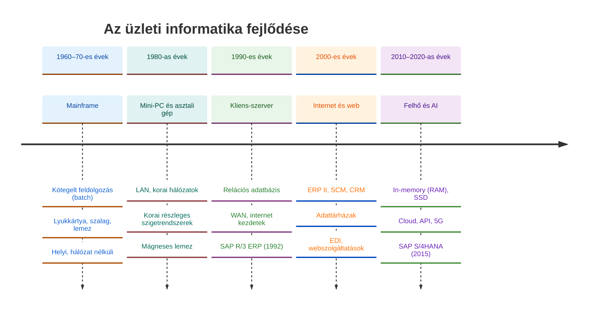

## V11 – Informatikai megoldások fejlődése és a szigetrendszerektől az integrált rendszerekig

**Tétel:** Informatikai fejlődés és szigetrendszerek: Ismertesse az informatikai megoldások fejlődését a 70-es évektől napjainkig, kitérve a hardver, az adatbevitel, az adattárolás és a kommunikáció evolúciójára! Mutassa be a szigetrendszerek kialakulásának okait és jellemzőit, majd fejtse ki, milyen szervezeti és technológiai igények vezettek az integrált rendszerek megjelenéséhez! Hasonlítsa össze a hagyományos szigetrendszerek és az integrált vállalatirányítási rendszerek tulajdonságait, és ismertesse a különböző rendszerek összekapcsolásának lehetőségeit és módszereit!

---

### 11.1. Az informatikai megoldások fejlődése

Az üzleti informatika az 1960-as évektől napjainkig több markáns korszakon ment át. Mindegyik korszakot a hardver, az adatkezelés és a kommunikáció együttes változása jellemzett.

| Korszak           | Hardver               | Adatbevitel         | Tárolás              | Kommunikáció                     |
| ----------------- | --------------------- | ------------------- | -------------------- | -------------------------------- |
| 1960–70-es évek   | Mainframe, lyukkártya | Kötegelt (batch)    | Szalag, lemez        | Helyi, nincs hálózat             |
| 1980-as évek      | Mini-PC, asztali gép  | Korai terminálok    | Mágneses lemez       | LAN, korai hálózatok             |
| 1990-es évek      | Kliens-szerver        | GUI, billentyűzet   | Relációs adatbázis   | WAN, internet kezdetek           |
| 2000-es évek      | Webszerverek, laptop  | Böngésző, mobil     | Adattárházak, RAID   | Internet, EDI, webszolgáltatások |
| 2010–2020-as évek | Felhő, IoT eszközök   | Mobil, API, szenzor | In-memory (RAM), SSD | Cloud, API, 5G                   |

### 11.2. A szigetrendszerek kialakulása és problémái

Az 1970–80-as évek vállalataiban minden szervezeti egység a saját igényeire fejlesztett vagy vásárolt szoftvert. A könyvelési osztálynak volt pénzügyi rendszere, a raktárnak készletnyilvántartója, az értékesítésnek rendelésrögzítője – de ezek egymástól teljesen elkülönülten működtek. Ezeket hívjuk **szigetrendszereknek** (siloed systems).

**A szigetrendszerek kialakulásának okai:**

- A szoftverpiacon az 1980-as évekig nem volt egységes, integrált megoldás.
- Az osztályvezetők önállóan döntöttek a saját IT-eszközeikről.
- A rendszerek különböző technológiákon (platformokon, adatbázisokon) futottak.

**A szigetrendszerek jellemző problémái:**

```mermaid
flowchart LR
    subgraph Ert["📦 Értékesítés — saját DB"]
        SO(["<b>Vevői rendelés</b><br/>rögzítve"]):::narancs
    end
    subgraph Rak["🏭 Raktár — saját DB"]
        GI(["<b>Készlet</b><br/>frissítve"]):::narancs
    end
    subgraph Pen["💰 Pénzügy — saját DB"]
        INV(["<b>Számla</b><br/>kiállítva"]):::narancs
    end
    subgraph HR_["👥 HR — saját DB"]
        PAY(["<b>Jutalék</b><br/>számítva"]):::narancs
    end

    Ert -->|"📧 e-mail / Excel<br/>⚠ Késés · Újrarögzítési hiba"| Rak
    Rak -->|"📊 Excel export<br/>⚠ Eltérő készletadat"| Pen
    Pen -->|"🗒️ Papíros kimutatás<br/>⚠ Nincs valós idejű kép"| HR_

    classDef narancs fill:#fff3e0,stroke:#ef6c00,stroke-width:2px,color:#e65100,rx:10,ry:10;

    style Ert fill:#fffaf3,stroke:#ffcc80,stroke-width:1.5px,color:#ef6c00;
    style Rak fill:#fffaf3,stroke:#ffcc80,stroke-width:1.5px,color:#ef6c00;
    style Pen fill:#fffaf3,stroke:#ffcc80,stroke-width:1.5px,color:#ef6c00;
    style HR_ fill:#fffaf3,stroke:#ffcc80,stroke-width:1.5px,color:#ef6c00;

    linkStyle default stroke:#c2185b,stroke-width:2px,stroke-dasharray: 5 5;
```

| Probléma              | Következmény                                                |
| --------------------- | ----------------------------------------------------------- |
| Adatredundancia       | Ugyanaz az adat több helyen van tárolva, eltérő értékekkel  |
| Manuális újrarögzítés | Hibalehetőség, időpazarlás                                  |
| Inkonzisztens adatok  | Raktárkészlet ≠ Pénzügyi könyvelés ≠ Értékesítési adat      |
| Nincs valós idejű kép | A vezető csak utólag, papíros jelentésekből kap információt |
| Nehéz auditálhatóság  | Az adatok útja nem követhető vissza                         |

### 11.3. Az integrált rendszerek megjelenésének igénye

Az 1990-es évekre a vállalatok mérete és komplexitása meghaladta, amit a szigetrendszerekkel kezelni lehetett. Az integráció iránti igényt két oldalról hajtotta:

**Szervezeti igények:** A globalizáció következtében a vállalatok több kontinensen, több pénznemben, különböző jogi szabályozás alatt működtek. A döntéshozóknak egységes, valós idejű képre volt szükségük a teljes szervezetről.

**Technológiai lehetőségek:** A kliens-szerver architektúra, a relációs adatbázisok és a hálózati infrastruktúra fejlődése lehetővé tette az egységes, moduláris szoftverrendszerek megvalósítását. Az SAP R/3 (1992) ezt az igényt elégítette ki elsőként széles körben.

### 11.4. Szigetrendszerek vs. integrált ERP rendszerek

| Jellemző             | Szigetrendszer               | Integrált ERP                            |
| -------------------- | ---------------------------- | ---------------------------------------- |
| Adatrögzítés         | Minden rendszerbe külön      | Egyszeri rögzítés, automatikus frissítés |
| Adatkonzisztencia    | Rendszerenként eltérő        | Egységes, központi adatbázis             |
| Valós idejűség       | Nincs, csak kötegelt         | Valós idejű tranzakciók és riportok      |
| Folyamat-lefedettség | Részleges, osztályszintű     | Teljes vállalat, end-to-end folyamatok   |
| Karbantartás         | Több rendszer, több szállító | Egy szállító, egységes platform          |
| Bevezetési kockázat  | Alacsony (kis rendszer)      | Magas (komplex projekt)                  |
| Testreszabhatóság    | Korlátlan (saját fejlesztés) | Korlátozott (best practice alapú)        |

### 11.5. Rendszerek összekapcsolásának módszerei

Ahol a teljes csere nem lehetséges, az összekapcsolás (integráció) különböző szinten valósítható meg:

| Módszer                               | Leírás                                                                                       | Jellemző alkalmazás                |
| ------------------------------------- | -------------------------------------------------------------------------------------------- | ---------------------------------- |
| **Fájlcsere / Batch**                 | Időszakos adatexport-import (CSV, XML)                                                       | Régi rendszerek, éjszakai futások  |
| **EDI** (Electronic Data Interchange) | Strukturált elektronikus üzenetcsere szabvány szerint                                        | Ellátási lánc, számlák, rendelések |
| **Middleware / EAI**                  | Enterprise Application Integration – közbenső réteg, amely fordítja és irányítja az adatokat | Vegyes IT-környezetek              |
| **ESB** (Enterprise Service Bus)      | Üzenetalapú integrációs busz, lazán csatolt architektúra                                     | Komplex vállalati ökoszisztémák    |
| **API / Webszolgáltatás**             | REST/SOAP alapú valós idejű adatcsere                                                        | Modern felhőalapú integrációk      |
| **iPaaS**                             | Integration Platform as a Service – felhőalapú integrációs platform                          | SaaS-rendszerek összekapcsolása    |

**Összegzés:** A vállalati informatika az izolált, osztályszintű szigetrendszerektől az egységes, valós idejű ERP platformok felé fejlődött. Ezt a folyamatot a szervezetek komplexitásának növekedése, a globalizáció és a technológiai lehetőségek bővülése együttesen hajtotta. A teljes integráció megvalósíthatatlansága esetén különböző middleware- és API-megoldások kínálnak átmeneti vagy kiegészítő kapcsolatot a rendszerek között.

---

*Forrás: Tasi Miklós: Vállalatirányítási rendszerek (Edutus, 2011); Molnár Bálint: Vállalatirányítási rendszerek gazdaságinformatikai megközelítésben (2014); GMXIV2MBLF oktatási segédanyag (2026)*
