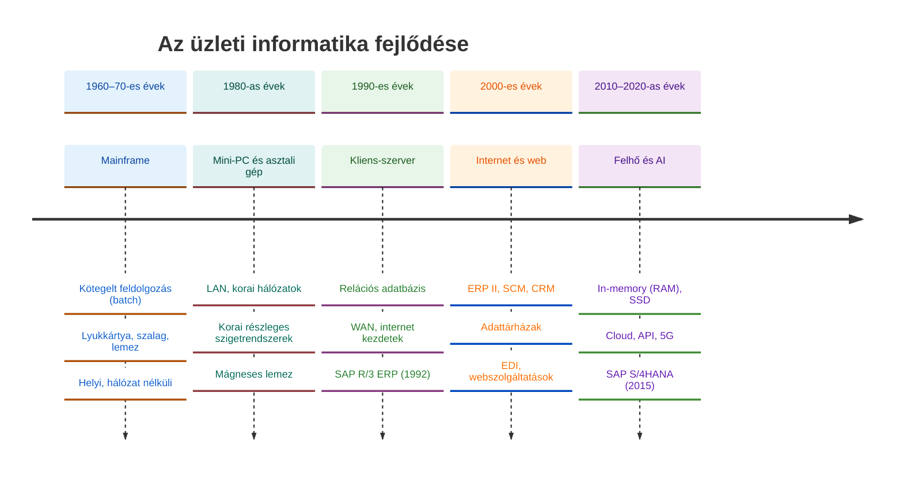
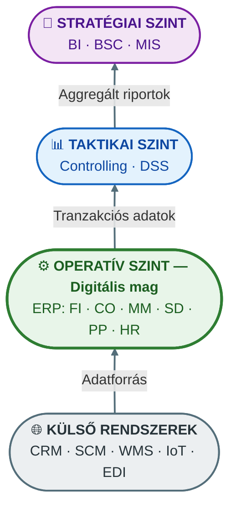

## V12 – Az ERP rendszer fogalma, fejlődéstörténete és szervezeti szerepe

**Tétel:** ERP fogalma és fejlődéstörténete: Határozza meg az integrált vállalatirányítási rendszer (ERP) fogalmát, és ismertesse fejlődéstörténetét az MRP-től az MRP II-n át a modern felhőalapú ERP megoldásokig! Fejtse ki, milyen szerepet tölt be az ERP a vállalati információs rendszer egészében, és mutassa be, hogyan illeszkedik a vállalat szervezeti felépítésébe és kultúrájába! Térjen ki az új üzleti modellek és az új üzleti folyamatkoncepciók megjelenésére, és vázolja az ERP rendszerek jövőbeni fejlődési irányait (felhőalapú ERP, mesterséges intelligencia integrációja)!

---

### 12.1. Az ERP fogalma

Az **ERP** (Enterprise Resource Planning – Integrált vállalatirányítási rendszer) olyan szoftvermegoldás, amely a vállalat valamennyi lényeges működtetési adatát **egyetlen, közös adatbázisban** tárolja, és a különböző részlegek (pénzügy, logisztika, gyártás, HR, értékesítés) folyamatait egységes platformon integrálja.

Az integráltság három alapelven nyugszik:

| Alapelv | Tartalma |
|---|---|
| **Egyszeri adatrögzítés** | Az adatot csak egyszer kell bevinni – a rendszer minden érintett folyamatot automatikusan frissít |
| **Automatikus frissítés** | Egy rendelés rögzítése azonnal módosítja a készletet, a termelési tervet és a pénzügyi könyvelést |
| **Valós idejű környezet** | Minden felhasználó naprakész adatokat lát, nincs szükség éjszakai adatszinkronizálásra |

### 12.2. Az ERP fejlődéstörténete

| Generáció | Időszak | Fókusz | SAP megfelelő |
|---|---|---|---|
| MRP | 1960-as évek | Anyagszükséglet-tervezés | SAP R/1 (1973) |
| Zárt láncú MRP | 1970-es évek | + kapacitástervezés (CRP) | SAP R/2 (1981) |
| MRP II | 1980-as évek | + pénzügyi riportok, gyártás | SAP R/2 kibővítve |
| ERP | 1990-es évek | Teljes belső integráció | SAP R/3 (1992) |
| ERP II | 2000-es évek | + internet, SCM, CRM, BI | SAP ERP 6.0 (2004) |
| Intelligens ERP | 2010–napjaink | In-memory, IoT, AI, felhő | SAP S/4HANA (2015–) |

**Az SAP fejlődése:** Az SAP-t 1972-ben alapította öt korábbi IBM-mérnök. Az R/3-as rendszer (1992) kliens-szerver architektúrával hozta el a valódi áttörést – ez lett a globális ERP-standard. A 2015-ben bevezetett S/4HANA az in-memory HANA adatbázison fut, amellyel az OLTP és OLAP feldolgozás egyetlen rendszerben valósul meg.

### 12.3. Az ERP helye a vállalati információs rendszerben

Az ERP nem egyedüli réteg – a vállalati IT-architektúrában több szinttel együttműködik:

Az ERP az „operatív mag" (digital core): minden üzleti tranzakció itt keletkezik és kerül rögzítésre. A felsőbb szintek (BI, controlling) ebből az adatbázisból táplálkoznak. A VIR-en belül az ERP biztosítja az egységes törzsadatokat, a bizonylati elvet és a bizonylatfolyamot.

### 12.4. ERP a szervezeti felépítésben és a vállalati kultúrában

Az ERP bevezetése nem csupán technológiai csere – a szervezet gondolkodásmódját is formálja. A funkcionális silók (osztályközpontú szemlélet) helyett **folyamatorientált szervezeti modell** válik szükségessé.

A Global Bike példáján látható ez a váltás: a felsővezetés nem osztályokban gondolkodik, hanem kulcsfolyamatokban – például *Idea-to-Market* (termékfejlesztéstől a piacra lépésig) vagy *Order-to-Cash* (rendeléstől a kifizetésig).

**Kulturális hatások:**

| Terület | Hagyományos szervezet | ERP-alapú szervezet |
|---|---|---|
| Döntéshozatal | Megérzés, utólagos riportok | Valós idejű adatok, szimulációk |
| Felelősség | Osztályszintű | Folyamat-szintű (folyamatgazda) |
| Láthatóság | Korlátozott (saját osztály) | Teljes szervezet átlátható |
| Felhasználói élmény | Komplex GUI-tranzakciók | SAP Fiori: szerepkör-alapú, egyszerűsített csempék |

### 12.5. Új üzleti modellek és folyamatkoncepciók

A digitális transzformáció (felhő, IoT, Big Data) új üzleti modelleket teremtett, amelyeket a modern ERP rendszereknek is le kell kezelniük:

- **Segment of One:** a tömegtermelés helyett egyéni, személyre szabott kiszolgálás digitálisan.
- **Subscription model:** előfizetéses üzleti modell – az ERP számlázási és CRM moduljai ezt is kezelik.
- **Platform economy:** a vállalat nem csupán terméket ad el, hanem ökoszisztéma-tagként digitális platformon vesz részt.

Az S/4HANA **„Run Simple"** filozófiája három irányban optimalizál: **hatékonyság** (folyamatlépések automatizálása), **eredményesség** (döntési intelligencia növelése) és **agilitás** (innováció gyors befogadása).

### 12.6. Jövőbeni fejlődési irányok

| Irány | Tartalom |
|---|---|
| **Felhőalapú ERP** | SaaS-modell, alacsonyabb IT-infrastruktúra-igény, automatikus frissítések (SAP Rise with SAP) |
| **AI-integráció** | Gépi tanulás a készlet-előrejelzésben, prediktív karbantartásban, anomália-detektálásban |
| **Embedded Analytics** | Az analitika beépül az ERP-be – nincs szükség különálló adattárházra a napi döntésekhez |
| **IoT-integráció** | Gyártósorok, raktárak, szállítóeszközök valós idejű adatai közvetlenül az ERP-be kerülnek |
| **Hiperautomatizálás** | RPA (robotikus folyamatautomatizálás) + AI + ERP = emberi beavatkozás nélküli folyamatok |

**Összegzés:** Az ERP az izolált raktárkezelő szoftverből vállalati digitális maggá fejlődött. Az MRP-től az S/4HANA-ig vezető út a fokozatos integrációs törekvések és technológiai ugrások sorozata. Ma az ERP nemcsak folyamatokat integrál, hanem a szervezeti kultúrát és a stratégiai döntéshozatalt is átformálja.

---

*Forrás: GMXIV2MBLF oktatási segédanyag (2026); Tasi Miklós: Vállalatirányítási rendszerek (2011); Monk, E., Wagner, B.: Concepts in Enterprise Resource Planning (Cengage, 2012); Davenport, T.H.: „Putting the Enterprise into the Enterprise System" (HBR, 1998)*
