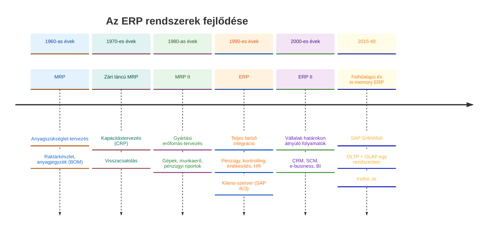
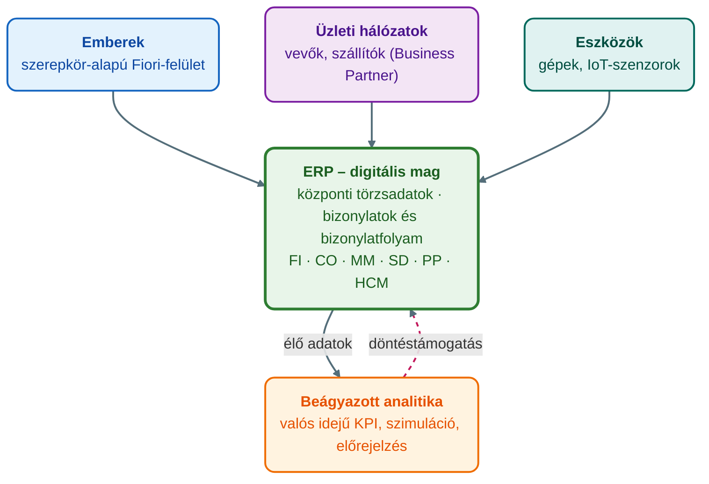

## V12 – Az ERP rendszer fogalma, fejlődéstörténete és szervezeti szerepe

### Beszerzendő anyagok

| Szerző | Mű | Jelleg | Indoklás / érintett rész |
|---|---|---|---|
| Tasi, M. | *Vállalatirányítási rendszerek* (Edutus Főiskola, 2011) | kötelező irodalom | A syllabus kötelező irodalomként nevezi meg; az R1–R2 részkérdések (ERP fogalma, MRP → MRP II → ERP II fejlődés) a helyi anyagban csak egy-egy mondattal szerepelnek. |
| Molnár, B. | *Vállalatirányítási rendszerek gazdaságinformatikai megközelítésben* (2014) | kötelező irodalom | A syllabus kötelező irodalma; az R1 és R3 részkérdések (ERP fogalma, helye a vállalati információrendszerben) elméleti háttere. |
| — | *Vállalati információs rendszerek I. Bevezetés a vállalati információs rendszerekbe* (Széchenyi István Egyetem, online jegyzet) | kötelező irodalom | A syllabus kötelező irodalma; az R3 részkérdés (az ERP a vállalati információs rendszer egészében, rendszertípusok) a helyi anyagban csak a segédanyag egy bekezdésével fedhető. |

**Tétel:** Határozza meg az integrált vállalatirányítási rendszer (ERP) fogalmát, és ismertesse fejlődéstörténetét az MRP-től az MRP II-n át a modern felhőalapú ERP megoldásokig! Fejtse ki, milyen szerepet tölt be az ERP a vállalati információs rendszer egészében, és mutassa be, hogyan illeszkedik a vállalat szervezeti felépítésébe és kultúrájába! Térjen ki az új üzleti modellek és az új üzleti folyamatkoncepciók megjelenésére, és vázolja az ERP rendszerek jövőbeni fejlődési irányait (felhőalapú ERP, mesterséges intelligencia integrációja)!

---

### 12.1. Az ERP fogalma

Az **ERP** (Enterprise Resource Planning) magyarul **integrált vállalatirányítási rendszer**. Olyan szoftvermegoldás, amely a vállalat valamennyi lényeges, a működéséhez szükséges adatát egyetlen központi helyen tárolja. A központi tárolás célja a folyamatok pontos nyomon követése és a megalapozott döntéshozatal (ÓE, é. n., „ERP fogalma és alapjai” lecke). A tárgy segédanyaga ugyanezt a folyamatok felől fogalmazza meg: az ERP a vállalat valamennyi lényeges üzleti folyamatát egyetlen közös platformon kezeli, célja pedig az emberi, pénzügyi és technikai erőforrások optimális elosztása és a belső hatékonyság maximalizálása (Novák, 2026, 4. o.).

Az **integráltság lényege** három elvben foglalható össze (ÓE, é. n., „ERP fogalma és alapjai” lecke):

| Alapelv | Tartalma |
|---|---|
| **Egyszeri adatrögzítés** | Az adatot csak egyszer kell bevinni, ami csökkenti a munkaterhelést és a hibalehetőséget. |
| **Automatikus frissítés** | Egy adat módosításakor a rendszer minden kapcsolódó folyamatot frissít: egy rendelés rögzítése azonnal módosítja a raktárkészletet és a termelési tervet is. |
| **Valós idejű környezet** | Minden felhasználó naprakész információt lát. |

A „Vállalatirányítási rendszerek” lecke a harmadik elem helyén a **folyamatorientáltságot** emeli ki: a rendszer a különböző részlegek (pénzügy, logisztika, HR) munkáját a közös cél érdekében hangolja össze (ÓE, é. n., „Vállalatirányítási rendszerek” lecke). A segédanyag szerint az ERP további jellemzője a **moduláris felépítés** (különálló, de szorosan összekapcsolódó egységek, amelyek egy-egy funkcionális területet fednek le) és a **standardizált folyamatok**: a szoftver iparági legjobb gyakorlatokat (best practice) kínál a folyamatok végrehajtásához (Novák, 2026, 4. o.).

### 12.2. Az ERP fejlődéstörténete

A vállalatirányítási rendszerek fejlődése a gyártási szektorból, a raktározás-menedzsmentből indult, és az intelligens, felhőalapú platformokig tart; az evolúció szorosan követte a hardvertechnológia és az üzleti igények változását (ÓE, é. n., „ERP fogalma és alapjai” lecke; Novák, 2026, 4. o.). A generációk a következők:

1. **MRP (Material Requirements Planning, anyagszükséglet-tervezés) – 1960-as évek.** A raktárkészletre és az anyagjegyzékre (BOM) fókuszált; célja a készletszintek minimalizálása úgy, hogy a gyártáshoz szükséges anyag pontosan akkor álljon rendelkezésre, amikor kell (ÓE, é. n., „ERP fogalma és alapjai” lecke; Novák, 2026, 4. o.).
2. **Zárt láncú MRP (closed-loop MRP) – 1970-es évek.** Már a szervezet kapacitásait is figyelembe vette a kapacitásszükséglet-tervezéssel (CRP – Capacity Requirements Planning) (ÓE, é. n., „ERP fogalma és alapjai” lecke).
3. **MRP II (Manufacturing Resource Planning, gyártási erőforrás-tervezés) – 1980-as évek.** Az anyagok mellett a gyártási kapacitásokkal (gépek, munkaerő) és a pénzügyi tervezéssel is foglalkozott, a gyártást pénzügyi riportokkal integrálta; a gyártósorról érkező visszacsatolás dinamikusabb tervezést tett lehetővé (ÓE, é. n., „ERP fogalma és alapjai” lecke; Novák, 2026, 5. o.).
4. **ERP – 1990-es évek.** Teljesen integrált megoldás a vállalat belső erőforrásaira: az integráció „átlépte a gyárkaput”, és egyetlen rendszerbe emelte a pénzügyet, a kontrollingot, az értékesítést és a HR-t. A kliens-szerver architektúra (pl. SAP R/3) tette lehetővé a globális elérést (ÓE, é. n., „ERP fogalma és alapjai” lecke; Novák, 2026, 5. o.).
5. **ERP II – 2000-es évek.** A vállalati határokon átnyúló folyamatok és az internetalapú megoldások korszaka: megjelentek az ügyfélkapcsolat-kezelő (CRM) és az ellátásilánc-menedzsment (SCM) megoldások, az e-business és az üzleti intelligencia (BI) (ÓE, é. n., „ERP fogalma és alapjai” lecke; ÓE, é. n., „Vállalatirányítási rendszerek” lecke).
6. **Modern felhőalapú és in-memory ERP – 2015-től napjainkig.** A legújabb generáció (pl. SAP S/4HANA) in-memory adatbázisra épül, amely egyesíti a tranzakciós (OLTP) és az analitikai (OLAP) feldolgozást; a felhőalapú (cloud) telepítés rugalmasságot és alacsonyabb belépési küszöböt ad (Novák, 2026, 5. o.).

| Generáció | Időszak | Fókusz |
|---|---|---|
| MRP | 1960-as évek | Anyagszükséglet-tervezés, raktárkészlet |
| Zárt láncú MRP | 1970-es évek | + kapacitástervezés (CRP) |
| MRP II | 1980-as évek | Gyártási erőforrások + pénzügyi riportok |
| ERP | 1990-es évek | A vállalat belső erőforrásainak teljes integrációja |
| ERP II | 2000-es évek | Vállalati határokon átnyúló folyamatok: CRM, SCM, e-business, BI |
| Felhőalapú és in-memory ERP | 2015-től | In-memory adatbázis, OLTP + OLAP egyesítése, felhő, AI |

**Az SAP története gyártói példaként.** Az SAP-t 1972-ben öt korábbi IBM-alkalmazott alapította azzal a vízióval, hogy standard szoftvert fejlesszenek valós idejű üzleti feldolgozáshoz (ÓE, é. n., „ERP fogalma és alapjai” lecke; SAP UCC Magdeburg, 2025, 7. dia). Mérföldkövei: az **SAP R/1** (1973) az első pénzügyi könyvelési szoftver (RF); az **SAP R/2** (1981) mainframe-alapú standard ERP rendszer; az **SAP R/3** (1992) kliens-szerver architektúrára épült, és ez hozta az igazi nemzetközi áttörést; az **SAP ERP 6.0** (2004) a Business Suite alapja; az **SAP HANA** in-memory platform 2011-ben jelent meg; az **SAP S/4HANA** (2015) pedig a negyedik generációs üzleti csomag, amely már az in-memory technológiára épül (ÓE, é. n., „ERP fogalma és alapjai” lecke; ÓE, é. n., „Vállalatirányítási rendszerek” lecke; SAP UCC Magdeburg, 2025, 8. dia). Az SAP szerint az S/4HANA „az R/3 óta a legnagyobb innováció”: összeköti az embereket, az üzleti hálózatokat és az eszközöket, valós időben működik, a törzsadatokat pedig központilag kezeli (SAP UCC Magdeburg, 2025, 10. dia).

### 12.3. Az ERP helye a vállalati információs rendszerben

A vállalati információs piramisban az ERP a **tranzakciós szintet (TPS)** foglalja el, a modern rendszerek azonban már a vezetői döntéstámogató (DSS) és a stratégiai információs (EIS) szinteket is kiszolgálják. Szerepe három pontban foglalható össze: **digitális mag** – a vállalat „idegrendszere”, ahol minden tranzakció összefut; **adatintegritás** – az „egy igazság forrása” (single source of truth), amely megszünteti a részlegek közötti adateltéréseket; **bizonylati elv** – minden gazdasági esemény nyomon követhető bizonylatok formájában (Novák, 2026, 5. o.).

**A digitális mag.** Az SAP S/4HANA a digitális transzformáció motorja: egységes platformként összeköti az embereket, az üzleti hálózatokat és az eszközöket. A törzsadatokat (partnerek, vevők, szállítók) központilag kezeli, ami biztosítja az adatok integritását, és valós időben működik, ami lehetővé teszi a vevői trendek előrejelzését és az azonnali válaszreakciót (ÓE, é. n., „VIR a vállalati információ rendszerében” lecke). Ezzel megszűnnek az információs szigetek: az adatok akadálytalanul áramlanak a részlegek és a földrajzi egységek között (ÓE, é. n., „VIR szerepe a vállalatok életében” lecke).

**Bizonylati elv és bizonylatfolyam.** Minden üzleti eseményt tranzakciók rögzítenek, amelyekből bizonylatok generálódnak. A bizonylat az üzleti tranzakció hiteles rekordja, amely a törzsadatokból és a szervezeti egységekből származó, előre meghatározott információkat tartalmazza. Példái: értékesítési, beszerzési, anyag- és számviteli bizonylat. A **bizonylatfolyam** (document flow) a kapcsolódó bizonylatok láncolata: a tranzakciók státusza bármely időpontban ellenőrizhető, mert a rendszer minden alkalommal frissíti a státuszt, amikor egy kapcsolódó bizonylat megváltozik. Az integrált folyamatokban – például az Order-to-Cash vagy a Build-to-Stock folyamatban – a bizonylatok automatikusan áramlanak a modulok között, ezért a pénzügyi (FI) és a vezetői számviteli (CO) adatok mindig összhangban vannak a fizikai folyamatokkal (ÓE, é. n., „VIR a vállalati információ rendszerében” lecke).

**Beágyazott analitika.** A hagyományos ERP rendszerek a tranzakciók rögzítésére fókuszáltak (OLTP), az elemzést különálló adattárházakban végezték (OLAP). Az S/4HANA architektúrája lehetővé teszi, hogy a tranzakciós és az analitikai folyamatok ugyanabban a rendszerben, párhuzamosan fussanak: nincs szükség az adatok éjszakai áttöltésére, az elemzések az élő adatokon alapulnak, a rendszer szimulációkkal és előrejelzésekkel támogatja a döntéseket, az eredmények pedig a Fiori felületen grafikonok és KPI-mutatók formájában jelennek meg (ÓE, é. n., „BI az ERP rendszerben” lecke).

### 12.4. Az ERP a szervezeti felépítésben és a vállalati kultúrában

Az ERP bevezetése nem technikai, hanem **szervezeti projekt** (Novák, 2026, 5. o.; ÓE, é. n., „ERP a szervezeti felépítésben és kultúrában” lecke).

**Szervezeti felépítés.** Az ERP a merev, funkcionális silóktól a **folyamatközpontú** működés felé mozdítja el a vállalatot: a Global Bike felsővezetése nem funkcionális területekben, hanem kulcsfolyamatokban – Idea-to-Market, Build-to-Stock, Order-to-Cash – gondolkodik. Az ERP növeli a folyamatok átláthatóságát, ami lehetővé teszi a menedzsmentszintek ritkítását, a **hierarchia laposítását** és a gyorsabb döntéshozatalt; emellett támogatja a **szervezeti agilitást**, a folyamatok rugalmasságát és a gyors alkalmazkodást az innovációkhoz (ÓE, é. n., „ERP a szervezeti felépítésben és kultúrában” lecke; Novák, 2026, 5. o.).

**Vállalati kultúra.** Az ERP a vállalat kultúráját a „Run Simple” (Működj egyszerűen) filozófia mentén formálja. Három hatása: az **adatvezérelt döntéshozatal** – megérzés helyett valós idejű adatokon alapuló elemzés és előrejelzés; az **együttműködés** – a munkavállalók látják tevékenységük hatását a teljes láncolatban, ami fokozza a globális felelősségvállalást; és a **személyre szabott munkavégzés** – az SAP Fiori szerepkör-alapú, egyszerűsített feladatvégzése növeli az elégedettséget és a produktivitást (ÓE, é. n., „ERP a szervezeti felépítésben és kultúrában” lecke). Az átláthatóságnak van árnyoldala is: a kontrolltól való félelem kulturális ellenállást válthat ki. A sikeres alkalmazáshoz ezért változásmenedzsmentre, az adatvezérelt döntéshozatal elfogadására és a felelősségi körök pontos tisztázására van szükség (Novák, 2026, 5. o.).

| Terület | Hagyományos, funkcionális szervezet | ERP-alapú, folyamatközpontú szervezet |
|---|---|---|
| Döntéshozatal | Megérzés, utólagos riportok | Valós idejű adatok, előrejelzések, szimulációk |
| Felelősség | Osztályszintű | A teljes láncolat látható, globális felelősségvállalás |
| Hierarchia | Többszintű menedzsment | Laposabb hierarchia, gyorsabb döntés |
| Láthatóság | Saját részlegre korlátozott | Átlátható, összekapcsolt folyamatok |
| Felhasználói felület | SAP GUI: tranzakció-központú, T-kódok, asztali kliens | SAP Fiori: szerepkör-alapú, webes, mobilon is használható |

(A felület összehasonlítása: ÓE, é. n., „Vállalatirányítási rendszerek” lecke.)

### 12.5. Új üzleti modellek és új üzleti folyamatkoncepciók

**A változás hajtóerői.** A felhőalapú számítástechnika, a Big Data és a dolgok internete (IoT) alapjaiban változtatta meg a vállalatok és a fogyasztók kapcsolatát, és új üzleti modelleket hozott létre. Három hajtóerő: a **felhatalmazott és tájékozott vevő**, aki a közösségi médián és más csatornákon közvetlen kapcsolatban áll a vállalatokkal, elvárásai pedig folyamatosan nőnek; a **szimuláció és előrejelzés**, amellyel a vállalat már nemcsak reagál az eseményekre, hanem alakítja a jövőt; és a **„Segment of One” marketing**, amely a tömegtermelés helyett teljesen személyre szabott, egyéni igényekre szabott kiszolgálást tesz lehetővé digitális eszközökkel (ÓE, é. n., „VIR szerepe a vállalatok életében” lecke). Az SAP ugyanezt a vevő, a technológia (IoT, felhő, Big Data, mobilitás) és a vállalat (új szervezeti egységek) oldaláról rendszerezi (SAP UCC Magdeburg, 2025, 18. dia). A segédanyag példái: a Segment of One a konfigurálható kerékpár; a **szolgáltatásközpontúság** (servitization) a termékértékesítés helyett használatalapú fizetés (Novák, 2026, 6. o.).

**Új folyamatkoncepciók az S/4HANA-ban.** Az S/4HANA bevezetése nem csupán technikai frissítés, hanem új üzleti folyamatkoncepció megvalósítása a „Run Simple” filozófia jegyében: a bonyolultság csökkentése és a hatékonyság növelése. A rendszer három irányban optimalizálja a folyamatokat: **hatékonyság** (efficiency) – a végrehajtás gyorsítása és az ismétlődő lépések automatizálása; **eredményesség** (effectiveness) – a döntéshozatali intelligencia növelése és a folyamatok átláthatóbbá tétele; **agilitás** (agility) – a szervezeti rugalmasság növelése, hogy a vállalat gyorsan adoptálhassa az új piaci innovációkat (ÓE, é. n., „VIR szerepe a vállalatok életében” lecke; SAP UCC Magdeburg, 2025, 24. dia). Konkrét folyamatbeli újítások: a **valós idejű készletgazdálkodás** – a készletmozgások és az elérhetőség ellenőrzése nem kötegelt feldolgozással, hanem azonnal történik, ami csökkenti a biztonsági készletek méretét és a készlethiány kockázatát; a **gyorsított anyagszükséglet-tervezés** – míg korábban az MRP futtatása órákat vett igénybe és éjszaka történt, az S/4HANA-ban bármikor, igény szerint lefuttatható („MRP run on request”), és azonnali javaslatot ad a beszerzésre vagy a gyártásra; valamint az **egyszerűsített adatmodell**, amely a felesleges aggregált táblák és indexek eltávolításával gyorsítja a tranzakciókezelést (ÓE, é. n., „VIR szerepe a vállalatok életében” lecke; ÓE, é. n., „BPR az ERP rendszerben” lecke).

### 12.6. Jövőbeni fejlődési irányok

A segédanyag szerint az ERP rendszerek fejlődését 2026-ra és az azt követő évekre két fő technológia határozza meg: a felhő és a mesterséges intelligencia (Novák, 2026, 6. o.).

**Felhőalapú ERP.** A vállalatok egyre inkább a felhős ERP felé nyitnak az alacsonyabb fenntartási költségek és a gyorsabb innováció miatt (ÓE, é. n., „Vállalatirányítási rendszerek” lecke). Az S/4HANA esetében a felhő és a helyben telepített (on-premise) változat között lehet választani, és a kettő hibrid módon is használható az integráció elvesztése nélkül (SAP UCC Magdeburg, 2025, 22. dia). A felhős változat előfizetéses licencű, az SAP üzemelteti, és negyedéves innovációs frissítéseket hoz, a bővíthetőség viszont korlátozott; az on-premise változatnál a hardver és a karbantartás a vállalat kezében van, az adatok felett teljes a kontroll, ritkábbak a kiadási ciklusok, és egyedi igények is megvalósíthatók (SAP UCC Magdeburg, 2025, 23. dia). A felhő gyorsabb innovációs ciklust, skálázhatóságot és bárhonnan elérést ad; a hibrid megoldással a kritikus adatok helyben tarthatók (Novák, 2026, 6. o.).

**Mesterséges intelligencia integrációja.** A gépi tanulás segíti az üzleti folyamatok automatizálását és az adatok mélyebb elemzését (ÓE, é. n., „Vállalatirányítási rendszerek” lecke). Az intelligens ERP (iERP) a gépi tanulást három területen használja: **prediktív analitika** (karbantartási igények vagy készlethiányok előrejelzése, mielőtt bekövetkeznének), **automatizált döntéshozatal** (egyszerűbb jóváhagyási folyamatok, például a számlaegyeztetés emberi beavatkozás nélkül) és **természetes nyelvű felület** (conversational UI, például hangalapú lekérdezés) (Novák, 2026, 6. o.). Az ügyfélkapcsolatok terén a prediktív modellek a vásárlási hajlandóságot elemzik, és a historikus adatokból előrejelzik a jövőbeli keresletet, így elkerülhető a készlethiány (ÓE, é. n., „BI az ERP rendszerben” lecke). Az SAP Leonardo innovációs keretrendszer ezeket a technológiákat ötvözi az üzleti folyamatokkal: pillérei az IoT (gépek valós idejű adatgyűjtése), a gépi tanulás (előrejelzés, prediktív karbantartás), a blockchain (átlátható tranzakciókövetés a beszállítói láncban), a Big Data és az analitika; kulcseleme a Design Thinking, a felhasználói problémából kiinduló, emberközpontú fejlesztés (ÓE, é. n., „SAP Leonardo” lecke).

**További trendek.** A generikus rendszerek helyett **iparág-specifikus** ERP terjed: az SAP iparági best practice csomagokat kínál (kiskereskedelem, autóipar, közművek, közszféra). Alapvető elvárás lesz a **mobilitás**, a teljes körű rendszerhasználat mobil eszközről (ÓE, é. n., „Vállalatirányítási rendszerek” lecke; ÓE, é. n., „SAP Leonardo” lecke). Mindez az **Intelligent Enterprise** víziójába illeszkedik: a vállalat racionalizálja folyamatait, élő adatokat használ, előrejelzi a vevői trendeket és összekapcsolja a teljes üzletmenetet (SAP UCC Magdeburg, 2025, 6. dia).

**Összegzés:** Az ERP a kezdeti raktárkezelő funkciótól a vállalati intelligencia központjáig jutott el: anyag → gyártás → teljes vállalat → vállalati hálózat → valós idejű digitális mag. Ma az ERP nemcsak folyamatokat integrál, hanem a szervezeti felépítést és a kultúrát is formálja, a jövő ERP rendszere pedig nemcsak rögzíti a múltat, hanem a felhő és az AI segítségével aktívan alakítja a jövőt (Novák, 2026, 6. o.).

---

### Várható vizsgáztatói kérdések

1. **Mi a különbség az MRP és az MRP II között?** — Az MRP (1960-as évek) anyagszükséglet-tervezés: a raktárkészletre és az anyagjegyzékre fókuszál, célja, hogy a gyártáshoz szükséges anyag akkor álljon rendelkezésre, amikor kell. Az MRP II (1980-as évek) gyártási erőforrás-tervezés: az anyagok mellett a gyártási kapacitásokat (gépek, munkaerő) és a pénzügyi tervezést is kezeli, és visszacsatolást kap a gyártósorról. A kettő között a zárt láncú MRP (1970-es évek) hozta be a kapacitástervezést (CRP) (ÓE, é. n., „ERP fogalma és alapjai” lecke; Novák, 2026, 4–5. o.).
2. **Miben lép túl az ERP II a klasszikus ERP-n?** — Az ERP (1990-es évek) a vállalat belső erőforrásait integrálja (pénzügy, kontrolling, értékesítés, HR) kliens-szerver architektúrán. Az ERP II (2000-es évek) átlépi a vállalati határokat: CRM, SCM, e-business és BI megoldásokkal, internetalapú integrációval a vevők és a beszállítók felé is kinyitja a rendszert (ÓE, é. n., „ERP fogalma és alapjai” lecke; ÓE, é. n., „Vállalatirányítási rendszerek” lecke).
3. **Mit jelent, hogy az ERP a vállalat „digitális magja”?** — Azt, hogy minden tranzakció itt fut össze: az S/4HANA egységes platformként összeköti az embereket, az üzleti hálózatokat és az eszközöket, központilag kezeli a törzsadatokat, és valós időben működik. A felsőbb vezetési szintek (DSS, EIS) ebből az egy igazságforrásból dolgoznak, a beágyazott analitika pedig ugyanebben a rendszerben fut (Novák, 2026, 5. o.; ÓE, é. n., „VIR a vállalati információ rendszerében” lecke).
4. **Mi a bizonylati elv, és mire jó a bizonylatfolyam?** — Minden üzleti eseményt tranzakció rögzít, amelyből bizonylat keletkezik: ez az esemény hiteles rekordja, amely a törzsadatokra és a szervezeti egységekre hivatkozik (értékesítési, beszerzési, anyag-, számviteli bizonylat). A bizonylatfolyam a kapcsolódó bizonylatok láncolata, amelynek státuszát a rendszer minden változáskor frissíti, így a folyamat az elejétől a végéig nyomon követhető, és az FI/CO adatok mindig összhangban vannak a fizikai folyamattal (ÓE, é. n., „VIR a vállalati információ rendszerében” lecke).
5. **Mi szól a felhőalapú és mi a helyben telepített (on-premise) ERP mellett?** — A felhő: előfizetéses licenc, az SAP üzemelteti, automatikus negyedéves innovációs frissítés, alacsonyabb fenntartási költség, skálázhatóság, bárhonnan elérés, de korlátozott bővíthetőség. Az on-premise: saját hardver és teljes kontroll az adatok és a karbantartás felett, ritkább kiadási ciklus, egyedi fejlesztési lehetőség. A kettő hibrid módon kombinálható, így a kritikus adatok helyben maradhatnak (SAP UCC Magdeburg, 2025, 22–23. dia; Novák, 2026, 6. o.).
6. **Mi a „Run Simple” három optimalizációs tényezője?** — Hatékonyság (a végrehajtás gyorsítása, ismétlődő lépések automatizálása), eredményesség (a döntési intelligencia növelése, átláthatóbb folyamatok) és agilitás (szervezeti rugalmasság, az innovációk gyors befogadása). Példák: valós idejű készletgazdálkodás, igény szerint futtatható MRP, egyszerűsített adatmodell (ÓE, é. n., „VIR szerepe a vállalatok életében” lecke; SAP UCC Magdeburg, 2025, 24. dia).

---

## Irodalom

* Novák, G. (2026). *Integrált vállalatirányítási rendszerek: Oktatási segédanyag* [Egyetemi jegyzet]. Óbudai Egyetem, Keleti Károly Gazdasági Kar.
* Óbudai Egyetem, Keleti Károly Gazdasági Kar. (é. n.). *BPR az ERP rendszerben* [Elektronikus tananyag, Integrált vállalatirányítási rendszerek (GMXIV2MBLF)].
* Óbudai Egyetem, Keleti Károly Gazdasági Kar. (é. n.). *Az ERP rendszerek szerepe a vállalat szervezeti felépítésében és kultúrájában* [Elektronikus tananyag, Integrált vállalatirányítási rendszerek (GMXIV2MBLF)].
* Óbudai Egyetem, Keleti Károly Gazdasági Kar. (é. n.). *Integrált vállalatirányítási rendszer a vállalati információ rendszerében* [Elektronikus tananyag, Integrált vállalatirányítási rendszerek (GMXIV2MBLF)].
* Óbudai Egyetem, Keleti Károly Gazdasági Kar. (é. n.). *Integrált vállalatirányítási rendszer fogalma és alapjai* [Elektronikus tananyag, Integrált vállalatirányítási rendszerek (GMXIV2MBLF)].
* Óbudai Egyetem, Keleti Károly Gazdasági Kar. (é. n.). *Az integrált vállalatirányítási rendszerek szerepe a vállalatok életében* [Elektronikus tananyag, Integrált vállalatirányítási rendszerek (GMXIV2MBLF)].
* Óbudai Egyetem, Keleti Károly Gazdasági Kar. (é. n.). *SAP Leonardo: A digitális innovációs rendszer* [Elektronikus tananyag, Integrált vállalatirányítási rendszerek (GMXIV2MBLF)].
* Óbudai Egyetem, Keleti Károly Gazdasági Kar. (é. n.). *Üzleti Intelligencia (BI) kialakítása az ERP rendszerben* [Elektronikus tananyag, Integrált vállalatirányítási rendszerek (GMXIV2MBLF)].
* Óbudai Egyetem, Keleti Károly Gazdasági Kar. (é. n.). *Vállalatirányítási rendszerek* [Elektronikus tananyag, Integrált vállalatirányítási rendszerek (GMXIV2MBLF)].
* SAP UCC Magdeburg. (2025). *Introduction to SAP S/4HANA* [Előadás-diasor, Intro to S/4HANA using Global Bike v4.3]. SAP SE / SAP University Competence Center Magdeburg.
