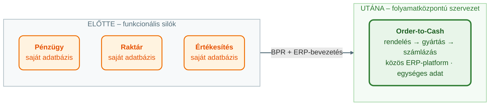
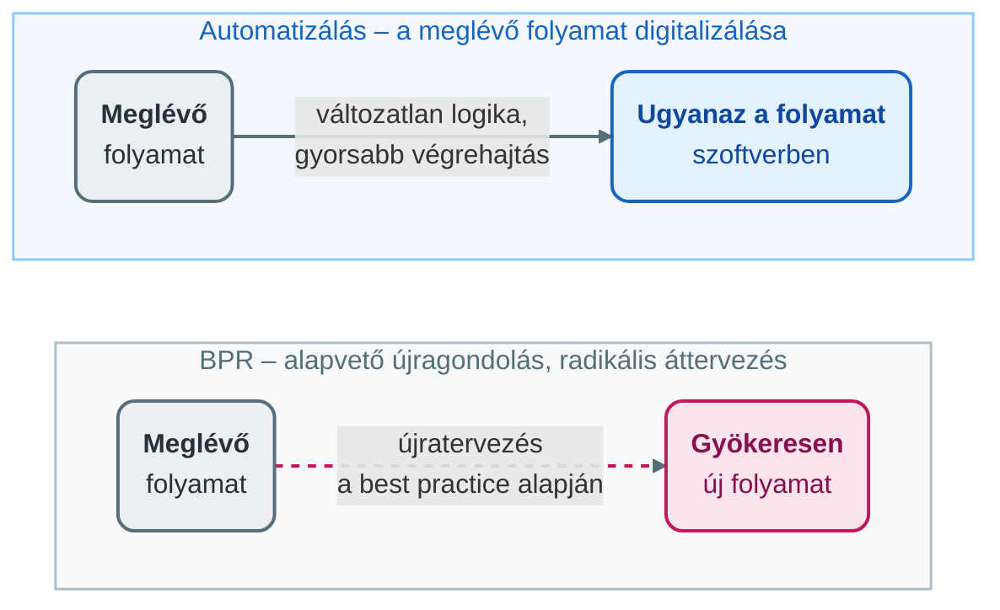

## V13 – ERP bevezetése: célok, előnyök, hátrányok, BPR

### Beszerzendő anyagok

| Szerző | Mű | Jelleg | Indoklás / érintett rész |
|---|---|---|---|
| Hetyei, J. | *ERP rendszerek Magyarországon a 21. században* | kötelező irodalom | A syllabus kötelező irodalomként nevezi meg; az R5–R8 részkérdések (kiválasztás, buktatók) hazai bevezetési tapasztalatai erre épülnének. |
| Tasi, M. | *Vállalatirányítási rendszerek* (Edutus Főiskola, 2011) | kötelező irodalom | A syllabus kötelező irodalma; az R1–R4 részkérdések (a bevezetés céljai, szervezeti hatásai) elméleti háttere. |
| Molnár, B. | *Vállalatirányítási rendszerek gazdaságinformatikai megközelítésben* (2014) | kötelező irodalom | A syllabus kötelező irodalma; az R5–R7 részkérdések (kiválasztási szempontok, módszerek, keretrendszerek) háttere. |

**Tétel:** Mutassa meg, miért van szükség egy ERP rendszer bevezetésére egy vállalatnál – ismertesse a célokat, az előnyöket, a hátrányokat és a bevezetéssel járó szervezeti változásokat! Ismertesse az integrált vállalatirányítási rendszerek kiválasztásának szempontjait, módszereit, szabványait és leggyakoribb buktatóit! Mutassa be az üzleti folyamatok újratervezésének (BPR) szerepét és jelentőségét az ERP bevezetés kontextusában, és fejtse ki, hogyan valósítható meg a BPR a gyakorlatban egy ERP projekt keretein belül!

---

### 13.1. Miért van szükség ERP bevezetésére? – A bevezetés céljai

Az ERP (Enterprise Resource Planning – integrált vállalatirányítási rendszer) bevezetése a vállalat életében jelentős stratégiai lépés, amely túlmutat a puszta szoftvercserén. Segít megoldani a szigetrendszerek okozta problémákat – az adatduplikációt, a lassú információáramlást és a gyenge átláthatóságot –, és egy egyre összetettebb üzleti környezetben támogatja a növekedést, a versenyképességet és a döntéshozatalt (Novák, 2026, 7. o.).

A bevezetés jellemzően akkor válik szükségessé, amikor a régi (legacy) rendszerek és a szigetrendszerek már nem bírják a terhelést, a növekedés miatt szaporodnak a hibák, vagy a piac gyorsabb reagálást kényszerít ki (Novák, 2026, 7. o.). A tananyag mintavállalata, a Global Bike, ezt az utat járta be: 2009-ben a korábban divíziónként futó, egymástól független alkalmazási környezeteket központosított IT-szolgáltató modellre cserélte, és bevezette az SAP ERP 6.0-t. A kitűzött cél a költségcsökkentés és az egységes, ellenőrzött technológiai platform volt, amely globálisan biztosítja a működés konzisztenciáját és a folyamatok integritását; 2017-ben pedig a digitális transzformáció gyorsítására az S/4HANA-ra való átállásról döntöttek (Magal et al., 2025, 11. o.).

A bevezetés **fő céljai** a segédanyag szerint (Novák, 2026, 7. o.):

1. **Központi, egységes adatbázis** („single source of truth"), amely valós idejű információt ad a teljes vállalatról.
2. **Az üzleti folyamatok standardizálása és optimalizálása** a hatékonyság növelése érdekében.
3. **Keresztfunkcionális integráció** – pénzügy, logisztika, gyártás, HR, értékesítés, ügyfélkapcsolat-kezelés (CRM) egy rendszerben.
4. **Jobb döntéstámogatás** valós idejű riportokkal, analitikával és előrejelzéssel.
5. **Költségcsökkentés, megfelelőség (compliance, pl. SOX, GDPR) és skálázhatóság** biztosítása.

### 13.2. Az ERP-bevezetés előnyei és hátrányai

**Főbb előnyök** (Novák, 2026, 7–8. o.):

- **Hatékonyságnövekedés:** az automatizált folyamatok csökkentik a manuális munkát és gyorsítják a műveleteket (pl. rendeléskezelés, készletgazdálkodás).
- **Valós idejű átláthatóság:** pontos, konzisztens adatok minden szinten, jobb riportolás, gyorsabb döntéshozatal.
- **Költségmegtakarítás:** csökken a redundancia, optimalizálódik a készlet, javul a beszerzés és a pénzügyi kontroll.
- **Jobb ügyfélélmény:** gyorsabb kiszolgálás, pontosabb szállítási idők.
- **Skálázhatóság:** könnyebben kezelhető a vállalat bővülése, fúziója vagy akvizíciója.
- **Stratégiai előny:** a versenyképesség növelése modern technológiákkal (AI, analitika, felhő).

**Hátrányok és kockázatok** – a bevezetés nem kockázatmentes (Novák, 2026, 8. o.):

- **Magas költségek:** licenc, implementáció, tanácsadás, hardver vagy felhő, képzés – és hosszú távú karbantartási költségek.
- **Hosszú bevezetési idő:** hat hónaptól több évig terjedhet, ami üzleti fennakadást okozhat.
- **Szervezeti ellenállás:** a munkatársak félelme a változástól, az új munkamódszerektől, az esetleges állásvesztéstől.
- **Átmeneti produktivitáscsökkenés:** az éles indulás (go-live) után gyakori a visszaesés.
- **Rugalmatlanság:** a „best practice" folyamatok nem mindig illeszkednek a vállalati sajátosságokhoz; a túlzott testreszabás (customization) drága és kockázatos.
- **Szállítófüggőség**, és a változásmenedzsment hiánya esetén kudarcveszély.

A mérleg tehát nem egyértelmű: az előnyök csak akkor realizálódnak, ha a vállalat a kockázatokat – mindenekelőtt a szervezeti ellenállást és a testreszabási kísértést – tudatosan kezeli.

### 13.3. Szervezeti változások az ERP-bevezetés során

Az ERP-bevezetés alapvetően **szervezeti transzformáció, nem csupán IT-projekt** (Novák, 2026, 9. o.). A tipikus változások:

- **A folyamatok átalakítása:** a funkcionális szigetek helyét keresztfunkcionális, standardizált, végponttól végpontig (end-to-end) tartó folyamatok veszik át, például rendelés → gyártás → számlázás.
- **A szerepkörök és felelősségek változása:** kevesebb manuális adatbevitel, több elemzői és ellenőrzői feladat.
- **Kulturális váltás:** adatvezérelt döntéshozatal és nagyobb átláthatóság, ami egyes középvezetőknél ellenállást válthat ki.
- **Képzés és változásmenedzsment:** intenzív felhasználói képzés, kommunikáció és motiváció szükséges.
- **Vezetői szerepvállalás:** a felső vezetés aktív támogatása nélkül szinte biztos a kudarc.
- **A szervezeti struktúra módosulása:** egyes részlegek összevonása vagy átalakítása.

A szervezeti felépítés oldaláról a tananyag három hatást emel ki (ÓE, é. n., „ERP a szervezeti felépítésben és kultúrában" lecke). Az első a **folyamatközpontúság**: a merev, funkcionális silók helyett a vállalat kulcsfolyamatokban gondolkodik – a Global Bike felső vezetése (társ-vezérigazgatók) nem funkcionális területekben, hanem az Idea-to-Market, Build-to-Stock és Order-to-Cash folyamatokban határozza meg magát. A második a **hierarchia laposítása**: a folyamatok átláthatósága lehetővé teszi a menedzsmentszintek ritkítását és a gyorsabb döntéshozatalt. A harmadik a **szervezeti agilitás**: a rendszer támogatja a folyamatok rugalmasságát és a gyors alkalmazkodást.

A kultúrát az ERP a „Run Simple" (működj egyszerűen) filozófia mentén formálja: a megérzések helyett a valós idejű adatokra épülő elemzés és előrejelzés válik a döntések alapjává; mivel a rendszer minden részleget összekapcsol, a munkavállalók látják tevékenységük hatását a teljes láncolatban, ami erősíti a közös felelősségvállalást; a szerepkör-alapú felületek (SAP Fiori) pedig egyszerűsítik és személyre szabják a munkavégzést (ÓE, é. n., „ERP a szervezeti felépítésben és kultúrában" lecke). Az átláthatóság ugyanakkor kulturális ellenállást is kiválthat – a kontrolltól való félelmet –, ezért a sikeres alkalmazáshoz változásmenedzsment, az adatvezérelt döntéshozatal elfogadása és a felelősségi körök pontos tisztázása kell (Novák, 2026, 6. o.). A siker kulcsa a **változásmenedzsment** (change management), amely kezeli az ellenállást és biztosítja a felhasználói elfogadást (user adoption) (Novák, 2026, 9. o.).

### 13.4. Az ERP-rendszer kiválasztásának szempontjai és módszerei

A rendszerválasztás stratégiai döntés, amelyet a segédanyag nyolc **szempont** mentén tárgyal (Novák, 2026, 9–10. o.):

| Szempont | Mit vizsgálunk? |
|---|---|
| **Üzleti illeszkedés** (functional fit) | Lefedi-e a vállalat fő folyamatait és iparági sajátosságait (gyártás, kereskedelem, szolgáltatás)? |
| **Skálázhatóság és rugalmasság** | Felhőalapú vagy helyi (on-premise) telepítés; támogatja-e a jövőbeli növekedést? |
| **Integrációs képességek** | API-k és middleware-támogatás a meglévő és jövőbeli rendszerekhez. |
| **Költség (TCO – Total Cost of Ownership)** | Nemcsak licenc, hanem implementáció, karbantartás, képzés is. |
| **A szállító megbízhatósága** | Referenciák, iparági tapasztalat, hosszú távú támogatás, pénzügyi stabilitás. |
| **Biztonság és compliance** | Adatvédelem, auditálhatóság, iparági előírások. |
| **Felhasználói élmény (UX)** | Kezelhetőség, mobil és távoli hozzáférés. |
| **Technológiai alapok** | Modern architektúra (microservices), AI/ML-támogatás. |

A kiválasztás **módszerei** (Novák, 2026, 10. o.) egymásra épülő lépéssort adnak:

1. **Szükségletfelmérés** (requirements gathering) és **üzleti eset** (business case) készítése – mit várunk a rendszertől, és mi igazolja a beruházást.
2. **Ajánlatkérés** (RFP – Request for Proposal) kiírása a szóba jöhető szállítók felé.
3. **Demók és proof-of-concept (PoC) tesztek** valós vállalati adatokkal.
4. **Referencialátogatások** és a szállítók **pontozásos értékelése**.
5. **Független tanácsadó bevonása** a torzítatlan vélemény érdekében.

### 13.5. Szabványok, keretrendszerek és a leggyakoribb buktatók

**Szabványok.** Szigorú nemzetközi „ERP-szabvány" nincs. A kiválasztásnál ehelyett jellemzően az információbiztonsági és megfelelőségi követelményekre hivatkoznak: az **ISO 27001** szabványra (információbiztonság), a **SOC 2** tanúsításra, a **GDPR**-kompatibilitásra, valamint iparági legjobb gyakorlatokra, mint a gyártásban az **APICS**. A keretrendszerek másik köre az **implementációs módszertanoké**: az SAP **ASAP** módszertana, a Microsoft Dynamics **Sure Step** módszertana, illetve az agilis és hibrid megközelítések (Novák, 2026, 10. o.).

**Leggyakoribb buktatók** (Novák, 2026, 10. o.):

- Rossz szállító vagy termék választása – csak az ár vagy a márkanév alapján.
- A folyamatok rendszerhez igazításának elmulasztása, helyette túlzott testreszabás.
- Az adatminőség alulbecslése („garbage in, garbage out").
- Elégtelen felső vezetői támogatás és erőforrás-allokáció.
- Rossz változásmenedzsment és alacsony felhasználói elfogadás.
- A hatókör elcsúszása (scope creep), alulbecsült idő és költség.
- Az adatmigráció elhanyagolása vagy a nem megfelelő tesztelés.

Feltűnő, hogy a buktatók többsége nem technológiai, hanem vezetési és szervezeti természetű – ez vezet át a BPR kérdéséhez.

### 13.6. A BPR szerepe és jelentősége az ERP-bevezetésben

Az **üzleti folyamatok újratervezése** (Business Process Reengineering – BPR) a munkafolyamatok **alapvető újragondolását és radikális áttervezését** jelenti a teljesítmény drasztikus javítása érdekében (ÓE, é. n., „BPR az ERP rendszerben" lecke). Lényege, hogy az informatika lehetőségeit kihasználva nem csupán automatizálja, hanem gyökeresen átalakítja a folyamatokat; a megközelítés Michael Hammer és James Champy nevéhez fűződik, az 1990-es évekből (Novák, 2026, 11. o.).

A BPR **szerepe és jelentősége** az ERP-bevezetésben (Novák, 2026, 11. o.):

- Az ERP-rendszerek **best practice** folyamatokat tartalmaznak: ha a régi folyamatokat erőltetjük rá a rendszerre, az előnyök elvesznek.
- A BPR biztosítja, hogy az ERP **ne a régi, rossz folyamatokat digitalizálja**, hanem valódi hatékonyságnövekedést hozzon. A tananyag PP-leckéje így fogalmaz: a cél nem „a káosz digitalizálása", hanem hatékonyabb, átláthatóbb folyamatok kialakítása (ÓE, é. n., „BPR az ERP rendszerben" lecke).
- Segít azonosítani a felesleges lépéseket, a redundanciákat és a szűk keresztmetszeteket.
- Növeli az ERP **megtérülését** (ROI), mert a működést már a bevezetés előtt vagy közben optimalizálja.
- A kettőt gyakran együtt alkalmazzák: BPR + ERP = nagyobb átalakulás, de jobb eredmény.

Hogy a BPR mekkora teret kap, azt nagyban az **átállási forgatókönyv** dönti el. Az SAP-tananyag az S/4HANA-ra való átállás három útját különbözteti meg (SAP UCC Magdeburg, 2025, 36–39. dia):

| Forgatókönyv | Lényege | Kapcsolat a BPR-rel |
|---|---|---|
| **Új bevezetés** (New Implementation, „greenfield") | A vállalat a nulláról építi fel folyamatait a rendszerben rendelkezésre álló kész üzleti modellek alapján; előre definiált migrációs objektumok és best practice-ek, vezetett konfiguráció; rövidebb értékteremtési idő, alacsonyabb TCO. | A legnagyobb BPR-lehetőség: a folyamatok újratervezése és egyszerűsítése kész, azonnal futtatható (ready-to-run) folyamatokra épül (ÓE, é. n., „BPR az ERP rendszerben" lecke; 37. dia). |
| **Rendszerkonverzió** (System Conversion) | A meglévő SAP-rendszer átalakítása S/4HANA-vá újrabevezetés nélkül; a futó üzleti folyamatok nem szakadnak meg. | A testreszabások és a meglévő folyamatok újraértékelése része a forgatókönyvnek – de a régi folyamatok átvitelének kockázata itt a legnagyobb (38. dia). |
| **Tájkép-átalakítás** (Landscape Transformation) | Több rendszer konszolidálása egyetlen S/4HANA-rendszerbe, vagy szelektív adatátvitel; fázisos megközelítést tesz lehetővé, a legnagyobb megtérülésű területekre fókuszálva. | A harmonizált, egyszerűsített folyamatok és az egységes törzsadat alacsonyabb TCO-hoz vezetnek (39. dia). |

### 13.7. A BPR megvalósítása a gyakorlatban, ERP-projekt keretében

Az S/4HANA bevezetése három **optimalizációs emelő** (optimization lever) mentén támogatja a folyamatok megújítását (ÓE, é. n., „BPR az ERP rendszerben" lecke; SAP UCC Magdeburg, 2025, 24. dia):

| Emelő | Tartalma | Példa a tananyagból |
|---|---|---|
| **Hatékonyság** (efficiency) | A végrehajtás gyorsítása, a folyamatlépések automatizálása, digitális feladatkiosztás. | Az anyagszükséglet-tervezés (MRP) már nem csak éjszakai kötegelt (batch) futásként, hanem bármikor, igény szerint futtatható („MRP run on request") (27. dia). |
| **Eredményesség** (effectiveness) | A folyamatok intelligenciájának növelése, a válaszidő lerövidítése, a hierarchikus szintek csökkentése. | A rendszer automatikus javaslatokat tesz beszerzésre vagy gyártásra a készlethiány elkerülésére – gyorsabb döntés (27. dia). |
| **Agilitás** (agility) | Szervezeti és folyamatbeli rugalmasság, az innovációk gyors befogadása. | „Segment of One": tömegtermelés helyett egyedi, személyre szabott kiszolgálás – például konfigurálható kerékpárok (25. dia; Novák, 2026, 6. o.). |

A BPR-t általában nem külön projektként, hanem az ERP-bevezetés **szerves részeként** végzik, egyidejű vagy előkészítő fázisban. A gyakorlati **lépések** (Novák, 2026, 11–12. o.):

1. **Jelenlegi állapot felmérése (As-Is):** folyamatleltár készítése (process mapping), a gyenge pontok azonosítása – akár folyamatbányászati (process mining) eszközökkel.
2. **Célállapot meghatározása (To-Be):** radikális újratervezés az üzleti célok alapján. Vezérkérdések: mi az értéket teremtő tevékenység, mi automatizálható, milyen best practice vehető át az ERP-ből?
3. **Az érintettek bevonása:** keresztfunkcionális munkacsoportok, felső vezetés, végfelhasználók részvétele.
4. **Gap-elemzés:** a célállapot összevetése a kiválasztott ERP standard folyamataival, majd döntés: a folyamatot alakítjuk, vagy az ERP-t szabjuk testre – az utóbbit minimalizálni kell.
5. **Az új folyamatok tervezése és dokumentálása:** munkafolyamatok (workflow), szerepkörök és teljesítménymutatók (KPI) definiálása.
6. **A változásmenedzsment integrálása:** kommunikáció, képzés, az ellenállás kezelése már a BPR során.
7. **Pilot tesztelés és iteráció:** kis körben tesztelés az ERP-ben, majd finomhangolás.
8. **Mérés és folyamatos javítás:** az éles indulás után a KPI-k követése és bevezetés utáni felülvizsgálat (post-implementation review).

A segédanyag négy gyakorlati **tanácsot** is ad a sikerhez (Novák, 2026, 12. o.): ne kezeljünk minden folyamatot egyformán, hanem priorizáljuk a kritikusakat; kombináljuk a BPR-t agilis módszerekkel (iteratív újratervezés); használjunk folyamatmodellező (BPMN) és folyamatbányászati eszközöket; és kerüljük a „big bang" bevezetést – a fázisos (phased) bevezetés jobban összefér a BPR-rel.

### Összegzés

Az ERP-bevezetés szükségessége a szigetrendszerek korlátaiból fakad, célja az egységes adatbázis, a standardizált, integrált folyamatok és a jobb döntéstámogatás. Az előnyök csak a kockázatok – költség, idő, ellenállás, testreszabás – tudatos kezelése mellett realizálódnak, ezért a bevezetés szervezeti transzformáció, amelynek kulcsa a változásmenedzsment. A kiválasztásnál az üzleti illeszkedés, a TCO, az integráció és a szállítói megbízhatóság a fő szempont, formális ERP-szabvány híján biztonsági és megfelelőségi követelményekre, valamint bevezetési módszertanokra támaszkodunk. A BPR nélkülözhetetlen eleme a sikeres bevezetésnek: csak így lesz valódi üzleti átalakulás egy drága, de alulhasznált rendszer helyett. A projekt sikerét végül a felső vezetői elköteleződés, a jó tervezés és a változásmenedzsment határozza meg (Novák, 2026, 12. o.).

---

### Várható vizsgáztatói kérdések

1. **Miért mondjuk, hogy az ERP-bevezetés szervezeti transzformáció, és nem IT-projekt?** — Mert a rendszer a funkcionális szigetek helyett keresztfunkcionális, standardizált folyamatokat kényszerít ki, megváltoztatja a szerepköröket (kevesebb adatbevitel, több elemzés), átláthatóságot és adatvezérelt döntéshozatalt hoz, ami ellenállást válthat ki, és akár a szervezeti struktúrát is módosítja. A kudarcok fő okai – gyenge vezetői támogatás, rossz változásmenedzsment – szintén szervezetiek, nem technikaiak (Novák, 2026, 9–10. o.).
2. **Mi a különbség a folyamat automatizálása és a BPR között?** — Az automatizálás a meglévő folyamatot viszi át változatlan logikával a szoftverbe; a BPR a folyamat alapvető újragondolása és radikális áttervezése a teljesítmény drasztikus javításáért. ERP-kontextusban a tét az, hogy ne a régi, rossz folyamatot digitalizáljuk, hanem a best practice-re építve valódi hatékonyságnövekedést érjünk el (ÓE, é. n., „BPR az ERP rendszerben" lecke; Novák, 2026, 11. o.).
3. **Mikor indokolt a greenfield bevezetés, és mikor a rendszerkonverzió?** — A greenfield (New Implementation) akkor, ha a vállalat a kész best practice folyamatokra építve akarja újratervezni és egyszerűsíteni a működését – ez a legnagyobb BPR-lehetőség. A rendszerkonverzió akkor, ha a futó folyamatokat nem szabad megszakítani és nincs szükség újrabevezetésre; ilyenkor a testreszabásokat újra kell értékelni, mert a régi folyamatok átvitelének kockázata itt a legnagyobb (SAP UCC Magdeburg, 2025, 37–38. dia).
4. **Léteznek-e ERP-szabványok? Mire hivatkoznak a kiválasztáskor?** — Szigorú nemzetközi ERP-szabvány nincs. A gyakorlatban az ISO 27001-re (információbiztonság), a SOC 2-re, a GDPR-kompatibilitásra és iparági best practice-ekre (pl. APICS) hivatkoznak, a bevezetést pedig implementációs módszertanok – ASAP, Sure Step, agilis/hibrid – keretezik (Novák, 2026, 10. o.).
5. **Mi a három optimalizációs emelő, és mondjon mindegyikre példát!** — Hatékonyság: a végrehajtás gyorsítása, lépések automatizálása – pl. az MRP igény szerinti futtatása batch helyett. Eredményesség: a folyamatok intelligenciájának növelése, rövidebb válaszidő, kevesebb hierarchiaszint – pl. a rendszer automatikus beszerzési vagy gyártási javaslatai. Agilitás: szervezeti és folyamatbeli rugalmasság – pl. a „Segment of One", a személyre szabott termék (ÓE, é. n., „BPR az ERP rendszerben" lecke; SAP UCC Magdeburg, 2025, 24–27. dia).
6. **Mit jelent a gap-elemzés döntési pontja a BPR-ben?** — A célállapotot összevetjük a kiválasztott ERP standard folyamataival; ahol eltérés van, dönteni kell: a folyamatot igazítjuk a rendszerhez, vagy a rendszert szabjuk testre. A segédanyag szerint a testreszabást minimalizálni kell, mert drága és kockázatos, és a buktatók között is szerepel a folyamatok rendszerhez igazításának elmulasztása (Novák, 2026, 8., 10., 12. o.).

---

## Irodalom

* Magal, S., Weidner, S., & Word, J. (2025). *Global Bike Group: Background and overview of Global Bike strategy and operations* (4.3 verzió) [Esettanulmány, Intro to S/4HANA using Global Bike]. SAP University Competence Center Magdeburg.
* Novák, G. (2026). *Integrált vállalatirányítási rendszerek: Oktatási segédanyag* [Egyetemi jegyzet]. Óbudai Egyetem, Keleti Károly Gazdasági Kar.
* Óbudai Egyetem, Keleti Károly Gazdasági Kar. (é. n.). *Az ERP rendszerek szerepe a vállalat szervezeti felépítésében és kultúrájában* [Elektronikus tananyag, Integrált vállalatirányítási rendszerek (GMXIV2MBLF)].
* Óbudai Egyetem, Keleti Károly Gazdasági Kar. (é. n.). *BPR az ERP rendszerben* [Elektronikus tananyag, Integrált vállalatirányítási rendszerek (GMXIV2MBLF)].
* SAP UCC Magdeburg. (2025). *Introduction to SAP S/4HANA* [Előadás-diasor, Intro to S/4HANA using Global Bike v4.3]. SAP SE / SAP University Competence Center Magdeburg.
