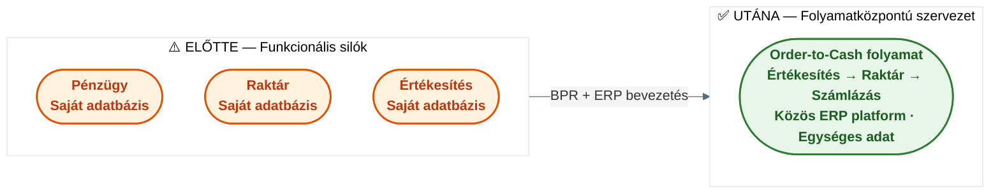
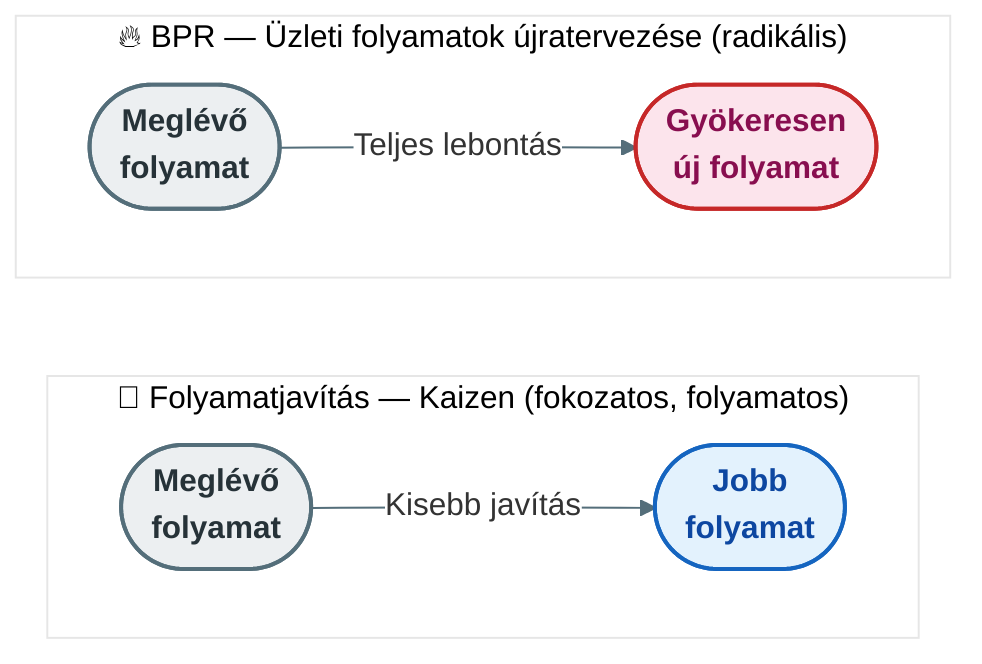

## V13 – ERP rendszer bevezetése, kiválasztása és az üzleti folyamatok újratervezése (BPR)

**Tétel:** ERP bevezetése és BPR: Mutassa meg, miért van szükség egy ERP rendszer bevezetésére egy vállalatnál – ismertesse a célokat, az előnyöket, a hátrányokat és a bevezetéssel járó szervezeti változásokat! Ismertesse az integrált vállalatirányítási rendszerek kiválasztásának szempontjait, módszereit, szabványait és leggyakoribb buktatóit! Mutassa be az üzleti folyamatok újratervezésének (BPR) szerepét és jelentőségét az ERP bevezetés kontextusában, és fejtse ki, hogyan valósítható meg a BPR a gyakorlatban egy ERP projekt keretein belül!

---

### 13.1. Miért van szükség ERP bevezetésre?

A vállalatok ERP-bevezetés mellett jellemzően akkor döntenek, amikor a meglévő rendszereik nem képesek kiszolgálni a szervezet növekvő komplexitását. A leggyakoribb kiváltó okok:

- **Információs szigetek:** az adatok osztályonként elkülönülnek, valós idejű kép a vállalatról nem alkotható.
- **Manuális folyamatok:** az adatok ismételt rögzítése hibalehetőséghez és késésekhez vezet.
- **Skálázhatósági korlát:** a régi rendszer nem bírja a növekvő tranzakciómennyiséget vagy a globális működést.
- **Megfelelési követelmények:** jogszabályi és számviteli előírások egységes, auditálható rendszert igényelnek.

### 13.2. Az ERP bevezetés előnyei és hátrányai

| | Előnyök | Hátrányok / kockázatok |
|---|---|---|
| **Adatkezelés** | Egységes adatbázis, egyszeri rögzítés, valós idejű adatok | Adatmigráció bonyolultsága, adatminőségi problémák |
| **Folyamatok** | Standardizált best practice folyamatok, automatizálás | Rugalmatlanság – a rendszer logikájához kell igazodni |
| **Szervezet** | Átláthatóság, döntéstámogatás, folyamatgazda szemlélet | Ellenállás a változással szemben, széleskörű oktatás igénye |
| **Gazdasági** | Csökkent IT-karbantartási teher (egy szállító) | Magas bevezetési költség (licenc, tanácsadás, infrastruktúra) |
| **Stratégiai** | Skálázhatóság, globális működés támogatása | Bevezetési idő: tipikusan 1–3 év |

### 13.3. Szervezeti változások ERP bevezetéskor

Az ERP bevezetés lényege szerint **szervezeti átalakulás, amelyet technológia támogat** – nem fordítva. A tipikus szervezeti hatások:

A bevezetéssel járó változások: szerepkörök átrendeződése, folyamatgazda szemlélet bevezetése, munkatársak átképzése, és változásmenedzsment (change management) szükségessége.

### 13.4. ERP kiválasztásának szempontjai és módszerei

Az ERP-rendszer kiválasztása stratégiai döntés. A leggyakrabban alkalmazott kiválasztási módszertan:

**1. Igényfelmérés (Fit-Gap elemzés)**  
A vállalat feltérképezi a jelenlegi folyamatait (AS-IS), majd azonosítja, melyeket fed le az ERP standard funkcionalitása és hol van rés (gap).

**2. Értékelési szempontok:**

| Szempont | Kérdés |
|---|---|
| Funkcionális lefedettség | Lefedi-e az ERP az összes kulcsfolyamatot (pénzügy, gyártás, logisztika)? |
| Iparági illeszkedés | Van-e iparág-specifikus best practice csomag? |
| TCO (Total Cost of Ownership) | Mi a teljes tulajdonlási költség 5 évre vetítve (licenc + bevezetés + üzemeltetés)? |
| Szállítói stabilitás | Megbízható, hosszú távú szállítói háttér? |
| Skálázhatóság | Kezeli-e a vállalat jövőbeni növekedését? |
| Felhős/helyi opció | SaaS vagy on-premise telepítés? |

**3. Leggyakoribb buktatók:**
- Alulbecsült bevezetési idő és költség.
- Túlzott testreszabás (customization) – az egyedi fejlesztések később a frissítések akadályává válnak.
- Elégtelen változásmenedzsment – a felhasználók nem fogadják be a rendszert.
- Adatminőségi problémák – a régi, hibás adatok az új rendszerbe kerülnek.
- Hiányzó felső vezetői elköteleződés.

### 13.5. BPR – az üzleti folyamatok újratervezése

A **BPR (Business Process Reengineering)** Hammer és Champy (1993) által kidolgozott módszertan: a munkafolyamatok **gyökeres újragondolása és radikális újratervezése** a teljesítmény drasztikus javítása érdekében.

A BPR nem egyszerű folyamatjavítás (continuous improvement), hanem nulláról való újraépítés:

**Az ERP és a BPR kapcsolata:**

Az ERP bevezetése és a BPR szorosan összekapcsolt, de a sorrend eldöntése kulcskérdés:

| Megközelítés | Logika | SAP-módszer |
|---|---|---|
| **Greenfield** | Nulláról, az ERP best practice folyamataihoz igazodik a vállalat | Activate módszertan – kész folyamatminták |
| **Brownfield** | Meglévő folyamatokat migrálják az új rendszerbe | Az egyedi fejlesztések megmaradnak, de a komplexitás nő |

### 13.6. BPR megvalósítása ERP projekt keretében

Az S/4HANA három optimalizációs emelőt kínál a BPR megvalósításához:

| Emelő | Tartalom | Példa |
|---|---|---|
| **Hatékonyság** (Efficiency) | Lépések automatizálása, digitális feladatkiosztás | MRP futtatás valós időben, nem éjszakai batch-ben |
| **Eredményesség** (Effectiveness) | Döntési intelligencia, rövidebb válaszidők | Beágyazott analitika: azonnal látható a rendelés jövedelmezősége |
| **Agilitás** (Agility) | Szervezeti rugalmasság, innováció gyors befogadása | Új üzleti modell (pl. subscription) bevezetése a meglévő ERP-en belül |

**A BPR lépései ERP projektben:**
1. AS-IS folyamatok dokumentálása és kiértékelése.
2. Az ERP best practice folyamatok (referencia modellek) megismerése.
3. Fit-Gap elemzés: hol illeszkedik a best practice, hol kell BPR.
4. TO-BE folyamatok tervezése az ERP logikájára építve.
5. Konfiguráció, tesztelés, oktatás, éles indítás (Go-Live).
6. Post-Go-Live stabilizáció és folyamatos fejlesztés.

**Összegzés:** Az ERP bevezetés sikere egyforma mértékben múlik a technológián és a szervezeti felkészültsége. A BPR az ERP projektek természetes kísérője: az ERP best practice folyamatai kényszerítik ki a vállalati folyamatok újragondolását. A greenfield megközelítés a legradikálisabb, de a legkedvezőbb hosszú távú eredményt hozhatja.

---

*Forrás: Hammer, M., Champy, J.: Reengineering the Corporation (HarperBusiness, 1993); GMXIV2MBLF oktatási segédanyag (2026); Davenport, T.H.: „Putting the Enterprise into the Enterprise System" (HBR, 1998); Hetyei József: ERP rendszerek Magyarországon a 21. században*
