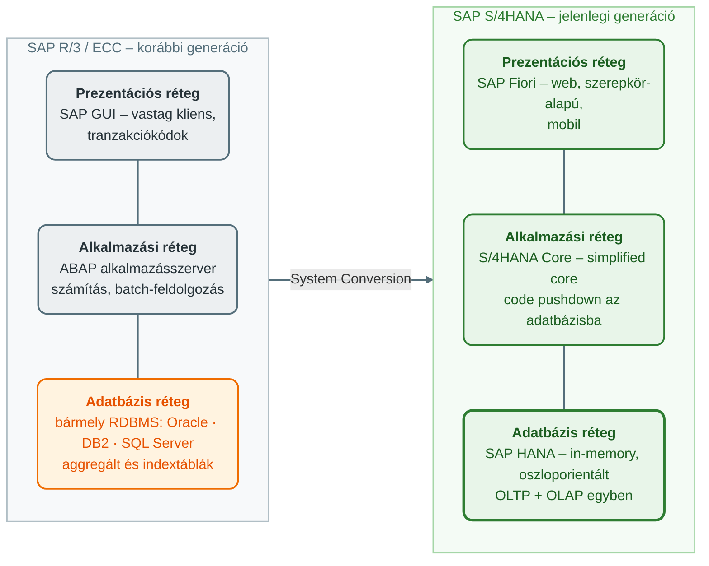
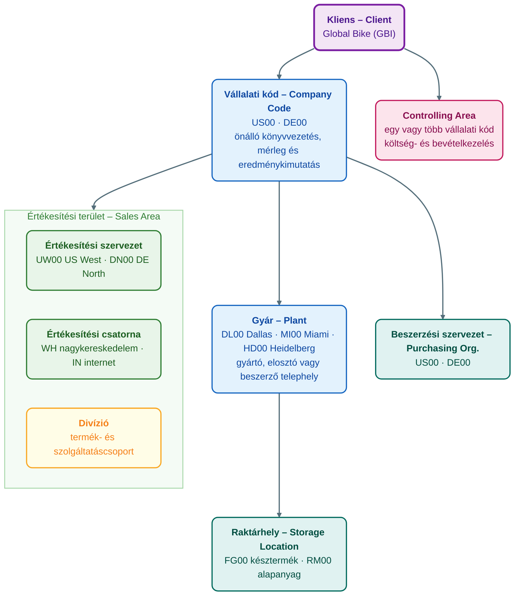
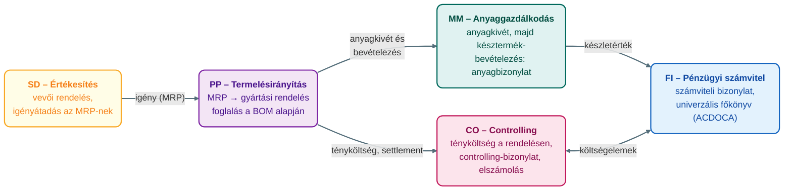

## V14 – SAP S/4HANA struktúra, felépítés és modulok

### Beszerzendő anyagok

| Szerző | Mű | Jelleg | Indoklás / érintett rész |
|---|---|---|---|
| Hetyei, J. | *ERP rendszerek Magyarországon a 21. században* | kötelező irodalom | A syllabus kötelező irodalomként nevezi meg; tartalma helyben nem ellenőrizhető. Az R3–R4 részkérdések (az SAP-modulok feladatai, hazai alkalmazási tapasztalatok) mélyítéséhez. |
| Tasi, M. | *Vállalatirányítási rendszerek* (Edutus Főiskola, 2011) | kötelező irodalom | A syllabus kötelező irodalma; tartalma helyben nem ellenőrizhető. Az R1 és R5 részkérdések (ERP-architektúra, modulintegráció) elméleti háttere. |
| Molnár, B. | *Vállalatirányítási rendszerek gazdaságinformatikai megközelítésben* (2014) | kötelező irodalom | A syllabus kötelező irodalma; tartalma helyben nem ellenőrizhető, a relevancia a cím alapján feltételezett. Az R1–R2 részkérdések (rendszerarchitektúra, adatmodell) informatikai háttere. |

**Tétel:** Ismertesse az SAP rendszer struktúráját és felépítését, különös tekintettel az S/4HANA architektúrára és annak elődjeitől való eltéréseire! Tekintse át az SAP főbb moduljait (FI, CO, MM, SD, PP, HR stb.), jellemezze az egyes modulok feladatait és felelősségi körét, majd mutassa be részletesen a modulok egymáshoz való kapcsolódási pontjait és az integrált adatáramlás logikáját! Fejtse ki, milyen előnyöket jelent az S/4HANA in-memory adatbázis-technológiája a korábbi megoldásokhoz képest!

---

### 14.1. Az SAP rendszer struktúrája és az S/4HANA architektúra

Az **SAP** (Systems, Applications and Products in Data Processing) moduláris, integrált vállalatirányítási (ERP) rendszer, amelynek két alappillére a **központi adatbázis** és a **háromrétegű kliens–szerver architektúra**: a prezentációs réteg (presentation layer), az alkalmazási réteg (application layer) és az adatbázis réteg (database layer). A vállalatot 1972-ben alapították; a mai értelemben vett ERP-struktúra az 1990-es években alakult ki (Novák, 2026, 13. o.; ÓE, é. n., „Vállalatirányítási rendszerek” lecke).

**Az elődök.** Az SAP R/2 (1981) még nagygépes (mainframe) rendszer volt. Az **SAP R/3** (1992) hozta a háromrétegű architektúrát („R” = real-time, „3” = three-tier), ABAP/4 nyelvvel, több gyártó relációs adatbázisán (Oracle, DB2, SQL Server); moduláris volt, de még nem teljesen integrált. Az **SAP ECC** (ERP Central Component, 2000-es évek, ECC 6.0) az R/3 továbbfejlesztése: hagyományos relációs adatbázisokon futott, bevezette a New General Ledgert, de az adatok redundánsak maradtak (aggregált táblák, indexek), és a kötegelt (batch) feldolgozás dominált (Novák, 2026, 13. o.; ÓE, é. n., „Vállalatirányítási rendszerek” lecke).

**Az S/4HANA (2015–).** Az SAP S/4HANA („Suite for HANA”) a negyedik generációs üzleti csomag, az SAP legnagyobb innovációja az R/3 óta, amely **kizárólag az SAP HANA in-memory adatbázison** fut, on-premise, felhős vagy hibrid telepítésben (Novák, 2026, 13. o.; SAP UCC Magdeburg, 2025c, 10. dia). Fő építőelemei (Novák, 2026, 13–14. o.):

- **HANA adatbázis**: in-memory, oszloporientált (columnar) tárolás, valós idejű számítások.
- **Egyszerűsített adatmodell**: drasztikusan csökkentett táblaszám, például az ACDOCA univerzális főkönyv és a MATDOC készlettábla; nincsenek külön aggregált és indextáblák.
- **SAP Fiori felület**: webalapú, szerepkör-alapú, mobilbarát.
- **Beágyazott analitika**: CDS (Core Data Services) nézetek, beépített AI/ML, valós idejű riporting.
- **Code-to-data paradigma**: a számítás az adatbázisba kerül (code pushdown), nem az alkalmazásszerverre.
- **Business Partner**: egységes vevő- és szállítókezelés.

A segédanyag hangsúlyozza, hogy az S/4HANA nem pusztán technológiai váltás, hanem üzleti transzformáció: a „simplified core” koncepcióval a felesleges rétegek eltűntek, a rendszer gyorsabb, rugalmasabb és jövőbiztosabb lett (Novák, 2026, 14. o.).

**Fő eltérések az elődöktől** (Novák, 2026, 14. o.; SAP UCC Magdeburg, 2025c, 29., 32. dia; ÓE, é. n., „Vállalatirányítási rendszerek” lecke):

| Jellemző | SAP R/3 / ECC | SAP S/4HANA |
|---|---|---|
| Adatbázis | Több gyártó (Oracle, DB2 stb.), lemezalapú | Csak SAP HANA, in-memory |
| Adatmodell | Komplex, redundáns (aggregált és indextáblák) | Egyszerűsített, oszloporientált, nincs aggregált tábla |
| Feldolgozás | Batch + részben valós idejű | Teljesen valós idejű |
| OLTP és OLAP | Külön rendszerekben | Egy rendszerben, azonnali elemzés |
| Felület | SAP GUI (vastag kliens, tranzakciókódok) | SAP Fiori (web, szerepkör-alapú, mobil) |
| FI–CO integráció | Külön táblák | Univerzális főkönyv (ACDOCA) |
| Teljesítmény | Lemezalapú I/O | Olvasás a memóriából |
| Adattömörítés (illusztráció) | 593 GB hagyományos adatbázison | 118,6 GB HANA-n, 42,4 GB S/4HANA-adatmodellel |

**Adattípusok.** Az SAP három adatkategóriával dolgozik (SAP UCC Magdeburg, 2025c, 13., 15–16. dia; ÓE, é. n., „Vállalatirányítási rendszerek” lecke):

| Adattípus | Jellemző | Példák |
|---|---|---|
| **Szervezeti adat** (Organizational Data) | A vállalat felépítését tükröző, ritkán változó struktúra | Kliens, vállalati kód (Company Code), gyár (Plant), raktárhely, értékesítési csatorna, beszerzési szervezet |
| **Törzsadat** (Master Data) | Hosszú ideig tárolt, ritkán változó üzleti objektum | Anyag (Material), vevő, szállító, főkönyvi számla, munkahely (Work Centre) |
| **Tranzakciós adat** (Transaction Data) | Üzleti esemény rögzítése; szervezeti és törzsadatra hivatkozik, és szituációs adatot (dátum, idő, személy, összeg) tartalmaz | Értékesítési rendelés, beszerzési megrendelés, számla, ajánlat |

**Bizonylati elv és bizonylatfolyam.** Az SAP **bizonylati elve** (Document Principle) szerint minden, a pénzügyi számvitelt érintő üzleti tranzakció egyedi sorszámú elektronikus bizonylatot ír az adatbázisba, amely tartalmazza a felelős személyt, az időpontot és a kereskedelmi tartalmat; a bizonylat utólag nem törölhető, legfeljebb bizonyos mértékig módosítható. Ez a belső kontrollrendszer és az ellenőrzési nyomvonal (audit trail) törvényileg is elvárt alapja (SAP UCC Magdeburg, 2025b, 26–27. dia). A **bizonylatfolyam** (Document Flow) a bizonylatok egymásra épülése – például megrendelés → anyagbizonylat → számla → kifizetés –, a rendelés státuszát a rendszer minden bizonylatváltozáskor frissíti (SAP UCC Magdeburg, 2025c, 17. dia).

**Telepítési modellek.** Az S/4HANA felhőben és on-premise is üzemeltethető, a kettő hibrid módon, az integráció elvesztése nélkül kombinálható (SAP UCC Magdeburg, 2025c, 22–23. dia; Novák, 2026, 13. o.):

| Jellemző | Cloud (előfizetéses licenc) | On-Premise (hagyományos licenc) |
|---|---|---|
| Üzemeltetés | Privát felhőben, az SAP tartja karban | A vállalat saját telephelyén, saját hardveren |
| Frissítés | Automatikus részvétel a negyedéves innovációs frissítésekben | Ritkább kiadási ciklusok, egyedi döntés |
| Testreszabás | In-app bővíthetőség, korlátozott ABAP | Hagyományos ABAP-fejlesztés, akár a mag módosításáig |
| Adatfelügyelet | SAP által üzemeltetett rendszer | Saját felügyeletű adatok |

Az átállásnak három forgatókönyve van (SAP UCC Magdeburg, 2025c, 37–39. dia): a **New Implementation** („greenfield”) új S/4HANA telepítése és az adatok kezdeti betöltése a korábbi – akár nem SAP – rendszerből, best practice folyamatokra építve; a **System Conversion** a meglévő SAP ERP átkonvertálása egy lépésben, újrabevezetés nélkül; a **Landscape Transformation** több rendszer konszolidálása egyetlen S/4HANA-rendszerbe, illetve szelektív adatátvétel (például Central Finance).

**SAP Fiori.** A Fiori az S/4HANA hivatalos felülete: szerepkör-alapú (mindenki csak a munkájához szükséges alkalmazásokat látja), hardverfüggetlen és valós idejű. Három alkalmazástípusa van (SAP UCC Magdeburg, 2025c, 33–34. dia; ÓE, é. n., „SAP S/4HANA” lecke): a **tranzakciós app** létrehoz, módosít, megjelenít irányított navigációval; az **analitikai app** vizuális áttekintést ad; a **factsheet** egy objektum lényeges adatait mutatja egy helyen, kontextuális navigációval.

### 14.2. Az SAP szervezeti egységei (Organizational Units)

Az SAP a vállalat jogi és fizikai felépítését **szervezeti egységekkel** modellezi, amelyek hierarchiába rendeződnek (ÓE, é. n., „SAP S/4HANA” lecke; SAP UCC Magdeburg, 2025c, 14. dia). A **kliens** (Client) a legmagasabb szint: önálló jogi és adminisztratív egység saját adatkörnyezettel. A **vállalati kód** (Company Code) a legkisebb olyan egység, amelyre teljes, önálló könyvvezetés – mérleg és eredménykimutatás – készül; tipikusan egy leányvállalat (SAP UCC Magdeburg, 2025d, 7. dia). A **gyár** (Plant) operatív egység a vállalaton belül: gyártó, elosztó, beszerző vagy karbantartó telephely; a **raktárhely** (Storage Location) a gyáron belül különbözteti meg egy anyag készleteit (SAP UCC Magdeburg, 2025d, 7. dia).

A funkcionális területeknek saját egységeik is vannak. A beszerzésben a **beszerzési szervezet** (Purchasing Organization) tárgyal a szállítókkal (SAP UCC Magdeburg, 2025d, 8. dia). Az értékesítésben az **értékesítési szervezet** (Sales Organization) felel a termékek értékesítéséért, az **értékesítési csatorna** (Distribution Channel) az út a vevőhöz (nagy-, kiskereskedelem, közvetlen értékesítés), a **divízió** (Division) termékcsoport; e három kombinációja az **értékesítési terület** (Sales Area), amely az árazási feltételeket határozza meg (SAP UCC Magdeburg, 2025f, 7–8. dia). A kontrollingban a **Controlling Area** egy vagy több vállalati kódot átfogó költség- és bevételkezelési egység, az **Operating Concern** az egységesen strukturált értékesítési piac, amelyre szegmensenkénti eredmény számítható (SAP UCC Magdeburg, 2025a, 10. dia).

**A Global Bike példája.** A tananyag mintavállalatában a GBI kliens alatt két vállalati kód működik (US00 Global Bike Inc., DE00 Global Bike Germany GmbH), alattuk gyárak (DL00 Dallas, MI00 Miami, HD00 Heidelberg stb.) és a készlet jellege szerinti raktárhelyek (RM00 alapanyag, SF00 félkész, FG00 késztermék); az értékesítési szervezetek régiónként szerveződnek (UW00 US West, DN00 Germany North stb.), két csatornával (WH nagykereskedelem, IN internet) (SAP UCC Magdeburg, 2025d, 10. dia; 2025f, 10. dia).

### 14.3. Az SAP főbb moduljai – feladatok és felelősségi kör

Az SAP **modul** logikailag összetartozó tranzakciók gyűjteménye egy azonosítható üzleti funkción belül (SAP UCC Magdeburg, 2025c, 11. dia; ÓE, é. n., „SAP S/4HANA” lecke). A modulok funkcionálisan specializáltak, de egy közös adatbázison dolgoznak (Novák, 2026, 15. o.). Az alapfolyamatok logikája jól megjegyezhető: **buy** (MM), **make** (PP), **sell** (SD), **track** (FI és CO), továbbá **people** (HCM), **maintain** (EAM), **store** (WM), **project** (PS) és **services** (CS) (SAP UCC Magdeburg, 2025c, 11. dia).

| Modul | Fő feladatok | Felelősségi kör |
|---|---|---|
| **FI** – Financial Accounting, pénzügyi számvitel | Főkönyv (GL), vevőkövetelések (AR), szállítói kötelezettségek (AP), eszközkönyvelés (AA), konszolidáció, pénzügyi riportok (mérleg, eredménykimutatás, cash flow) | **Külső** számvitel: törvényi megfelelés (compliance), külső beszámolók hatóságok, bankok, tulajdonosok, könyvvizsgálók felé (Novák, 2026, 15. o.; SAP UCC Magdeburg, 2025b, 6–7. dia) |
| **CO** – Controlling, vezetői számvitel | Költséghelyek, belső rendelések, profitcenterek, termékköltség-számítás, jövedelmezőség-elemzés (CO-PA), tervezés | **Belső** döntéstámogatás és költségoptimalizálás – menedzsment-, nem törvényi cél (Novák, 2026, 15. o.; SAP UCC Magdeburg, 2025a) |
| **MM** – Materials Management, anyaggazdálkodás | Beszerzés (igény, megrendelés), áruátvétel, készletgazdálkodás, raktározás, számlaellenőrzés (Invoice Verification), szállítói kapcsolatok | Anyagbeszerzés, készletoptimalizálás, a **procure-to-pay** folyamat (Novák, 2026, 15. o.; SAP UCC Magdeburg, 2025d) |
| **SD** – Sales and Distribution, értékesítés | Ajánlatkérés → ajánlat → vevői rendelés → kiszállítás → számlázás; árazás, rendelkezésre állás ellenőrzése | Vevői rendelések, szállítás, számlázás, az **order-to-cash** folyamat (Novák, 2026, 15. o.; SAP UCC Magdeburg, 2025f) |
| **PP** – Production Planning, termelésirányítás | Értékesítési és termelési tervezés (SOP), igénykezelés, MPS, anyagszükséglet-tervezés (MRP), kapacitástervezés, gyártási rendelések, darabjegyzék (BOM), műveleti terv | A gyártási folyamatok tervezése és optimalizálása (Novák, 2026, 15. o.; SAP UCC Magdeburg, 2025e) |
| **HCM / HR** – Human Capital Management | Személyügyi adminisztráció (PA), szervezetmenedzsment (OM), időnyilvántartás, bérszámfejtés, képzés, személyügyi kontrolling | A munkavállalói életciklus, bérszámfejtés, HR-analitika (Novák, 2026, 15. o.) |
| **WM / EWM** – Warehouse Management, raktárkezelés | Tárhely (storage bin) szintű raktárkezelés, be- és kitárolás, leltár (physical inventory) | Összetett raktári folyamatok optimalizálása (ÓE, é. n., „SAP S/4HANA” lecke) |
| **QM** – Quality Management, minőségügy | Minőségtervezés, vizsgálati tétel (inspection lot), eredményrögzítés, használati döntés (usage decision) | Minőségellenőrzés a logisztikai folyamatokban (Novák, 2026, 15. o.) |
| **PS** – Project System, projektrendszer | Projektstruktúra-terv (WBS), hálózati terv, mérföldkövek, projektköltség-kontroll, elszámolás | Projektek tervezése, végrehajtása, kontrollingja (Novák, 2026, 15. o.) |
| **PM / EAM** – Plant Maintenance / Enterprise Asset Management | Műszaki objektumok (funkcionális hely, berendezés) nyilvántartása, karbantartási rendelések, megelőző karbantartás | A vállalati eszközök műszaki állapotának fenntartása (Novák, 2026, 15. o.; ÓE, é. n., „SAP S/4HANA” lecke) |

A legfontosabb elhatárolás a **FI és a CO** között húzódik: a FI a külső érdekhordozók felé, jogszabályi keretek között számol el, a CO a vezetés belső információigényét szolgálja; az S/4HANA-ban a kettő az univerzális főkönyvben (ACDOCA) egyesül (Novák, 2026, 14–15. o.).

### 14.4. A modulok kapcsolódási pontjai és az integrált adatáramlás logikája

Az SAP erőssége az **integráció**: minden modul ugyanazon a központi adatbázison dolgozik, így nincs adatduplikáció, és az adatáramlás – az S/4HANA-ban különösen – valós idejű (Novák, 2026, 15. o.). Egy adatot egyszer rögzítenek, és mindenhol elérhető, konzisztens marad: ez a **single source of truth** elve (Novák, 2026, 16. o.). A legfontosabb kapcsolódási pontok (Novák, 2026, 15–16. o.):

1. **Törzsadat-integráció.** A közös anyagtörzs (Material Master) és az egységes üzleti partner (Business Partner) minden modul számára ugyanaz. Egy anyag adatai egyszerre határozzák meg az értékesítési árat (SD), a beszerzési feltételeket (MM), a költséget (CO), a készletértékelést (FI) és a gyártási paramétereket (PP); az anyagtörzs ezért modulonkénti funkcionális **nézetekben** tárolódik (SAP UCC Magdeburg, 2025f, 15–16. dia).
2. **FI ↔ CO.** Az S/4HANA-ban az ACDOCA univerzális főkönyv egyesíti a két modult; minden FI-tranzakció automatikusan megjelenik a CO-ban. A kapcsolat mechanizmusa a költségelem: az **elsődleges költségelemek** a FI főkönyvi költségszámláiból származnak, és FI-könyveléskor automatikusan átkerülnek a CO-ba, a **másodlagos költségelemek** csak a CO-n belüli belső költségáramlást (felosztás, elszámolás) jelölik, nincs FI-párjuk (SAP UCC Magdeburg, 2025a, 15–16. dia).
3. **SD → FI.** Értékesítési rendelés → szállítás → számla → FI-könyvelés: a számlázási bizonylat automatikusan terheli a vevő alszámláját és jóváírja az árbevétel-számlát, innentől a folyamat a pénzügyi számvitelben folytatódik a beérkező fizetésig (SAP UCC Magdeburg, 2025f, 42., 44. dia).
4. **MM → FI.** Beszerzési megrendelés → áruátvétel → számla → kötelezettség és készletértékelés. Az áruátvétel anyag- és számviteli bizonylatot hoz létre (készlet tartozik / GR-IR elszámolási számla követel); a számlaellenőrzés a számlát a megrendeléshez (célár, célmennyiség) és az áruátvételhez (tényleges mennyiség) veti össze – ez a **háromoldalú egyeztetés** (3-way match) –, eltérésnél figyelmeztet vagy blokkol, a könyvelt számla pedig az összeget a szállítói kötelezettségre viszi át (SAP UCC Magdeburg, 2025d, 37–42. dia).
5. **PP ↔ MM.** A gyártási rendelés a darabjegyzék alapján **foglalást** tesz az alkatrészekre; a rendelés felszabadítása után az anyagkivét frissíti a foglalást és a készletet, a költség tényköltségként a rendelésre kerül; a PP az MRP alapján tervez, amelynek kimenete részletes gyártási és beszerzési terv (SAP UCC Magdeburg, 2025e, 35., 54. dia).
6. **SD ↔ MM/PP.** Az értékesítési rendelés rögzítésekor a rendszer rendelkezésre állást ellenőriz (ATP), és az igényt átadja az MRP-nek, amely szükség esetén gyártási rendelést indít (SAP UCC Magdeburg, 2025f, 27. dia; Novák, 2026, 16. o.).
7. **HR/HCM → FI/CO.** A bérszámfejtés eredménye automatikusan bérköltségként könyvelődik a FI-be, a CO-ban pedig költséghelyre kerül.
8. **Bizonylatfolyam mint általános logika.** Egy tranzakció (például a vevői rendelés) követő bizonylatokat generál (szállítás, számla), amelyek valós időben frissítik a főkönyvet és a költségszámítást; az S/4HANA-ban ehhez nem kell kötegelt futás.

A két klasszikus integrált folyamat a beszerzési és az értékesítési lánc:

**Procure-to-Pay (P2P)** – az MM és a FI integrációja (SAP UCC Magdeburg, 2025d, 21., 37–40. dia):

| Lépés | Modul | Bizonylat / hatás |
|---|---|---|
| Igény rögzítése | MM | Beszerzési igény (Purchase Requisition) – nincs FI-hatás |
| Megrendelés | MM | Beszerzési megrendelés (Purchase Order) a szállító felé |
| Áruátvétel | MM → FI | Goods Receipt: anyagbizonylat + számviteli bizonylat; készletmennyiség és -érték nő |
| Számlaellenőrzés | MM → FI | Invoice Verification (3-way match): szállítói kötelezettség keletkezik |
| Kifizetés | FI | Outgoing Payment: a kötelezettség kiegyenlítődik, a bankszámla csökken |

**Order-to-Cash (O2C)** – az SD, az MM és a FI integrációja (SAP UCC Magdeburg, 2025f, 21., 27., 35., 42., 44. dia):

| Lépés | Modul | Bizonylat / hatás |
|---|---|---|
| Értékesítés előtti tevékenység | SD | Ajánlatkérés (Inquiry), ajánlat (Quotation) |
| Vevői rendelés | SD → MM/PP | Sales Order: árazás, hitelkeret-ellenőrzés, rendelkezésre állás (ATP), igényátadás az MRP-nek |
| Kiszállítás | SD → MM → FI | Szállítási bizonylat, komissiózás, csomagolás, kiadás (Post Goods Issue): készlet csökken, anyag- és számviteli bizonylat |
| Számlázás | SD → FI | Billing Document: vevőkövetelés tartozik, árbevétel követel |
| Beérkező fizetés | FI | Incoming Payment: a követelés kiegyenlítődik, a bankszámla nő |

A gyártási rendelés életciklusa egyetlen eseménysorban mutatja, hogyan frissül párhuzamosan a négy logisztikai-pénzügyi modul (SAP UCC Magdeburg, 2025e, 54–58. dia):

A késztermék bevételezése egyszerre három bizonylatot hoz létre – anyagbizonylatot, számviteli bizonylatot és controlling-bizonylatot –, majd a rendelés **elszámolása** (settlement) a tényköltséget a fogadó költségobjektumra (anyag, költséghely, belső rendelés, vevői rendelés, projekt) vezeti át; a standard ár és a tényköltség különbsége árkülönbözeti számlára kerül (SAP UCC Magdeburg, 2025e, 56–58. dia).

### 14.5. Az in-memory technológia előnyei a korábbi megoldásokhoz képest

Az SAP HANA in-memory, oszloporientált adatbázis radikálisan különbözik az R/3 és az ECC lemezalapú relációs adatbázisaitól. Képességei: oszlopos tárolás (column store), memóriában végzett és párhuzamos feldolgozás, tömörítés, hardverfüggetlenség, bármely attribútum indexként használható (SAP UCC Magdeburg, 2025c, 29–30. dia). A segédanyag öt előnyt emel ki (Novák, 2026, 16. o.):

1. **Sebesség és valós idejű feldolgozás.** Az adatok a RAM-ban vannak, így milliós sorszámú táblák másodpercek alatt feldolgozhatók, lemez-I/O nélkül. Tranzakció és riport egyaránt valós idejű, kötegelt feldolgozásra nincs szükség; az anyagszükséglet-tervezés például igény szerint bármikor futtatható („MRP run on request”) (SAP UCC Magdeburg, 2025c, 27. dia).
2. **Egyszerűsített adatmodell.** Az aggregált és indextáblák megszűnésével az adatmennyiség akár tizedére csökken (ACDOCA, MATDOC). Illusztrációk: 593 GB-os hagyományos adatbázis HANA-n 118,6 GB, az S/4HANA adatmodelljével 42,4 GB; egy könyvelési tranzakció korábban 15 táblát érintett, ma négyet; a készletkezelésben 26 aggregált tábla helyett egy bizonylattábla van (SAP UCC Magdeburg, 2025c, 26., 32. dia). Az adattáblák száma összességében több mint 70%-kal csökkent (ÓE, é. n., „Vállalatirányítási rendszerek” lecke); az aggregálás és az elemzés menet közben (on the fly) történik.
3. **Beágyazott analitika.** A CDS nézetekkel a valós idejű BI közvetlenül a tranzakciós rendszerben fut: az OLTP és az OLAP egy rendszerben egyesül, külön adattárházra nincs szükség, a vezető az élő tranzakciós adatokból kap riportot (Novák, 2026, 16. o.; SAP UCC Magdeburg, 2025c, 29. dia).
4. **Skálázhatóság és innováció.** Könnyebb az AI/ML, a prediktív analitika és az IoT integrációja; a code pushdown révén az alkalmazásszerver terhelése csökken.
5. **Hosszú távú költséghatékonyság.** Kevesebb hardver, gyorsabb bevezetés, a redundancia megszűnése miatt alacsonyabb teljes birtoklási költség (TCO).

Üzleti oldalon mindez valós idejű készletkezelést, nagyobb készletforgást, kisebb biztonsági készletet és gyorsabb operatív riportolást jelent (SAP UCC Magdeburg, 2025c, 26. dia); a HANA tehát nem csupán gyorsabb rendszert ad, hanem valós idejű döntéshozatalt és digitális transzformációt tesz lehetővé (Novák, 2026, 16. o.).

**Összegzés.** Az SAP S/4HANA integrált, in-memory alapú vállalatirányítási platform: háromrétegű architektúrája az elődökhöz képest a Fiori felületben, a simplified core-ban és a HANA adatbázisban újult meg. A szervezeti egységek a vállalat jogi és fizikai felépítését, a modulok az üzleti funkciókat (buy–make–sell–track) képezik le, miközben a közös törzsadatok, az univerzális főkönyv és a bizonylatfolyam biztosítják az egységes, valós idejű adatképet. Az in-memory technológia így nem csak sebességet, hanem minőségileg új döntéstámogatási képességet jelent.

---

### Várható vizsgáztatói kérdések

1. **Mi a különbség a FI és a CO modul fókusza között, és hogyan kapcsolódnak össze az S/4HANA-ban?** — A FI a külső számvitelt szolgálja törvényi keretek között (főkönyv, követelések, kötelezettségek, külső beszámolók), a CO a belső, menedzsmentcélú költség- és jövedelmezőség-elemzést. Az S/4HANA-ban az ACDOCA univerzális főkönyv egyesíti a kettőt; a kapcsolatot az elsődleges költségelemek adják, amelyek a FI költségszámláiból automatikusan a CO-ba kerülnek, míg a másodlagos költségelemek csak a CO-n belüli áramlást jelölik (Novák, 2026, 14–15. o.; SAP UCC Magdeburg, 2025a, 16. dia).
2. **Mi a különbség a vállalati kód és a gyár között?** — A vállalati kód (Company Code) a legkisebb egység, amelyre teljes, önálló könyvvezetés készül (mérleg, eredménykimutatás), tehát jogi-számviteli fogalom; a gyár (Plant) operatív telephely – gyártó, elosztó, beszerző vagy karbantartó egység – egy vállalati kódon belül, amely alá raktárhelyek tartoznak (SAP UCC Magdeburg, 2025d, 7. dia).
3. **Mi a háromoldalú egyeztetés (3-way match), és melyik modulokat köti össze?** — A beérkező szállítói számlát a rendszer a beszerzési megrendeléshez (célár, célmennyiség) és az áruátvételhez (tényleges mennyiség) veti össze; eltérés esetén figyelmeztet vagy blokkolja a számlát. Az MM számlaellenőrzése így közvetlenül FI-kötelezettséget hoz létre a GR-IR elszámolási számlán keresztül (SAP UCC Magdeburg, 2025d, 38–42. dia).
4. **Miért nevezik az S/4HANA adatmodelljét egyszerűsítettnek?** — Mert megszűntek az aggregált és indextáblák, a számítás az adatbázisban, menet közben történik. Illusztrációk: 593 → 118,6 → 42,4 GB; 15 tábla helyett 4 egy könyvelésnél; 26 aggregált tábla helyett 1 bizonylattábla a készletkezelésben; összességében több mint 70%-kal kevesebb tábla (SAP UCC Magdeburg, 2025c, 26., 32. dia; ÓE, é. n., „Vállalatirányítási rendszerek” lecke).
5. **Mit jelent az OLTP és az OLAP egyesítése, és mi a gyakorlati haszna?** — A tranzakciós és az analitikai feldolgozás ugyanabban a rendszerben, ugyanazon az adaton történik, ezért a riportok az élő adatból, külön adattárház és kötegelt áttöltés nélkül készülnek; a vezető valós időben kap döntéstámogatást (Novák, 2026, 16. o.; SAP UCC Magdeburg, 2025c, 29. dia).
6. **Melyik átállási forgatókönyvet választaná egy régi SAP ECC-t futtató vállalatnak, és miért?** — Ha a meglévő folyamatokat meg akarja őrizni, a System Conversion a kézenfekvő: egy lépésben konvertálja az adatbázist, a platformot és az alkalmazást, újrabevezetés nélkül. Ha a folyamatokat újra akarja tervezni best practice alapon, a New Implementation (greenfield) a jobb; több régiós rendszer összevonásához a Landscape Transformation való (SAP UCC Magdeburg, 2025c, 37–39. dia).

---

## Irodalom

* Novák, G. (2026). *Integrált vállalatirányítási rendszerek: Oktatási segédanyag* [Egyetemi jegyzet]. Óbudai Egyetem, Keleti Károly Gazdasági Kar.
* Óbudai Egyetem, Keleti Károly Gazdasági Kar. (é. n.). *SAP S/4HANA: struktúra, felépítés és modulok* [Elektronikus tananyag, Integrált vállalatirányítási rendszerek (GMXIV2MBLF)].
* Óbudai Egyetem, Keleti Károly Gazdasági Kar. (é. n.). *Vállalatirányítási rendszerek* [Elektronikus tananyag, Integrált vállalatirányítási rendszerek (GMXIV2MBLF)].
* SAP UCC Magdeburg. (2025a). *Controlling (CO)* [Előadás-diasor, Introduction to S/4HANA using Global Bike v4.3]. SAP SE / SAP University Competence Center Magdeburg.
* SAP UCC Magdeburg. (2025b). *Financial Accounting (FI)* [Előadás-diasor, Introduction to S/4HANA using Global Bike v4.3]. SAP SE / SAP University Competence Center Magdeburg.
* SAP UCC Magdeburg. (2025c). *Introduction to SAP S/4HANA: Next Generation Business Suite* [Előadás-diasor, Introduction to S/4HANA using Global Bike v4.3]. SAP SE / SAP University Competence Center Magdeburg.
* SAP UCC Magdeburg. (2025d). *Materials Management (MM)* [Előadás-diasor, Introduction to S/4HANA using Global Bike v4.3]. SAP SE / SAP University Competence Center Magdeburg.
* SAP UCC Magdeburg. (2025e). *Production Planning and Execution (PP)* [Előadás-diasor, Introduction to S/4HANA using Global Bike v4.3]. SAP SE / SAP University Competence Center Magdeburg.
* SAP UCC Magdeburg. (2025f). *Sales and Distribution (SD)* [Előadás-diasor, Introduction to S/4HANA using Global Bike v4.3]. SAP SE / SAP University Competence Center Magdeburg.
