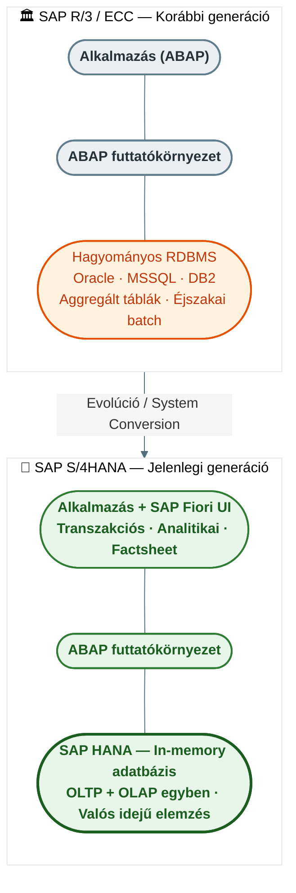
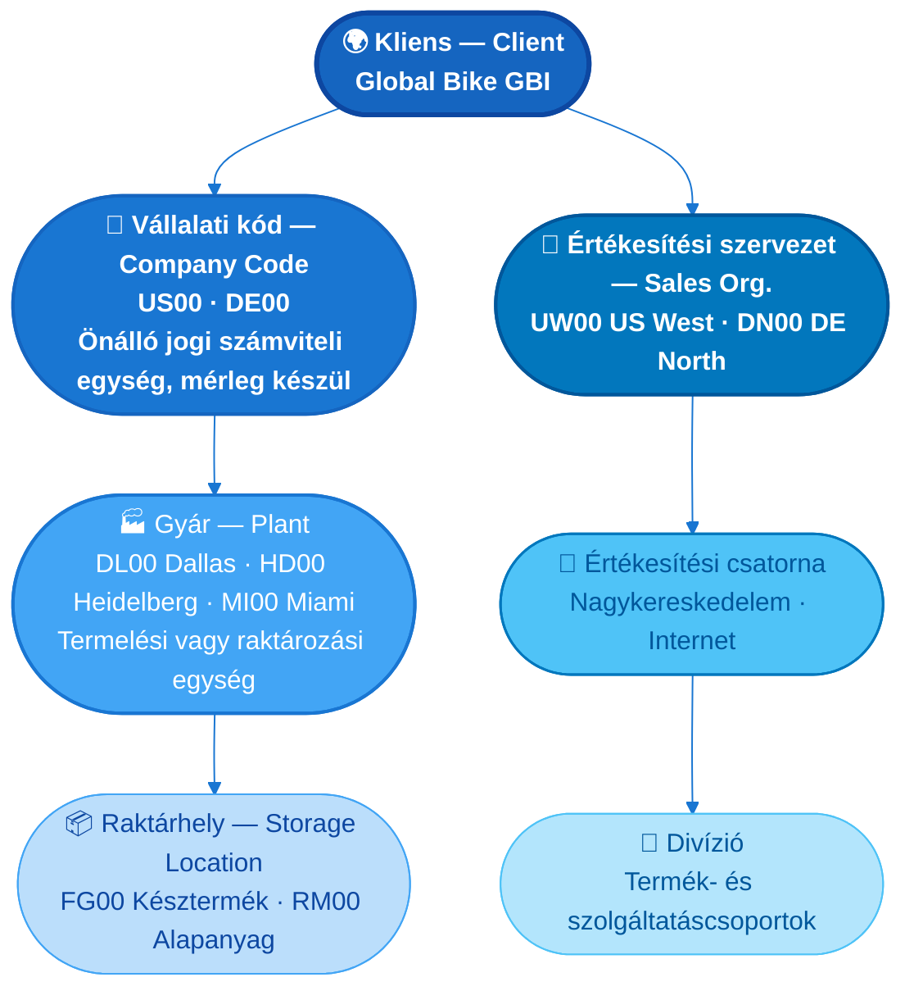
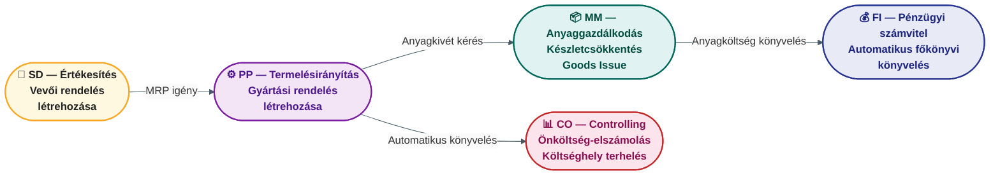

## V14 – SAP S/4HANA struktúra, felépítés és modulok

**Tétel:** SAP S/4HANA struktúra és modulok: Ismertesse az SAP rendszer struktúráját és felépítését, különös tekintettel az S/4HANA architektúrára és annak elődjeitől való eltéréseire! Tekintse át az SAP főbb moduljait (FI, CO, MM, SD, PP, HR stb.), jellemezze az egyes modulok feladatait és felelősségi körét, majd mutassa be részletesen a modulok egymáshoz való kapcsolódási pontjait és az integrált adatáramlás logikáját! Fejtse ki, milyen előnyöket jelent az S/4HANA in-memory adatbázis-technológiája a korábbi megoldásokhoz képest!

---

### 14.1. Az SAP S/4HANA architektúrája és eltérése az elődjeitől

Az SAP S/4HANA (2015–) a vállalatirányítási rendszerek negyedik generációja. Legfőbb újítása az **SAP HANA in-memory adatbázis**, amely az adatokat a merevlemez helyett a RAM-ban tárolja.

**Az S/4HANA előnyei a korábbi generációkhoz képest:**

| Jellemző | SAP ECC (korábbi) | SAP S/4HANA |
|---|---|---|
| Adattárolás | Merevlemez (disk-based) | Memóriában (in-memory, RAM) |
| Adatmodell | Aggregált táblák, indexek | Egyszerűsített modell, oszlopcentrikus tárolás |
| OLTP + OLAP | Különálló rendszerek | Egyetlen rendszerben, valós időben |
| Adattömörítés | Alap | 593 GB → 118,6 GB (HANA) → 42,4 GB (S/4HANA) |
| Felhasználói felület | SAP GUI (tranzakciók) | SAP Fiori (csempék, szerepköralapú, mobil) |
| Analitika | Éjszakai adatáttöltés | Azonnali, beágyazott analitika |

**Az S/4HANA bizonylati elve (Document Principle):**  
Minden üzleti esemény egyedi sorszámú, nem törölhető elektronikus bizonylatot hoz létre az SAP adatbázisban. A bizonylat tartalmazza a felelős személyt, az időbélyeget és a tranzakció kereskedelmi tartalmát. Ez az erős belső kontrollrendszer és az audit-trail alapja. A **bizonylatfolyam** (Document Flow) e bizonylatok egymáshoz láncolódását jelenti – például: Megrendelő → Árubevételezés → Szállítói számla → Kifizetés.

**Az SAP adattípusai:**

| Adattípus | Jellemző | Példák |
|---|---|---|
| **Szervezeti adat** | Tartósan rögzített, ritkán változó struktúra | Kliens, Vállalati kód (Company Code), Gyár (Plant), Raktárhely |
| **Törzadat (Master Data)** | Hosszú életciklusú, alapvető üzleti objektum | Anyag (Material), Vevő (Customer), Szállító (Vendor), Főkönyvi számla |
| **Tranzakciós adat** | Üzleti esemény rögzítése; hivatkozik a törzadatra és szervezeti adatra | Értékesítési rendelés, Megrendelő, Számla, Szállítási bizonylat |

### 14.2. Az SAP szervezeti egységei (Organizational Units)

Az SAP a vállalat fizikai és jogi struktúráját szervezeti egységekkel modellezi. Ezek hierarchikusan épülnek egymásra:

**A Global Bike vállalati struktúra az SAP-ban:**  
A GBI-példa jól illusztrálja a szervezeti egységek hierarchiáját: Kliens (GBI) → Vállalati kód (US00, DE00) → Gyár (Dallas DL00, Miami MI00, Heidelberg HD00) → Raktárhely (FG00: késztermék, RM00: alapanyag) → Értékesítési szervezet (US West UW00, DE North DN00).

### 14.3. Az SAP főbb moduljai

Az SAP S/4HANA logikailag kapcsolódó tranzakciókat modulokba rendez. Minden modul egy üzleti funkciót fed le, de közös adatbázison és törzsadatokon keresztül szorosan integrálódnak egymással.

| Modul | Teljes név | Fő feladatok |
|---|---|---|
| **FI** | Financial Accounting – Pénzügyi számvitel | Főkönyv, szállítói kötelezettségek (AP), vevői követelések (AR), eszközgazdálkodás (AA) |
| **CO** | Controlling – Vezetői számvitel | Költséghelyek, belső rendelések, jövedelmezőségi elemzés (PA), eredményszámítás |
| **MM** | Materials Management – Anyaggazdálkodás | Beszerzés, árubevételezés, készletkezelés, számlavezetés (LIV) |
| **SD** | Sales & Distribution – Értékesítés | Vevői rendelések, kiszállítás, számlázás (Order-to-Cash folyamat) |
| **PP** | Production Planning – Termelésirányítás | MRP, gyártási rendelések, kapacitástervezés (Make folyamat) |
| **HR/HCM** | Human Capital Management | Szervezeti felépítés, személyügyi adminisztráció, bérszámfejtés, képzés |
| **WM** | Warehouse Management – Raktárgazdálkodás | Tárhelyszintű raktárkezelés, áttárolási rendelések, fizikai készletnyilvántartás |
| **QM** | Quality Management – Minőségügy | Minőségtervezés, vizsgálati tételek, használati döntés |
| **PS** | Project System – Projektmenedzsment | WBS, hálózati tervek, projektköltség-kontroll, erőforrás-ütemezés |
| **PM** | Plant Maintenance – Karbantartásmenedzsment | Karbantartási rendelések, megelőző karbantartás, eszköznyilvántartás |

### 14.4. A modulok közötti integrált adatáramlás

Az SAP egyik legfontosabb jellemzője, hogy az egyes modulok nem egymás után, hanem **párhuzamosan és automatikusan** frissülnek egyetlen üzleti tranzakció hatására. Az adatáramlást közös törzsadatok és bizonylatfolyam biztosítja.

**Példa: Gyártási rendelés teljes adatáramlása**

**A Procure-to-Pay (P2P) folyamat – az MM és FI integráció klasszikus példája:**

| Lépés | Modul | Tranzakció |
|---|---|---|
| Igény rögzítése | MM | Megrendelési igény (Purchase Requisition) |
| Megrendelő leadása | MM | Megrendelő (Purchase Order) |
| Árubevételezés | MM | Goods Receipt → automatikus készletnövelés |
| Szállítói számla | MM–FI | Invoice Verification → szállítói kötelezettség keletkezik FI-ban |
| Kifizetés | FI | Outgoing Payment → bankszámla csökken |

**A SAP Fiori felhasználói felület három alkalmazástípusa:**

| Típus | Tartalom | Példa |
|---|---|---|
| **Tranzakciós App** | Adatlétrehozás, módosítás, megtekintés irányított navigációval | Értékesítési rendelés létrehozása |
| **Analitikai App** | Üzleti adatok vizuális áttekintése, KPI-megjelenítés | Bevétel régiónkénti eloszlása |
| **Factsheet** | Objektum kulcsinformációi + kontextuális navigáció a kapcsolódó objektumokhoz | Anyagkártya, Vevőkártya |

**S/4HANA telepítési lehetőségek (Cloud vs. On-Premise):**

| Jellemző | Cloud (SaaS, előfizetéses) | On-Premise (hagyományos) |
|---|---|---|
| Üzemeltetés | SAP felügyeli | Vállalat maga üzemelteti |
| Frissítés | Negyedéves automatikus | Kevésbé sűrű, egyedi döntés |
| Testreszabhatóság | Korlátozott (in-app extensibility) | Teljes ABAP-fejlesztés lehetséges |
| Adatfelügyelet | SAP adatközpontban | Vállalat helyszínén |
| Átállási forgatókönyv | **Greenfield (New Implementation)** – nulláról, data migration szükséges | **Brownfield (System Conversion)** – meglévő ECC átkonvertálása |

A harmadik átállási forgatókönyv a **Landscape Transformation**: több régiós ERP-rendszer összevonása egyetlen S/4HANA-installanciába.

### 14.5. Az in-memory technológia üzleti értéke

Az SAP HANA adatbázis három szinten hozza az üzleti értéket:

**1. Sebesség:** Az MRP futtatása – amely korábban órákat igényelbe vett éjszakai kötegelt futásban – az S/4HANA-ban percek alatt elvégezhető bármikor, igény szerint.

**2. Egyszerűsítés:** Az aggregált és redundáns adattáblák kiiktatásával az adatmodell 70%-kal egyszerűsödött. Ez csökkenti a karbantartási terhet és a migráció komplexitását.

**3. Valós idejű döntéstámogatás:** Mivel az OLTP és OLAP ugyanabban a rendszerben fut, a vezető azonnal, az élő tranzakciós adatok alapján kaphat elemzési riportot – anélkül, hogy adattárházba kellene exportálni az adatokat.

**Összegzés:** Az SAP S/4HANA egy integrált, in-memory alapú vállalatirányítási platform. A moduláris felépítés lehetővé teszi a rugalmas implementációt, míg a közös adatbázis és a bizonylatfolyam garantálja a teljes vállalat egységes adatképét. Az in-memory technológia nem csupán sebességet, hanem minőségileg új döntéstámogatási képességet is jelent.

---

*Forrás: GMXIV2MBLF oktatási segédanyag (2026); SAP UCC Magdeburg: Intro to SAP S/4HANA Using Global Bike v4.3 (2025) – Introduction, FI, CO, MM, SD, PS modulok; Russel, D., Hartley, N.: SAP S/4HANA: An Introduction (SAP Press, 2019); Plattner, H., Zeier, A.: In-Memory Data Management (Springer, 2012); help.sap.com*
