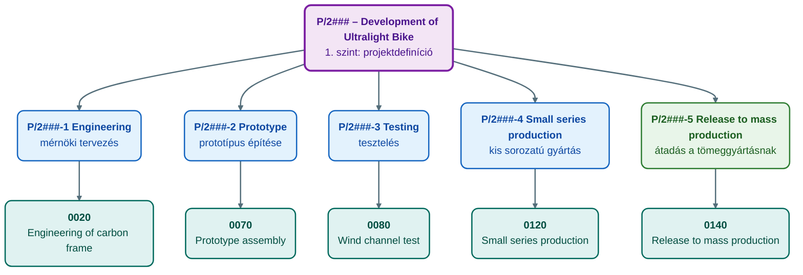
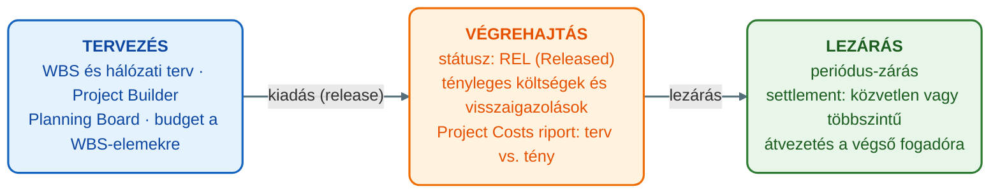
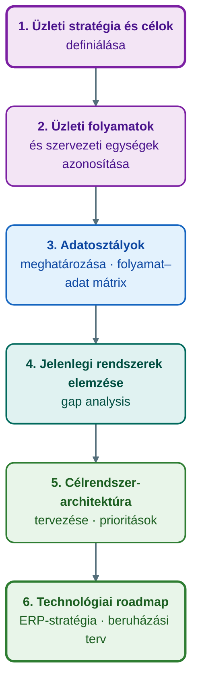
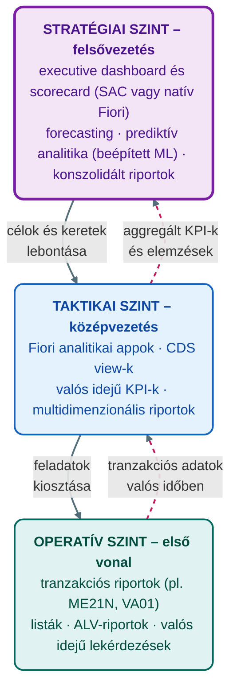

## V15 – ERP rendszer és projektmenedzsment, BSP módszertan, ITIL és döntéstámogatás

### Beszerzendő anyagok

| Szerző | Mű | Jelleg | Indoklás / érintett rész |
|---|---|---|---|
| — | *Vállalati információs rendszerek I. Bevezetés a vállalati információs rendszerekbe* (Széchenyi István Egyetem, online jegyzet) | kötelező irodalom | A syllabus kötelező irodalma; az R2–R3 részkérdések (információs rendszerek szervezési módszerei, BSP) a segédanyagban csak felsorolásszinten szerepelnek, ez a jegyzet adhatna hozzájuk mélységet. |
| Molnár, B. | *Vállalatirányítási rendszerek gazdaságinformatikai megközelítésben* (2014) | kötelező irodalom | A syllabus kötelező irodalma; az R4–R5 részkérdések (ERP-üzemeltetés, szolgáltatásmenedzsment) elméleti háttere erre épülne. |
| Tasi, M. | *Vállalatirányítási rendszerek* (Edutus Főiskola, 2011) | kötelező irodalom | A syllabus kötelező irodalma; az R1 és R6 részkérdések (ERP-funkciók, a vezetési szintek döntéstámogatása) tankönyvi háttere. |

**Tétel:** Ismertesse, hogyan támogatja az ERP rendszer a projektmenedzsmentet, milyen funkciókat biztosít a projektek tervezéséhez, erőforrás-kezeléséhez, nyomon követéséhez és kontrollingjához! Mutassa be az információs rendszerek szervezési módszereit és a BSP (Business Systems Planning) módszertan lényegét a vállalati ERP stratégia tervezésének kontextusában! Fejtse ki az ERP rendszer működtetésének alapelveit, kitérve az üzemeltetés- és szolgáltatásmenedzsment (ITIL szemlélet) legfontosabb feladataira, és ismertesse, hogyan támogatja az ERP rendszer saját, natív eszközeivel a különböző vezetési szintek döntéshozatalát!

---

### 15.1. Az ERP szerepe a projektmenedzsmentben – az SAP PS modul

A vállalatirányítási rendszerben a projektmenedzsment célja a komplex, időben behatárolt és egyedi célú üzleti folyamatok tervezése, irányítása és ellenőrzése (ÓE, é. n., „Projektmenedzsment az ERP rendszerben” lecke). A projekt ismérvei az SAP tananyag szerint: komplex, egyedi, magas kockázatú, célorientált, időben korlátozott, költség- és kapacitásigényes, több szervezeti egységet érint, magas minőségi követelmények vonatkoznak rá, és stratégiai jelentőségű a vállalat számára (SAP UCC Magdeburg, 2025b, 10. dia; Wassmann et al., 2025, 6. o.).

Az ERP – az SAP-ban a Project System (PS) modul – a projekteket nem elszigetelten, hanem a vállalat többi folyamatával (pénzügy, logisztika, gyártás, HR) összekapcsolva kezeli, ezért a „projektmenedzsment-háromszög” (idő, költség, terjedelem/scope) valós időben nyomon követhető, és az erőforrások keresztfunkcionálisan allokálhatók (Novák, 2026, 17. o.). A lecke a PS stratégiai szerepét három pontban foglalja össze (ÓE, é. n., „Projektmenedzsment az ERP rendszerben” lecke):

- **Integrált megközelítés:** a projektadatok közvetlenül kapcsolódnak a pénzügyhöz (FI), a kontrollinghoz (CO), az anyag- és készletgazdálkodáshoz (MM) és a termeléshez (PP).
- **Erőforrás-optimalizálás:** az emberi erőforrások és a gépi kapacitások pontos ütemezése a projektek között.
- **Költségkontroll:** valós idejű rálátás a tervezett és a tényleges költségekre, a jövedelmezőségi célok érdekében.

A PS modul sajátossága, hogy **nincs saját szervezeti struktúrája**: azt a vállalati struktúra szervezeti egységeihez való hozzárendeléssel örökli, a Pénzügy és a Logisztika moduljaihoz integráltan működik, és a termelékenységét elsősorban a többi SAP-modullal való integráció teremti meg (SAP UCC Magdeburg, 2025b, 7. dia). Három projekttípust különböztet meg: vevői projekt (customer project), általános költségprojekt (overhead cost project) és beruházási projekt (investment project) (SAP UCC Magdeburg, 2025b, 10. dia). A Global Bike esettanulmány egy költségprojektet hoz létre (projektprofil: „Cost projects (Europe)”) az ultrakönnyű versenykerékpár fejlesztésére (Wassmann et al., 2025, 6. o.).

A tételben kért négy funkciócsoportot a segédanyag így bontja ki (Novák, 2026, 17–18. o.):

| Funkciócsoport | Az ERP (SAP PS) által nyújtott funkciók |
|---|---|
| **Tervezés** | WBS (munkalebontási struktúra: projekt → fázis → feladat → munkaelem); hálózati tervezés (network planning) és Gantt-diagram: a tevékenységek sorrendje, függőségei, a kritikus út számítása; mérföldkövek; költségvetés-tervezés (budgeting) |
| **Erőforrás-kezelés** | az emberi erőforrások (HR-integráció), gépek és anyagok kapacitástervezése; kapacitás-ellenőrzés és -allokáció (resource leveling); munkaközpontok (work center) kezelése; integráció a PP és az MM modullal |
| **Nyomon követés** | haladáskövetés (progress analysis), Earned Value Management (EVM): tervezett vs. tényleges érték; valós idejű státuszriportok, az eltérések (variance) automatikus jelzése; dokumentumáramlás és audit-trail |
| **Kontrolling** | költség- és bevétel-kontrolling (CO-integráció), projektszintű eredménykimutatás; kockázat- és változáskezelés (change requests); KPI-alapú teljesítménymérés és előrejelzés (forecasting) |

Az ERP előnye, hogy a projektadatok automatikusan könyvelődnek – például SD-rendelésből vagy MM-beszerzésből –, így nincs manuális adatátadás; S/4HANA-ban a Fiori-alkalmazások és a beágyazott analitika gyors, mobil döntéstámogatást adnak (Novák, 2026, 18. o.).

### 15.2. A projekt strukturálása: WBS, hálózati terv, mérföldkövek

A PS törzsadatai: a projekt, a WBS-elemek (PSP-elemek), a sorrendek és kapcsolatok, a mérföldkövek és a munkaadatok (SAP UCC Magdeburg, 2025b, 9. dia). A projektet két fő strukturális elemmel bontjuk kezelhető egységekre (ÓE, é. n., „Projektmenedzsment az ERP rendszerben” lecke).

**WBS (Work Breakdown Structure – munkalebontási struktúra).** A projekt hierarchikus modellje, amely a szükséges tevékenységeket hierarchikus formában mutatja, és minden további tervezés alapja: a költségek, a határidők, az erőforrások és a kifizetések tervezéséé és ellenőrzéséé (Wassmann et al., 2025, 4. o.). A WBS-elem egy konkrét feladatot vagy részfeladatot ír le, amely munkacsomagokra bontható tovább; az elemekhez költségkeret, határidő és felelős (felelős költséghely) rendelhető, és a költségek és bevételek gyűjtőhelyéül szolgálnak (SAP UCC Magdeburg, 2025b, 13. dia; ÓE, é. n., „Projektmenedzsment az ERP rendszerben” lecke). A hierarchia fázisok, funkciók vagy objektumok szerint strukturálható (SAP UCC Magdeburg, 2025b, 14. dia).

A Global Bike esettanulmány P/2### jelű projektje („Development of Ultralight Bike”) öt második szintű WBS-elemre bomlik: Engineering, Prototype, Testing, Small series production, Release to mass production (Wassmann et al., 2025, 7. o.); a hálózati tevékenységek – például 0020 „Engineering of carbon frame” vagy 0080 „Wind channel test” – ezekhez az elemekhez vannak hozzárendelve (Wassmann et al., 2025, 10. o.):

A WBS-elem lehetséges státuszai (SAP UCC Magdeburg, 2025b, 13. dia): *Released* (tényleges költségek rögzíthetők rá), *Unlocked*, *Technically complete*, *Closed* (a logisztikai és pénzügyi folyamatok lezárva), *Deletion flag* és *Fully invoiced* (a további számlázás gátolható).

**Hálózati terv és tevékenységek (network activities).** Míg a WBS a feladatok hierarchiáját mutatja, a hálózati terv a tevékenységek időbeli lefolyását és logikai kapcsolatait ábrázolja; a tevékenységekhez időtartam és erőforrás-szükséglet rendelhető (ÓE, é. n., „Projektmenedzsment az ERP rendszerben” lecke). A PS háromféle tevékenységet különböztet meg (SAP UCC Magdeburg, 2025b, 17. dia):

| Tevékenységtípus | Tartalom |
|---|---|
| **Belsőleg feldolgozott (internally processed)** | saját erőforrással végzett munka; munkaközponthoz és aktivitástípushoz kötött, a munka mennyiségéből (pl. óra) a rendszer a munkaközpont képlete alapján kapacitásigényt számol (SAP UCC Magdeburg, 2025b, 22. dia) |
| **Külsőleg feldolgozott (externally processed)** | más vállalattól igénybe vett szolgáltatás; a külső feldolgozást a beszerzési osztály kezeli (Wassmann et al., 2025, 11. o.) |
| **Általános költségtevékenység (general costs)** | közvetlenül, összegben és költségnemre tervezett tétel – az esettanulmányban a hivatásos tesztpilóták teljesítménytesztje (Wassmann et al., 2025, 11. o.) |

A német DIN 69 900 szabvány a tevékenységet a folyamat összetevőjeként írja le, öt ismérvvel: van időtartama, meghatározott kezdete és vége, megszakítás nélkül hajtják végre, erőforrást igényel, és költséget okoz (SAP UCC Magdeburg, 2025b, 17. dia). A tevékenységek közötti **kapcsolatok (relationships)** a hálózati terv időbeli sorrendjét adják meg, és technikai vagy logikai függőséget fejeznek ki; négy típusuk: normál sorrend (normal series: vég → kezdet), kezdő sorrend (start series: kezdet → kezdet), záró sorrend (end series: vég → vég) és kötő sorrend (bounding series: kezdet → vég) (SAP UCC Magdeburg, 2025b, 19. dia). A hálózati grafikán a projekt kritikus útja is látható (Wassmann et al., 2025, 13. o.).

**Mérföldkövek (milestones).** A fázisok vagy szervezeti egységek közötti átmeneteket jelölik; WBS-elemhez vagy tevékenységhez rendelhetők, elsődlegesen információs és dokumentációs célt szolgálnak, de üzleti folyamatokat is indíthatnak: tevékenységek kiadása, standard ütemterv beillesztése, workflow-feladatok indítása, értékesítési projektnél haladásjelentés vagy mérföldkő-számlázás (SAP UCC Magdeburg, 2025b, 20–21. dia; Wassmann et al., 2025, 21. o.).

### 15.3. A projekt életciklusa az SAP PS-ben

A projektek kezelése a rendszerben három fő szakaszra osztható (ÓE, é. n., „Projektmenedzsment az ERP rendszerben” lecke):

**Tervezési fázis.** A projektstruktúra kialakítása, a határidők ütemezése és a költségvetés (budget) allokálása a WBS-elemekhez (ÓE, é. n., „Projektmenedzsment az ERP rendszerben” lecke). Minden adat egyetlen tranzakcióban, a Project Builderben készíthető elő, az ütemezés a hálózatokra épül (SAP UCC Magdeburg, 2025b, 12. dia); a Project Planning Board grafikus felületén a munka összehangolható, a kapacitások ellenőrizhetők és a költségek kiszámíthatók (SAP UCC Magdeburg, 2025b, 25. dia).

**Végrehajtási fázis.** Ebben a szakaszban történik a tényleges adatok rögzítése. A rendszer státuszokat kezel – például REL (Released / kiadva) –, amelyek engedélyezik a könyveléseket; a tényleges költségek szállítói számlák, anyagkivétek vagy munkaidő-visszaigazolások alapján keletkeznek (ÓE, é. n., „Projektmenedzsment az ERP rendszerben” lecke). A végrehajtás több lépésből áll (például beszerzési folyamat): a szolgáltatás átvételekor rögzítik az időket, és az Easy Cost Planninggel tervezett tételek kötelezettségei és költségei könyvelődnek (SAP UCC Magdeburg, 2025b, 26–27. dia). A tevékenység visszaigazolása (confirmation) részlegesen, a végső visszaigazolás (final confirmation) teljesen visszaigazolt státuszba állítja a tevékenységet (Wassmann et al., 2025, 34. o.).

**Lezárási fázis.** A projekt pénzügyi elszámolása (settlement): a felmerült költségeket a végső vevőre vagy belső költséghelyre vezetik át (ÓE, é. n., „Projektmenedzsment az ERP rendszerben” lecke). A periódus-zárás jellemzően háttérben fut, és a költségeket az FI-be és más modulokba adja át; két elszámolási típus van (SAP UCC Magdeburg, 2025b, 28. dia):

| Settlement típus | Leírás |
|---|---|
| **Közvetlen elszámolás (direct settlement)** | minden objektum közvetlenül a külső költségobjektumra (pl. költséghely, jövedelmezőségi szegmens) számol el |
| **Többszintű elszámolás (multi-level settlement)** | a projekt egyes objektumai először a felettes WBS-elemre számolnak el, majd az az összegyűjtött költségeket a külső fogadóra vezeti át |

**Információs rendszer.** A PS információs rendszere a projekt kulcsmutatóinak értékelésére szolgál: riportokat és grafikonokat ad a teljesítményről, az ütemezésről és a költségekről; riporttípusai a struktúraalapú, a költségorientált, a tételes és az összesítő riportok (SAP UCC Magdeburg, 2025b, 29. dia). Az esettanulmányban a Structure Overview a struktúrát és a terv–tény dátumokat mutatja, a „Project Costs – Actual/Commitment/Total/Planned” riport pedig a tervezett, elkötelezett és tényleges költségeket veti össze; egy FI-ben rögzített szállítói számla azonnal megjelenik benne (Wassmann et al., 2025, 25., 28. o.; ÓE, é. n., „Projektmenedzsment az ERP rendszerben” lecke).

### 15.4. Az információs rendszerek szervezési módszerei

Az információs rendszerek szervezési (tervezési) módszerei a vállalati stratégia és az IT/IS-tervek összehangolását szolgálják. A segédanyag három megközelítést különböztet meg (Novák, 2026, 18. o.):

- **Top-down (üzletvezérelt):** a vállalati stratégiából indul ki – ide tartozik a BSP és a CSF (Critical Success Factors, kritikus sikertényezők) módszer;
- **Bottom-up (technológiavezérelt):** a meglévő rendszerek optimalizálásából épít;
- **Hibrid megközelítések:** például a vállalati architektúra (Enterprise Architecture) keretrendszerei, mint a TOGAF.

Az ERP-stratégia tervezésében a top-down logika a meghatározó: a BSP alapelve is ez, és éppen ezért képes minimalizálni a redundanciát és a szigetrendszerek kialakulását (Novák, 2026, 18–19. o.; vö. V11).

### 15.5. BSP – Business Systems Planning

A **BSP** (Business Systems Planning) az IBM által az 1970-es években kifejlesztett módszertan; célja az információs rendszerek stratégiai tervezése úgy, hogy azok maximálisan támogassák az üzleti célokat. Alapelve a top-down lánc: **üzleti stratégia → folyamatok → adatok → alkalmazások → technológia** (Novák, 2026, 18. o.). Főbb lépései (Novák, 2026, 19. o.):

1. Az üzleti stratégia és a célok definiálása.
2. A főbb üzleti folyamatok (business processes) és a szervezeti egységek azonosítása.
3. Az adatosztályok (data classes) meghatározása és a folyamat–adat mátrix (process/data matrix) elkészítése.
4. A jelenlegi rendszerek elemzése (gap analysis).
5. A célrendszer-architektúra megtervezése és a prioritások felállítása.
6. Technológiai ütemterv (roadmap) készítése: ERP-stratégia, beruházási terv.

Az ERP-stratégia kontextusában a BSP négy okból különösen hasznos (Novák, 2026, 19. o.): segít meghatározni, mely üzleti folyamatokhoz szükséges ERP-modul (például PS vagy FI/CO); minimalizálja a redundanciát és a szigetrendszerek kialakulását; biztosítja az ERP-bevezetés üzleti indokoltságát (business alignment); eredménye pedig egy hosszú távú ERP-ütemterv (roadmap), amely a beruházásokat a stratégiai célokhoz köti. A folyamat–adat mátrix – melyik folyamat melyik adatosztályt hozza létre vagy használja – az ERP integrált adatmodelljének tervezési előképe (vö. V12).

### 15.6. Az ERP működtetésének alapelvei és az ITIL szemléletű üzemeltetés

**Alapelvek.** Az ERP működtetésének alapelvei: a folyamatos **rendelkezésre állás** (availability), a **megbízhatóság** (reliability), a **skálázhatóság**, a **biztonság** és a **költséghatékonyság** (a TCO optimalizálása). Mivel az ERP kritikus üzleti rendszer, a működtetés nem pusztán technikai, hanem szolgáltatásorientált szemléletet igényel (Novák, 2026, 19. o.).

**ITIL.** Az ITIL (IT Infrastructure Library) az IT-szolgáltatásmenedzsment (ITSM) legjobb gyakorlatainak keretrendszere, amely az IT-t üzleti szolgáltatásként kezeli. Életciklus-fázisai és a hozzájuk tartozó ERP-specifikus feladatok (Novák, 2026, 19–20. o.):

| ITIL-fázis | Legfontosabb feladatok ERP-kontextusban |
|---|---|
| **Service Strategy** | a szolgáltatási portfólió tervezése (pl. az ERP rendelkezésre állási SLA-i) |
| **Service Design** | kapacitás- és üzletmenet-folytonossági (continuity) tervezés, biztonsági irányelvek |
| **Service Transition** | változásmenedzsment (change management): javítócsomagok (patch), verzióváltások (upgrade) |
| **Service Operation** | incidenskezelés (incident management: a zavarok elhárítása), problémakezelés (problem management: a gyökérokok megszüntetése) |
| **Continual Service Improvement** | KPI-mérés, optimalizálás, bevezetés utáni felülvizsgálat (post-implementation review) |

A legfontosabb ERP-specifikus üzemeltetési feladatok (Novák, 2026, 20. o.):

- **Incident & Problem Management:** a rendszerleállás gyors elhárítása (pl. az S/4HANA állásidejének minimalizálása) és az ismétlődő hibák gyökérokának megszüntetése;
- **Change & Release Management:** konfiguráció- és transzportkezelés az SAP Transport Management Systemmel (TMS), hogy a változtatások ellenőrzötten kerüljenek az éles rendszerbe;
- **Service Level Management:** az SLA-k betartása (pl. 99,9 %-os rendelkezésre állás);
- **CMDB (Configuration Management Database):** az ERP-komponensek nyilvántartása.

A szemlélet lényege, hogy az ERP-t nem szoftverként, hanem mérhető szolgáltatásként kezeljük, és az IT az ITIL-folyamatok mentén tartja egyensúlyban a változtatás kontrollját és a stabil működést.

### 15.7. Az ERP natív döntéstámogatása a vezetési szinteken

Az ERP a saját, beépített eszközeivel – külön BI-rendszer nélkül – támogatja a döntéshozatalt az operatív, a taktikai és a stratégiai szinten (Novák, 2026, 20–21. o.):

- **Operatív szint** (napi műveletek, első vonal): tranzakciós riportok (pl. ME21N, VA01), listák, ALV-riportok; valós idejű lekérdezések standard riportokkal és query-eszközökkel (Novák, 2026, 20. o.).
- **Taktikai szint** (középvezetés, havi és éves tervezés): műszerfalak (dashboard) és analitikai nézetek – S/4HANA-ban Fiori-alkalmazások és CDS (Core Data Services) view-k; beágyazott analitika valós idejű KPI-kkel (pl. készletforgás, projekt-variancia); multidimenzionális, pivot-szerű riportálás (Novák, 2026, 21. o.).
- **Stratégiai szint** (felsővezetés): vezetői műszerfalak (executive dashboard) és scorecardok SAP Analytics Cloud integrációval vagy natív Fioriban; előrejelzés (forecasting) és prediktív analitika az S/4HANA beépített ML-modelljeivel; összevont riportok (konszolidáció, üzleti partner alapú áttekintés) (Novák, 2026, 21. o.).

Ennek technológiai alapja a **beágyazott analitika (Embedded Analytics)**. A hagyományos ERP a tranzakciók rögzítésére (OLTP) fókuszált, az elemzéseket különálló adattárházban (OLAP) végezték; az S/4HANA-ban a tranzakciós és az analitikai folyamatok ugyanabban a rendszerben, párhuzamosan futnak, így nincs szükség az adatok éjszakai áttöltésére, az elemzések az élő, pillanatnyi adatokon alapulnak, a rendszer szimulációkkal és előrejelzésekkel segíti a vezetőket, és az adatok a Fiori felületen grafikonok és KPI-mutatók formájában jelennek meg (ÓE, é. n., „BI az ERP rendszerben” lecke).

A natív eszköztár felhasználói oldala a **Fiori** három alkalmazástípusa (ÓE, é. n., „ERP fogalma és alapjai” lecke; SAP UCC Magdeburg, 2025a, 34. dia): a *tranzakciós* alkalmazások a napi operatív feladatokra (pl. rendelés rögzítése), az *analitikai* alkalmazások a KPI-k vizuális áttekintésére és elemzésére, a *fact sheet* alkalmazások pedig egy-egy üzleti objektum (vevő, anyag) adatainak gyors megjelenítésére szolgálnak.

A natív döntéstámogatás előnyei (Novák, 2026, 21. o.): egyetlen igazságforrás (single source of truth), valós idejű adatok (HANA-technológia), szerepkör-alapú hozzáférés (Fiori) és minimális adatduplikáció – a döntések így gyorsabbak, pontosabbak és adatvezéreltek.

**Összegzés:** Az ERP nem csupán operatív támogatást nyújt, hanem stratégiai eszköz is. A PS modulon keresztül a projekteket a pénzügyi és kontrolling folyamatokkal integrálja; a BSP – és általában a top-down tervezés – az ERP-stratégia üzleti megalapozásának kerete; az ITIL a stabil, szolgáltatásként mért működtetést szervezi; natív analitikai eszközeivel pedig a teljes döntési hierarchiát – az operatív listáktól a vezetői műszerfalakig – valós idejű adatokkal látja el (Novák, 2026, 21. o.).

---

### Várható vizsgáztatói kérdések

1. **Mi a különbség a WBS és a hálózati terv között, és miért kell mindkettő?** — A WBS a projekt hierarchikus modellje: a feladatokat és részfeladatokat bontja munkacsomagokra, az elemei a költségek és bevételek gyűjtőhelyei, és minden további tervezés alapját adják (Wassmann et al., 2025, 4. o.; SAP UCC Magdeburg, 2025b, 13. dia). A hálózati terv ezzel szemben a tevékenységek időbeli lefolyását és logikai függőségeit ábrázolja, a kapcsolatok négy típusával és a kritikus úttal (ÓE, é. n., „Projektmenedzsment az ERP rendszerben” lecke; SAP UCC Magdeburg, 2025b, 19. dia). A kettő együtt kell: a tevékenységeket WBS-elemekhez rendelik, így a „mit és kinek a terhére” (WBS) és a „mikor, milyen sorrendben” (hálózat) egyetlen struktúrában kapcsolódik össze (Wassmann et al., 2025, 10. o.).
2. **Mi a különbség a közvetlen és a többszintű settlement között?** — Közvetlen elszámolásnál minden projektobjektum közvetlenül a külső költségobjektumra (költséghely, jövedelmezőségi szegmens) számol el; többszintű elszámolásnál az objektumok először a felettes WBS-elemre, és az összegyűjtött költséget az vezeti tovább a külső fogadóra. Mindkettő a periódus-zárás része, és az FI-be adja át a költségeket (SAP UCC Magdeburg, 2025b, 28. dia).
3. **Miért mondjuk, hogy a PS modul értékét az integráció adja?** — Mert a PS-nek nincs saját szervezeti struktúrája, azt a vállalati struktúrából örökli, és a Pénzügy és a Logisztika moduljaihoz kapcsolódva működik (SAP UCC Magdeburg, 2025b, 7. dia); a projektadatok automatikusan könyvelődnek SD-rendelésből vagy MM-beszerzésből (Novák, 2026, 18. o.), és egy FI-ben rögzített szállítói számla azonnal megjelenik a projekt költségriportjában (ÓE, é. n., „Projektmenedzsment az ERP rendszerben” lecke).
4. **Miben különbözik a BSP a bottom-up tervezéstől, és mit ad az ERP-stratégiának?** — A bottom-up a meglévő rendszerek optimalizálásából indul ki, a BSP top-down: az üzleti stratégiából vezeti le a folyamatokat, az adatokat, az alkalmazásokat és a technológiát. Az ERP-stratégiában ezért tudja megmondani, mely folyamatokhoz kell ERP-modul, elkerüli a szigetrendszereket, biztosítja a business alignmentet, és hosszú távú ERP-roadmapet ad (Novák, 2026, 18–19. o.).
5. **Hogyan jelenik meg az ITIL Service Transition és Service Operation az ERP üzemeltetésében?** — A Service Transition a változásmenedzsment: javítócsomagok, verzióváltások, konfiguráció- és transzportkezelés az SAP TMS-szel; a Service Operation az incidens- és problémakezelés: a leállás gyors elhárítása és a gyökérokok megszüntetése, az SLA-k (pl. 99,9 % rendelkezésre állás) betartása mellett (Novák, 2026, 20. o.).
6. **Miért nem kell külön adattárház az S/4HANA-ban a vezetői döntéstámogatáshoz?** — Mert a beágyazott analitika révén a tranzakciós (OLTP) és az analitikai (OLAP) feldolgozás ugyanabban a rendszerben fut, a CDS view-k és a Fiori analitikai alkalmazások az élő adatokon dolgoznak, így nincs éjszakai adatáttöltés (ÓE, é. n., „BI az ERP rendszerben” lecke; Novák, 2026, 21. o.); ennek technológiai alapja a HANA in-memory adatbázis (vö. V14).

---

## Irodalom

* Novák, G. (2026). *Integrált vállalatirányítási rendszerek: Oktatási segédanyag* [Egyetemi jegyzet]. Óbudai Egyetem, Keleti Károly Gazdasági Kar.
* Óbudai Egyetem, Keleti Károly Gazdasági Kar. (é. n.). *Integrált vállalatirányítási rendszer fogalma és alapjai* [Elektronikus tananyag, Integrált vállalatirányítási rendszerek (GMXIV2MBLF)].
* Óbudai Egyetem, Keleti Károly Gazdasági Kar. (é. n.). *Projektmenedzsment az ERP rendszerben* [Elektronikus tananyag, Integrált vállalatirányítási rendszerek (GMXIV2MBLF)].
* Óbudai Egyetem, Keleti Károly Gazdasági Kar. (é. n.). *Üzleti Intelligencia (BI) kialakítása az ERP rendszerben* [Elektronikus tananyag, Integrált vállalatirányítási rendszerek (GMXIV2MBLF)].
* SAP UCC Magdeburg. (2025a). *Introduction to SAP S/4HANA* [Előadás-diasor, Intro to S/4HANA using Global Bike v4.3]. SAP SE / SAP University Competence Center Magdeburg.
* SAP UCC Magdeburg. (2025b). *Project Management (PS)* [Előadás-diasor, Intro to S/4HANA using Global Bike v4.3]. SAP SE / SAP University Competence Center Magdeburg.
* Wassmann, M., Wagner, B., & Weidner, S. (2025). *Project Management (PS): Case study* (4.3 verzió) [Esettanulmány, Intro to S/4HANA using Global Bike]. SAP University Competence Center Magdeburg.
