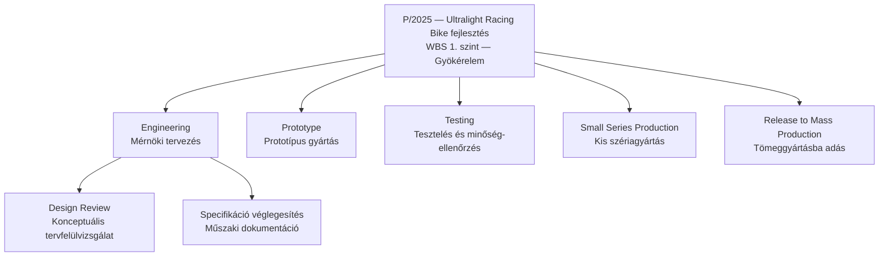
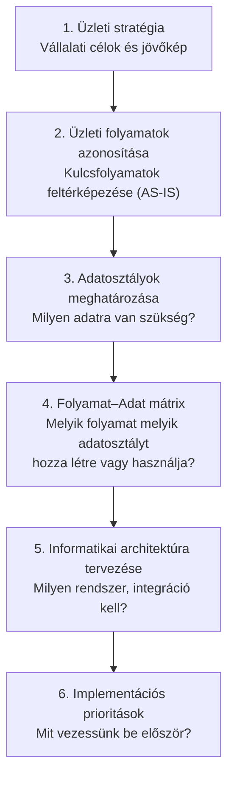
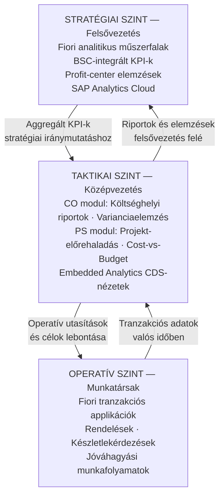

## V15 – ERP rendszer és projektmenedzsment, BSP módszertan, ITIL és döntéstámogatás

**Tételkérdés:** Ismertesse, hogyan támogatja az ERP rendszer a projektmenedzsmentet, milyen funkciókat biztosít a projektek tervezéséhez, erőforrás-kezeléséhez, nyomon követéséhez és kontrollingjához! Mutassa be az információs rendszerek szervezési módszereit és a BSP (Business Systems Planning) módszertan lényegét a vállalati ERP stratégia tervezésének kontextusában! Fejtse ki az ERP rendszer működtetésének alapelveit, kitérve az üzemeltetés- és szolgáltatásmenedzsment (ITIL szemlélet) legfontosabb feladataira, és ismertesse, hogyan támogatja az ERP rendszer saját, natív eszközeivel a különböző vezetési szintek döntéshozatalát!

---

### 15.1. Az ERP szerepe a projektmenedzsmentben – az SAP PS modul

Az SAP Project System (PS) modul az ERP-be integrált projektmenedzsment-eszköz. Ellentétben az önálló projektszoftverekkel (pl. MS Project), az SAP PS valós időben kapcsolódik a pénzügyi, kontrolling, anyag- és gyártásirányítási modulokhoz.

**A PS modul stratégiai értéke:**

| Funkció | Tartalom |
|---|---|
| Tervezés | WBS felépítése, hálózati tervek, mérföldkövek, határidők, felelősök rögzítése |
| Erőforrás-kezelés | Emberi és gépi kapacitások ütemezése, kapacitás-ütközések jelzése |
| Nyomonkövetés | Státuszok kezelése (tervezett → kiadott → lezárt), tényleges vs. tervezett összehasonlítás |
| Kontroll | Valós idejű költség-rálátás, budget vs. tényleges adatok, elszámolás (settlement) |
| Integráció | Automatikus könyvelés a FI-ban szállítói számla vagy anyagkivét esetén |

**A PS modul sajátossága:** A PS nem rendelkezik önálló szervezeti struktúrával – az FI, CO és MM modulokból örökli azt (Company Code, Controlling Area, Plant). Ezzel biztosítja a teljes pénzügyi és logisztikai integráltságot. A PS modul értékét elsősorban a más modulokkal való integráció teremti meg.

**Projekttípusok az SAP PS-ben:**

| Projekttípus | Jellemző | Példa |
|---|---|---|
| **Vevői projekt (Customer project)** | Vevői rendeléshez kapcsolódik; a bevétel és kiadás a projekten keresztül folyik | Egyedi termék legyártása és leszállítása |
| **Általános költségprojekt (Overhead cost project)** | Nem értékesítési célú belső projekt | Irodafelújítás, belső fejlesztés |
| **Beruházási projekt (Investment project)** | Tőkésítendő befektetés; a költségek eszközként jelennek meg | Gyárbővítés, gépbeszerzés |

### 15.2. A projekt strukturálása: WBS és hálózati tervek

**WBS (Work Breakdown Structure – Munkalebontási struktúra):**  
A projekt hierarchikus modellje, amely a feladatokat kezelhető egységekre bontja. Minden WBS-elemhez rendelhető: költségkeret, felelős, határidő és mérföldkő.

**WBS-elem (PSP-elem) lehetséges státuszai:**

| Státusz | Jelentés |
|---|---|
| **Released** | Tényleges költségek rögzíthetők a WBS-elemre |
| **Unlocked** | Feloldott, feldolgozható állapot |
| **Technically Complete** | Műszaki zárás: a logisztikai folyamatok lezárulnak |
| **Closed** | Logisztika és pénzügy egyaránt lezárva |
| **Deletion Flag** | Törlésre jelölve |
| **Fully Invoiced** | Teljes számlázás megtörtént; további számlák gátoltak |

**Tevékenységtípusok (Activity Types) a hálózati tervben:**

| Típus | Leírás |
|---|---|
| **Belsőleg feldolgozott (Internally processed)** | Saját erőforrással elvégzett tevékenység; aktivitástípushoz és munkaközponthoz kötött |
| **Külső megrendelés (Externally processed)** | Alvállalkozóval elvégezhető; automatikus megrendelési igényt generál az MM-ben |
| **Általános költségtevékenység (General costs)** | Tételes költségtervezés, amelyet nem emberi/gépi erőforrás, hanem költségnem alapján terveznek |

A DIN 69 900 szabvány szerint a tevékenységeknek meghatározott kezdete és vége, megszakítás nélküli végrehajtásuk és erőforrásigényük van.

**Hálózati tervek (Network Activities):**  
Míg a WBS a feladatok hierarchiáját mutatja, a hálózati terv az időbeli sorrendet és logikai függőségeket ábrázolja. A kapcsolatok típusai: normál sorozat (vég→kezdet), start-sorozat (kezdet→kezdet), vég-sorozat (vég→vég), kötési sorozat (kezdet→vég).

### 15.3. A projekt életciklusa az SAP-ban

A lezárási fázisban a felmerült projektköltségeket **settlement**-tel (elszámolással) vezetik át a végső fogadó cost object-re. Az SAP PS két settlement-típust különböztet meg:

| Settlement típus | Leírás |
|---|---|
| **Közvetlen elszámolás (Direct settlement)** | Minden WBS-elem közvetlenül a végső külső fogadóra (pl. költséghelyre, jövedelmezőségi szegmensre) számolja el a kötelezettségét |
| **Többszintű elszámolás (Multi-level settlement)** | Az alacsonyabb szintű WBS-elemek először a magasabb szintű WBS-elemre számolnak el, majd az összesített összeg kerül a végső fogadóra |

A settlement biztosítja a teljes pénzügyi transzparenciát és az FI modulba való automatikus könyvelést.

### 15.4. BSP – Business Systems Planning módszertan

A **BSP** (Business Systems Planning) az IBM által az 1970-es években kidolgozott módszertan az informciórendszerek vállalati stratégiával való összehangolásához. Az ERP stratégiai tervezés kontextusában ma is alkalmazott keretrendszer.

**A BSP alaplogikája:**

**A BSP kapcsolódó módszerei:**

| Módszer | Tartalom |
|---|---|
| **CSF** (Critical Success Factors) | A vállalat sikerkritériumainak azonosítása, amelyekhez az IT-t igazítani kell |
| **Folyamat–Adat mátrix** | Melyik folyamat melyik adatosztályt hozza létre vagy használja? |
| **Entitás-kapcsolat modell** | Az adatosztályok közötti összefüggések feltérképezése |

A BSP napjainkban az SAP Activate és a Solution Manager módszertanokba integrálva él tovább az ERP stratégiai tervezés eszközeként.

### 15.5. ITIL-alapú ERP üzemeltetés

Az **ITIL** (IT Infrastructure Library) az IT-szolgáltatásmenedzsment globális keretrendszere. Az ERP rendszer üzemeltetése – különösen nagyobb szervezetekben – ITIL-folyamatok mentén szerveződik.

**Kulcs ITIL-folyamatok ERP-üzemeltetés kontextusában:**

| ITIL folyamat | Mit jelent ERP esetén? |
|---|---|
| **Incident Management** | ERP leállás, modul-hiba kezelése, SLA-nak megfelelő helyreállítás |
| **Problem Management** | Ismétlődő hibák gyökérok-elemzése (pl. teljesítményprobléma a PP modulban) |
| **Change Management** | ERP frissítések, patch-ek, konfigurációváltozások engedélyezési folyamata |
| **Service Level Management** | ERP rendelkezésre állási és teljesítmény-SLA-k meghatározása és mérése |
| **Release Management** | Új ERP verziók, modulbővítések kontrollált bevezetése |

**Az ERP üzemeltetés alapelvei:**
- **Landscape (rendszertáj) kezelése:** DEV (fejlesztési) → QAS (minőségbiztosítási / teszt) → PRD (éles) rendszer hármas szintű, transzport-folyamattal irányított változtatáskezeléssel.
- **Backup és disaster recovery:** Az ERP adatbázis rendszeres mentése, helyreállítási tervek.
- **Jogosultságkezelés:** Szerepköralapú hozzáférés-vezérlés (RBAC), szegregáció elvének betartása.

### 15.6. Az ERP natív döntéstámogatása a különböző vezetési szinteken

Az SAP S/4HANA beépített (natív) eszközei különböző részletességű és célú információt nyújtanak a három klasszikus vezetési szint számára:

**SAP Embedded Analytics:** Az S/4HANA-ban nincs szükség külön adattárházba exportálni az adatokat az elemzéshez. A CDS (Core Data Services) nézetek és az SAP Analytics Cloud közvetlen kapcsolatban állnak az éles adatbázissal – az elemzés az aktuális, pillanatszintű adatokon alapul.

**Összegzés:** Az ERP rendszer a projektmenedzsmenttől az üzemeltetésen át a döntéstámogatásig egységes platformot nyújt. Az SAP PS modul a projekteket a pénzügyi és kontrolling folyamatokkal integrálja; a BSP módszertan a stratégiai tervezéshez ad keretet; az ITIL az üzemeltetést szervezi; a beágyazott analitika pedig minden szinten valós idejű döntési alapot biztosít.

---

*Forrás: GMXIV2MBLF oktatási segédanyag (2026); SAP UCC Magdeburg: Intro to SAP S/4HANA Using Global Bike v4.3 – PS modul (2025); PMI: PMBOK Guide, 7th ed. (2021); Axelos: ITIL 4 Foundation (2019); IBM: Business Systems Planning – BSP (1984); Rockart, J.F.: „Chief Executives Define Their Own Data Needs" (HBR, 1979)*
