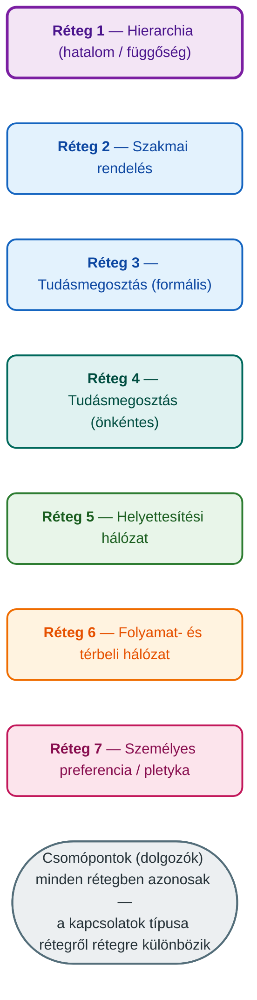
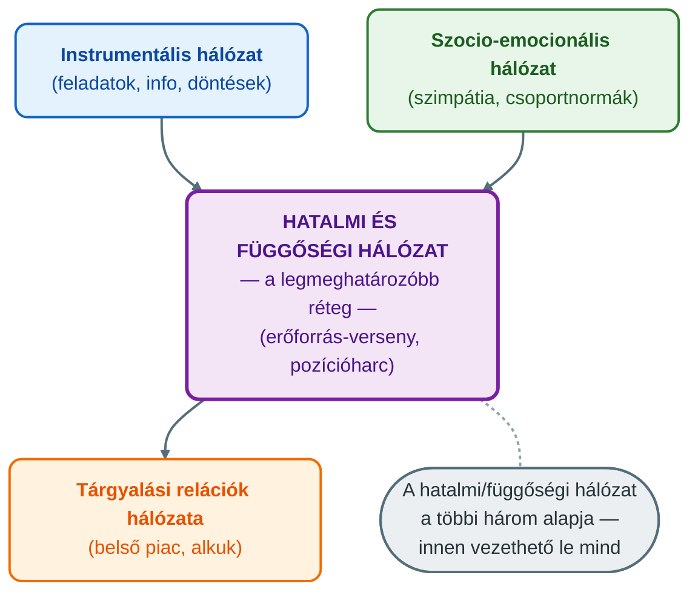
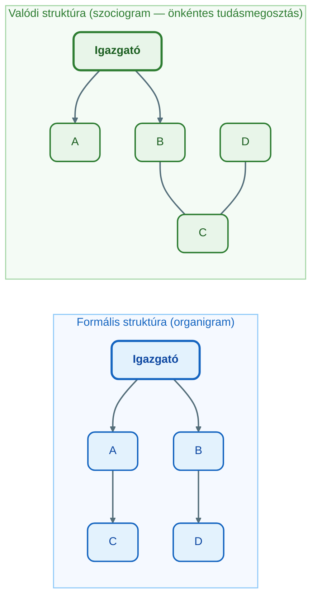

## V16 – A vállalat komplex hálózati modellje

**Tétel:** Vállalat komplex hálózati modellje: A vállalat komplex hálózati modellje. Mutassa be milyen hálózati rétegekből áll egy komplex vállalati hálózat, és mi a jellemző a különböző réteghálózatokra!

---

### 16.1. A szervezet mint komplex hálózat

A szervezetek hagyományos ábrázolása az organigram: formális hierarchia, pozíciók és alá-fölé rendeltségi kapcsolatok. Ez a kép azonban hamis egyszerűsítés. A valódi szervezet sokkal összetettebb: egymásra rakódott, különböző logikájú kapcsolathálók rendszere.

A hálózattudomány szemléletében a vállalat **multiplex hálózat**: ugyanazon csomópontok (dolgozók, szervezeti egységek) között több, egymástól elkülönülő, de egymással kölcsönható hálózati réteg húzódik.

Ez a Kivela-terminológia szerinti **multiplex hálózat** (szemben a multilayer hálózattal, amelynek rétegei más-más csomópontokat is tartalmazhatnak).

---

### 16.2. A réteghálózatok típusai és jellemzői

Dr. Szilágyi előadása és Mastenbroek szervezetelmélete alapján az alábbi fő rétegtípusok különíthetők el:

| Réteghálózat | Kérdés, amellyel feltérképezhető | Kapcsolat típusa | Irányítottság |
|---|---|---|---|
| Hierarchikus hatalom | „Ki a közvetlen felettese?" | Formális, pozíció-alapú | Irányított ↑↓ |
| Szakmai rendelés | „Kinek adhat szakmai utasítást?" | Szaktudás-alapú | Irányított |
| Formális tudásmegosztás | „Ki ad Önnek adatot, információt?" | Feladatból fakadó | Irányított |
| Önkéntes tudásmegosztás | „Kitől kér tanácsot önszántából?" | Bizalom-alapú | Irányított |
| Helyettesítési hálózat | „Ki helyettesíti Önt?" | Kompetencia-alapú | Irányítatlan |
| Folyamathálózat | Munkafolyamat-lépések sorrendje | Formális, procedurális | Irányított |
| Személyes preferencia | „Kivel dolgozna szívesen?" | Emocionális | Irányítatlan |
| Pletyka / informális | „Kivel beszél napi szinten magánügyekről?" | Szocio-emocionális | Irányítatlan |

---

### 16.3. Mastenbroek négy szervezeti hálózata

Willem Frans Gerard Mastenbroek (1942–) holland szociológus az alábbi négy alapvető szervezeti hálózatot azonosította:

**1. Instrumentális kapcsolatok hálózata**
Az egyének egymást eszköznek tekintik a feladatok elvégzéséhez. Ezen a hálózaton folyik a szakmai információcsere, adatszolgáltatás és döntéshozatal. Ez a szervezet „munkafolyamat-hálója."

**2. Szocio-emocionális kapcsolatok hálózata**
Szimpátián és antipátián alapuló kapcsolatok. Csoportkohézió, közös nyelv, csoportidentitás és normák ebből a hálózatból nőnek ki. Az egyéni normák jellemzően ezen a hálózaton terjednek el.

**3. Hatalmi és függőségi hálózat**
A politikai játék terepe. Erőforrásokért, pozíciókért folyó verseny és manőverezés zajlik itt, legtöbbször rejtve, a szervezeti érdek köntösébe öltöztetve. Mastenbroek szerint ez a **legmeghatározóbb** réteg, a többi háromból ez vezethető le.

**4. Tárgyalási relációk hálózata**
A szervezet belső piacát képezi. Az egyének és csoportok erőforrásokért alkudoznak egymással, igyekeznek bővíteni saját befolyási szférájukat.

**A hatalmi/függőségi viszony három meghatározó tényezője:**
- **Bizonytalanság szintje** – akinek több jövőbeli információja van, annak erősebbek a pozíciói.
- **Helyettesíthetőség szintje** – a nehezen helyettesíthető egyén vagy csoport hatalma nagyobb.
- **Centralitás szintje és formája** – minél inkább nélkülözhetetlen valaki a hálózatban, annál nagyobb a hatalma.

---

### 16.4. Formális vs. valódi szervezeti struktúra

A szociometria atyja, Jacob Levy Moreno (1933) felismerte, hogy a szervezetekben spontán barátságok, belső csoportok és csoportközi kapcsolatok alakulnak ki – és ezek **különböznek a hivatalos organigram-tól.**

D és C az organigram szerint nem kapcsolódnak egymáshoz — a valódi hálózatban azonban közvetlen kommunikáció zajlik közöttük. Ez az eltérés teszi a hálózatelemzést értékes vezetői eszközzé: feltárhatók az informális hatalmi centrumok, kommunikációs szűk keresztmetszetek és rejtett tudáscsomópontok.

---

### 16.5. Az esettanulmány tanulsága: három tudásmegosztási réteg

Az előadás egy valós szervezeti esettanulmányban három tudásmegosztási réteget elemzett ugyanazon szervezetben:

| Réteg | Topológia | Tanulság |
|---|---|---|
| Szakmai rendelés (formális) | Hierarchikus, centralizált | Követi az organigram-ot |
| Önkéntes tudásmegosztás | Hálószerű, elosztott | Eltér a formális struktúrától |
| Pletykahálózat | Sürű, informális klaszterek | Tükrözi a tényleges szimpátiákat és csoportokat |

A három réteg egymásra vetítve teljesen más képet ad, mint bármelyik réteg önmagában – ez a multiplex megközelítés lényege.

---

**Összegzés:** A vállalat nem egységes szervezet, hanem egymásra rakódott, különböző logikájú kapcsolathálók rendszere. A Mastenbroek-féle négy hálózat (instrumentális, szocio-emocionális, hatalmi/függőségi, tárgyalási) és az ezekre ráépülő további rétegek (helyettesítési, folyamat, térbeli, pletyka) együttesen alkotják a szervezet valódi, komplex multiplex hálózatát. A szervezeti menedzsment hatékonysága attól függ, hogy a vezető mennyire érti és kezeli ezeket a párhuzamosan futó hálózatokat.

---

*Forrás: Dr. Szilágyi Győző Attila, GMXVU2MBLF előadásanyag (2025/26); Mastenbroek, W.F.G. (1988): Conflict Management and Organization Development; Barabási Albert-László (2022): Behálózva; Håkansson, H. (2010): Határtalan hálózatok*
