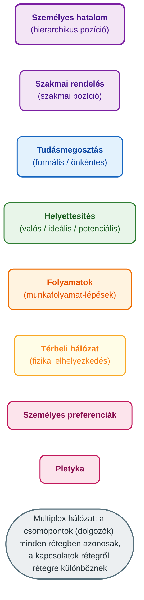
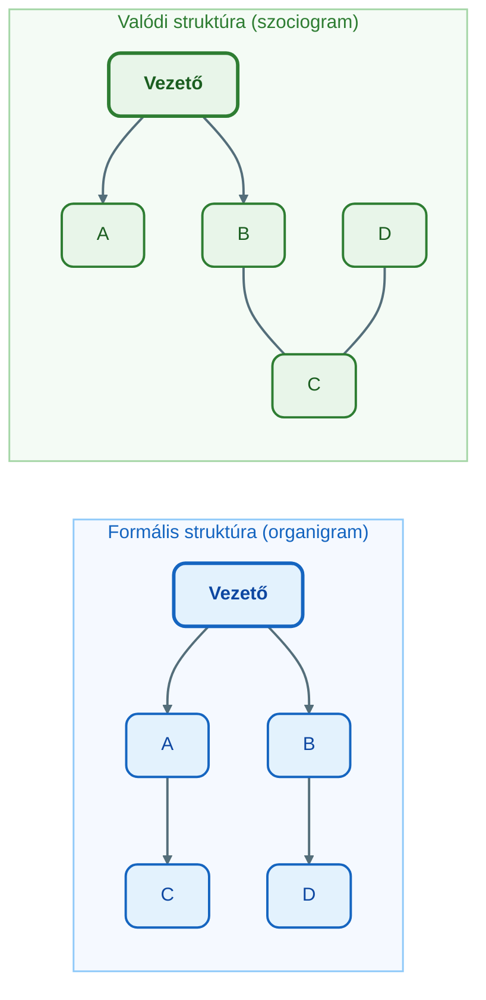
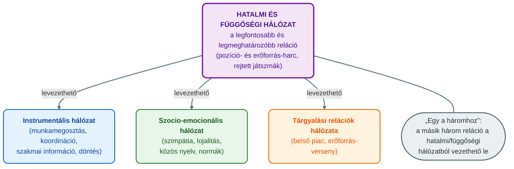

## V16 – A vállalat komplex hálózati modellje

**Tétel:** A vállalat komplex hálózati modellje. Mutassa be milyen hálózati rétegekből áll egy komplex vállalati hálózat, és mi a jellemző a különböző réteghálózatokra!

---

### 16.1. A szervezet komplex rendszer, nem gép

A hálózattudomány (network science) a komplex rendszereket vizsgálja. Komplex rendszer vesz körül minket mindenütt: a társadalom, a kommunikációs rendszerek, az agy, az élő szervezet, a gazdaság – amely országokat, kormányokat, embereket és vállalatok milliárdjait kapcsolja össze (Szilágyi, 2026, 30. dia). Az előadás ezért teszi fel a kérdést: gép-e a szervezet? (Szilágyi, 2026, 33. dia)

A válaszhoz a komplikált és a komplex rendszert kell megkülönböztetni, mert a kettő nem ugyanaz (Szilágyi, 2026, 31–32. dia):

| Jellemző | Komplikált rendszer | Komplex rendszer |
|---|---|---|
| Részek száma | sok | sok |
| Spontán átrendeződés | nem lehetséges | lehetséges |
| Visszacsatolások | kevés, tervezett | sok, részben sztochasztikusan megjelenő |
| Részek megjelenése, eltűnése | nem jellemző | a részek megjelenhetnek és eltűnhetnek |
| A rendszer viselkedése | a részekből kiszámítható | a részekből **nem** számítható ki |

Egy gép komplikált: sok alkatrésze van, de a viselkedése az alkatrészekből levezethető. A szervezet ezzel szemben komplex: spontán átrendeződik, sztochasztikus visszacsatolásai vannak, tagjai jönnek és mennek, és a viselkedése nem számítható ki a részekből. Ezért a szervezet nem gép, hanem **hálózat** – és nem egyetlen hálózat, hanem több (Szilágyi, 2026, 37–38. dia). Ez a tétel kiindulópontja: a vállalat komplex hálózati modellje azt írja le, hogy ugyanazon dolgozók között egyszerre több, különböző logikájú kapcsolatháló működik.

---

### 16.2. A vállalat mint multiplex hálózat

A hagyományos gráfelméleti leírás az **egyszerű gráf** (simple graph): két csomópont között csak egyféle kapcsolat van. A szervezet leírásához **színezett gráf** (colored graph) kell: a csomópontok között többféle, eltérő típusú kapcsolat is lehet. A színezett gráf azonos színű részgráfokra bontható, és ezek a részgráfok az eredeti gráf homomorf leképezései (Szilágyi, 2026, 87–88. dia). Egy-egy ilyen részgráf a szervezet egy-egy hálózati rétege.

A több rétegű hálózatokra az előadás a Kivelä-féle terminológiát használja (Szilágyi, 2026, 90–91. dia):

- **Monoplex (egyrétegű) hálózat** (monoplex / single-layer network): két csomópont között csak egy kapcsolat van.
- **Összekapcsolt hálózat** (interconnected network): több monoplex hálózatból áll, és a különböző monoplex hálózatok csomópontjai között is vannak kapcsolatok.
- **Hálózati réteg** (network layer): az összekapcsolt hálózat egy-egy monoplex hálózata.
- **Rétegen belüli kapcsolat** (intra-layer connection): egy rétegen belüli él.
- **Rétegközi kapcsolat** (inter-layer connection): különböző rétegek csomópontjai közötti él.
- **Multilayer hálózat**: olyan összekapcsolt hálózat, amelyben a rétegek csomópontjai azonosak, és rétegközi kapcsolat **bármely** csomópontok között lehet.
- **Multiplex hálózat**: olyan összekapcsolt hálózat, amelyben a rétegek csomópontjai azonosak, de rétegközi kapcsolat **csak ugyanazon csomópontok** között van – vagyis minden csomópont csak a saját másik rétegbeli megfelelőjéhez kötődik.

A két fogalom tehát a rétegközi kapcsolatokban különbözik, nem a csomópontokban. (Az előadás multilayer példaábráján a rétegek csomóponthalmaza részben el is tér egymástól, ezért a vizsgán érdemes a 91. dia szöveges definícióját visszamondani; Szilágyi, 2026, 92–93. dia.)

A vállalat ebben a keretben **multiplex hálózat**: minden rétegben ugyanazok a dolgozók a csomópontok, és egy dolgozó a hierarchia-rétegbeli, a tudásmegosztási rétegbeli és a pletyka-rétegbeli „önmagával” azonos. A rétegek viszont rétegről rétegre más kapcsolatokat tartalmaznak.

---

### 16.3. A vállalati hálózat rétegei

Az előadás a következő réteghálózatokat sorolja fel egy szervezetben (Szilágyi, 2026, 38., 89. dia):

1. **Személyes hatalom** (personal power) – a hierarchikus pozícióból fakadó hatalmi kapcsolatok.
2. **Szakmai rendelés** (professional ordering) – a szakmai pozícióból fakadó utasítási kapcsolatok.
3. **Tudásmegosztás** (knowledge sharing) – formális és önkéntes változatban; a többes szám jelzi, hogy több ilyen réteg is lehet.
4. **Helyettesítés** (substitutional) – valós, ideális és potenciális változatban.
5. **Folyamatok** (processes) – a munkafolyamatokból fakadó kapcsolatok.
6. **Térbeli** (spatial) hálózat – a fizikai elhelyezkedésből fakadó kapcsolatok.
7. **Személyes preferenciák** (personal preferences).
8. **Pletyka** (gossip).
9. „stb.” – a lista nyitott, a szervezet további rétegekkel is leírható.

A rétegek közös jellemzője, hogy mindegyiken információ terjed, és hogy vannak közöttük irányított és irányítatlan rétegek (Szilágyi, 2026, 94. dia). Az egyes rétegek jellemzőit (milyen kérdéssel térképezhetők fel, melyik Mastenbroek-féle hálózathoz tartoznak, milyen a topológiájuk) a 16.5–16.7. szakasz részletezi.

---

### 16.4. Formális és valódi struktúra: organigram és szociogram

A szervezetek hagyományos ábrázolása a hivatalos szervezeti ábra (organizational chart, organigram). Jacob Levy **Moreno** 1933-ban módszert dolgozott ki az emberi csoportok személyes kapcsolatainak feltérképezésére, és megfigyelte, hogy a szervezetekben barátságok, belső csoportok és csoportközi kapcsolatok jönnek létre. Ezek a kapcsolatok hálózatot alkotnak, és ez a hálózat **különbözik a hivatalos szervezeti ábrától**. Ez a módszer a **szociometria**, amelyet Magyarországon Mérei honosított meg (Szilágyi, 2026, 23. dia).

A szociometria menete (Szilágyi, 2026, 24. dia):

- személyes preferencia-kérdéseket teszünk fel, például: „Kivel dolgozna szívesen egy közös szobában?”;
- a válaszokból **szociometriai mátrixot** készítünk;
- csak a **kölcsönös** választások adnak kapcsolatot;
- a mátrixból **szociogramot** rajzolunk, amely **irányítatlan** hálózat.

A szociometria csak a csoporttagok személyes preferenciáit mutatja meg (Szilágyi, 2026, 23. dia) – vagyis a 16.3. szakasz rétegei közül a személyes preferencia réteget. A vállalat komplex hálózati modellje ugyanezt a logikát terjeszti ki a többi rétegre: minden réteg egy-egy célzott kérdéssel térképezhető fel (lásd 16.6.).

*Szemléltető példa (nem esettanulmány): az organigram szerint C és D nem kapcsolódik egymáshoz, a szociogramban viszont közvetlen kapcsolatban állnak – ez Moreno megfigyelésének lényege.*

---

### 16.5. Mastenbroek négy szervezeti hálózata és a hatalom három tényezője

A réteghálózatok jellemzéséhez az előadás Willem Frans Gerard **Mastenbroek** (1942–) holland szociológus hatalmi struktúra-modelljét használja (*Conflict Management and Organization Development*, 1988; Szilágyi, 2026, 100. dia). Mastenbroek négy szervezeti relációhálózatot különböztet meg (Szilágyi, 2026, 101–104. dia):

**1. Instrumentális kapcsolatok hálózata** (instrumental relationships network). A kapcsolatban álló személyek egymást a termelés eszközének tekintik. Mivel a szakmai tevékenység a munkatárs tevékenységét is igényli, ez munkamegosztást és koordinációt eredményez. Ebben a hálózatban áramlik a szakmai információ, itt történik az adatszolgáltatás, a kommunikáció, és itt születnek a döntések is.

**2. Szocio-emocionális kapcsolatok hálózata** (socio-emotional relationships network). A munkatársak szimpátián és ellenszenven alapuló érzelmi kapcsolataira épül. Kulcselve a csoporthoz tartozás, és ezen keresztül a lojalitás, valamint a csoportkohézió elemei: a közös nyelv és a csoportkép. Az egyéni normák ebben a hálózatban alakulhatnak ki; a hálózatot az érzelmek uralják.

**3. Hatalmi és függőségi hálózat** (power and dependency network). Itt zajlik a szervezeti hatalmi játék és a belső politikai manőverezés: az emberek pozíciókért és erőforrásokért küzdenek. Ezek a játszmák jellemzően a háttérben folynak; a résztvevők gyakran a félrevezetés stratégiáját alkalmazzák, és egyéni szándékaikat a szervezeti érdek mögé rejtik.

**4. Tárgyalási relációk hálózata** (negotiation relation network). A szervezet belső piacként jelenik meg: az egyének erőforrásokért versengenek, felosztják a belső piacot, és hogy nagyobb részt kapjanak az erőforrásokból, valamint dominánsabbak legyenek a döntéshozatalban, folyamatosan tágítják saját piaci határaikat – mások rovására.

**Az „egy a háromhoz” megközelítés.** A hatalmi és függőségi reláció a legfontosabb és egyben a legmeghatározóbb; a másik három relációforma **ebből vezethető le** (Szilágyi, 2026, 105. dia).

Mastenbroek lényeges kérdésnek tekinti az egyének és a szervezeti egységek függőségének és függetlenségének mértékét a szervezetben. Ezt három tényező határozza meg (Szilágyi, 2026, 106–109. dia):

- **A bizonytalanság szintje** (level of uncertainty): mennyi információja van az egyénnek vagy a szervezeti egységnek a jövőről. Aki a nagy valószínűséggel bekövetkező jövőbeli eseményekről tud, előnyben van, és befolyásolhatja mások szervezeti pozícióját.
- **A helyettesíthetőség szintje** (level of substitution): az a személy vagy csoport, akit a szervezeten belül nehéz vagy lehetetlen helyettesíteni, nélkülözhetetlensége révén jelentős hatalomhoz juthat. Ezért gyakori szervezeti viselkedés, hogy az egyének és csoportok igyekeznek nélkülözhetetlenné válni.
- **A centralitás szintje és formája** (level and form of centrality): az egyének és csoportok között kölcsönös függés lehet; ahol ez fennáll, ott erős kölcsönös függőség alakul ki. Minél nagyobb a személy jelentősége a szervezetben, annál nagyobb hatalma lehet.

---

### 16.6. A réteghálózatok feltérképezése, besorolása és topológiája

Az előadás a Moreno-féle logikát követve egy-egy célzott kérdéssel térképezi fel az egyes réteghálózatokat, és mindegyiket **Mastenbroek valamelyik hálózatához** rendeli. A kérdésekből kirajzolódó hálózatok topológiája rétegenként más és más (Szilágyi, 2026, 110–114. dia):

| Réteghálózat (16.3.) | Feltérképező kérdés | Mastenbroek-hálózat | Topológia a dián |
|---|---|---|---|
| Személyes hatalom | „Ki(k) a közvetlen felettese(i)?” | hatalmi és függőségi (**hatalom** oldala) | fa-szerű hierarchia: néhány nagy fokszámú (vezetői) csomópont köré rendeződő, összefüggő hálózat |
| Helyettesítés | „Ki szokta Önt helyettesíteni?” | hatalmi és függőségi (**függőség** oldala) | sok apró, egymástól elkülönülő komponens – nincs összefüggő egész |
| Szakmai rendelés | „Kinek tud szakmai utasítást adni?” | tárgyalási relációk | több központú, fa-szerű, összefüggő hálózat |
| Tudásmegosztás (formális) | „Kinek ad rendszeresen szakértői információt?” | instrumentális | sűrű, erősen összefüggő mag, sok kereszt-kapcsolattal |
| Pletyka / személyes preferencia | „Kivel beszél naponta nem szakmai ügyekről?” | szocio-emocionális | néhány sűrű klaszter, amelyeket kevés csomópontból álló lánc (híd) köt össze; néhány elszigetelt csomópont |

A táblázat a tétel kulcsa: ugyanazon dolgozók között a hatalmi réteg fa-szerű, a helyettesítési réteg széttöredezett, az instrumentális réteg sűrű, a szocio-emocionális réteg pedig klaszteres. A helyettesítési réteg töredezettsége közvetlenül Mastenbroek helyettesíthetőség-tényezőjéhez kapcsolódik: ahol nincs helyettes, ott nélkülözhetetlenség, vagyis hatalom keletkezik (Szilágyi, 2026, 108., 111. dia).

**Esettanulmány: három tudásmegosztási réteg ugyanabban a szervezetben.** Az előadás egy esettanulmány eredményeként ugyanazon szervezet három rétegét mutatja be egymás mellett (Szilágyi, 2026, 39. dia):

| Réteg | Topológia a dián |
|---|---|
| Szakmai rendelés (professional ordering) | elágazó, fa-szerű hálózat néhány kiemelt csomóponttal |
| Önkéntes tudásmegosztás (voluntary knowledge sharing) | sűrű, rácsszerű, összefüggő hálózat |
| Pletyka (gossip) | egymástól elkülönülő, lazán összekapcsolt csoportok (klaszterek) |

A három kép ugyanazokat az embereket ábrázolja, mégis három teljesen eltérő hálózat rajzolódik ki – ez a multiplex megközelítés lényege: egyetlen réteg (például az organigram) önmagában nem írja le a szervezetet.

---

### 16.7. Rétegtopológia és információterjedés

A szervezet komplex emberi hálózat, amelyben sok hálózati réteg van. Vannak irányítatlan és irányított információs rétegek, és minden rétegen terjed információ. A különböző rétegek topológiája eltérő, és az információterjedés a hálózati topológiától függ (Szilágyi, 2026, 94. dia). A rétegek jellemzése ezért nem öncélú: a 16.6. táblázat topológiái azt is megmutatják, hogy egy-egy rétegen hogyan terjedhet az információ – a fa-szerű hatalmi rétegen a vezetői csomópontokon át, a sűrű instrumentális rétegen sok párhuzamos úton, a klaszteres szocio-emocionális rétegen pedig a klasztereket összekötő hidakon keresztül. (Az információterjedési modell részletes tárgyalása a tárgy 8. hetének témája.)

---

**Összegzés:** A szervezet nem gép, hanem komplex rendszer, ezért hálózatként írható le – mégpedig **multiplex hálózatként**, amelyben ugyanazon dolgozók között több, eltérő logikájú réteg működik: személyes hatalom, szakmai rendelés, tudásmegosztás, helyettesítés, folyamatok, térbeli hálózat, személyes preferenciák, pletyka. A valódi struktúra (szociogram) Moreno óta tudottan eltér a formálistól (organigram). A rétegek egy-egy célzott kérdéssel térképezhetők fel, és Mastenbroek négy hálózatába sorolhatók: instrumentális, szocio-emocionális, hatalmi és függőségi, tárgyalási – ezek közül a hatalmi és függőségi a legmeghatározóbb, a másik három ebből vezethető le, mértékét pedig a bizonytalanság, a helyettesíthetőség és a centralitás határozza meg. A rétegek topológiája eltérő (fa-szerű, töredezett, sűrű, klaszteres), és mivel az információterjedés a topológiától függ, a vezetőnek az egyes rétegeket külön-külön kell ismernie és kezelnie.

---

### Várható vizsgáztatói kérdések

1. **Mi a különbség a multilayer és a multiplex hálózat között?** — Mindkettő összekapcsolt hálózat, amelynek rétegei azonos csomópontokat tartalmaznak. A multilayer hálózatban rétegközi kapcsolat bármely csomópontok között lehet, a multiplex hálózatban csak ugyanazon csomópont rétegbeli másai között. A szervezet multiplex: minden dolgozó csak a saját másik rétegbeli megfelelőjéhez kötődik (Szilágyi, 2026, 91. dia).

2. **Miért nem gép a szervezet?** — A gép komplikált rendszer: sok része van, de nem rendeződik át spontán, visszacsatolásai tervezettek, részei nem tűnnek el, viselkedése a részekből kiszámítható. A szervezet komplex: spontán átrendeződik, visszacsatolásai részben sztochasztikusak, tagjai megjelennek és eltűnnek, viselkedése a részekből nem számítható ki (Szilágyi, 2026, 31–33. dia).

3. **Mastenbroek szerint melyik hálózat a legmeghatározóbb, és mitől függ a függőség mértéke?** — A hatalmi és függőségi hálózat; a másik három reláció ebből vezethető le („egy a háromhoz”). A függőség mértékét három tényező adja: a bizonytalanság szintje (jövőre vonatkozó információ), a helyettesíthetőség szintje (nélkülözhetetlenség) és a centralitás szintje és formája (kölcsönös függőségek, a személy jelentősége) (Szilágyi, 2026, 105–109. dia).

4. **Hogyan térképezhető fel egy réteghálózat?** — Moreno szociometriai módszerével: célzott kérdést teszünk fel, a válaszokból mátrixot, abból hálózatot készítünk; a szociogramban csak a kölcsönös választás ad kapcsolatot, és a szociogram irányítatlan. A vállalati rétegekhez az előadás kérdései: ki a felettese, ki helyettesíti, kinek adhat szakmai utasítást, kinek ad szakértői információt, kivel beszél naponta nem szakmai ügyekről (Szilágyi, 2026, 23–24., 110–114. dia).

5. **Miben tér el a szociogram az organigramtól, és miért fontos ez a vezetőnek?** — Az organigram a formális hierarchiát mutatja; a szociogram a tényleges személyes kapcsolatokat, amelyek Moreno megfigyelése szerint különböznek a hivatalos ábrától. Az esettanulmány három rétege (szakmai rendelés, önkéntes tudásmegosztás, pletyka) ugyanazon emberek között három eltérő topológiát mutat; mivel az információterjedés a topológiától függ, a vezetőnek a rétegeket külön kell ismernie (Szilágyi, 2026, 23., 39., 94. dia).

6. **Mi a kapcsolat a helyettesítési réteg és a hatalom között?** — A helyettesítési réteg a „Ki szokta Önt helyettesíteni?” kérdéssel térképezhető fel, és a hatalmi-függőségi hálózat függőségi oldalát mutatja. A dián sok apró, elkülönülő komponensből áll. Mastenbroek szerint akit nehéz vagy lehetetlen helyettesíteni, nélkülözhetetlensége révén hatalomhoz jut – ezért törekszenek a szereplők a nélkülözhetetlenségre (Szilágyi, 2026, 108., 111. dia).

---

## Irodalom

* Óbudai Egyetem, Keleti Károly Gazdasági Kar. (2026). *Vállalati és üzleti hálózatmenedzsment (GMXVU2MBLF) — Syllabus* [Syllabus].
* Szilágyi, G. A. (2026). *Organizational networks* [Előadás-prezentáció]. Óbudai Egyetem, Keleti Károly Gazdasági Kar.
