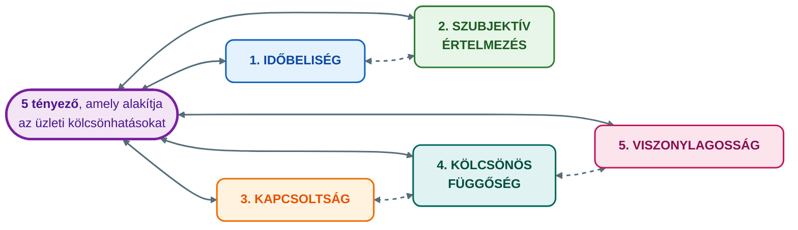
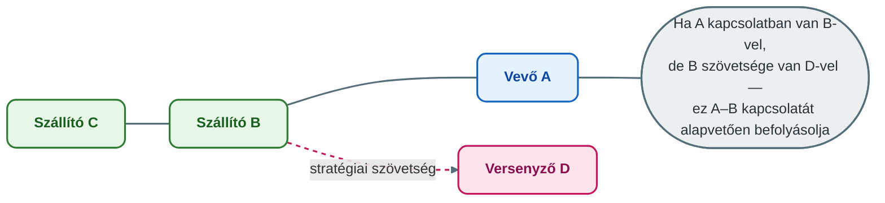
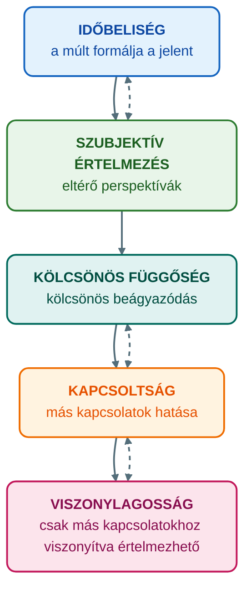

## V17 – Az üzleti hálózatok kölcsönhatásait befolyásoló tényezők

### Beszerzendő anyagok

| Szerző | Mű | Jelleg | Indoklás / érintett rész |
|---|---|---|---|
| Håkansson, H. | *Határtalan hálózatok.* Alinea Kiadó, 2010. | ajánlott irodalom | A syllabus (Óbudai Egyetem, 2026) ajánlott irodalomként nevezi meg; az „öt tényező” *listája* erre épül. A forrásmappában 2026-11-06-tól a Håkansson & Snehota (szerk., 2017) IMP-összegző kötet áll rendelkezésre, amely a tényezők *tartalmát* alátámasztja (17.4), de a lista szó szerinti ellenőrzéséhez a 2010-es mű továbbra is szükséges. |
| Szilágyi, G. A. | A 2–3. oktatási hét előadásanyaga (az üzleti kölcsönhatás elmélete; az 5 alapvető tényező; a hálózati működés 3 szempontja) | előadás-prezentáció | Az `Előadás_ppt1.pdf` nem tartalmazza; a syllabus 3. hete a tétel témája. |

**Tétel:** Az üzleti hálózatok kölcsönhatásait befolyásoló tényezők: a kölcsönhatások időbelisége; szubjektív értelmezés; kapcsoltság; kölcsönös függőség; viszonylagosság.

---

*A 17.1–17.3 szakasz az öt tényező listáját Håkansson (2010) alapján adja; a mű a forrásmappában nem elérhető, ezért a lista szó szerint nem volt ellenőrizhető. A 17.4 szakasz az egyes tényezők tartalmát az IMP-iskola 2017-es összegző kötetéből (Håkansson & Snehota, szerk., 2017) támasztja alá, fejezetszerzős hivatkozással.*

### 17.1. Az üzleti kölcsönhatás fogalma

Az üzleti kapcsolatok nem egyszerű adásvételi tranzakciók. Hakan Håkansson és az IMP (Industrial Marketing and Purchasing) csoport kutatásai rámutattak, hogy a vállalatok közötti kapcsolatok összetett, tartós **kölcsönhatások**, amelyeket a neoklasszikus közgazdaságtan és a hagyományos stratégiai menedzsment nem tud megfelelően leírni (Håkansson, 2010).

Az IMP megközelítés szerint az üzleti kölcsönhatásokat öt alapvető tényező határozza meg (Håkansson, 2010). Ezek nem független változók – egymást erősítik és szövik át.

---

### 17.2. Az öt tényező részletes bemutatása

#### 1. Időbeliség

Az üzleti kapcsolatok időben fejlődnek. Nem pillanatfelvételek, hanem folyamatok: múlt, jelen és jövő elvárások együttesen határozzák meg, hogy a két fél hogyan viselkedik egymással.

**Következmény a menedzsment számára:**
- A múltbeli tapasztalat (bizalom, konfliktus, teljesítmény) beépül a kapcsolat "tőkéjébe."
- Egy hosszú távú kapcsolat megszakítása nem csak a jövőbeli tranzakciók elvesztését jelenti, hanem az addig befektetett kapcsolat-specifikus eszközök (tudás, adaptáció, koordinációs rutinok) elvesztését is.
- Az idő múlásával a felek egymáshoz igazítják folyamataikat és rendszereiket – ezt **kapcsolatspecifikus adaptációnak** nevezzük.

#### 2. Szubjektív értelmezés

Ugyanazt az üzleti kapcsolatot a két fél eltérően értelmezi. Nincs egyetlen "objektív" leírás egy kölcsönhatásról: minden résztvevő a saját perspektívájából, céljaiból és korábbi tapasztalataiból kiindulva értelmezi azt.

**Következmény a menedzsment számára:**
- Egy szállítói kapcsolatot a vevő "stratégiai partnerségnek" láthat, míg a szállító "rutinügyfélnek" tekinti a vevőt – vagy fordítva.
- Ez kommunikációs és koordinációs feszültségeket okozhat.
- A sikeres együttműködés feltétele a **közösen konstruált értelmezési keret** kialakítása.

| Fél | Értelmezési dimenzió | Lehetséges eltérés |
|---|---|---|
| Vevő | "Ez stratégiai partnerség" | Szállító: "Rutinügylet" |
| Szállító | "Fontos referenciaprojekt" | Vevő: "Kis tételszámú megrendelés" |
| Mindkét fél | A kapcsolat hosszú távú értéke | Eltérő diszkontráta, eltérő időhorizont |

*Saját szemléltető példa, nem a forrásból.*

#### 3. Kapcsoltság

Egyetlen üzleti kapcsolat sem létezik önmagában. Minden A–B kapcsolatot befolyásol az A és B más kapcsolataik összessége. A hálózatban minden összefügg mindennel.

*Saját szemléltető példa, nem a forrásból.*

**Következmény a menedzsment számára:**
- Egy kapcsolat értéke nem önmagában, hanem a hálózati kontextusban értelmezhető.
- Az egyes partnerek kapcsolatai egymásra hatnak: egy szállítóváltás hullámokat indít a hálózatban.
- A jó hálózati pozíció önmagában is versenyelőnyt jelent.

#### 4. Kölcsönös függőség

Az üzleti kapcsolatokban mindkét fél függ a másiktól – még ha ez aszimmetrikusan is valósul meg. A függőség nem gyengeség: elkerülhetetlen következménye az üzleti specializációnak és a munkamegosztásnak.

**A függőség forrásai:**
- **Erőforrás-függőség:** az egyik fél olyan erőforrással (tudás, technológia, kapacitás) rendelkezik, amelyet a másik nem tud helyettesíteni.
- **Rutin-függőség:** az együttműködés során kialakult koordinációs eljárások olyannyira beágyazódnak, hogy a váltás magas tranzakciós költséggel járna.
- **Reputáció-függőség:** a kapcsolat mindkét fél piaci hírnevét befolyásolja.

#### 5. Viszonylagosság

Egy kapcsolat jellegét és értékét mindig más kapcsolatokhoz viszonyítva kell meghatározni. Nincs abszolút "jó" vagy "rossz" kapcsolat – csak hálózati kontextusában értékelhetők.

**Következmény a menedzsment számára:**
- Egy szállítói kapcsolat értékét nem önmagában kell mérni, hanem alternatívákhoz képest (más szállítók, belső előállítás).
- A kapcsolat priorizálása is viszonylagos: A-nak B fontosabb lehet, ha C és D gyengébb alternatíva, mint ha erős alternatívái vannak.
- A hálózati pozíció is relatív: amit hub-nak tekintünk egy kis hálózatban, az periférián lehet egy nagyobb struktúrában.

---

### 17.3. Az öt tényező összefüggése

Az öt tényező együttesen magyarázza, miért **nem egyszerűsíthető le** az üzleti hálózat sem pusztán erőforrás-tranzakciókra (neoklasszikus közgazdaságtan), sem tisztán strukturális viszonyokra (szociológiai hálózatelemzés). A vállalatok közötti kölcsönhatás **dinamikus, szubjektíven értelmezett, hálózatba ágyazott folyamat**.

---

### 17.4. Az öt tényező az IMP empirikus kutatásában

Az IMP-kutatás 1976-ban indult: öt európai országban mintegy 800 vevő–szállító kapcsolatot írtak le több mint 1000 interjúval (Håkansson & Snehota, 2017). A kutatás három megfigyelt jellemzőt emel ki: az üzleti kapcsolatok **folytonosságát**, a kapcsolatok közötti **kölcsönös függőségekből** adódó hálózati szerkezetet, és az **interakció** mindenütt-jelenvalóságát (Håkansson & Snehota, 2017). Az öt tényező ezekből olvasható ki:

| Tényező | Mit mond a 2017-es IMP-kötet |
|---|---|
| **Időbeliség** | „Az interakciónak mindig van története”: a két cég közötti interakciónak nincs jól azonosítható kezdete és vége; a jelenlegi interakció a korábbi interakciók, a mások felé irányuló jelenlegi interakciók és a jövőbeli interakcióra vonatkozó várakozások eredője (Ford, Mattsson & Snehota, 2017). A kapcsolatok „a történelem termékei”: tárgyi és nem tárgyi beruházásokat és lock-in hatásokat hordoznak, amelyek szűkítik a jövőbeli lehetőségeket (Håkansson & Snehota, 2017). A szereplői kötések útfüggőséget (path dependency) teremtenek: a közös múltból bizonyos viselkedési minták lesznek várhatók, és új helyzetben nehéz másképp reagálni (Freytag, Gadde & Harrison, 2017). |
| **Szubjektív értelmezés** | A vezetői feladat magja a **sense-making**: az interakció kimenetét a résztvevők értelmezései határozzák meg, nem az eredeti szándékok. Minden vezetőnek saját **hálózatképe** (*network picture*) van, amely egyéni, a saját horizontja és időperspektívája által korlátozott, normatív elemekkel terhelt, és „inkább szubjektív és érzelmi, mint kognitív és tényszerű”. „Minden nézet hiányos” – ezért a vezetőnek a saját feltevéseit és a partnerek hálózatképét is kérdőre kell vonnia (Ford, Mattsson & Snehota, 2017). |
| **Kapcsoltság** | Ami a vállalat egyik kapcsolatában a tevékenységekkel, erőforrásokkal és szereplőkkel történik, hat arra, hogy mi történhet a saját és a partner többi kapcsolatában; egy vevőkapcsolat tartalma függhet egy szállítói kapcsolattól. Minden vállalat egy **határtalan**, egyik résztvevő által sem teljesen megismerhető hálózat csomópontja (Håkansson & Snehota, 2017). Egyetlen kapcsolat sem „hermetikusan zárt” a többitől (Freytag, Gadde & Harrison, 2017). |
| **Kölcsönös függőség** | Az IMP nem az általános, cégszintű „függést”, hanem a *specifikus, többes számú* **függőségeket** vizsgálja, amelyek a kapcsolat három rétegében jönnek létre: a tevékenységek **integrációjában**, az erőforrások **interfészeiben** és a szereplők **interakciójában** („a három I”). A függőségek **Janus-arcúak**: a hatékonyság és az innováció előfeltételei, ugyanakkor korlátozzák a cég mozgásterét – a DAN-Technology és a TT Electronics közös fejlesztése növelte mindkét cég eladásait, de a szállító vonakodása gátolta a vevő német piacra lépését (Freytag, Gadde & Harrison, 2017). Pfeffer és Salancik (1978) nyomán: a szervezetek a bizonytalanság csökkentése érdekében *növelik* kölcsönös függőségüket (idézi Freytag, Gadde & Harrison, 2017). |
| **Viszonylagosság** | Minden vállalat **egyedi csomópont** egy meghatározott kapcsolati halmaz metszéspontjában; a beágyazottság egyszerre eszköz és teher (Håkansson & Snehota, 2017). Az erőforrás értéke „nem rögzített”: attól függ, milyen kombinációban és mely partnerrel használják (Ford, Mattsson & Snehota, 2017). A vállalat identitása kapcsolatról kapcsolatra változik, és a partnerválasztás „kettős választás”: választani és választottnak lenni (Freytag, Gadde & Harrison, 2017; Munksgaard, Olsen & Prenkert, 2017). |

**Pontosítás a vizsgára.** A 2017-es kötet nem „öt tényezőről” beszél, hanem három jellemzőről (folytonosság, hálózati struktúra, interakció) és három I-ről (integráció, interfészek, interakció). A megfeleltetés: időbeliség ↔ folytonosság; kapcsoltság és kölcsönös függőség ↔ hálózati struktúra és a három I; szubjektív értelmezés ↔ sense-making és hálózatkép; viszonylagosság ↔ egyedi csomópont és kontextusfüggő erőforrásérték. A tételsor az öt tényezőt kérdezi, ezért a feleletben a listát kell mondani, a 2017-es fogalmak a kifejtésben használhatók.

Az összegző fogalom az **interaktivitás** (*interactivity*): a hálózat kollektív hajlandósága arra, hogy az interakciót a fejlesztés fő eszközeként használja. Három feltétele van: két aktív fél kell (a kapcsolat nem hozható létre egyoldalúan); a kapcsolat függőségeket teremt, ami az autonómia egy részének feladását jelenti; és a költség megelőzi a bevételt – az interakció előbb kerül, mint amennyit hoz (Håkansson & Snehota, 2017). Az interaktivitás önerősítő: az interakció értéke attól függ, mennyien interaktálnak már a hálózatban (Håkansson & Snehota, 2017).

---

**Összegzés:** Håkansson (2010) és az IMP csoport szerint az üzleti kölcsönhatásokat öt egymást átszövő tényező határozza meg: az időbeliség (a kapcsolat fejlődik és múltja van), a szubjektív értelmezés (a felek eltérően látják ugyanazt), a kapcsoltság (nincs önálló kapcsolat, csak hálózati kontextus), a kölcsönös függőség (mindkét fél függ a másiktól) és a viszonylagosság (egy kapcsolat értéke más kapcsolatokhoz képest értelmezhető). Ez az öt tényező együttesen teszi az üzleti hálózatot komplex, nem lineárisan kezelhető rendszerré. Az IMP 2017-es összegző kötete ugyanezt három megfigyelt jellemzővel (folytonosság, hálózati struktúra, interakció) és az interaktivitás fogalmával írja le (Håkansson & Snehota, 2017).

---

### Várható vizsgáztatói kérdések

1. **Miért nem elég a neoklasszikus „piac” fogalma az üzleti kapcsolatok leírására?** — Mert a tankönyvi kép független vállalatokat feltételez, amelyek homogén termékpiacokon, ármechanizmussal koordinálva adnak-vesznek; az IMP empirikus kutatásai ezzel szemben azt találták, hogy a vállalatok kevés kulcspartnerrel tartós, beruházásokat és lock-int hordozó kapcsolatokat építenek, és ezek a kapcsolatok hálózatot alkotnak (Håkansson & Snehota, 2017). Az öt tényező épp ezt a tartós, beágyazott jelleget bontja ki.

2. **Mit jelent az, hogy „az interakciónak mindig van története”, és mi következik belőle?** — A két cég közötti interakciónak nincs azonosítható kezdete és vége; a mai interakció a korábbi interakciók, a mások felé irányuló jelenlegi interakciók és a jövőbeli várakozások eredője (Ford, Mattsson & Snehota, 2017). Következmény: egy epizód (például egy vételi ügylet) önmagában nem elemezhető, csak az akció–reakció láncok tágabb halmazában; a kapcsolat megszakítása a felhalmozott, kapcsolat-specifikus beruházásokat is elveszíti.

3. **Mi a hálózatkép, és miért a szubjektív értelmezés tényezőjéhez tartozik?** — A hálózatkép a vezető egyéni, részleges, saját horizontja és időperspektívája által korlátozott képe a hálózatról, amely normatív elemeket (a „jogos” saját pozíció) is tartalmaz, és „inkább szubjektív és érzelmi, mint kognitív és tényszerű”. Mivel minden nézet hiányos, a vezetőnek a saját és a partner hálózatképét is kérdőre kell vonnia, és a partnerek szélesebb rálátásából tanulhat (Ford, Mattsson & Snehota, 2017).

4. **Miért „Janus-arcú” a kölcsönös függőség?** — A tevékenységek integrációja, az erőforrás-interfészek és a szereplői interakció révén létrejövő függőségek a hatékonyság- és innovációs nyereség előfeltételei, de egyúttal korlátozzák, kivel és mit tehet a cég a jövőben. A DANT–TTE példában a közös fejlesztés növelte az eladásokat, a szállító vonakodása viszont gátolta a vevő német terjeszkedését (Freytag, Gadde & Harrison, 2017). A mainstream elmélet a függetlenséget ajánlja; az IMP szerint a függőség elkerülhetetlen, mihelyt a cégek együttműködnek.

5. **Hogyan kapcsolódik a viszonylagosság a hálózati pozícióhoz?** — Minden vállalat egyedi csomópont egy meghatározott kapcsolati halmaz metszéspontjában, ezért értéke és lehetőségei csak a többi kapcsolathoz képest értelmezhetők (Håkansson & Snehota, 2017); az erőforrás értéke is attól függ, milyen kombinációban használják (Ford, Mattsson & Snehota, 2017). Ugyanez a logika jelenik meg a hálózattudományban is: a hub-pozíció egy kis hálózatban periféria lehet egy nagyobban (V20).

6. **Mi az interaktivitás, és miben több az interakciónál?** — Az interakció két fél akció–reakció lánca; az interaktivitás a hálózat kollektív tulajdonsága: a szereplők hajlandósága és képessége arra, hogy az interakciót a fejlesztés fő eszközeként használják. Feltételei: két aktív fél, a függőség elfogadása, és annak vállalása, hogy a költség megelőzi a bevételt. Önerősítő: minél többen interaktálnak a hálózatban, annál fontosabb részt venni benne (Håkansson & Snehota, 2017).

---

## Irodalom

* Ford, D., Mattsson, L.-G., & Snehota, I. (2017). Management in the interactive business world. In H. Håkansson & I. Snehota (szerk.), *No business is an island: Making sense of the interactive business world* (2. fej.). Emerald.
* Freytag, P. V., Gadde, L.-E., & Harrison, D. (2017). Interdependencies – blessings and curses. In H. Håkansson & I. Snehota (szerk.), *No business is an island: Making sense of the interactive business world* (13. fej.). Emerald.
* Håkansson, H. (2010). *Határtalan hálózatok.* Alinea Kiadó.
* Håkansson, H., & Snehota, I. (2017). The significance of business relationships. In H. Håkansson & I. Snehota (szerk.), *No business is an island: Making sense of the interactive business world* (1. fej.). Emerald.
* Munksgaard, K. B., Olsen, P. I., & Prenkert, F. (2017). Boundaries of business actors and networks – theoretical and methodological reflections. In H. Håkansson & I. Snehota (szerk.), *No business is an island: Making sense of the interactive business world* (12. fej.). Emerald.
* Óbudai Egyetem, Keleti Károly Gazdasági Kar. (2026). *Vállalati és üzleti hálózatmenedzsment (GMXVU2MBLF) — Syllabus* [Syllabus].
