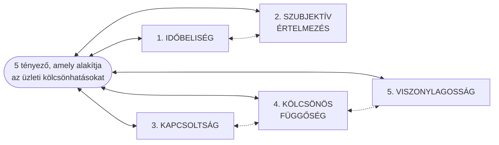
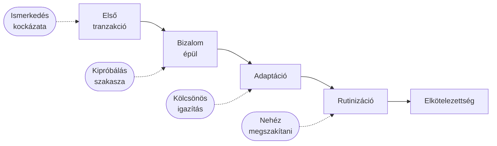
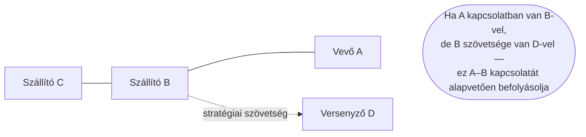
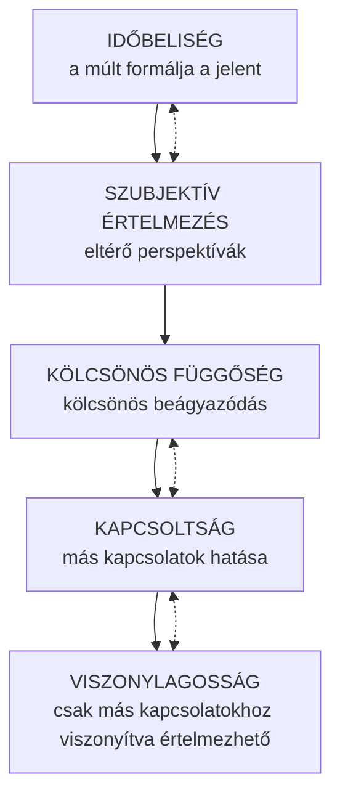

## V17 – Az üzleti hálózatok kölcsönhatásait befolyásoló tényezők

**Tételkérdés:** Az üzleti hálózatok kölcsönhatásait befolyásoló tényezők: a kölcsönhatások időbelisége; szubjektív értelmezés; kapcsoltság; kölcsönös függőség; viszonylagosság.

---

### 17.1. Az üzleti kölcsönhatás fogalma

Az üzleti kapcsolatok nem egyszerű adásvételi tranzakciók. Hakan Håkansson és az IMP (Industrial Marketing and Purchasing) csoport kutatásai rámutattak, hogy a vállalatok közötti kapcsolatok összetett, tartós **kölcsönhatások** (interactions), amelyeket a neoklasszikus közgazdaságtan és a hagyományos stratégiai menedzsment nem tud megfelelően leírni.

Az IMP megközelítés szerint az üzleti kölcsönhatásokat öt alapvető tényező határozza meg. Ezek nem független változók – egymást erősítik és szövik át.

---

### 17.2. Az öt tényező részletes bemutatása

#### 1. Időbeliség (Temporality)

Az üzleti kapcsolatok időben fejlődnek. Nem pillanatfelvételek, hanem folyamatok: múlt, jelen és jövő elvárások együttesen határozzák meg, hogy a két fél hogyan viselkedik egymással.

**Következmény a menedzsment számára:**
- A múltbeli tapasztalat (bizalom, konfliktus, teljesítmény) beépül a kapcsolat "tőkéjébe."
- Egy hosszú távú kapcsolat megszakítása nem csak a jövőbeli tranzakciók elvesztését jelenti, hanem az addig befektetett kapcsolat-specifikus eszközök (tudás, adaptáció, koordinációs rutinok) elvesztését is.
- Az idő múlásával a felek egymáshoz igazítják folyamataikat és rendszereiket – ezt **kapcsolatspecifikus adaptációnak** (relationship-specific adaptation) nevezzük.

#### 2. Szubjektív értelmezés (Subjective/Mutually defined interpretation)

Ugyanazt az üzleti kapcsolatot a két fél eltérően értelmezi. Nincs egyetlen "objektív" leírás egy kölcsönhatásról: minden résztvevő a saját perspektívájából, céljaiból és korábbi tapasztalataiból kiindulva értelmezi azt.

**Következmény a menedzsment számára:**
- Egy szállítói kapcsolatot a vevő "stratégiai partnerségnek" láthat, míg a szállító "rutinügyfélnek" tekinti a vevőt – vagy fordítva.
- Ez kommunikációs és koordinációs feszültségeket okozhat.
- A sikeres együttműködés feltétele a **közösen konstruált értelmezési keret** kialakítása.

| Fél | Értelmezési dimenzió | Lehetséges eltérés |
|---|---|---|
| Vevő | "Ez stratégiai partnerség" | Szállító: "Rutinügylet" |
| Szállító | "Fontos referenciaprojekt" | Vevő: "Kis tételszámú megrendelés" |
| Mindkét fél | A kapcsolat hosszú távú értéke | Eltérő diszkontráta, eltérő időhorizont |

#### 3. Kapcsoltság (Connectedness)

Egyetlen üzleti kapcsolat sem létezik önmagában. Minden A–B kapcsolatot befolyásol az A és B más kapcsolataik összessége. A hálózatban minden összefügg mindennel.

**Következmény a menedzsment számára:**
- Egy kapcsolat értéke nem önmagában, hanem a hálózati kontextusban értelmezhető.
- Az egyes partnerek kapcsolatai egymásra hatnak: egy szállítóváltás hullámokat indít a hálózatban.
- A jó hálózati pozíció (pl. centrális helyzet, strukturális lyukak áthidalása) önmagában is versenyelőnyt jelent.

#### 4. Kölcsönös függőség (Mutual dependence)

Az üzleti kapcsolatokban mindkét fél függ a másiktól – még ha ez aszimmetrikusan is valósul meg. A függőség nem gyengeség: elkerülhetetlen következménye az üzleti specializációnak és a munkamegosztásnak.

**A függőség forrásai:**
- **Erőforrás-függőség:** az egyik fél olyan erőforrással (tudás, technológia, kapacitás) rendelkezik, amelyet a másik nem tud helyettesíteni.
- **Rutin-függőség:** az együttmüködés során kialakult koordinációs eljárások olyannyira beágyazódnak, hogy a váltás magas tranzakciós költséggel járna.
- **Reputáció-függőség:** a kapcsolat mindkét fél piaci hírnevét befolyásolja.

| Függőségi típus | Szimmetrikus | Aszimmetrikus |
|---|---|---|
| Erőforrás | Mindkét fél nélkülözhetetlen | Az egyik fél könnyen helyettesíthető |
| Rutinizáció | Kölcsönös adaptáció | Csak az egyik fél alkalmazkodott |
| Reputáció | Kölcsönösen előnyös hivatkozás | Csak az egyiknek jelent referenciát |

#### 5. Viszonylagosság (Relativity)

Egy kapcsolat jellegét és értékét mindig más kapcsolatokhoz viszonyítva kell meghatározni. Nincs abszolút "jó" vagy "rossz" kapcsolat – csak hálózati kontextusában értékelhetők.

**Következmény a menedzsment számára:**
- Egy szállítói kapcsolat értékét nem önmagában kell mérni, hanem alternatívákhoz képest (más szállítók, belső előállítás).
- A kapcsolat priorálása is viszonylagos: A-nak B fontosabb lehet, ha C és D slabba, mint ha erős alternatívái vannak.
- A hálózati pozíció is relatív: amit hub-nak tekintünk egy kis hálózatban, az periférián lehet egy nagyobb struktúrában.

---

### 17.3. Az öt tényező összefüggése

Az öt tényező együttesen magyarázza, miért **nem egyszerűsíthető le** az üzleti hálózat sem pusztán erőforrás-tranzakciókra (neoklasszikus közgazdaságtan), sem tisztán strukturális viszonyokra (szociológiai hálózatelemzés). A vállalatok közötti kölcsönhatás **dinamikus, szubjektíven értelmezett, hálózatba ágyazott folyamat**.

---

**Összegzés:** Håkansson és az IMP csoport szerint az üzleti kölcsönhatásokat öt egymást átszövő tényező határozza meg: az időbeliség (a kapcsolat fejlődik és múltja van), a szubjektív értelmezés (a felek eltérően látják ugyanazt), a kapcsoltság (nincs önálló kapcsolat, csak hálózati kontextus), a kölcsönös függőség (mindkét fél függ a másiktól) és a viszonylagosság (egy kapcsolat értéke más kapcsolatokhoz képest értelmezhető). Ez az öt tényező együttesen teszi az üzleti hálózatot komplex, nem lineárisan kezelhető rendszerré.

---

*Forrás: Håkansson, H. (2010): Határtalan hálózatok. Alinea Kiadó; Dr. Szilágyi Győző Attila, GMXVU2MBLF előadásanyag (2025/26); Håkansson, H. – Snehota, I. (1995): Developing Relationships in Business Networks*
