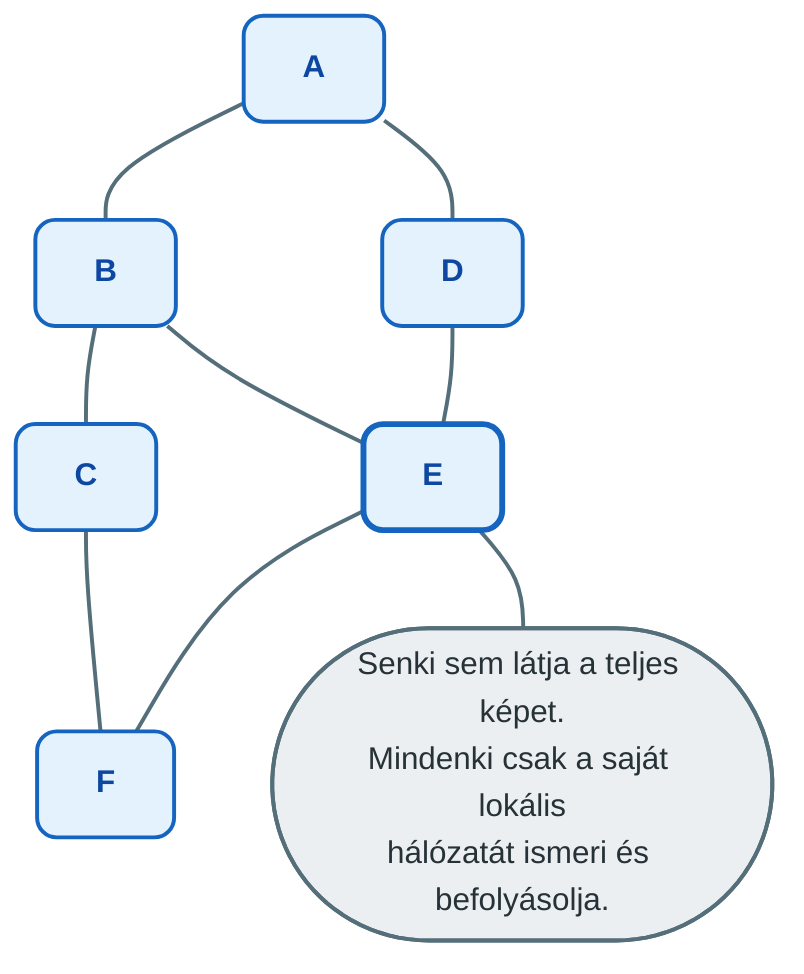
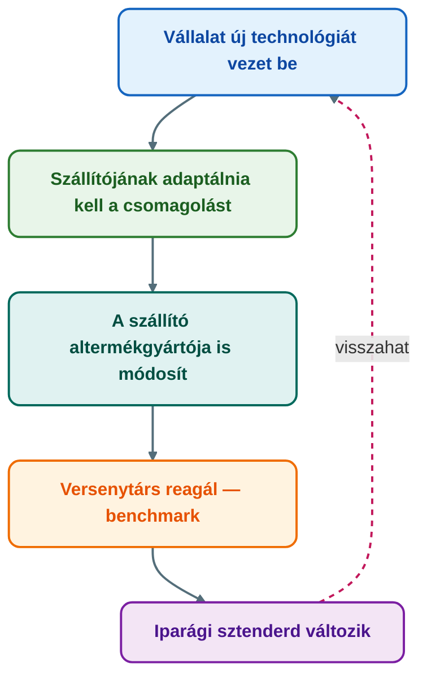
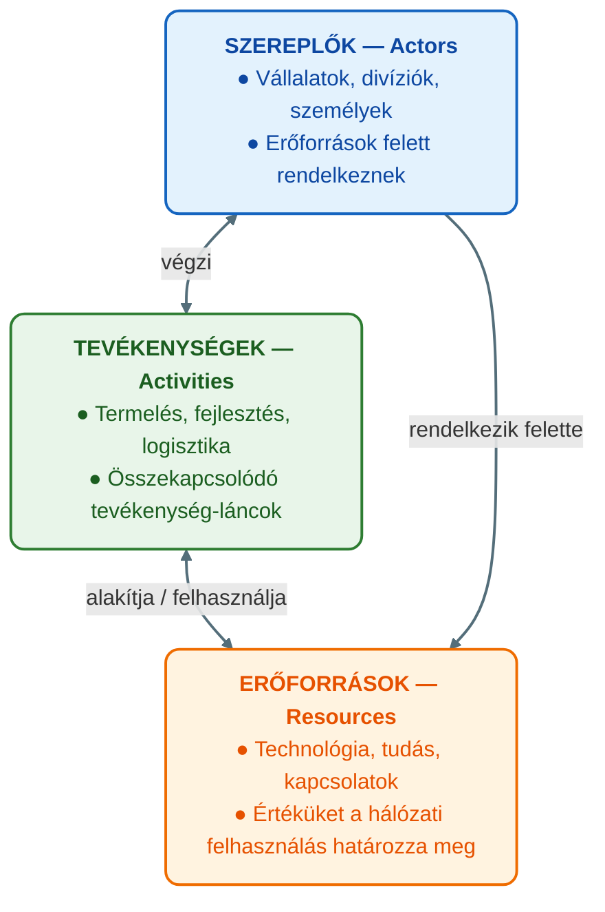

## V18 – Hálózati működés és szempontjai

### Beszerzendő anyagok

| Szerző | Mű | Jelleg | Indoklás / érintett rész |
|---|---|---|---|
| Håkansson, H. | *Határtalan hálózatok.* Alinea Kiadó, 2010. | ajánlott irodalom | A syllabus (Óbudai Egyetem, 2026) ajánlott irodalomként nevezi meg; az R1–R2 teljes tartalma (hálózatelvű megközelítés, a hálózati működés 3 szempontja, ARA-modell) erre épül, a forrásmappában nem ellenőrizhető. |
| Szilágyi, G. A. | A 2–3. és 6. oktatási hét előadásanyaga (az üzleti kölcsönhatás elmélete; a hálózati működés 3 szempontja; tevékenységek és erőforrások hálózati értelmezése) | előadás-prezentáció | Az `Előadás_ppt1.pdf` ezeket nem tartalmazza; a syllabus 3. és 6. hete a tétel témája. |

**Tétel:** Hálózati működés. Mutassa be a vállalati működés hálózatelvű megközelítését! A hálózati működés szempontjai.

---

*A 18.1–18.3 szakasz Håkansson (2010) alapján készült; a mű a forrásmappában nem elérhető, ezért ez a tartalom a revízió során nem volt ellenőrizhető. A gyenge kötésekre vonatkozó részek (18.2 tudás-szempont, 18.4) az előadásanyag (Szilágyi, 2026) és Buchanan (2002) alapján ellenőrzöttek.*

### 18.1. A hálózatelvű megközelítés szükségessége

A hagyományos vállalatelmélet a szervezetet zárt rendszerként kezeli: a vállalat maga tervez, dönt, termel és értékesít. A hálózatelvű megközelítés ezzel szemben abból indul ki, hogy **egyetlen vállalat sem értelmezhető a kapcsolataitól függetlenül** (Håkansson, 2010).

A hálózattudomány gazdasági alkalmazásának kiindulópontja, hogy a sikeres vállalatok az üzleti stratégiájukat hálózatra építik. A más vállalatokkal összekapcsolt (linked) vállalat robusztusabb, mint az önállóan működő: a magasabb kapcsolatsűrűség (link density) nagyobb tűrőképességet ad a véletlen hibákkal és a célzott támadásokkal szemben is (Szilágyi, 2026, 13. dia).

A hálózatelvű megközelítés – Håkansson és az IMP (Industrial Marketing and Purchasing) csoport nyomán – nem a vállalat belső folyamataira, hanem a vállalat **hálózati pozíciójára** és **kapcsolataira** fókuszál (Håkansson, 2010).

---

### 18.2. A hálózati működés három szempontja

Håkansson (2010) szerint a hálózatban való működés három szempontból különbözik alapvetően az önálló vállalati működéstől:

#### 1. szempont: Irányíthatóság (Control)

**Hagyományos nézet:** A vezető irányítja a vállalatot, a vállalat irányítja folyamatait.

**Hálózati realitás:** A hálózatban nincs egyetlen szereplő sem, aki az egész rendszert uralna. Minden szereplő befolyásolja a többieket, de senki sem irányítja teljesen a hálózatot. Minél nagyobb és sűrűbb a hálózat, annál kisebb az egyes szereplők kontrollja az egész felett (Håkansson, 2010).

**Következmény:** A menedzser feladata nem a kontroll maximalizálása, hanem a **hálózati pozíció tudatos alakítása** és a befolyás körének értelmes menedzsmentje.

#### 2. szempont: Tudás (Knowledge)

**Hagyományos nézet:** A szervezet tud mindent, ami a döntésekhez kell; a tudásmenedzsment a belső folyamat.

**Hálózati realitás:** A hálózatban elosztottan tárolt tudás messze meghaladja bármelyik szereplő egyéni tudását. Az innováció, a problémamegoldás és a kompetenciafejlesztés egyre inkább **kapcsolatokon keresztül** történik – nem belső fejlesztéssel, hanem partnerekkel együtt (Håkansson, 2010).

Ehhez kapcsolódik Mark Granovetter **gyenge kötések elmélete** (the strength of weak ties). Granovetter abból a megfigyelésből indult ki, hogy az emberek új állást jellemzően nem a barátaikon, hanem laza ismerőseiken keresztül találnak. Az erős kötések (strong ties) a családhoz és a közeli barátokhoz fűznek, és a közeli barátaink gyakran egymással is barátok, ezért az erős kötések zárt csoportokat alkotnak. A gyenge kötések (weak ties) ezzel szemben **társadalmi hidak** (social bridges): más, egyébként elérhetetlen körökbe vezetnek (Granovetter, 1973, idézi Szilágyi, 2026, 27. dia; Buchanan, 2002). Az erős kötéseken át jellemzően olyan hírt kapunk, amelyet már hallottunk; az új információ a gyenge kötéseken érkezik (Buchanan, 2002). A részleteket a 18.4. szakasz foglalja össze.

**Következmény:** A vállalat kapcsolatai **tudásforrások** – nem csak erőforrás-csere eszközei. A tudás-hálózat menedzselése stratégiai feladat (Håkansson, 2010).

#### 3. szempont: Változás (Change)

**Hagyományos nézet:** A változás tervezett, vezérelt folyamat.

**Hálózati realitás:** A hálózatban a változás folyamatos és részben spontán. Bármely szereplő változása hullámokat indít a hálózatban, amelyek nem mindig kiszámíthatók. A hálózat dinamikus egyensúlyi állapotban van, nem statikus struktúra (Håkansson, 2010).

*Saját szemléltető példa a változás továbbgyűrűzésére (nem forrásból):*

**Következmény:** A hálózatban való változáskezelés nem top-down tervezés, hanem **folyamatos alkalmazkodás** és a hálózati visszacsatolások figyelemmel kísérése (Håkansson, 2010).

---

### 18.3. Az ARA modell – tevékenységek, erőforrások, szereplők

Håkansson és az IMP csoport az ARA modellel (Activities–Resources–Actors) írja le az üzleti hálózat három alapvető dimenzióját (Håkansson, 2010):

A három elem egymással szorosan összekapcsolt: a szereplők tevékenységeket végeznek erőforrásokkal, a tevékenységek erőforrásokat alakítanak, az erőforrások a szereplők kontrollja alatt állnak – de nem egyetlen szereplőén, hanem a kapcsolatok hálójában megoszlva (Håkansson, 2010).

---

### 18.4. Erős és gyenge kapcsolatok szerepe a vállalati hálózatban

Granovetter elmélete a vállalati hálózatra is alkalmazható: a vállalat kapcsolatai is lehetnek erősek (gyakori, szoros, egymással is összekapcsolt partnerek) és gyengék (ritka, laza, más hálózatokba vezető kapcsolatok). A két kötéstípus a tudás szempontjából eltérő szerepet tölt be (Granovetter, 1973, idézi Szilágyi, 2026, 27. dia; Buchanan, 2002):

| Dimenzió | Erős kötés | Gyenge kötés |
|---|---|---|
| Interakció gyakorisága | Magas (család, közeli barátok; gyakran látott kontakt) | Alacsony (alkalmanként vagy ritkán látott ismerős) |
| Közös kapcsolatok | Sok: a partnerek egymással is kapcsolatban állnak (zárt csoport) | Kevés: a kapcsolat más, egyébként elérhetetlen körbe vezet |
| Információ jellege | Redundáns: amit már tudunk, azt halljuk újra | Új: más információs világból érkezik |
| Hálózati szerep | Csoportkohézió | Híd (bridge): eltávolítása ugrásszerűen megnöveli a két fél közötti távolságot |

Granovetter állásszerzési vizsgálatában a megkérdezettek 16%-a jutott álláshoz olyan kontakton keresztül, akit gyakran látott, 84%-a pedig olyanon keresztül, akit csak alkalmanként vagy ritkán (Buchanan, 2002). A gyenge kötés nem csak egy személyhez köt: rajta keresztül két lépésben annak minden ismerőse, három lépésben azok ismerősei is elérhetők – az erős kötéseknek nincs ilyen „kitörési” hatásuk, mert olyanokhoz kötnek, akikhez egyébként is közel állnánk (Buchanan, 2002). A vállalat számára ebből az következik, hogy az új tudás és az innováció forrása jellemzően a laza, más hálózatokba átnyúló kapcsolat (Håkansson, 2010).

---

**Összegzés:** A hálózatelvű megközelítés szerint a vállalat nem zárt rendszer, hanem egy komplex hálózat csomópontja. A hálózati működés három szempontja – irányíthatóság (senki sem uralja teljesen a hálózatot), tudás (elosztott és kapcsolatokon keresztül áramlik) és változás (folyamatos, kaszkád-szerű, nem teljesen tervezett) – alapvetően megváltoztatja a menedzsment feladatát: nem vezérlés, hanem pozicionálás, kapcsolatmenedzsment és alkalmazkodás. Az ARA modell tevékenységek, erőforrások és szereplők hármasában írja le ezt a hálózatot (Håkansson, 2010).

---

### Várható vizsgáztatói kérdések

1. **Miért éppen a gyenge kötések a „társadalmi hidak”?** — Granovetter szerint az erős kötések (család, közeli barátok) zárt csoportokat alkotnak, mert a barátaink egymásnak is barátai; rajtuk keresztül főként redundáns, már ismert információ érkezik. A gyenge kötés más, egyébként elérhetetlen körbe vezet, ezért híd: ha eltávolítjuk, a két fél közötti távolság ugrásszerűen megnő (Granovetter, 1973, idézi Szilágyi, 2026, 27. dia; Buchanan, 2002).
2. **Mit mutatott Granovetter állásszerzési vizsgálata, és mi ennek a vállalati tanulsága?** — A megkérdezettek 16%-a gyakran látott, 84%-a csak alkalmanként vagy ritkán látott kontakton keresztül jutott álláshoz, mert a hír a gyenge kötéseken át jut ki a saját csoport határain túlra (Buchanan, 2002). Vállalati szinten ez azt jelenti, hogy a kapcsolatok tudásforrások, és az új tudás jellemzően a laza, más hálózatokba átnyúló partnerkapcsolatokon érkezik (Håkansson, 2010).
3. **Miért robusztusabb a hálózatba kapcsolt vállalat az önállónál?** — A sikeres vállalatok hálózatra építik a stratégiájukat; a más vállalatokkal összekapcsolt vállalat robusztusabb, mert a magasabb kapcsolatsűrűség nagyobb tűrőképességet ad a véletlen hibákkal és a célzott támadásokkal szemben is (Szilágyi, 2026, 13. dia). Ez a hálózati robusztusság témájához (V20) is kapcsolódik.
4. **Mi a hálózati működés három szempontja, és mi következik belőlük a menedzser feladatára?** — Irányíthatóság: senki sem uralja az egész hálózatot, ezért a feladat a hálózati pozíció tudatos alakítása, nem a kontroll maximalizálása. Tudás: a tudás elosztott, a kapcsolatok tudásforrások. Változás: a változás folyamatos és továbbgyűrűzik, ezért folyamatos alkalmazkodás kell (Håkansson, 2010). *(Nem ellenőrizhető: Håkansson (2010) a forrásmappában nem elérhető.)*

---

## Irodalom

* Buchanan, M. (2002). *Nexus: Small worlds and the groundbreaking science of networks.* W. W. Norton. (A syllabus a magyar kiadást nevezi meg: *Nexus.* Typotex, 2003.)
* Håkansson, H. (2010). *Határtalan hálózatok.* Alinea Kiadó.
* Óbudai Egyetem, Keleti Károly Gazdasági Kar. (2026). *Vállalati és üzleti hálózatmenedzsment (GMXVU2MBLF) — Syllabus* [Syllabus].
* Szilágyi, G. A. (2026). *Organizational networks* [Előadás-prezentáció]. Óbudai Egyetem, Keleti Károly Gazdasági Kar.
