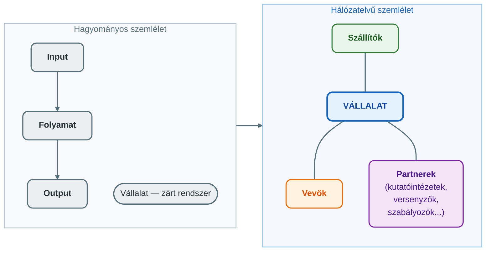
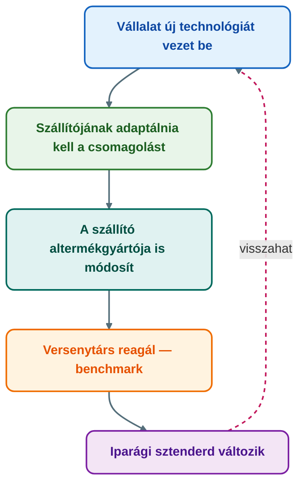
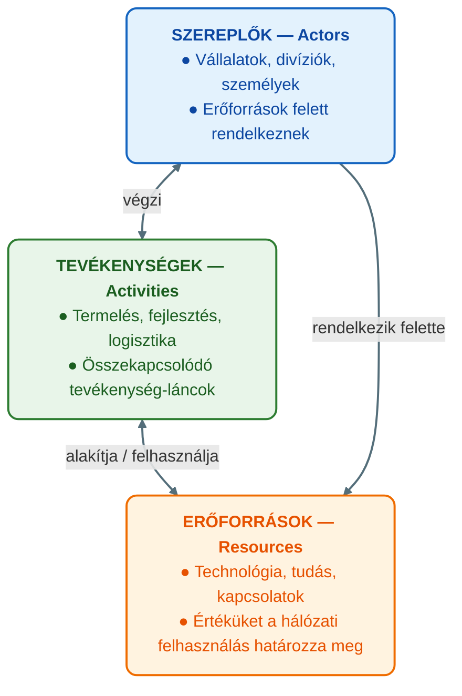

## V18 – Hálózati működés és szempontjai

### Beszerzendő anyagok

| Szerző | Mű | Jelleg | Indoklás / érintett rész |
|---|---|---|---|
| Håkansson, H. | *Határtalan hálózatok.* Alinea Kiadó, 2010. | ajánlott irodalom | A syllabus (Óbudai Egyetem, 2026) ajánlott irodalomként nevezi meg; a „három szempont” *listája* erre épül. A forrásmappában 2026-11-06-tól a Håkansson & Snehota (szerk., 2017) IMP-összegző kötet áll rendelkezésre, amely a három szempont tartalmát és az ARA-modellt elsődleges forrásként alátámasztja (18.2, 18.3, 18.5); a lista szó szerinti ellenőrzéséhez a 2010-es mű továbbra is szükséges. |
| Szilágyi, G. A. | A 2–3. és 6. oktatási hét előadásanyaga (az üzleti kölcsönhatás elmélete; a hálózati működés 3 szempontja; tevékenységek és erőforrások hálózati értelmezése) | előadás-prezentáció | Az `Előadás_ppt1.pdf` ezeket nem tartalmazza; a syllabus 3. és 6. hete a tétel témája. |

**Tétel:** Hálózati működés. Mutassa be a vállalati működés hálózatelvű megközelítését! A hálózati működés szempontjai.

---

*A 18.1–18.3 szakasz a három szempont és az ARA-modell listáját Håkansson (2010) alapján adja; a mű a forrásmappában nem elérhető, ezért a listák szó szerint nem voltak ellenőrizhetők. A szempontok tartalmát és az ARA-modellt az IMP 2017-es összegző kötete (Håkansson & Snehota, szerk., 2017) alapján ellenőriztük és egészítettük ki (fejezetszerzős hivatkozással). A gyenge kötésekre vonatkozó részek (18.2 tudás-szempont, 18.4) az előadásanyag (Szilágyi, 2026), Buchanan (2002) és Barabási (2014) alapján ellenőrzöttek.*

### 18.1. A hálózatelvű megközelítés szükségessége

A hagyományos vállalatelmélet a szervezetet zárt rendszerként kezeli: a vállalat maga tervez, dönt, termel és értékesít. A hálózatelvű megközelítés ezzel szemben abból indul ki, hogy **egyetlen vállalat sem értelmezhető a kapcsolataitól függetlenül** (Håkansson, 2010).

A hálózattudomány gazdasági alkalmazásának kiindulópontja, hogy a sikeres vállalatok az üzleti stratégiájukat hálózatra építik. A más vállalatokkal összekapcsolt (linked) vállalat robusztusabb, mint az önállóan működő: a magasabb kapcsolatsűrűség (link density) nagyobb tűrőképességet ad a véletlen hibákkal és a célzott támadásokkal szemben is (Szilágyi, 2026, 13. dia).

A hálózatelvű megközelítés – Håkansson és az IMP (Industrial Marketing and Purchasing) csoport nyomán – nem a vállalat belső folyamataira, hanem a vállalat **hálózati pozíciójára** és **kapcsolataira** fókuszál (Håkansson, 2010). Az IMP négy évtizedes empirikus kutatása három megfigyelt jellemzőre épül: az üzleti kapcsolatok **folytonossága** (a vállalatok kevés kulcspartnerrel tartós, beruházásokat hordozó kapcsolatokat építenek), a kapcsolatok közötti **kölcsönös függőségek** hálózati szerkezete, és az **interakció** mindenütt-jelenvalósága (Håkansson & Snehota, 2017). Barabási ugyanezt a vállalat belső szerkezetére mondja: a 20. századi vállalat **fa** (a vezérigazgató a gyökér, lefelé egyre specializáltabb feladatok), az információs gazdaság vállalata **háló** – lapos, sok keresztkapcsolattal, projektcsapatokkal, szövetségekkel és kiszervezéssel; a vállalatok „sosem dolgoznak egyedül” (Barabási, 2014, 14. fej.).

---

### 18.2. A hálózati működés három szempontja

Håkansson (2010) szerint a hálózatban való működés három szempontból különbözik alapvetően az önálló vállalati működéstől:

#### 1. szempont: Irányíthatóság (Control)

**Hagyományos nézet:** A vezető irányítja a vállalatot, a vállalat irányítja folyamatait.

**Hálózati realitás:** A hálózatban nincs egyetlen szereplő sem, aki az egész rendszert uralna. Minden szereplő befolyásolja a többieket, de senki sem irányítja teljesen a hálózatot. Minél nagyobb és sűrűbb a hálózat, annál kisebb az egyes szereplők kontrollja az egész felett (Håkansson, 2010).

**Következmény:** A menedzser feladata nem a kontroll maximalizálása, hanem a **hálózati pozíció tudatos alakítása** és a befolyás körének értelmes menedzsmentje.

A 2017-es IMP-kötet ugyanezt három vezetői tulajdonsággal fogalmazza meg: minden vállalat **egyedi csomópont** egy meghatározott kapcsolati halmaz metszéspontjában; a beágyazottság egyszerre **eszköz és teher** (asset and liability); és a vállalat **korlátozottan irányít** (limited control) – sosem teljesen autonóm, mert eredménye attól is függ, mások hogyan cselekszenek és reagálnak (Håkansson & Snehota, 2017). A kontroll határa paradox: ha egy vállalatnak sikerülne teljesen uralnia egy kapcsolatot, épp az interakció legjobb hatásáról – a partner kezdeményezéseiről – mondana le; „a hálózat szigorú értelemben meghal, ha hierarchiává válik” (Håkansson & Snehota, 2017). A vezető ezért hierarchikus tekintély nélkül koordinál: mások motiválásával, közvetítéssel, közös kísérletezéssel (Ford, Mattsson & Snehota, 2017).

#### 2. szempont: Tudás (Knowledge)

**Hagyományos nézet:** A szervezet tud mindent, ami a döntésekhez kell; a tudásmenedzsment a belső folyamat.

**Hálózati realitás:** A hálózatban elosztottan tárolt tudás messze meghaladja bármelyik szereplő egyéni tudását. Az innováció, a problémamegoldás és a kompetenciafejlesztés egyre inkább **kapcsolatokon keresztül** történik – nem belső fejlesztéssel, hanem partnerekkel együtt (Håkansson, 2010).

Ehhez kapcsolódik Mark Granovetter **gyenge kötések elmélete** (the strength of weak ties). Granovetter abból a megfigyelésből indult ki, hogy az emberek új állást jellemzően nem a barátaikon, hanem laza ismerőseiken keresztül találnak. Az erős kötések (strong ties) a családhoz és a közeli barátokhoz fűznek, és a közeli barátaink gyakran egymással is barátok, ezért az erős kötések zárt csoportokat alkotnak. A gyenge kötések (weak ties) ezzel szemben **társadalmi hidak** (social bridges): más, egyébként elérhetetlen körökbe vezetnek (Granovetter, 1973, idézi Szilágyi, 2026, 27. dia; Buchanan, 2002). Az erős kötéseken át jellemzően olyan hírt kapunk, amelyet már hallottunk; az új információ a gyenge kötéseken érkezik (Buchanan, 2002). A részleteket a 18.4. szakasz foglalja össze.

**Következmény:** A vállalat kapcsolatai **tudásforrások** – nem csak erőforrás-csere eszközei. A tudás-hálózat menedzselése stratégiai feladat (Håkansson, 2010).

Az IMP-kötet a tudás-szempontot a **hálózatkép** (*network picture*) fogalmával írja le: minden vezető képe a hálózatról egyéni, részleges és a saját horizontja által korlátozott – „minden nézet hiányos”. Aki csak néhány kulcspartnert lát, azok szélesebb rálátásából tanulhat, és jobban boldogul, mint aki egyedül próbál „teljes” képet építeni; ezért támaszkodnak a cégek kereskedőik és külföldi ügynökeik hálózatismeretére. Az innováció is az interakcióban születik: az interakció egyszerre az új megoldások létrehozásának és a meglévő erőforrás-szövetbe illesztésének eszköze (Ford, Mattsson & Snehota, 2017).

#### 3. szempont: Változás (Change)

**Hagyományos nézet:** A változás tervezett, vezérelt folyamat.

**Hálózati realitás:** A hálózatban a változás folyamatos és részben spontán. Bármely szereplő változása hullámokat indít a hálózatban, amelyek nem mindig kiszámíthatók. A hálózat dinamikus egyensúlyi állapotban van, nem statikus struktúra (Håkansson, 2010).

*Saját szemléltető példa a változás továbbgyűrűzésére (nem forrásból):*

**Következmény:** A hálózatban való változáskezelés nem top-down tervezés, hanem **folyamatos alkalmazkodás** és a hálózati visszacsatolások figyelemmel kísérése (Håkansson, 2010).

A 2017-es kötet szerint „az üzleti hálózatok és a bennük lévő vállalatok folyamatos mozgásban vannak”, és a vezető **dualitásokkal** él együtt: egyszerre reagál a kontextusra és alakítja azt; stabilitást kell biztosítania a hatékonysághoz és változást a fejlesztéshez; a sikeres innováció egy stabil kapcsolatban gyökerezik, a stabil kapcsolat fenntartása viszont folyamatos alkalmazkodást kíván. Egy kapcsolaton belül három választás ismétlődik: alkalmazkodás vagy szembesítés (conform/confront), a meglévő kapcsolatszerkezet megszilárdítása vagy új építése (consolidate/create), engedés a partner szakértelmének vagy a partner kényszerítése (concede/coerce) (Ford, Mattsson & Snehota, 2017).

---

### 18.3. Az ARA modell – tevékenységek, erőforrások, szereplők

Håkansson és az IMP csoport az ARA modellel (Activities–Resources–Actors) írja le az üzleti hálózat három alapvető dimenzióját (Håkansson, 2010; Håkansson & Snehota, 1995). A 2017-es kötet a kapcsolat „három szubsztancia-rétegeként” fogalmazza meg: az első rétegben a két fél **tevékenységei** kapcsolódnak össze és hangolódnak egymáshoz (termelés, K+F, szállítás, raktározás – akár több szervezet határán át); a második rétegben **erőforrásaik** kötődnek és kombinálódnak (az erőforrás értéke a konkrét felhasználási kontextusban, az összekötésektől függ); a harmadik rétegben a **szereplők** között kötések jönnek létre (az egyének megismerik egymás erőforrásait, céljait, és közösen fejlődnek). A legtöbb vállalat számára a fő üzleti kapcsolatok „a legfontosabb erőforrást” jelentik (Håkansson & Snehota, 2017).

A három elem egymással szorosan összekapcsolt: a szereplők tevékenységeket végeznek erőforrásokkal, a tevékenységek erőforrásokat alakítanak, az erőforrások a szereplők kontrollja alatt állnak – de nem egyetlen szereplőén, hanem a kapcsolatok hálójában megoszlva (Håkansson, 2010). A rétegekben a függőségek is más-más formát öltenek – „a három I”: a tevékenységek **integrációja**, az erőforrások **interfészei** és a szereplők **interakciója**. A tevékenység-rétegben szekvenciális, pooled és reciprok függőségek különböztethetők meg (Thompson, 1967, idézi Freytag, Gadde & Harrison, 2017); az erőforrás-rétegben nem maga az erőforrás, hanem az erőforrások közötti interfész a függőség forrása; a szereplői rétegben a kötések idővel épülnek, ezért a kapcsolat történetének ismerete nélkül a jelenlegi függőségek nem érthetők (Freytag, Gadde & Harrison, 2017).

---

### 18.4. Erős és gyenge kapcsolatok szerepe a vállalati hálózatban

Granovetter elmélete a vállalati hálózatra is alkalmazható: a vállalat kapcsolatai is lehetnek erősek (gyakori, szoros, egymással is összekapcsolt partnerek) és gyengék (ritka, laza, más hálózatokba vezető kapcsolatok). A két kötéstípus a tudás szempontjából eltérő szerepet tölt be (Granovetter, 1973, idézi Szilágyi, 2026, 27. dia; Buchanan, 2002):

| Dimenzió | Erős kötés | Gyenge kötés |
|---|---|---|
| Interakció gyakorisága | Magas (család, közeli barátok; gyakran látott kontakt) | Alacsony (alkalmanként vagy ritkán látott ismerős) |
| Közös kapcsolatok | Sok: a partnerek egymással is kapcsolatban állnak (zárt csoport) | Kevés: a kapcsolat más, egyébként elérhetetlen körbe vezet |
| Információ jellege | Redundáns: amit már tudunk, azt halljuk újra | Új: más információs világból érkezik |
| Hálózati szerep | Csoportkohézió | Híd (bridge): eltávolítása ugrásszerűen megnöveli a két fél közötti távolságot |

Granovetter állásszerzési vizsgálatában a megkérdezettek 16%-a jutott álláshoz olyan kontakton keresztül, akit gyakran látott, 84%-a pedig olyanon keresztül, akit csak alkalmanként vagy ritkán (Buchanan, 2002). A gyenge kötés nem csak egy személyhez köt: rajta keresztül két lépésben annak minden ismerőse, három lépésben azok ismerősei is elérhetők – az erős kötéseknek nincs ilyen „kitörési” hatásuk, mert olyanokhoz kötnek, akikhez egyébként is közel állnánk (Buchanan, 2002). A vállalat számára ebből az következik, hogy az új tudás és az innováció forrása jellemzően a laza, más hálózatokba átnyúló kapcsolat (Håkansson, 2010). Barabási ugyanezt a hálózattudomány nyelvén mondja: Granovetter társadalma „sűrűn kapcsolt klaszterek gyűjteménye, amelyeket néhány külső kapcsolat köt össze”; minél erősebb a kötés két ember között, annál nagyobb az átfedés baráti köreik között – a kis világ modell (Watts–Strogatz) épp ezt a klaszteres szerkezetet egyezteti össze a rövid utakkal (Barabási, 2014, 4. fej.).

---

### 18.5. A tevékenységek és erőforrások hálózati értelmezése a gyakorlatban: szállítói interfészek

A syllabus 6. hete (tevékenységek és erőforrások hálózati értelmezése; hálózatelvű folyamat- és erőforrásmenedzsment) a beszerzési oldalon válik kézzelfoghatóvá. Az IMP megkülönbözteti a **magas** és az **alacsony bevonódású** (high/low involvement) szállítói kapcsolatot: magas bevonódásról akkor beszélünk, ha a három réteg legalább egyikében jelentős az összekapcsolás; egy vevő csak kevés ilyen kapcsolatot bír el, mert kezelési költségük nagy (Gadde & Snehota, 2000, idézi Gadde & Wynstra, 2017). A kapcsolat tartalmát négy **szállítói interfész** írja le (Araujo, Dubois & Gadde, 1999, idézi Gadde & Wynstra, 2017):

| Interfész | Ki határozza meg a csere tárgyát? | Interakció | Tanulási hatás |
|---|---|---|---|
| **Standardizált** | a vevő a szállító polcáról választ | minimális | nincs |
| **Specifikált** | a vevő részletesen előírja | kevés | minimális – a vevő szándékosan zárja ki a szállító inputját |
| **Fordítási** (translation) | a vevő a funkciót írja elő, a szállító „lefordítja” kivitelre | közepes | közvetett: a szállító más kapcsolatokban szerzett tudását hasznosítja |
| **Interaktív** | a két fél közösen, egymás erőforrásainak ismeretében | intenzív, cégközi csapatok | közvetlen tanulás, kollaboratív innováció |

Az IMP normatív üzenete: ha a vevő többet akar a szállítótól, mint egy standard terméket adott áron, **fel kell adnia autonómiája egy részét**, és el kell fogadnia a szállítót fejlesztési partnerként (Håkansson & Snehota, 2017). Ez a három szempont (korlátozott irányíthatóság, elosztott tudás, folyamatos változás) beszerzési oldali következménye.

---

**Összegzés:** A hálózatelvű megközelítés szerint a vállalat nem zárt rendszer, hanem egy komplex hálózat csomópontja. A hálózati működés három szempontja – irányíthatóság (senki sem uralja teljesen a hálózatot), tudás (elosztott és kapcsolatokon keresztül áramlik) és változás (folyamatos, kaszkád-szerű, nem teljesen tervezett) – alapvetően megváltoztatja a menedzsment feladatát: nem vezérlés, hanem pozicionálás, kapcsolatmenedzsment és alkalmazkodás. Az ARA modell tevékenységek, erőforrások és szereplők hármasában írja le ezt a hálózatot (Håkansson, 2010), amelyet az IMP 2017-es kötete a kapcsolat három szubsztancia-rétegeként és a függőségek „három I-jeként” pontosít (Håkansson & Snehota, 2017; Freytag, Gadde & Harrison, 2017).

---

### Várható vizsgáztatói kérdések

1. **Miért éppen a gyenge kötések a „társadalmi hidak”?** — Granovetter szerint az erős kötések (család, közeli barátok) zárt csoportokat alkotnak, mert a barátaink egymásnak is barátai; rajtuk keresztül főként redundáns, már ismert információ érkezik. A gyenge kötés más, egyébként elérhetetlen körbe vezet, ezért híd: ha eltávolítjuk, a két fél közötti távolság ugrásszerűen megnő (Granovetter, 1973, idézi Szilágyi, 2026, 27. dia; Buchanan, 2002).
2. **Mit mutatott Granovetter állásszerzési vizsgálata, és mi ennek a vállalati tanulsága?** — A megkérdezettek 16%-a gyakran látott, 84%-a csak alkalmanként vagy ritkán látott kontakton keresztül jutott álláshoz, mert a hír a gyenge kötéseken át jut ki a saját csoport határain túlra (Buchanan, 2002). Vállalati szinten ez azt jelenti, hogy a kapcsolatok tudásforrások, és az új tudás jellemzően a laza, más hálózatokba átnyúló partnerkapcsolatokon érkezik (Håkansson, 2010).
3. **Miért robusztusabb a hálózatba kapcsolt vállalat az önállónál?** — A sikeres vállalatok hálózatra építik a stratégiájukat; a más vállalatokkal összekapcsolt vállalat robusztusabb, mert a magasabb kapcsolatsűrűség nagyobb tűrőképességet ad a véletlen hibákkal és a célzott támadásokkal szemben is (Szilágyi, 2026, 13. dia). Ez a hálózati robusztusság témájához (V20) is kapcsolódik.
4. **Mi a hálózati működés három szempontja, és mi következik belőlük a menedzser feladatára?** — Irányíthatóság: senki sem uralja az egész hálózatot, ezért a feladat a hálózati pozíció tudatos alakítása, nem a kontroll maximalizálása. Tudás: a tudás elosztott, a kapcsolatok tudásforrások. Változás: a változás folyamatos és továbbgyűrűzik, ezért folyamatos alkalmazkodás kell (Håkansson, 2010). A 2017-es kötet ugyanezt „limited control”, „minden nézet hiányos” és „folyamatos mozgás – dualitások” formában írja le (Håkansson & Snehota, 2017; Ford, Mattsson & Snehota, 2017). *(A hármas lista szó szerinti alakja Håkansson (2010) beszerzéséig nem ellenőrizhető.)*

5. **Miért „hal meg” a hálózat, ha hierarchiává válik?** — Mert a hálózat értéke a sok, különböző ambíciójú szereplő kezdeményezéseiből, specializált erőforrásaiból és készségeiből fakad; ha egyetlen központ viselné az összes felelősséget és teljes kontrollt gyakorolna, a vállalat elveszítené a partner kezdeményezéseiből származó hasznot (Håkansson & Snehota, 2017). Ez az irányíthatóság-szempont paradoxona: a kontroll feladásának egy része az interakció előfeltétele.

6. **Mi a különbség a specifikált és az interaktív szállítói interfész között, és mikor melyiket érdemes választani?** — A specifikált interfészben a vevő részletesen előírja a termék jellemzőit, kevés az interakció, a szállító „kapacitástartalék”, a tanulás minimális; az interaktív interfészben a csere tárgyát a két fél közösen, egymás erőforrásainak ismeretében határozza meg, intenzív cégközi csapatmunkával, ami közvetlen tanulást és kollaboratív innovációt ad – de drága, ezért csak kevés szállítóval tartható fenn (Araujo, Dubois & Gadde, 1999, idézi Gadde & Wynstra, 2017). A fejlesztési partnerséghez interaktív, a költséghatékony tömegbeszerzéshez standardizált vagy specifikált interfész való.

---

## Irodalom

* Araujo, L., Dubois, A., & Gadde, L.-E. (1999). Managing interfaces with suppliers. *Industrial Marketing Management, 28*(5), 497–506. (Idézi: Gadde & Wynstra, 2017.)
* Barabási, A.-L. (2014). *Linked: The new science of networks.* Basic Books. (Magyar kiadás: *Behálózva.* Open Books, 2022 — a syllabus kötelező irodalma.)
* Buchanan, M. (2002). *Nexus: Small worlds and the groundbreaking science of networks.* W. W. Norton. (A syllabus a magyar kiadást nevezi meg: *Nexus.* Typotex, 2003.)
* Ford, D., Mattsson, L.-G., & Snehota, I. (2017). Management in the interactive business world. In H. Håkansson & I. Snehota (szerk.), *No business is an island: Making sense of the interactive business world* (2. fej.). Emerald.
* Freytag, P. V., Gadde, L.-E., & Harrison, D. (2017). Interdependencies – blessings and curses. In H. Håkansson & I. Snehota (szerk.), *No business is an island: Making sense of the interactive business world* (13. fej.). Emerald.
* Gadde, L.-E., & Wynstra, F. (2017). Purchasing and supply management: On strategic roles and supplier interfaces. In H. Håkansson & I. Snehota (szerk.), *No business is an island: Making sense of the interactive business world* (4. fej.). Emerald.
* Håkansson, H. (2010). *Határtalan hálózatok.* Alinea Kiadó.
* Håkansson, H., & Snehota, I. (1995). *Developing relationships in business networks.* Routledge. (Idézi: Håkansson & Snehota, 2017.)
* Håkansson, H., & Snehota, I. (2017). The significance of business relationships. In H. Håkansson & I. Snehota (szerk.), *No business is an island: Making sense of the interactive business world* (1. fej.). Emerald.
* Óbudai Egyetem, Keleti Károly Gazdasági Kar. (2026). *Vállalati és üzleti hálózatmenedzsment (GMXVU2MBLF) — Syllabus* [Syllabus].
* Szilágyi, G. A. (2026). *Organizational networks* [Előadás-prezentáció]. Óbudai Egyetem, Keleti Károly Gazdasági Kar.
