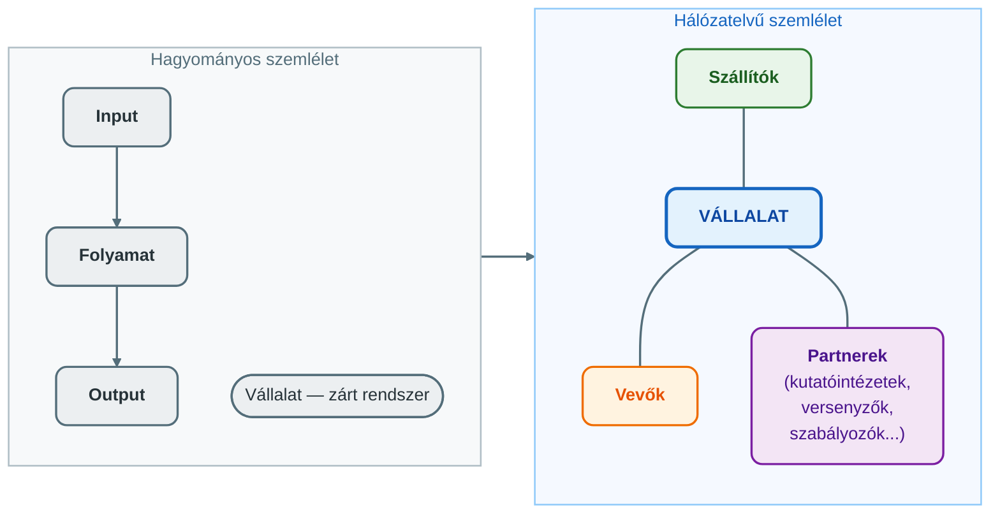
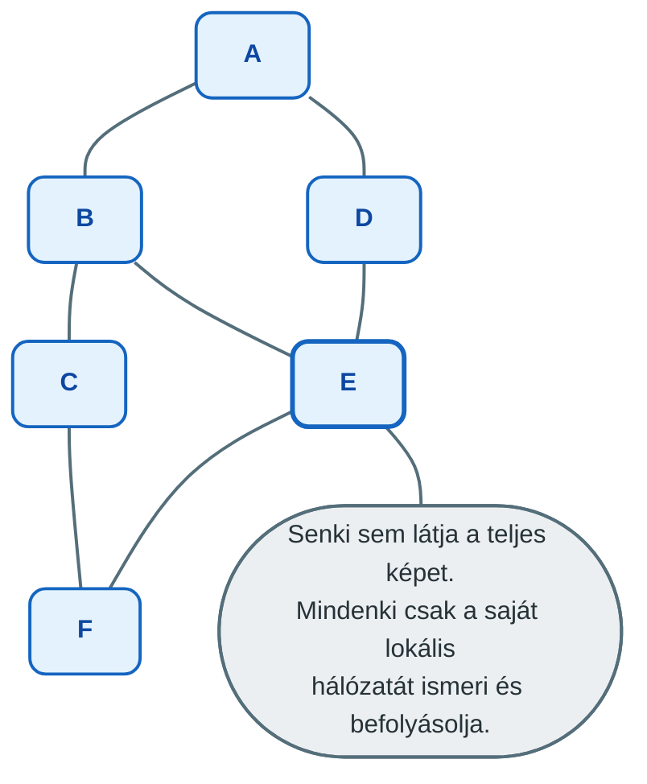
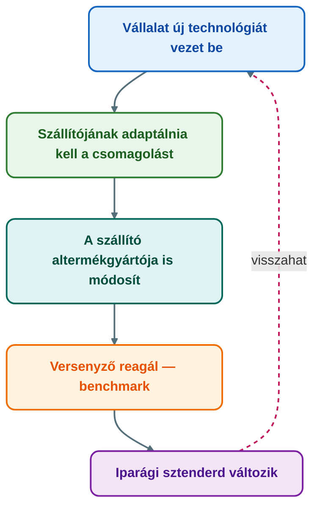
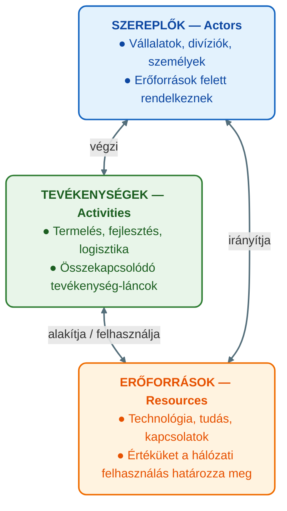

## V18 – Hálózati működés

**Tétel:** Hálózati működés és szempontjai: Hálózati működés. Mutassa be a vállalati működés hálózatelvű megközelítését! A hálózati működés szempontjai.

---

### 18.1. A hálózatelvű megközelítés szükségessége

A hagyományos vállalatelmélet a szervezetet zárt rendszerként kezeli: a vállalat maga tervez, dönt, termel és értékesít. Ez a szemlélet kielégítő volt, amíg a vállalatok valóban viszonylag önállóan működtek. A 20. század végére azonban a munkamegosztás, a kiszervezés (outsourcing) és az ellátási láncok komplexitása oda jutott, hogy **egyetlen vállalat sem értelmezhető a kapcsolataitól függetlenül.**

A hálózatelvű megközelítés – Håkansson és az IMP csoport nyomán – nem a vállalat belső folyamataira, hanem a vállalat **hálózati pozíciójára** és **kapcsolataira** fókuszál.

---

### 18.2. A hálózati működés három szempontja

Håkansson elmélete szerint a hálózatban való működés három szempontból különbözik alapvetően az önálló vállalati működéstől:

#### 1. szempont: Irányíthatóság (Control)

**Hagyományos nézet:** A vezető irányítja a vállalatot, a vállalat irányítja folyamatait.

**Hálózati realitás:** A hálózatban nincs egyetlen szereplő sem, aki az egész rendszert uralna. Minden szereplő befolyásolja a többieket, de senki sem irányítja teljesen a hálózatot. Minél nagyobb és sürűbb a hálózat, annál kisebb az egyes szereplők kontrollja az egész felett.

**Következmény:** A menedzser feladata nem a kontroll maximalizálása, hanem a **hálózati pozíció tudatos alakítása** és a befolyás körének értelmes menedzsmentje.

#### 2. szempont: Tudás (Knowledge)

**Hagyományos nézet:** A szervezet tud mindent, ami a döntésekhez kell; a tudásmenedzsment a belső folyamat.

**Hálózati realitás:** A hálózatban elosztottan tárolt tudás messze meghaladja bármelyik szereplő egyéni tudását. Az innováció, a problémamegoldás és a kompetenciafejlesztés egyre inkább **kapcsolatokon keresztül** történik – nem belső fejlesztéssel, hanem partnerekkel együtt.

Mark Granovetter (1973) **gyenge kötések elmélete** ehhez szorosan kapcsolódik: az erős kötések (szoros, sürű baráti körök) bezárnak, a gyenge kötések (laza ismeretségek) hídként kötnek össze különböző tudásbázisokat.

| Kapcsolat típusa | Jellemzők | Tudás-transzfer szempontjából |
|---|---|---|
| Erős kötés | Sürű, sok közös kontakt, sok interakció | Redundáns tudás; visszaigazolás, de kevés újdonság |
| Gyenge kötés | Ritka, kevés közös kontakt | Híd különböző információs világok közt; innováció forrása |

**Következmény:** A vállalat kapcsolatai **tudásforrások** – nem csak erőforrás-csere eszközei. A tudás-hálózat menedzselése stratégiai feladat.

#### 3. szempont: Változás (Change)

**Hagyományos nézet:** A változás tervezett, vezérelt folyamat (BPR, szervezetfejlesztés).

**Hálózati realitás:** A hálózatban a változás folyamatos és részben spontán. Bármely szereplő változása hullámokat indít a hálózatban, amelyek nem mindig kiszámíthatók. A hálózat dinamikus egyensúlyi állapotban van, nem statikus struktúra.

**Következmény:** A hálózatban való változáskezelés nem top-down tervezés, hanem **folyamatos alkalmazkodás** és a hálózati visszacsatolások figyelemmel kísérése.

---

### 18.3. Az ARA modell – tevékenységek, erőforrások, szereplők

Håkansson és az IMP csoport az ARA modellel (Activities–Resources–Actors) írja le az üzleti hálózat három alapvető dimenzióját:

A három elem egymással szorosan összekapcsolt: a szereplők tevékenységeket végeznek erőforrásokkal, a tevékenységek erőforrásokat alakítanak, az erőforrások a szereplők kontrollja alatt állnak – de nem egyetlen szereplőén, hanem a kapcsolatok hálójában megoszlva.

---

### 18.4. Erős és gyenge kapcsolatok szerepe a vállalati hálózatban

Granovetter elméletét az IMP keretrendszerben alkalmazva:

| Dimenzió | Erős kapcsolat | Gyenge kapcsolat |
|---|---|---|
| Interakció gyakorisága | Magas | Alacsony |
| Bizalom szintje | Magas | Közepes/alacsony |
| Adaptáció mértéke | Magas (kapcsolatspecifikus) | Alacsony |
| Tudás-redundancia | Magas (ugyanaz az info mindkét félnél) | Alacsony (új tudás forrása) |
| Hálózati szerep | Klaszter-kohézió | Hálózati híd (bridging) |
| Stratégiai érték | Stabilitás, megbízhatóság | Innováció, diverzifikáció |

Az optimális hálózati stratégia **vegyes portfólió**: erős kapcsolatok a kulcstevékenységekhez és megbízható ellátáshoz, gyenge kapcsolatok az innovációhoz és piaci szondázáshoz.

---

**Összegzés:** A hálózatelvű megközelítés szerint a vállalat nem zárt rendszer, hanem egy komplex hálózat csomópontja. A hálózati működés három szempontja – irányíthatóság (senki sem uralja teljesen a hálózatot), tudás (elosztott és kapcsolatokon keresztül áramlik) és változás (folyamatos, kaszkád-szerű, nem teljesen tervezett) – alapvetően megváltoztatja a menedzsment feladatát: nem vezérlés, hanem pozicionálás, kapcsolatmenedzsment és alkalmazkodás. Az ARA modell tevékenységek, erőforrások és szereplők hármasában írja le ezt a hálózatot.

---

*Forrás: Håkansson, H. (2010): Határtalan hálózatok. Alinea Kiadó; Granovetter, M. (1973): The Strength of Weak Ties; Dr. Szilágyi Győző Attila, GMXVU2MBLF előadásanyag (2025/26); Barabási Albert-László (2022): Behálózva*
