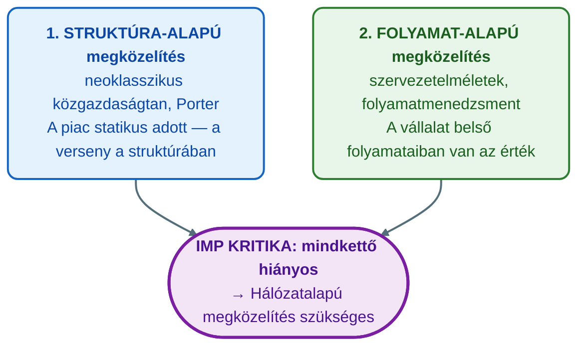
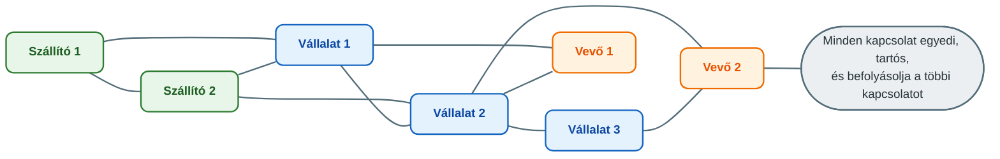
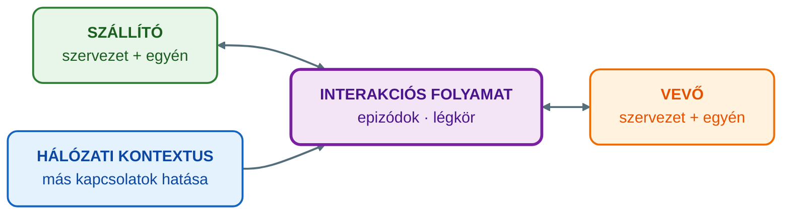

## V19 – Az üzleti kölcsönhatások hálózat alapú megközelítése

### Beszerzendő anyagok

| Szerző | Mű | Jelleg | Indoklás / érintett rész |
|---|---|---|---|
| Håkansson, H. | *Határtalan hálózatok.* Alinea Kiadó, 2010. | ajánlott irodalom | A tantárgynyilvántartó (Óbudai Egyetem, 2026) ajánlott irodalomként nevezi meg; a „struktúra-alapú / folyamat-alapú” kritika *elnevezése és tagolása* erre épül. A forrásmappában 2026-11-06-tól a Håkansson & Snehota (szerk., 2017) IMP-összegző kötet és Barabási *Linked* (2014) áll rendelkezésre, amelyek a kritika tartalmát és a piac hálózati értelmezését elsődleges forrásként alátámasztják (19.2–19.4); a 2010-es mű tagolásának szó szerinti ellenőrzéséhez a mű továbbra is szükséges. |
| Szilágyi, G. A. | A 2. oktatási hét előadásanyaga (az üzleti kölcsönhatás elmélete; a strukturális és a folyamatalapú megközelítés kritikája) | előadás-prezentáció | Az `Előadás_ppt1.pdf` nem tartalmazza; a syllabus 2. hete a tétel témája. |

**Tétel:** Az üzleti kölcsönhatások hálózat alapú megközelítése. Ismertesse a struktúra-alapú és a folyamat-alapú megközelítés kritikáját! Mutassa be a piac hálózatalapú értelmezését!

---

*A 19.1–19.5 szakasz tagolása (struktúra-alapú vs. folyamat-alapú megközelítés) Håkansson (2010) alapján készült; a mű a forrásmappában nem elérhető, ezért a tagolás szó szerint nem volt ellenőrizhető. A kritika tartalma és a piac hálózatalapú értelmezése az IMP 2017-es összegző kötetéből (Håkansson & Snehota, szerk., 2017) és a kötelező irodalomból (Barabási, 2014) ellenőrzött. A 19.5 szakasz (IMP interakció-modell) a tételkérdésen túlmutató kiegészítés.*

### 19.1. A két klasszikus megközelítés

Az üzleti kapcsolatok és a piac elemzésére két domináns elméleti hagyomány alakult ki, amelyeket Håkansson és az IMP csoport szisztematikusan kritizált. Az IMP (Industrial Marketing and Purchasing) csoport 1976-ban indult kutatása öt európai országban mintegy 800 vevő–szállító kapcsolatot írt le több mint 1000 interjúval, és **jelenségvezérelt** (phenomenon-driven) volt: a „termékek és szolgáltatások mögötti” üzleti világot írta le, amelyre a közgazdaságtan és a menedzsment meglévő elmélete csak korlátozott magyarázatot adott (Håkansson & Snehota, 2017).

---

### 19.2. A struktúra-alapú megközelítés és kritikája

#### A megközelítés lényege

A struktúra-alapú (structural) megközelítés – amelyet leginkább a neoklasszikus mikroökonómia és Michael Porter versenyerő-modellje képvisel – az üzleti kapcsolatokat piaci struktúrák kontextusában értelmezi:

- A piac egyensúlyi állapot felé tart.
- A szereplők racionális, önérdekkövető döntéshozók.
- A kapcsolatok távolságtartók, tranzakció-orientáltak.
- A versenyhelyzet az iparági struktúra (5 erő) által meghatározott.

#### Az IMP kritika

- **Statikus kép:** A struktúraelemzés pillanatfelvételt ad, de nem magyarázza, hogyan változnak a kapcsolatok időben.
- **Egyirányú tranzakcionalitás:** A vevő–szállító kapcsolatot anonim, egyszeri tranzakcióként kezeli, holott a valóságban tartós, kölcsönösen alakuló kapcsolatokról van szó.
- **Tudás figyelmen kívül hagyása:** A kapcsolat-specifikus tudás, adaptáció és közösen épített kompetenciák nem jelennek meg.
- **Hálózati kontextus hiánya:** Egyetlen vállalat–piac párt vizsgál, nem a vállalat egész kapcsolathálóját.

Az IMP 2017-es kötete a kritikát így fogalmazza meg: a közgazdasági és menedzsment-tankönyvek olyan gazdaságot feltételeznek, amely **független vállalatokból** áll, amelyek **termékkategóriával meghatározott piacokon**, **árjelzésekkel koordinálva** adnak-vesznek; a kutatás ezzel szemben a vállalatok **kapcsoltságát és korlátozott autonómiáját** találta, és azt, hogy a termék nem adott, hanem a felek által meghatározott változó (Håkansson & Snehota, 2017). Ugyanezt Barabási a közgazdaságtan „standard formális modelljének” nevezi: a vállalatok és fogyasztók autonóm, anonim egységek, akik csak az árrendszeren át hatnak egymásra, és nem egymással, hanem „a piaccal” – egy mitikus közvetítővel – interaktálnak; a gazdaság állapotát aggregált mutatókkal (foglalkoztatás, kibocsátás, infláció) írják le, az azokat létrehozó, egymással összefüggő mikroviselkedést figyelmen kívül hagyva (Barabási, 2014, 14. fej.).

| Aspektus | Struktúra-alapú | IMP kritika |
|---|---|---|
| Kapcsolat természete | Távolságtartó, anonim | Tartós, személyes, adaptált |
| Idődimenzió | Statikus | Dinamikus, múlttal és jövővel |
| Tudás szerepe | Figyelmen kívül | Kulcserőforrás |
| Piac képe | Aggregált struktúra | Egyedi kapcsolatok hálója |

---

### 19.3. A folyamat-alapú megközelítés és kritikája

#### A megközelítés lényege

A folyamat-alapú (process-based) megközelítés a szervezet belső folyamatait helyezi a középpontba. Az értékteremtés a vállalat belső értéklánca mentén zajlik (Porter értéklánc-modellje), a menedzsment feladata az optimális belső folyamatok kialakítása.

#### Az IMP kritika

- **Bezárt szemlélet:** Az értékteremtést kizárólag a vállalaton belül helyezi el – holott az érték egyre inkább a **vállalatok közötti interakciókban** keletkezik.
- **Elváló be- és kimenet:** A belső folyamat-optimalizáció nem veszi figyelembe, hogy a bemenetek (pl. alapanyag, tudás) a kapcsolatok minőségétől függnek.
- **Nem tükrözi a valóságot:** A modern ellátási láncokban, platformgazdaságokban és innovációs ökoszisztémákban az értékteremtés hálózati folyamat, nem belső.

A folyamat-alapú szemlélet stratégiai párja az **erőforrás-alapú nézet** (resource-based view): e szerint a vállalat a *saját, belső* erőforrásaiból teremt értéket, és a vezető feladata ezek fejlesztése (Wernerfelt, 1984, idézi Ford, Mattsson & Snehota, 2017). Az IMP ezt az „egyoldalú” menedzsmentképet bírálja: az érték **mások felhasználásával** (working with and through others) keletkezik – erőforrások kombinálásával, tevékenységek koordinálásával és egyének összekapcsolásával a vállalatokon *belül és át*; a vezető ezért a saját cégén kívüli, mások által kontrollált erőforrásokért is elszámoltatható (Ford, Mattsson & Snehota, 2017). A kapcsolatok fejlesztése nem a csúcsvezetés, hanem a beszerzési, értékesítési és műszaki *középvezetők* munkája, és nem történhet egyoldalúan (Håkansson & Snehota, 2017).

| Aspektus | Folyamat-alapú | IMP kritika |
|---|---|---|
| Értékteremtés helye | Vállalaton belül | Kapcsolatokban, hálózatban |
| Vállalat határai | Élesek, adottak | Elmosódottak, kapcsolatfüggők |
| Szállítók/vevők szerepe | Input/output | Aktív társalkotók |
| Koordináció | Belső hierarchia | Hálózati kölcsönös alkalmazkodás |

---

### 19.4. A hálózatalapú megközelítés – a piac mint hálózat

Az IMP csoport az üzleti piacokat (B2B markets) nem homogén, anonim versenytérként, hanem **egyedi kapcsolatok hálózataként** értelmezi.

**A piac mint hálózat legfontosabb következményei:**

1. **Nincs tökéletes verseny** – a piacon valójában egyedi kapcsolatok léteznek, nem homogén tranzakciók. Egy szállítói pozíció nem lecserélhető egyszerűen egy másikra.

2. **Az ár csak az egyik koordináló mechanizmus** – a bizalom, a kölcsönös adaptáció és a kapcsolat-specifikus tudás legalább annyira fontos.

3. **A piaci pozíció = hálózati pozíció** – nem az iparági struktúrában elfoglalt hely, hanem a konkrét kapcsolatok minősége és száma határozza meg a piaci erőt.

4. **Az innováció hálózati folyamat** – az IMP empirikus kutatásai azt mutatták, hogy az ipari innovációk döntő hányada vevő–szállító kapcsolatokban keletkezik, nem zárt laboratóriumokban. A 2017-es kötet szerint „az innovációk az interakcióban erednek”: az interakció egyszerre az új megoldások létrehozásának és a meglévő erőforrás-szövetbe illesztésének eszköze (Ford, Mattsson & Snehota, 2017).

**A piac mint hálózat három megfigyelt jellemzője (Håkansson & Snehota, 2017).** (1) *Folytonosság:* a vállalatok nem „ad hoc vásárolnak” – néhány vevő és néhány szállító adja a forgalom nagy részét, a kapcsolat három rétegű (tevékenységek összekapcsolása, erőforrások összekötése, szereplők közötti kötések), múltja és beágyazódása (lock-in) van. (2) *Hálózati struktúra:* ami az egyik kapcsolatban történik, hat a többire; minden vállalat egy határtalan, egészében megismerhetetlen hálózat egyedi csomópontja, beágyazottsága egyszerre eszköz és teher, és csak korlátozottan irányít. (3) *Interakció:* az akció–reakció láncok a függőségek kezelésének és újraalkotásának eszközei, és a fejlődés fő hajtóereje. Ebből következik, hogy a hálózat nem kezelhető „pont-beavatkozással”: a beavatkozásnak is folyamatosnak kell lennie.

**Ugyanez Barabási topológiai nyelvén.** A piac „nem más, mint irányított hálózat”: csomópontjai a vállalatok, pénzintézetek, kormányok; kapcsolatai a vétel–eladás, a közös K+F és marketing; a kapcsolat **súlya** a tranzakció értéke, **iránya** a szolgáltatótól a fogadó felé mutat, és e súlyozott, irányított hálózat szerkezete és fejlődése határozza meg a makrogazdasági folyamatok kimenetét. Powell nyomán: a piacon a lehető legkeményebb azonnali alku a stratégia, a hálózatban viszont a hosszú távú egymásrautaltság kiépítése – ezért a hálózati gazdaságban a vevő és a szállító **partner, nem versenytárs**, és a kapcsolatuk tartós és stabil (Barabási, 2014, 14. fej.). A két érvelés kiegészíti egymást: Barabási a hálózat *topológiájából*, az IMP a kapcsolat *tartalmából* indul ki.

---

### 19.5. Az IMP interakció-modell

A hálózatalapú megközelítés operatív magja az IMP interakció-modell, amely a vevő–szállító kapcsolatot négy dimenzióban írja le:

| Dimenzió | Tartalom |
|---|---|
| Interakciós epizódok | Konkrét ügyletek, tárgyalások, problémamegoldások (termék, pénz, info, szociális csere) |
| Kapcsolat légköre | Hatalom/függőség; konfliktus/kooperáció; bizalom; közelség/távolság |
| Szervezetek és egyének | Az interakció egyszerre szervezeti és személyes szinten zajlik |
| Környezet | Iparági struktúra; dinamizmus; internacionalizáció; szociális rendszer |

---

**Összegzés:** A struktúra-alapú megközelítés statikus piaci képe és a folyamat-alapú megközelítés vállalaton belülre zárt értékteremtési logikája egyaránt hiányos, mert figyelmen kívül hagyja az üzleti kapcsolatok tartós, dinamikus és hálózatba ágyazott természetét. Az IMP csoport hálózatalapú megközelítése a piacot egyedi kapcsolatok rendszereként értelmezi, ahol az értékteremtés, az innováció és a koordináció a vállalatok közötti kölcsönhatásokon alapul. A piac mint hálózat szemlélet következménye, hogy a vállalat piaci pozícióját nem az iparági struktúra, hanem a konkrét kapcsolatok minősége és hálózati elhelyezkedése határozza meg. Az IMP empirikus képe (folytonosság, hálózati struktúra, interakció; Håkansson & Snehota, 2017) és Barabási „irányított, súlyozott hálózat” modellje (Barabási, 2014, 14. fej.) ugyanezt a következtetést két irányból támasztja alá.

---

### Várható vizsgáztatói kérdések

1. **Miben különbözik az IMP piacképe a tankönyvi piacmodelltől?** — A tankönyvi modell független vállalatokat feltételez, amelyek termékkategóriával meghatározott piacokon, árjelzésekkel koordinálva adnak-vesznek; az IMP empirikus kutatása ezzel szemben a vállalatok kapcsoltságát és korlátozott autonómiáját találta: kevés kulcspartnerrel tartós, beruházásokat hordozó kapcsolatok, amelyek hálózatot alkotnak (Håkansson & Snehota, 2017). Barabási ugyanezt a „standard formális modell” kritikájaként fogalmazza meg: a vállalatok nem egy mitikus „piaccal”, hanem egymással interaktálnak (Barabási, 2014, 14. fej.).

2. **Miért bírálja az IMP az erőforrás-alapú nézetet?** — Mert az a vállalat saját, belső erőforrásaiból vezeti le az értéket, holott az érték mások felhasználásával – erőforrások kombinálásával, tevékenységek koordinálásával és egyének összekapcsolásával a vállalatok határán át – keletkezik; a vezető ezért a mások által kontrollált erőforrásokért is elszámoltatható (Wernerfelt, 1984, idézi Ford, Mattsson & Snehota, 2017).

3. **Mit jelent, hogy a piac „irányított, súlyozott hálózat”?** — A csomópontok a gazdasági szereplők, a kapcsolatok a tranzakciók és együttműködések; a súly a tranzakció értéke, az irány a szolgáltatótól a fogadó felé mutat; e hálózat szerkezete és fejlődése határozza meg a makrogazdasági kimeneteket, ezért például a kaszkádhibák (1997-es ázsiai válság) sem magyarázhatók olyan keretben, ahol minden szervezet csak „a piaccal” áll kapcsolatban (Barabási, 2014, 14. fej.).

4. **Mi az IMP három megfigyelt jellemzője, és hogyan vezet a „piac mint hálózat” tételhez?** — Folytonosság (tartós, három rétegű, múlttal bíró kapcsolatok), hálózati struktúra (a kapcsolatok közötti kölcsönös függőségek; minden vállalat egyedi, korlátozottan irányító csomópont) és interakció (akció–reakció láncok mint a fejlődés hajtóereje). Ha a kapcsolatok tartósak és egymástól függenek, a piac nem anonim versenytér, hanem egyedi kapcsolatok hálózata (Håkansson & Snehota, 2017).

5. **Miért partner a vevő és a szállító a hálózati gazdaságban, és hol van ennek a határa?** — Powell szerint a hálózatban nem a kemény azonnali alku, hanem a hosszú távú egymásrautaltság kiépítése a stratégia, ezért a kapcsolat tartós és stabil (Barabási, 2014, 14. fej.); az IMP szerint ha a vevő többet akar a szállítótól egy standard terméknél, fel kell adnia autonómiája egy részét (Håkansson & Snehota, 2017). A határ: a függőség Janus-arcú – előfeltétele a hatékonyságnak és az innovációnak, de korlátozza a mozgásteret (V17).

6. **Miért nem kezelhető a hálózat „pont-beavatkozással”?** — Mert az interakció folyamatos, a hálózat sosem átlátható kívülről, és az egyszeri beavatkozást a hálózat gyorsan „elnyeli”; a beavatkozásnak – akár vezetőként, akár szabályozóként – magának is folyamatosnak kell lennie (Håkansson & Snehota, 2017). A közbeszerzés nyílt pályáztatása például a tökéletes piac feltevésére épül, és ezért akadályozza a szállítói képességek kiaknázását (Håkansson & Snehota, 2017).

---

## Irodalom

* Barabási, A.-L. (2014). *Linked: The new science of networks.* Basic Books. (Magyar kiadás: *Behálózva.* Open Books, 2022 — a syllabus kötelező irodalma.)
* Ford, D., Mattsson, L.-G., & Snehota, I. (2017). Management in the interactive business world. In H. Håkansson & I. Snehota (szerk.), *No business is an island: Making sense of the interactive business world* (2. fej.). Emerald.
* Håkansson, H. (2010). *Határtalan hálózatok.* Alinea Kiadó.
* Håkansson, H., & Snehota, I. (2017). The significance of business relationships. In H. Håkansson & I. Snehota (szerk.), *No business is an island: Making sense of the interactive business world* (1. fej.). Emerald.
* Óbudai Egyetem, Keleti Károly Gazdasági Kar. (2026). *Vállalati és üzleti hálózatmenedzsment (GMXVU2MBLF) — Tantárgynyilvántartó adatlap* [Syllabus].
* Wernerfelt, B. (1984). A resource-based view of the firm. *Strategic Management Journal, 5*(2), 171–180. (Idézi: Ford, Mattsson & Snehota, 2017.)
