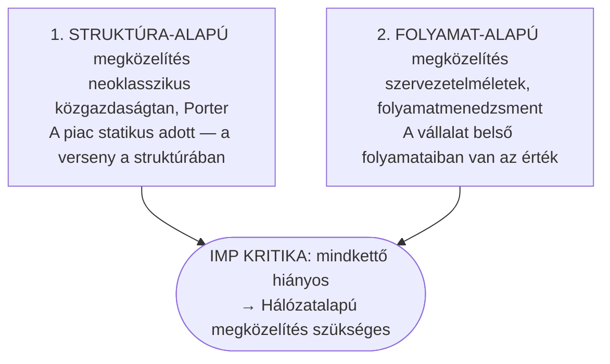
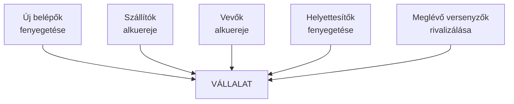
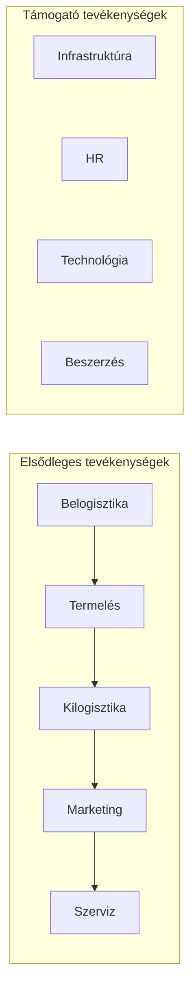
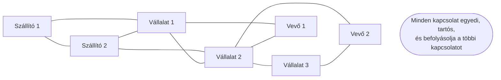
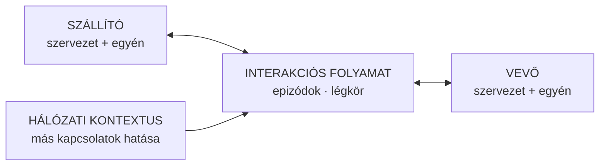

## V19 – Az üzleti kölcsönhatások hálózat alapú megközelítése

**Tétel:** Üzleti kölcsönhatások hálózatalapú megközelítése: Az üzleti kölcsönhatások hálózat alapú megközelítése. Ismertesse a struktúra-alapú és a folyamat-alapú megközelítés kritikáját! Mutassa be a piac hálózatalapú értelmezését!

---

### 19.1. A két klasszikus megközelítés

Az üzleti kapcsolatok és a piac elemzésére két domináns elméleti hagyomány alakult ki, amelyeket Håkansson és az IMP csoport szisztematikusan kritizált:

---

### 19.2. A struktúra-alapú megközelítés és kritikája

#### A megközelítés lényege

A struktúra-alapú (structural) megközelítés – amelyet leginkább a neoklasszikus mikroökonómia és Michael Porter versenyerő-modellje képvisel – az üzleti kapcsolatokat piaci struktúrák kontextusában értelmezi:

- A piac egyensúlyi állapot felé tart.
- A szereplők racionális, önérdekkövető döntéshozók.
- A kapcsolatok távolságtartók, tranzakció-orientáltak.
- A versenyhelyzet az iparági struktúra (5 erő) által meghatározott.

#### Az IMP kritika

- **Statikus kép:** A struktúraelemzés pillanatfelvételt ad, de nem magyarázza, hogyan változnak a kapcsolatok időben.
- **Egyirányú tranzakcionalitás:** A vevő–szállító kapcsolatot anonim, egyszeri tranzakcióként kezeli, holott a valóságban tartós, kölcsönösen alakuló kapcsolatokról van szó.
- **Tudás figyelmen kívül hagyása:** A kapcsolat-specifikus tudás, adaptáció és közösen épített kompetenciák nem jelennek meg.
- **Hálózati kontextus hiánya:** Egyetlen vállalat–piac párt vizsgál, nem a vállalat egész kapcsolathálóját.

| Aspektus | Struktúra-alapú | IMP kritika |
|---|---|---|
| Kapcsolat természete | Távolságtartó, anonim | Tartós, személyes, adaptált |
| Idődimenzió | Statikus | Dinamikus, múlttal és jövővel |
| Tudás szerepe | Figyelmen kívül | Kulcserőforrás |
| Piac képe | Aggregált struktúra | Egyedi kapcsolatok hálója |

---

### 19.3. A folyamat-alapú megközelítés és kritikája

#### A megközelítés lényege

A folyamat-alapú (process-based) megközelítés a szervezet belső folyamatait helyezi a középpontba. Az értékteremtés a vállalat belső értéklánca mentén zajlik (Porter értéklánc-modellje), a menedzsment feladata az optimális belső folyamatok kialakítása.

#### Az IMP kritika

- **Bezárt szemlélet:** Az értékteremtést kizárólag a vállalaton belül helyezi el – holott az érték egyre inkább a **vállalatok közötti interakciókban** keletkezik.
- **Elváló be- és kimenet:** A belső folyamat-optimalizáció nem veszi figyelembe, hogy a bemenetek (pl. alapanyag, tudás) a kapcsolatok minőségétől függnek.
- **Nem tükrözi a valóságot:** A modern ellátási láncokban, platformgazdaságokban és innovációs ökoszisztémákban a értékteremtés hálózati folyamat, nem belső.

| Aspektus | Folyamat-alapú | IMP kritika |
|---|---|---|
| Értékteremtés helye | Vállalaton belül | Kapcsolatokban, hálózatban |
| Vállalat határai | Élesek, adottak | Elmosódottak, kapcsolatfüggők |
| Szállítók/vevők szerepe | Input/output | Aktív társalkotók |
| Koordináció | Belső hierarchia | Hálózati kölcsönös alkalmazkodás |

---

### 19.4. A hálózatalapú megközelítés – a piac mint hálózat

Az IMP csoport az üzleti piacokat (B2B markets) nem homogén, anonim versenytérként, hanem **egyedi kapcsolatok hálózataként** értelmezi.

**A piac mint hálózat legfontosabb következményei:**

1. **Nincs tökéletes verseny** – a piacon valójában egyedi kapcsolatok léteznek, nem homogén tranzakciók. Egy szállítói pozíció nem lecserélhető egyszerűen egy másikra.

2. **Az ár csak az egyik koordináló mechanizmus** – a bizalom, a kölcsönös adaptáció és a kapcsolat-specifikus tudás legalább annyira fontos.

3. **A piaci pozíció = hálózati pozíció** – nem az iparági struktúrában elfoglalt hely, hanem a konkrét kapcsolatok minősége és száma határozza meg a piaci erőt.

4. **Az innováció hálózati folyamat** – az IMP empirikus kutatásai (Håkansson, 1987, 1989) azt mutatták, hogy az ipari innovációk döntő hányada vevő–szállító kapcsolatokban keletkezik, nem zárt laboratóriumokban.

---

### 19.5. Az IMP interakció-modell

A hálózatalapú megközelítés operatív magja az IMP interakció-modell, amely a vevő–szállító kapcsolatot négy dimenzióban írja le:

| Dimenzió | Tartalom |
|---|---|
| Interakciós epizódok | Konkrét ügyletek, tárgyalások, problémamegoldások (termék, pénz, info, szociális csere) |
| Kapcsolat légköre | Hatalom/függőség; konfliktus/kooperáció; bizalom; közelség/távolság |
| Szervezetek és egyének | Az interakció egyszerre szervezeti és személyes szinten zajlik |
| Környezet | Iparági struktúra; dinamizmus; internacionalizáció; szociális rendszer |

---

**Összegzés:** A struktúra-alapú megközelítés statikus piaci képe és a folyamat-alapú megközelítés vállalaton belülre zárt értékteremtési logikája egyaránt hiányos, mert figyelmen kívül hagyja az üzleti kapcsolatok tartós, dinamikus és hálózatba ágyazott természetét. Az IMP csoport hálózatalapú megközelítése a piacot egyedi kapcsolatok rendszereként értelmezi, ahol az értékteremtés, az innováció és a koordináció a vállalatok közötti kölcsönhatásokon alapul. A piac mint hálózat szemlélet következménye, hogy a vállalat piaci pozícióját nem az iparági struktúra, hanem a konkrét kapcsolatok minősége és hálózati elhelyezkedése határozza meg.

---

*Forrás: Håkansson, H. (2010): Határtalan hálózatok. Alinea Kiadó; Dr. Szilágyi Győző Attila, GMXVU2MBLF előadásanyag (2025/26); Håkansson, H. – Snehota, I. (1995): Developing Relationships in Business Networks; Porter, M.E. (1980): Competitive Strategy (mint kritika alapja)*
