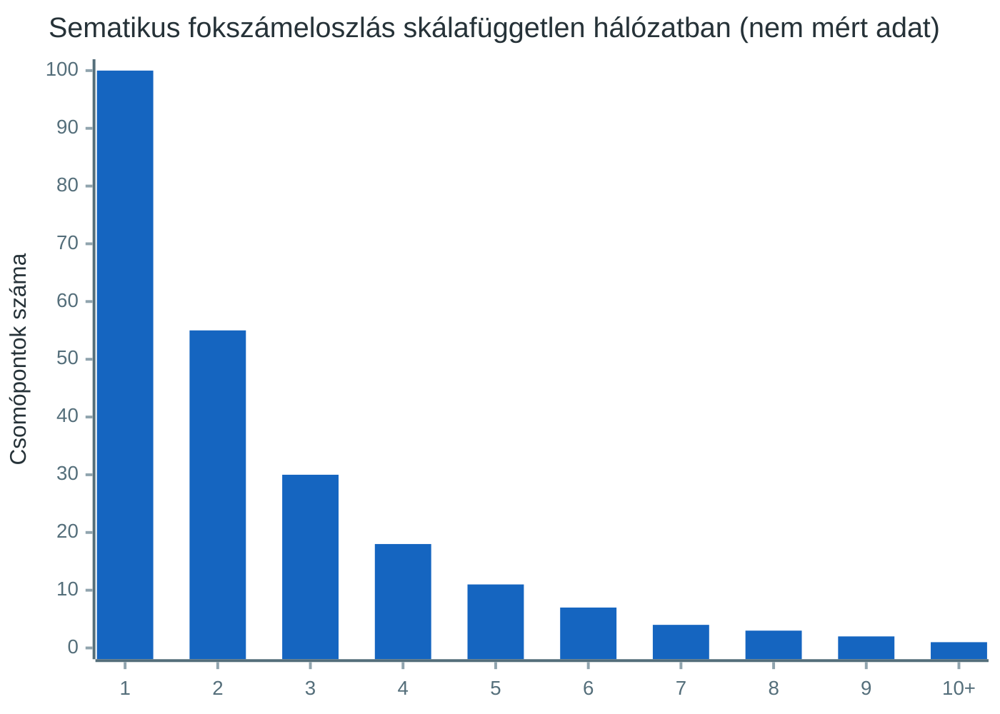
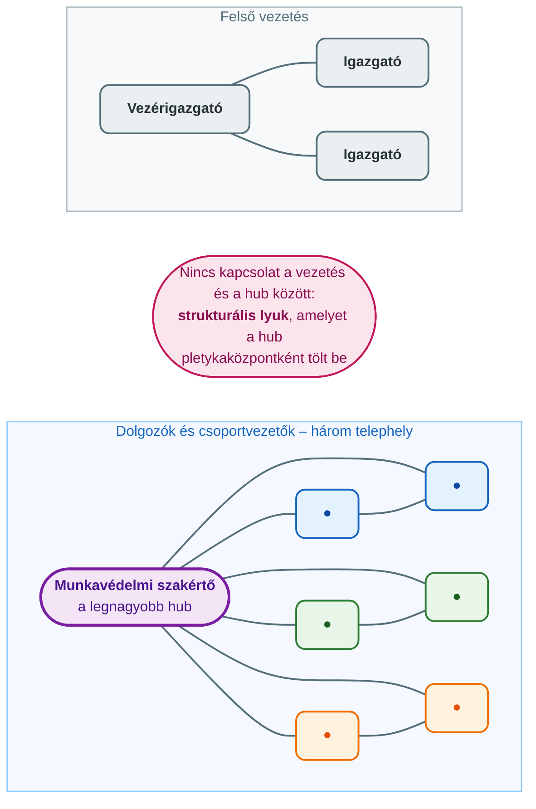
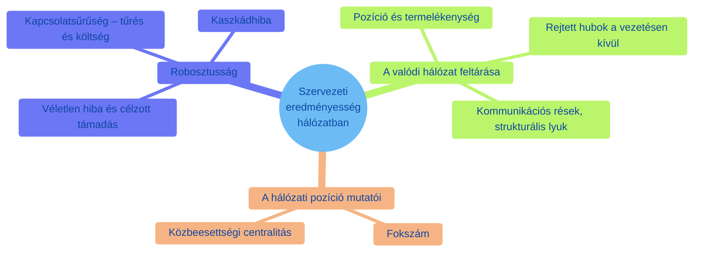

## V20 – Hálózati üzleti stratégia

### Beszerzendő anyagok

| Szerző | Mű | Jelleg | Indoklás / érintett rész |
|---|---|---|---|
| Barabási, A.-L. | *Behálózva.* Open Books, 2022. | kötelező irodalom | A syllabus (Óbudai Egyetem, 2026) egyetlen kötelező műve; a hubok, a preferenciális kapcsolódás és a robosztusság tárgyalása (R1, R3) rá épül. A forrásmappában csak az angol *Network Science* előzetes kiadás (Barabási, 2012) van. |
| Håkansson, H. | *Határtalan hálózatok.* Alinea Kiadó, 2010. | ajánlott irodalom | A syllabus ajánlott irodalma; a tétel szervezeti határokra (R2) és eredményességre (R3) vonatkozó részkérdése a tárgy üzletihálózat-vonalához tartozik, a forrásmappában nem ellenőrizhető. |
| Szilágyi, G. A. | A 10–12. oktatási hét előadásanyaga (robosztusság és reziliencia, hálózatrengések; hálózati menedzsment, stratégia és menedzsment a hálózatokban; fejlődő vállalati hálózatok) | előadás-prezentáció | Az `Előadás_ppt1.pdf` a Mastenbroek-résznél véget ér; a syllabus 11. hete („Stratégia és menedzsment a hálózatokban”) a tétel témája, és mindhárom részkérdést (R1–R3) érinti. |

**Tétel:** Hálózati üzleti stratégia. Mutassa be az üzleti stratégiaalkotás hálózati megközelítését! Hogyan értelmezi a hálózati stratégiát: a szervezeti határokat és a szervezeti eredményességet.

---

*A szervezeti határok hálózati értelmezéséhez (20.3) a forrásmappában nincs közvetlen tananyag; a szakasz csak az előadásból és a Barabási-tankönyvből kinyerhető közvetett állításokra épül, ezért rövidebb a többinél. A hiányt a „Beszerzendő anyagok” táblázat jelzi.*

### 20.1. A hálózati szemlélet a stratégiaalkotásban

A hálózattudomány (network science) kiindulópontja a tárgyban az, hogy a szervezet **nem gép, hanem hálózat** – sőt egyszerre több, egymásra rakódó hálózat (Szilágyi, 2026). A gép komplikált (complicated) rendszer: sok alkatrésze van, de viselkedése a részekből kiszámítható, és nem rendeződik át spontán. A szervezet ezzel szemben komplex (complex) rendszer: részei megjelennek és eltűnnek, visszacsatolásai részben véletlenszerűek, és viselkedése a részek ismeretéből nem vezethető le (Szilágyi, 2026). Ebből következik a stratégiaalkotás hálózati megközelítésének alapgondolata: a vállalat teljesítményét nem csak a belső erőforrásai, hanem a kapcsolatainak szerkezete – a hálózatban elfoglalt pozíciója – határozza meg.

Az előadás ezt gazdasági tételként fogalmazza meg: **a sikeres vállalatok a hálózatra építik üzleti stratégiájukat**, és a kapcsolatokkal rendelkező (linked) vállalatok robosztusabbak, mint az önállóak; a nagyobb kapcsolatsűrűség nagyobb véletlenhiba- és támadástűrést ad a vállalatnak (Szilágyi, 2026). Barabási ugyanezt a 21. század legsikeresebb cégein mutatja be: a Google, a Facebook, a Cisco, az Apple vagy az Akamai technológiája és üzleti modellje hálózatokra épül – a Google például nemcsak a web legnagyobb feltérképezője, hanem keresőtechnológiája is a web hálózati tulajdonságaira támaszkodik (Barabási, 2012, 1. fej.).

A hagyományos és a hálózati szemlélet különbsége a vezetés nézőpontjában ragadható meg. A hagyományos menedzsment a szervezetet a **hivatalos parancslánc** (organigram) alapján érti meg. A hálózati szemlélet szerint viszont a vállalat sikere szempontjából az **informális hálózat** – ki kivel kommunikál valójában – még fontosabb: ennek térképe feltárja a kulcsegységek közötti kommunikációhiányt, és megmutatja, kik azok, akik a részlegeket és a termékeket ténylegesen összekötik (Barabási, 2012, 1. fej.). Ez a gondolat a tárgy elejéig nyúlik vissza: már Moreno szociometriája (1933) azt mutatta ki, hogy a szervezetben kialakuló kapcsolathálózat eltér a hivatalos szervezeti ábrától (Szilágyi, 2026).

---

### 20.2. Hálózati pozíció mint stratégiai alap: hubok és preferenciális kapcsolódás

A hálózati pozíció stratégiai jelentőségét a valós hálózatok topológiája magyarázza. A véletlen (Erdős–Rényi) hálózat fokszámeloszlása Poisson-eloszlás, haranggörbéhez hasonló: a legtöbb csomópontnak hasonló számú kapcsolata van, hubok nincsenek. A valós, nagy hálózatok azonban nem ilyenek: fokszámeloszlásuk hatványfüggvényt (power-law) követ, ezért **skálafüggetlenek** (scale-free). Bennük a legtöbb csomópontnak csak kevés kapcsolata van, és ezt a sok kis csomópontot néhány, rendkívül sok kapcsolattal rendelkező **hub** tartja össze (Szilágyi, 2026). Buchanan ezért nevezi az ilyen hálózatokat „arisztokratikusnak”, szemben az „egalitárius” hálózatokkal, amelyekben a kapcsolatok nagyjából egyenletesen oszlanak el (Buchanan, 2003, 7. fej.).

A hubok keletkezését a Barabási–Albert-modell két, együtt ható mechanizmussal magyarázza (Szilágyi, 2026; Barabási, 2012, 5. fej.):

1. **Növekedés (growth):** a valós hálózatok nem statikusak – a csomópontok száma új belépőkkel folyamatosan nő, míg a véletlen hálózat modellje rögzített csomópontszámmal, statikusan számol.
2. **Preferenciális kapcsolódás (preferential attachment):** az új csomópontok nem véletlenszerűen, hanem nagyobb valószínűséggel a már jól kapcsolt csomópontokhoz kötődnek.

A két mechanizmus együtt „a gazdag gazdagodik” (rich-gets-richer) dinamikát hozza létre: aki korábban lépett be és több kapcsolatot gyűjtött, az aránytalanul több újat vonz. A hubok tehát nem azért nagyok, mert gyorsabban nőnek, hanem mert **korábban érkeztek** – ezt nevezi a marketing- és üzleti irodalom az első belépő előnyének (first-mover advantage) (Barabási, 2012, 5. fej.; Buchanan, 2003, 7. fej.).

**Stratégiai következmény – és a korlátja.** A modellből az következne, hogy a korai, tudatos pozicionálás önerősítő előnyt ad, és a legrégebbi szereplő mindig a legnagyobb hub marad. A valóság ennél árnyaltabb. A Google harmadik belépőként nemcsak vezető kereső lett, hanem 2000-re a web legjobban kapcsolt csomópontja is – pozíciója azonban nem bizonyult tartósnak: 2011-ben a még később induló Facebook vette át a web legnagyobb hubjának szerepét. Az Apple 1987-es Newton kéziszámítógépét a Palm söpörte le a piacról, majd egy évtizeddel később az iPaddel az Apple hódította vissza a vásárlókat (Barabási, 2012, 6. fej.). A magyarázat a **rátermettség (fitness)**: a csomópontok nem csak a koruk, hanem belső tulajdonságaik alapján is eltérő ütemben gyűjtenek kapcsolatokat. Egy vállalat esetében a fitness a vásárlók megszerzésére való képesség a versenytársakhoz képest, amely a menedzsment minőségével és az innovativitással függhet össze (Barabási, 2012, 6. fej.). A hub-pozíció tehát stratégiai cél, de nem tartja fenn önmagát: a korai belépés előnyét a rátermett késői belépő megfordíthatja.

**A pozíció mérése.** A hálózati pozíció két alapmutatója az előadásban a **fokszám** (degree) – a csomópont kapcsolatainak száma, a csomópont legfontosabb tulajdonsága – és a **közbeesettségi centralitás** (betweenness centrality), amely azt mutatja meg, hogy a hálózat összes legrövidebb útjából hány halad át az adott csomóponton (Szilágyi, 2026). A magas fokszám a hub ismérve; a magas közbeesettség azt jelzi, hogy a csomópont egymástól távoli hálózatrészeket köt össze. Buchanan szerint a hubok a sok kapcsolatuk révén természetes módon töltik be a Granovetter-féle hidak szerepét (Buchanan, 2003, 7. fej.).

---

### 20.3. A szervezeti határok hálózati értelmezése

A hálózati stratégia a szervezet határait is másképp értelmezi, mint a hagyományos szemlélet. A megengedett forrásokból három, egymásra épülő állítás olvasható ki.

Először: a szervezet határa **nem az organigram**. A szociometria óta tudjuk, hogy a tényleges kapcsolathálózat eltér a hivatalos szervezeti ábrától (Szilágyi, 2026), és a vezetés számára a hivatalos parancslánc helyett az informális hálózat a releváns egység (Barabási, 2012, 1. fej.). A stratégia tárgya tehát nem a szervezeti ábrára rajzolt doboz, hanem a valódi hálózat.

Másodszor: a szervezet **többrétegű (multiplex) hálózat**. Ugyanazon személyek között egyszerre létezik pozícióból fakadó hatalmi, szakmai utasítási, tudásmegosztási, helyettesítési, folyamat-, térbeli, preferencia- és pletykaréteg, és ezek topológiája eltér egymástól (Szilágyi, 2026). A határ ezért rétegenként más: egy dolgozó a hivatalos hierarchiában a periférián lehet, miközben a tudásmegosztási rétegben központi szereplő.

Harmadszor: a stratégiailag releváns hálózat **túlnyúlik a vállalaton**. Az előadás gazdasági tétele szerint a kapcsolatokkal rendelkező vállalatok robosztusabbak az önállóknál, és a kapcsolatsűrűség a vállalat hiba- és támadástűrését növeli (Szilágyi, 2026) – vagyis a vállalat teljesítőképessége a jogi határain kívüli kapcsolatoktól is függ. Ebben az értelemben a hálózati stratégia a szervezeti határt nem a tulajdon vagy a szervezeti ábra, hanem a kapcsolatok alapján húzza meg.

*Megjegyzés: a határok részletes, üzleti hálózati értelmezése a forrásmappából nem ellenőrizhető; lásd a „Beszerzendő anyagok” táblázatot.*

---

### 20.4. Szervezeti eredményesség: a hálózati pozíció és a valódi hálózat feltárása

A hálózati megközelítés az eredményességet a kapcsolatszerkezethez köti. A menedzsment-szakirodalomban egyre több bizonyíték van arra, hogy **a dolgozó pozíciója az informális hálózatban összefügg a termelékenységével** (Barabási, 2012, 1. fej.). Ezért alakult ki egy tanácsadói iparág – az IBM-től az SAP-ig – a szervezet valódi struktúrájának feltérképezésére: véleményvezérek azonosítására, a fluktuáció megelőzésére, egy feladatra optimális csoportok kijelölésére, termékek terjedésének modellezésére (Barabási, 2012, 1. fej.). Barabási megfogalmazásában a hálózattudomány „mikroszkóp” a felső vezetés kezében, amely a valódi hálózat feltárásával javítja a vállalat eredményességét (effectiveness).

Ezt egy magyar vállalat esettanulmánya szemlélteti (Barabási, 2012, 1. fej.). A három telephelyű cégnek súlyos belső kommunikációs problémája volt: a dolgozókhoz eljutó információ eltért a vezetés szándékától. A Maven 7 tanácsadó cég online kérdőívvel térképezte fel, hogy a dolgozók kitől kérnek tanácsot a vállalatot érintő döntésekben. A térkép néhány rendkívül befolyásos egyént – a szervezet hubjait – azonosított, és kiderült: **egyikük sem a vezetés tagja**. Sem az igazgatók, sem a vezérigazgató, sem a felső vezetők nem voltak hubok; a legnagyobb hub egy beosztott, a cég munkavédelmi és környezetvédelmi szakértője volt, akinek a munkája minden telephely bejárása. A dolgozók jelentős része egy-két lépésre volt tőle, a felső vezetéssel viszont nem volt kapcsolata, így az útja során összegyűjtött információkat adta tovább, pletykaközpontként működve.

A tanulság stratégiai: a megoldás nem a hub elbocsátása – ez a problémát csak súlyosbítaná. A valódi hiba az volt, hogy a vezetés nem épített ki megfelelő kommunikációs csatornákat, és **strukturális lyukat** (structural hole) hagyott maga és a dolgozók között, amelyet a hálózat természetes módon a munkavédelmi szakértővel töltött be. Ha a vezetés neki és a többi hubnak hozzáférést ad a valós információkhoz, az alapvetően megváltoztatja a vállalaton belüli információ megbízhatóságát (Barabási, 2012, 1. fej.).

---

### 20.5. Eredményesség és robosztusság: a hálózat zavartűrő képessége

Az eredményesség hálózati értelmezésének másik pillére a **robosztusság** (robustness): az a képesség, hogy a rendszer egyes elemeinek kiesése ellenére is fenntartja az alapfunkcióit. Sok természeti és társadalmi rendszer működik tovább alkotóelemeinek meghibásodása után is, és ennek forrása a hálózati szerkezet (Szilágyi, 2026). A **perkolációs elmélet** (percolation theory) kérdése: hány csomópontot kell eltávolítani ahhoz, hogy a hálózat izolált komponensekre essen szét? Egyetlen csomópont eltávolítása csak korlátozottan hat a hálózat egységére, több csomóponté viszont széttördelheti (Szilágyi, 2026).

Az előadás két hibatípust különböztet meg: a **véletlen hibát** (failure) és a **célzott támadást** (attack); a robosztusság a hálózat topológiájától függ, és a skálafüggetlen hálózat másként viselkedik, mint a véletlen (Szilágyi, 2026). Ez a skálafüggetlen hálózatok „Achilles-sarka” (Albert, Jeong és Barabási 2000-es Nature-cikke nyomán): a valós hálózatok **robosztusak a véletlen hibákkal szemben, de sérülékenyek a célzott támadással szemben** (Barabási, 2012, 8. fej.). Buchanan ezt számszerűsíti: az internet szerkezetű hálózatban a csomópontok 5%-ának véletlen kiesése nem változtatja meg a hálózat átmérőjét, mert a véletlen hiba szinte mindig kis fokszámú elemet talál el, a hubok pedig „ragasztóként” tartják össze a hálózatot; ha viszont a legnagyobb hubokat távolítjuk el, már 1%-uk eltávolítása 12%-kal növeli az átmérőt, 5% megduplázza, 18% pedig apró töredékekre szakítja a hálózatot (Buchanan, 2003, 8. fej.).

A vállalatra ebből két következmény adódik. Egyrészt a hub-pozíció előny és kockázat egyszerre: ha a vállalat működése egy-két kulcsszereplőre vagy kulcspartnerre (hubra) épül, a véletlen zavarokat jól tűri, de e hubok célzott kiesése szétszakíthatja. Másrészt a robosztusság **tervezhető, de költséges**: a küllős (hub-and-spoke) hálózat a véletlen hibával szemben robosztus, a központ kiesésére viszont szétesik; ha a perifériás csomópontokat is összekötjük egymással, a támadástűrés nő – de a hálózat fenntartásának költsége, amely az átlagos fokszámmal arányos, a tankönyv példájában megduplázódik (Barabási, 2012, 8. fej.). A magas kapcsolatsűrűség tehát egyszerre növeli a vállalat hiba- és támadástűrését (Szilágyi, 2026) és a kapcsolatok fenntartásának költségét; a stratégiai döntés a kettő közötti egyensúly megtalálása.

A robosztusság dinamikus oldala a **kaszkádhiba** (cascading failure): ha egy csomópont kiesik, a terhelése a szomszédaira kerül, és ha azok nem bírják, ők is kiesnek vagy továbbadják a terhet. Így terjedt a 2003-as észak-amerikai áramszünet, amely nyolc amerikai államban 45 millió, Ontarióban további 10 millió embert hagyott áram nélkül, és Barabási szerint kaszkádhiba állt a 2009–2011-es pénzügyi válság mögött is, amikor az amerikai hitelválság bankokat, vállalatokat és államokat sodort csődbe (Barabási, 2012, 1. fej.). A hálózati stratégia ezért a kapcsolódásból fakadó sérülékenységgel (vulnerability due to interconnectivity) is számol: a hálózatba kapcsolt vállalat a partnerei zavarait is „örökli”.

---

**Összegzés:** A hálózati üzleti stratégia abból indul ki, hogy a szervezet nem gép, hanem komplex, többrétegű hálózat, és a sikeres vállalatok a hálózatra építik a stratégiájukat. A stratégiai alap a hálózati pozíció: a skálafüggetlen hálózatokban a növekedés és a preferenciális kapcsolódás hubokat hoz létre, a korai belépő előnye önerősítő, de a rátermett késői belépő megfordíthatja. A szervezeti határ hálózati szemléletben nem az organigram és nem a tulajdon, hanem a valódi, rétegenként eltérő és a vállalaton túlnyúló kapcsolathálózat. Az eredményesség a hálózati pozícióból (fokszám, közbeesettség), a valódi hálózat feltárásából (rejtett hubok, strukturális lyukak) és a robosztusságból fakad: a kapcsolatsűrűség növeli a hiba- és támadástűrést, de a hub-függőség célzott támadásra sérülékennyé tesz, és a robosztusság növelésének költsége van.

---

### Várható vizsgáztatói kérdések

1. **Miért mondja az előadás, hogy a szervezet nem gép, hanem hálózat – és mi következik ebből a stratégiára?** — A gép komplikált rendszer: viselkedése a részekből kiszámítható, nem rendeződik át spontán. A szervezet komplex rendszer: részei megjelennek és eltűnnek, visszacsatolásai részben véletlenszerűek, viselkedése a részekből nem vezethető le (Szilágyi, 2026). Ezért a vállalat teljesítménye nem csak a részek (erőforrások) minőségétől, hanem a kapcsolatszerkezettől, vagyis a hálózati pozíciótól függ.
2. **Elég-e a preferenciális kapcsolódás a hubok keletkezésének magyarázatához?** — Nem. A Barabási–Albert-modell két mechanizmust tételez: a növekedést (a csomópontok száma folyamatosan nő, szemben a véletlen modell rögzített, statikus csomópontszámával) és a preferenciális kapcsolódást (az új csomópont a jól kapcsoltakhoz köt). A kettő együtt adja a hatványfüggvény-eloszlást és a hubokat (Szilágyi, 2026; Barabási, 2012, 5. fej.).
3. **Ha a korai belépő előnye önerősítő, miért nem mindig a legrégebbi szereplő a legnagyobb hub?** — A rátermettség (fitness) miatt: a csomópontok belső tulajdonságaik szerint eltérő ütemben gyűjtenek kapcsolatokat. A Google harmadik belépőként lett a web legnagyobb hubja 2000-re, 2011-ben pedig a még később induló Facebook vette át a helyét; az Apple Newtonját a Palm szorította ki, majd az iPad hódította vissza a piacot. Vállalatnál a fitness a vásárlók megszerzésének képessége, amely a menedzsment minőségével és az innovativitással függhet össze (Barabási, 2012, 6. fej.).
4. **Mi a különbség a fokszám és a közbeesettségi centralitás között, és melyik mikor fontos?** — A fokszám a csomópont kapcsolatainak száma, a csomópont legfontosabb tulajdonsága; a közbeesettségi centralitás azt mutatja, hogy a hálózat legrövidebb útjaiból hány halad át a csomóponton (Szilágyi, 2026). A fokszám a hub-jelleget, a közbeesettség a hídszerepet méri; a hubok nagy fokszámuk révén gyakran egyben hidak is (Buchanan, 2003, 7. fej.).
5. **Mit jelent a skálafüggetlen hálózat „Achilles-sarka”, és mi következik belőle a vállalati stratégiára?** — A valós hálózatok robosztusak a véletlen hibákkal, de sérülékenyek a célzott támadással szemben (Barabási, 2012, 8. fej.): a csomópontok 5%-ának véletlen kiesése nem változtatja meg az átmérőt, a legnagyobb hubok 1%-ának eltávolítása viszont 12%-kal növeli, 18%-uké pedig széttöredezi a hálózatot (Buchanan, 2003, 8. fej.). A vállalatnak ezért kezelnie kell a hub-függőséget; a perifériás csomópontok összekötése növeli a támadástűrést, de a fenntartás költségét is (Barabási, 2012, 8. fej.).
6. **A Maven 7 esettanulmányban miért nem megoldás a legnagyobb hub elbocsátása?** — Mert nem a hub a probléma, hanem a vezetés által hagyott strukturális lyuk: a felső vezetés nem épített ki kommunikációs csatornát a dolgozók felé, és ezt a rést töltötte be a sok telephelyet bejáró munkavédelmi szakértő. Elbocsátása a problémát súlyosbítaná; a megoldás az, hogy a vezetés a huboknak hozzáférést ad a valós információkhoz (Barabási, 2012, 1. fej.).

---

## Irodalom

* Barabási, A.-L. (2012). *Network science* [Elektronikus tankönyv, előzetes kiadás, PDF Version: November 2012]. barabasilab.com/networksciencebook
* Buchanan, M. (2003). *Nexus: Small worlds and the groundbreaking science of networks.* W. W. Norton.
* Óbudai Egyetem, Keleti Károly Gazdasági Kar. (2026). *Vállalati és üzleti hálózatmenedzsment (GMXVU2MBLF) — Syllabus* [Syllabus].
* Szilágyi, G. A. (2026). *Organizational networks* [Előadás-prezentáció]. Óbudai Egyetem, Keleti Károly Gazdasági Kar.
