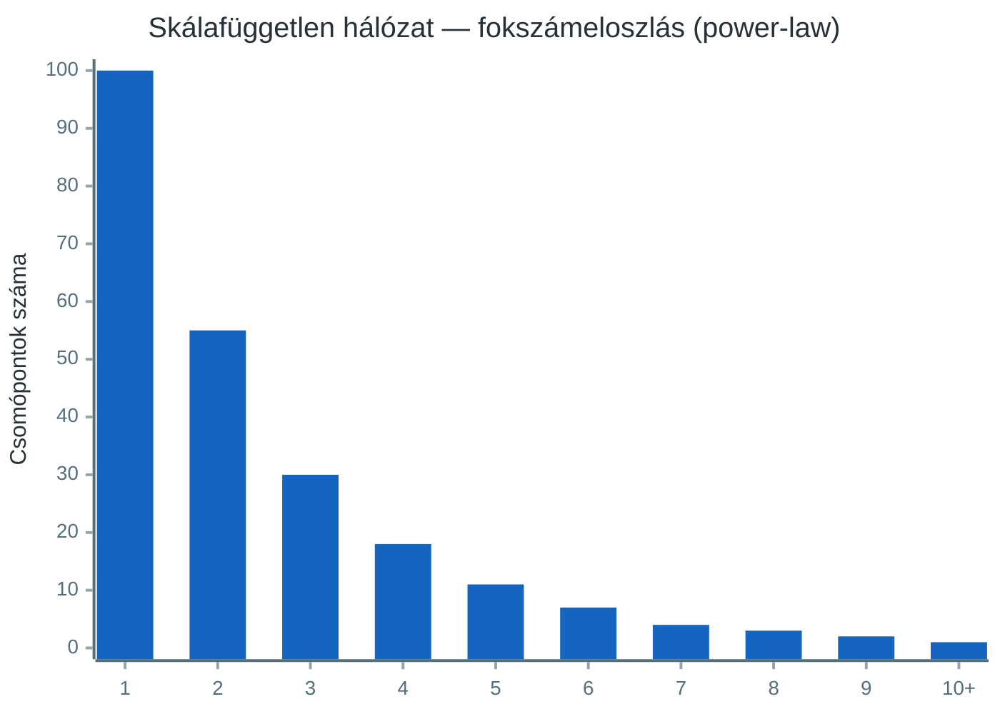
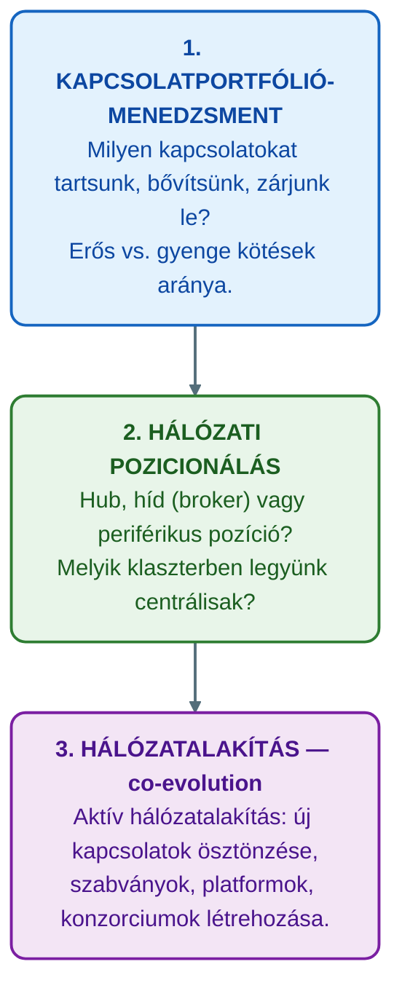
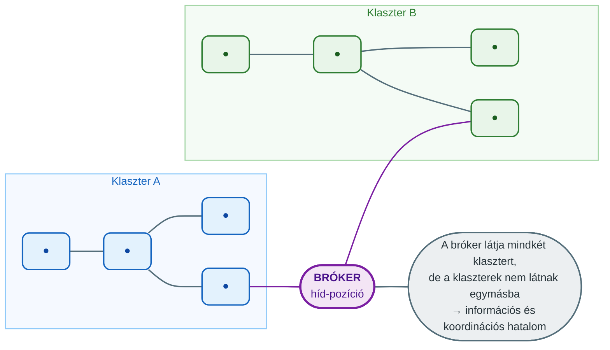
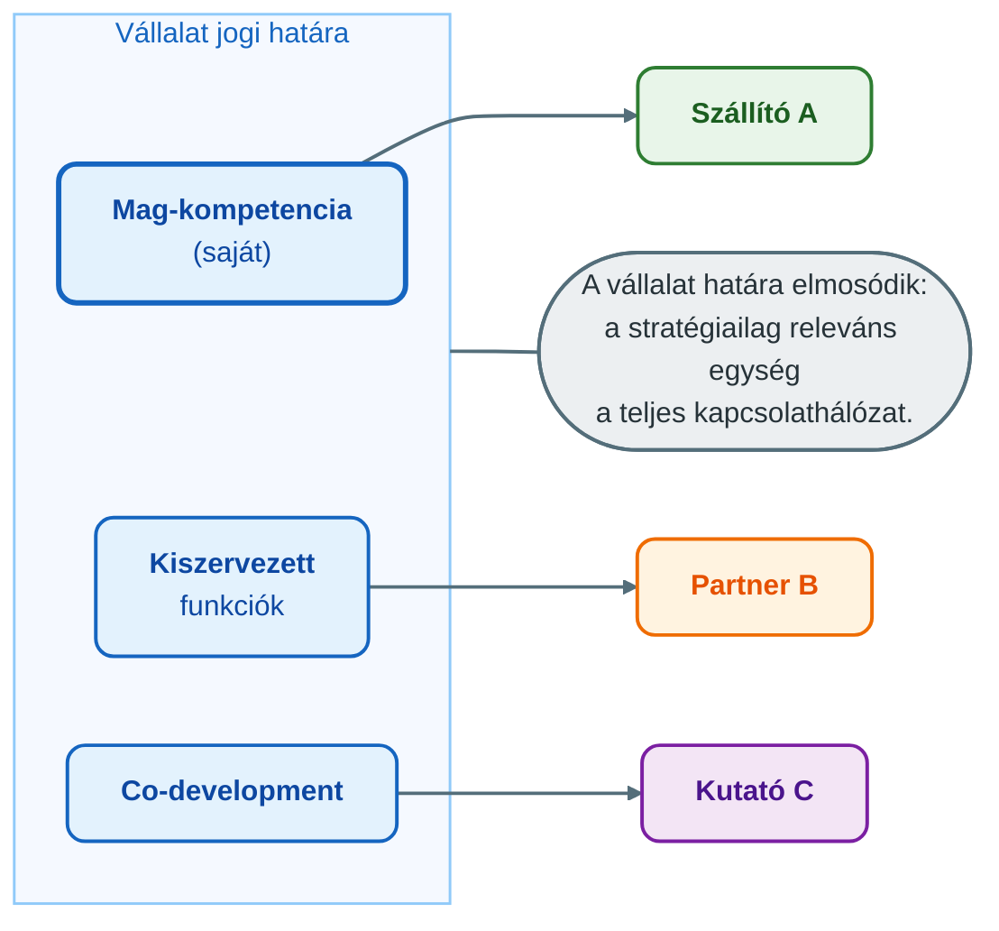
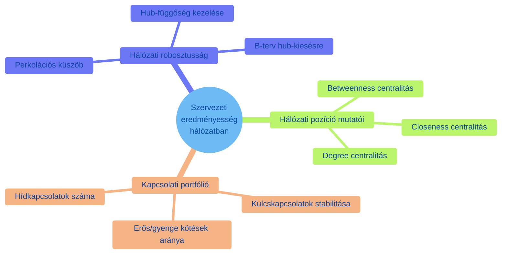

## V20 – Hálózati üzleti stratégia

**Tétel:** Hálózati üzleti stratégia: Hálózati üzleti stratégia. Mutassa be az üzleti stratégiaalkotás hálózati megközelítését! Hogyan értelmezi a hálózati stratégiát: a szervezeti határokat és a szervezeti eredményességet.

---

### 20.1. A hagyományos stratégia korlátai hálózati környezetben

A klasszikus stratégiai menedzsment – Porter versenyerő-modellje, az erőforrás-alapú elmélet (RBV) – az egyes vállalatot mint önálló stratégiaalakítót kezeli, amely a versenyképességét belülről, saját erőforrásaiból és képességeiből fakadóan építi fel.

```mermaid
flowchart TD
    subgraph KLASS["Klasszikus stratégiai logika"]
        K1["<b>Vállalat</b>"]:::szurke --> K2["<b>Belső erőforrások</b><br/>/ képességek"]:::szurke --> K3["<b>Verseny-<br/>előny</b>"]:::szurke --> K4["<b>Piaci<br/>pozíció</b>"]:::szurke
    end
    subgraph HAL["Hálózati stratégiai logika"]
        H1["<b>Kapcsolat-<br/>hálózat</b>"]:::kek --> H2["<b>Hálózati<br/>pozíció</b>"]:::kek --> H3["<b>Stratégiai<br/>mozgástér</b>"]:::kek --> H4["<b>Verseny-<br/>előny</b>"]:::zold
    end

    classDef kek    fill:#e3f2fd,stroke:#1565c0,stroke-width:2px,color:#0d47a1,rx:10,ry:10;
    classDef zold   fill:#e8f5e9,stroke:#2e7d32,stroke-width:2px,color:#1b5e20,rx:10,ry:10;
    classDef szurke fill:#eceff1,stroke:#546e7a,stroke-width:2px,color:#263238,rx:10,ry:10;

    style KLASS fill:#f7f9fa,stroke:#b0bec5,stroke-width:1.5px,color:#546e7a;
    style HAL   fill:#f5f9ff,stroke:#90caf9,stroke-width:1.5px,color:#1565c0;

    linkStyle default stroke:#546e7a,stroke-width:2px;
```

A hálózati megközelítés szerint a stratégia nem csupán a vállalaton belülről fakad, hanem **a hálózatban elfoglalt pozícióból és a kapcsolatokból** is. A kapcsolatok nem csak erőforrások szerzésének eszközei – ők maguk is stratégiai erőforrások.

---

### 20.2. Hálózati pozíció mint stratégiai alap

Barabási Albert-László skálafüggetlen hálózat-elmélete szerint a hálózatokban a kapcsolatok nem egyenlően oszlanak el: néhány csomópont (hub) rendkívül sok kapcsolattal rendelkezik, a legtöbb csomópontnak viszont csak kevés van. Ez a **power-law (hatványfüggvény) fokszámeloszlás**.

**Preferential attachment (preferenciális kapcsolódás):** Az új szereplők nem véletlenszerűen kötődnek a hálózatba, hanem inkább a már jól kapcsolt csomópontokat keresik. „A gazdag gazdagodik" elv hálózati megfelelője.

**Stratégiai következmény:** Aki korán és hatékonyan kiépíti a kapcsolatait, hub-pozícióba kerülhet – és ez a pozíció önmagát erősítő folyamat révén fenntartható versenyelőnnyé válik.

---

### 20.3. A hálózati stratégia három szintje

#### Hub-stratégia
Célja a centrális pozíció megszerzése és megtartása. A hub magas betweenness centralitással rendelkezik: sok legrövidebb útvonal halad át rajta, ami kontrollt ad az információ- és erőforrásáramlás felett.

**Példák:** Amazon (kereskedelmi hub), Google (információs hub), SAP (üzleti szoftver-ökoszisztéma hub).

#### Híd (broker) stratégia
Célja a strukturális lyukak (structural holes – Burt, 1992) kitöltése: olyan pozíció kiépítése, ahol a vállalat két egyébként nem összekötött hálózati klasztert kapcsol össze.

**Következmény:** A bróker látja mindkét klasztert, de a klaszterek nem látnak egymásba – ez információs és koordinációs hatalmat jelent.

---

### 20.4. Szervezeti határok a hálózati stratégiában

A hagyományos vállalatelmélet a szervezeti határt jogi és tulajdonosi alapon húzza meg: ami a vállalathoz tartozik, az belül van; ami nem, az kívül. A hálózati megközelítés ezt alapvetően újraértelmezi.

**A szervezeti határok három értelmezése hálózati szemléletben:**

| Határkoncepció | Hagyományos | Hálózati |
|---|---|---|
| Jogi határ | A vállalat tulajdonában lévő eszközök | Formálisan megmarad, de stratégiailag kevéssé releváns |
| Kompetencia határ | Amit a vállalat tud elvégezni | Kiterjed a partnerek kompetenciáira is (kiszervezés, co-development) |
| Kapcsolati határ | Nem értelmezhető | A vállalat hálózati identitása: kit tekint partnernek, kivel nem akar kapcsolatot |

**Következmény:** A kiszervezés, a stratégiai szövetség, a joint venture és a platform-ökoszisztéma mind a hálózati szemlélet produktuma: a vállalat nem próbál mindent belül csinálni, hanem tudatosan alakítja a kapcsolatait.

---

### 20.5. Szervezeti eredményesség hálózati nézőpontból

A hagyományos hatékonyság-fogalom (efficiency) belső folyamatok optimalizálásáról szól. A hálózati megközelítés az **eredményességet (effectiveness)** hálózati kontextusban definiálja:

**Eredményesség hálózatban:**
- Nem csak a saját folyamatok optimálisak, hanem a kapcsolatokon keresztül elérhető értékteremtés is maximalizált.
- A hálózati pozíció értéke: közbeesettségi centralitás, elérhetőség (más csomópontokhoz való közelség), híd-funkció.
- A kapcsolati tőke (relational capital) megőrzése: a hosszú távú kapcsolatok értékének fenntartása.

**Robosztusság és reziliencia:** Az előadás perkolációs elmélete alapján a skálafüggetlen hálózatok véletlenszerű meghibásodásokkal szemben robosztusak (sok kis csomópont kiesése nem szakítja szét a hálózatot), de célzott hubeltávolítással szemben sérülékenyek. A stratégiai tervezésnek figyelembe kell vennie: ha a vállalat hub-függő, akkor hub-kiesés esetén mi a B-terv?

---

**Összegzés:** A hálózati üzleti stratégia nem csupán a versenyerők és a belső folyamatok optimalizálásáról szól, hanem a hálózatban elfoglalt pozíció tudatos kialakításáról és menedzseléséről. A szervezeti határok a hálózati szemléletben elmosódottak: a stratégiailag releváns egység a vállalat és kapcsolatai együttesen. Az eredményesség mérése kiterjed a hálózati pozíció mutatóira (centralitás, híd-funkció) és a kapcsolati portfólió minőségére. A preferenciális kapcsolódás elvéből következik, hogy a korai és tudatos pozicionálás a legfontosabb stratégiai lépés egy hálózatban.

---

*Forrás: Barabási Albert-László (2022): Behálózva; Barabási Albert-László (2024): A hálózatok tudománya; Håkansson, H. (2010): Határtalan hálózatok; Burt, R.S. (1992): Structural Holes; Dr. Szilágyi Győző Attila, GMXVU2MBLF előadásanyag (2025/26)*
